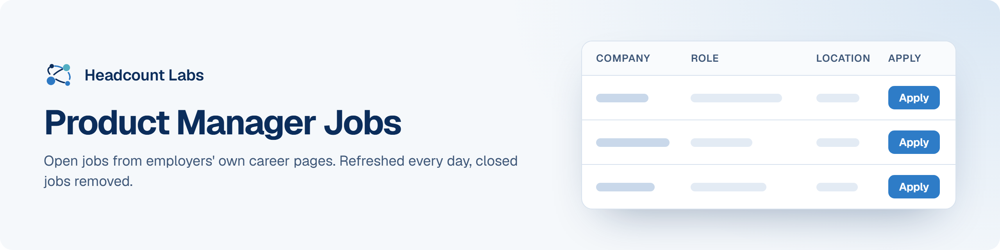

# Product Manager Jobs

Product manager and product owner jobs at US employers.

**400 open jobs** · 12 new since the last update · 12 removed because they closed or left the employer's board · updated October 23, 2026 at 5:56 AM EDT

This list is built and refreshed every day by [Headcount Labs](https://headcountlabs.com/?utm_source=github&utm_medium=job-list&utm_campaign=product-manager-jobs), which reads jobs straight from employers' own career pages and job boards. Every job here was still listed on its source board when we last read that board, within the past 3 days, and was posted in the past 30 days. Copies of the same job are merged into one row, and jobs that close are removed at the next update.

Want this data in your own app or agent? Use the [Headcount Labs jobs API](https://headcountlabs.com/docs/?utm_source=github&utm_medium=job-list&utm_campaign=product-manager-jobs) (free tier), the [MCP server](https://headcountlabs.com/mcp/?utm_source=github&utm_medium=job-list&utm_campaign=product-manager-jobs) for Claude, ChatGPT and other AI assistants, or the [public dataset subsets](https://huggingface.co/HeadcountLabs) on Hugging Face (the full dataset is coming soon).

**Columns.** *Apply* opens the original posting on the employer's site. *Details* opens the job on Headcount Labs, with every posting we found for it. *Remote* shows what the employer states; a dash means the posting doesn't say. *Pay* is the range the employer published.

## Posted in the last 7 days

| Company | Role | Location | Remote | Pay | Posted | Apply | Details |
| --- | --- | --- | --- | --- | --- | :---: | :---: |
| **Zebra Technologies Corporation** | Product Manager, Advanced | Lincolnshire, IL | Hybrid | $123k–$184k/yr | Oct 21 |  | <a href="https://headcountlabs.com/catalog/jobs/3e9424de-c55f-4950-a7d9-d2f805a9dfe9?utm_source=github&utm_medium=job-list&utm_campaign=product-manager-jobs">via Headcount Labs</a> |
| **Warner Bros. Discovery** | Staff Product Manager, New Business Underscored | 

5 locations
United States Nebraska New York, NY Atlanta, GA Washington, DC
 | Hybrid | $133k–$247k/yr | Oct 21 |  | <a href="https://headcountlabs.com/catalog/jobs/1645e065-5b45-4d1d-a9cb-cefdcf085ad7?utm_source=github&utm_medium=job-list&utm_campaign=product-manager-jobs">via Headcount Labs</a> |
| **Warner Bros. Discovery** | Staff Product Manager, Newsource | 

5 locations
United States Nebraska New York, NY Atlanta, GA Washington, DC
 | Hybrid | $130k–$240k/yr | Oct 21 |  | <a href="https://headcountlabs.com/catalog/jobs/f5a3e8e7-b4e3-47bb-9982-1293163981d9?utm_source=github&utm_medium=job-list&utm_campaign=product-manager-jobs">via Headcount Labs</a> |
| **Warner Bros. Discovery** | Sr. Product Manager, Financial Solutions (Order to Cash) | Silver Spring, MD | Hybrid | $137k–$254k/yr | Oct 21 |  | <a href="https://headcountlabs.com/catalog/jobs/e11b7267-5e13-4e0e-8bb3-543fd9955596?utm_source=github&utm_medium=job-list&utm_campaign=product-manager-jobs">via Headcount Labs</a> |
| **Warner Bros. Discovery** | Senior Product Manager | 

4 locations
San Francisco, CA Bellevue, WA New York, NY Culver City, CA
 | Hybrid | $126k–$234k/yr | Oct 21 |  | <a href="https://headcountlabs.com/catalog/jobs/d794c14c-afd6-4bfc-816a-1ceb1868dcc4?utm_source=github&utm_medium=job-list&utm_campaign=product-manager-jobs">via Headcount Labs</a> |
| **Warner Bros. Discovery** | Staff Product Manager, Developer Experience | 

2 locations
New York, NY United States
 | Hybrid | $133k–$247k/yr | Oct 21 |  | <a href="https://headcountlabs.com/catalog/jobs/ac62576f-4ff4-4328-b76d-566d4387383e?utm_source=github&utm_medium=job-list&utm_campaign=product-manager-jobs">via Headcount Labs</a> |
| **Warner Bros. Discovery** | Advanced Product Manager | 

2 locations
Utah California
 | Remote | $122k–$228k/yr | Oct 21 |  | <a href="https://headcountlabs.com/catalog/jobs/1d46b93f-f094-4fd2-8083-a299c35b54ce?utm_source=github&utm_medium=job-list&utm_campaign=product-manager-jobs">via Headcount Labs</a> |
| **Vontier** | Intern - Product Owner (Summer 2027) | Raleigh, NC | Hybrid | $23/hr | Oct 21 |  | <a href="https://headcountlabs.com/catalog/jobs/0b8c63f6-83d6-44b4-af17-d7bd6add6295?utm_source=github&utm_medium=job-list&utm_campaign=product-manager-jobs">via Headcount Labs</a> |
| **Verisk Careers &#124; Verisk** | Xactware Product Manager I | Lehi, UT | Hybrid | $105k–$130k/yr | Oct 21 |  | <a href="https://headcountlabs.com/catalog/jobs/b4679398-d93d-4050-994d-9cebaea05125?utm_source=github&utm_medium=job-list&utm_campaign=product-manager-jobs">via Headcount Labs</a> |
| **True Talent Solutions Partners** | Forward Deployed Product Manager | 

2 locations
San Francisco, CA New York, NY
 | On-site | — | Oct 21 |  | <a href="https://headcountlabs.com/catalog/jobs/7dac35c2-f05c-4728-9b79-938a26433c41?utm_source=github&utm_medium=job-list&utm_campaign=product-manager-jobs">via Headcount Labs</a> |
| **Tri Tool** | Product Manager | Rancho Cordova, CA | — | — | Oct 21 |  | <a href="https://headcountlabs.com/catalog/jobs/e450c00a-af3b-44d8-a97f-c68184c3ca19?utm_source=github&utm_medium=job-list&utm_campaign=product-manager-jobs">via Headcount Labs</a> |
| **Toast** | Senior Product Manager, Lending | United States | Remote | $159k–$254k/yr | Oct 21 |  | <a href="https://headcountlabs.com/catalog/jobs/4530fa1c-1eb7-4ab2-8f70-1b90038fdd73?utm_source=github&utm_medium=job-list&utm_campaign=product-manager-jobs">via Headcount Labs</a> |
| **The Coca-Cola Company** | RGM Product Manager | Atlanta, GA | — | $202k–$229k/yr | Oct 21 |  | <a href="https://headcountlabs.com/catalog/jobs/c3a1a792-848f-4898-a5c6-c46cf9ab3c18?utm_source=github&utm_medium=job-list&utm_campaign=product-manager-jobs">via Headcount Labs</a> |
| **Terradepth Inc** | Product Manager | United States | Remote | — | Oct 21 |  | <a href="https://headcountlabs.com/catalog/jobs/30e11134-8610-4fcf-b58f-7fa01a730d55?utm_source=github&utm_medium=job-list&utm_campaign=product-manager-jobs">via Headcount Labs</a> |
| **Teradyne** | Sr. Inbound Product Manager (IST, North Reading, MA) | North Reading, MA | — | $163k–$261k/yr | Oct 21 |  | <a href="https://headcountlabs.com/catalog/jobs/474c8886-a689-4d23-aa73-39ded5736d86?utm_source=github&utm_medium=job-list&utm_campaign=product-manager-jobs">via Headcount Labs</a> |
| **TE Connectivity** | Product Manager Underground Connectors | United States | Hybrid | $141k–$176k/yr | Oct 21 |  | <a href="https://headcountlabs.com/catalog/jobs/8a280f50-15bd-432c-9ae3-4bc1faa937dd?utm_source=github&utm_medium=job-list&utm_campaign=product-manager-jobs">via Headcount Labs</a> |
| **TE Connectivity** | Product Manager - Remote | United States | Remote | $111k–$138k/yr | Oct 21 |  | <a href="https://headcountlabs.com/catalog/jobs/cca804c5-7b3c-41c0-856b-6c5c6faf9b16?utm_source=github&utm_medium=job-list&utm_campaign=product-manager-jobs">via Headcount Labs</a> |
| **TCC Toyota Motor Credit Corporation Company** | Product Manager | Plano, TX | — | — | Oct 21 |  | <a href="https://headcountlabs.com/catalog/jobs/dc3c1570-5d8c-4c34-bb8d-9e478c4c7b1e?utm_source=github&utm_medium=job-list&utm_campaign=product-manager-jobs">via Headcount Labs</a> |
| **Stripe** | Product Manager, Radar - Fraud and Abuse Prevention | San Francisco, Seattle, NY | Remote | — | Oct 21 |  | <a href="https://headcountlabs.com/catalog/jobs/be6d240e-abf3-4864-8923-4ddbbf6f848a?utm_source=github&utm_medium=job-list&utm_campaign=product-manager-jobs">via Headcount Labs</a> |
| **Stripe** | Product Manager, Radar | 

2 locations
San Francisco San Francisco, Seattle, NY
 | Remote | — | Oct 21 |  | <a href="https://headcountlabs.com/catalog/jobs/25f75a8b-50f7-4fee-a41c-68c1c9bbd42e?utm_source=github&utm_medium=job-list&utm_campaign=product-manager-jobs">via Headcount Labs</a> |
| **SpyCloud** | Product Manager, Investigations | Austin, TX | — | $115k–$150k/yr | Oct 21 |  | <a href="https://headcountlabs.com/catalog/jobs/206c9688-30d4-4606-8f6d-c95f0662b4be?utm_source=github&utm_medium=job-list&utm_campaign=product-manager-jobs">via Headcount Labs</a> |
| **SpotOn** | Product Manager (Owner Experiences) | 

2 locations
Austin, TX Chicago, IL
 | — | $185k–$215k/yr | Oct 21 |  | <a href="https://headcountlabs.com/catalog/jobs/b71e75bf-5acf-4c42-ad1d-27c18460ebbb?utm_source=github&utm_medium=job-list&utm_campaign=product-manager-jobs">via Headcount Labs</a> |
| **ServiceNow** | Senior Staff Outbound Product Manager - GTM / Data &amp; Analytics | 

3 locations
Santa Clara, CA New York, NY Washington, DC
 | Hybrid | $191k–$334k/yr | Oct 21 |  | <a href="https://headcountlabs.com/catalog/jobs/f225d0c5-1e7e-4279-bcfe-a1c3bbd773b8?utm_source=github&utm_medium=job-list&utm_campaign=product-manager-jobs">via Headcount Labs</a> |
| **SAS** | CI360 AI &amp; Agentic AI Product Manager | Cary HQ, NC | — | — | Oct 21 |  | <a href="https://headcountlabs.com/catalog/jobs/06ff3fbf-21de-48c5-8260-7ad7bb3ebef7?utm_source=github&utm_medium=job-list&utm_campaign=product-manager-jobs">via Headcount Labs</a> |
| **Rust-Oleum Corporation** | Product Manager - Small Paints | Vernon Hills, IL | Hybrid | $85k–$1,250k/yr | Oct 21 |  | <a href="https://headcountlabs.com/catalog/jobs/a9db4ee2-7d37-4384-b5a9-0f264c9b51bf?utm_source=github&utm_medium=job-list&utm_campaign=product-manager-jobs">via Headcount Labs</a> |
| **Riverside Research Institute** | Product Owner 1 | Dayton, OH | — | $110k–$130k/yr | Oct 21 |  | <a href="https://headcountlabs.com/catalog/jobs/dfd1d9fb-16fb-48bd-813e-1ca463269a1f?utm_source=github&utm_medium=job-list&utm_campaign=product-manager-jobs">via Headcount Labs</a> |
| **Rehlko** | Associate Product Manager, Commercialization | Milwaukee, WI | Hybrid | $90k–$114k/yr | Oct 21 |  | <a href="https://headcountlabs.com/catalog/jobs/add2a7cb-803e-4f2c-90c8-8d166329c8f2?utm_source=github&utm_medium=job-list&utm_campaign=product-manager-jobs">via Headcount Labs</a> |
| **Realtor.com** | Senior Product Manager - Visualization | Austin, TX | — | — | Oct 21 |  | <a href="https://headcountlabs.com/catalog/jobs/ed5be672-7be7-4d40-93e0-2fffd435940e?utm_source=github&utm_medium=job-list&utm_campaign=product-manager-jobs">via Headcount Labs</a> |
| **Ralliant** | Product Manager | 

2 locations
United States Fultonville, NY
 | Remote | — | Oct 21 |  | <a href="https://headcountlabs.com/catalog/jobs/7be4f2d5-18fe-4641-b392-d44d9c0e635e?utm_source=github&utm_medium=job-list&utm_campaign=product-manager-jobs">via Headcount Labs</a> |
| **Pushpay** | Senior Product Manager 1 | Colorado Springs, CO | Remote | $107k–$130k/yr | Oct 21 |  | <a href="https://headcountlabs.com/catalog/jobs/8ea1a691-c198-442f-9c8e-ebde5b5b560d?utm_source=github&utm_medium=job-list&utm_campaign=product-manager-jobs">via Headcount Labs</a> |
| **Proximie** | Senior Product Manager - East Coast Remote | Orlando | Remote | — | Oct 21 |  | <a href="https://headcountlabs.com/catalog/jobs/24d98a9e-506c-4c29-964e-f8659809000e?utm_source=github&utm_medium=job-list&utm_campaign=product-manager-jobs">via Headcount Labs</a> |
| **Pacific Gas And Electric Company** | Product Owner, Expert | Oakland, CA | Hybrid | — | Oct 21 |  | <a href="https://headcountlabs.com/catalog/jobs/9d75a2af-24f6-43e6-b58e-31e34ce97ec7?utm_source=github&utm_medium=job-list&utm_campaign=product-manager-jobs">via Headcount Labs</a> |
| **PACCAR** | Technical Product Owner - Global Platform Development | Kirkland, WA | — | $90k–$142k/yr | Oct 21 |  | <a href="https://headcountlabs.com/catalog/jobs/c3129204-0d09-4b44-87e4-3aea394d5910?utm_source=github&utm_medium=job-list&utm_campaign=product-manager-jobs">via Headcount Labs</a> |
| **Orepac Holding Company** | Inside Sales Representative &amp; Product Manager | Spokane, WA | — | $75k–$85k/yr | Oct 21 |  | <a href="https://headcountlabs.com/catalog/jobs/8a805f76-1ffc-4d7a-b067-f51e1dfb93ba?utm_source=github&utm_medium=job-list&utm_campaign=product-manager-jobs">via Headcount Labs</a> |
| **OpenLoop Health** | Senior Staff Product Manager | 

2 locations
United States Toronto
 | Remote | — | Oct 21 |  | <a href="https://headcountlabs.com/catalog/jobs/4a42e6e2-79ce-4620-8892-efb7f9d823d7?utm_source=github&utm_medium=job-list&utm_campaign=product-manager-jobs">via Headcount Labs</a> |
| **OpenArt AI** | Growth Product Manager | San Carlos, CA | Hybrid | $300k–$400k/yr | Oct 21 |  | <a href="https://headcountlabs.com/catalog/jobs/ab602283-f8fe-4c90-a411-274dd4137013?utm_source=github&utm_medium=job-list&utm_campaign=product-manager-jobs">via Headcount Labs</a> |
| **New Moon Production** | Product Manager – Roadmap Track (Sunshine Island) | United States | Remote | — | Oct 21 |  | <a href="https://headcountlabs.com/catalog/jobs/5d2051dd-2e6d-4d64-9fe4-f0f6913e6ff0?utm_source=github&utm_medium=job-list&utm_campaign=product-manager-jobs">via Headcount Labs</a> |
| **New Balance Athletics, Inc.** | Digital Product Owner - Commercial Planning | United States | Hybrid | $120k–$180k/yr | Oct 21 |  | <a href="https://headcountlabs.com/catalog/jobs/683cebc3-2e97-4037-b180-182ae82b022e?utm_source=github&utm_medium=job-list&utm_campaign=product-manager-jobs">via Headcount Labs</a> |
| **NetApp, Inc.** | Sr. Product Manager | 

4 locations
Waltham, MA Boulder, CO San Jose, CA Morrisville, NC
 | — | $196k–$293k/yr | Oct 21 |  | <a href="https://headcountlabs.com/catalog/jobs/2bc2f8fc-56f5-4fdc-83f7-4fec2e0d5033?utm_source=github&utm_medium=job-list&utm_campaign=product-manager-jobs">via Headcount Labs</a> |
| **MSCI Inc.** | Product Manager, Private Assets Diligence Platform | New York, NY | — | $143k–$186k/yr | Oct 21 |  | <a href="https://headcountlabs.com/catalog/jobs/66257f43-8f70-4d49-97d6-e36b7003a5e2?utm_source=github&utm_medium=job-list&utm_campaign=product-manager-jobs">via Headcount Labs</a> |
| **Mercury Systems** | Principal Product Manager | Andover, MA | — | — | Oct 21 |  | <a href="https://headcountlabs.com/catalog/jobs/57e92a79-078c-438a-b40a-52c422425965?utm_source=github&utm_medium=job-list&utm_campaign=product-manager-jobs">via Headcount Labs</a> |
| **McKinstry** | Senior Product Manager, M365 | Seattle, WA | — | $99k–$170k/yr | Oct 21 |  | <a href="https://headcountlabs.com/catalog/jobs/06d0b1b7-8c10-487d-a4ba-f54ca2360529?utm_source=github&utm_medium=job-list&utm_campaign=product-manager-jobs">via Headcount Labs</a> |
| **Maven AGI** | Senior Product Manager, Integrations | 

2 locations
Boston, MA San Francisco, CA
 | Hybrid | $175k–$230k/yr | Oct 21 |  | <a href="https://headcountlabs.com/catalog/jobs/f34c9a9b-67ff-4c1f-a016-9aab8fd08c8f?utm_source=github&utm_medium=job-list&utm_campaign=product-manager-jobs">via Headcount Labs</a> |
| **Ma Labs, Inc** | Assistant Product Manager (Purchasing) | San Jose, CA | — | — | Oct 21 |  | <a href="https://headcountlabs.com/catalog/jobs/c95d0a7c-7283-40c2-a2fc-0a612455774a?utm_source=github&utm_medium=job-list&utm_campaign=product-manager-jobs">via Headcount Labs</a> |
| **Luxury Presence** | Staff Product Manager, Search and AI Visibility - US (Remote) | United States | Remote | $170k–$200k/yr | Oct 21 |  | <a href="https://headcountlabs.com/catalog/jobs/88e93d79-5d79-4920-962c-b8992dd55078?utm_source=github&utm_medium=job-list&utm_campaign=product-manager-jobs">via Headcount Labs</a> |
| **LangChain** | Product Manager, LangSmith | New York, NY | On-site | — | Oct 21 |  | <a href="https://headcountlabs.com/catalog/jobs/7d72b01e-0d08-42f5-bc58-d5462b479098?utm_source=github&utm_medium=job-list&utm_campaign=product-manager-jobs">via Headcount Labs</a> |
| **LAM Lennar Associates Mgmt LLC** | Staff Product Manager – Finance Systems &amp; Business Solutions | 

3 locations
United States Irving, TX Miami, FL
 | Remote | — | Oct 21 |  | <a href="https://headcountlabs.com/catalog/jobs/7b2e52bc-7bf0-47b0-9e03-fe0ccbb15e9c?utm_source=github&utm_medium=job-list&utm_campaign=product-manager-jobs">via Headcount Labs</a> |
| **Kiss Nail Products, Inc.** | International Market Product Manager | New York | — | $69k–$137k/yr | Oct 21 |  | <a href="https://headcountlabs.com/catalog/jobs/58577bbc-bb0c-42f0-82b0-5dd69bc2ac75?utm_source=github&utm_medium=job-list&utm_campaign=product-manager-jobs">via Headcount Labs</a> |
| **Jobgether** | Sr. Product Manager- Financial Stewardship | United States | Remote | $140k–$168k/yr | Oct 21 |  | <a href="https://headcountlabs.com/catalog/jobs/bde2e282-c127-44ad-996d-cad8764614d8?utm_source=github&utm_medium=job-list&utm_campaign=product-manager-jobs">via Headcount Labs</a> |
| **Jobgether** | Senior Product Manager, Core | United States | Remote | $170k–$208k/yr | Oct 21 |  | <a href="https://headcountlabs.com/catalog/jobs/0b07004c-a10c-4078-a57a-cdbf4f47c123?utm_source=github&utm_medium=job-list&utm_campaign=product-manager-jobs">via Headcount Labs</a> |
| **Jobgether** | Principal Product Manager, Product Development Platforms | United States | Remote | $182k–$291k/yr | Oct 21 |  | <a href="https://headcountlabs.com/catalog/jobs/05de90a3-daae-423c-bde6-ccf12a99f3cd?utm_source=github&utm_medium=job-list&utm_campaign=product-manager-jobs">via Headcount Labs</a> |
| **Jobgether** | Senior Product Manager, Shared Hosting | United States | Remote | $140k–$170k/yr | Oct 21 |  | <a href="https://headcountlabs.com/catalog/jobs/ffcbe105-d021-448a-8b51-362026d87701?utm_source=github&utm_medium=job-list&utm_campaign=product-manager-jobs">via Headcount Labs</a> |
| **Jobgether** | Senior Product Manager - Automation Platform | United States | Remote | — | Oct 21 |  | <a href="https://headcountlabs.com/catalog/jobs/794a8a79-2ad9-45b0-a2b3-95288e96a384?utm_source=github&utm_medium=job-list&utm_campaign=product-manager-jobs">via Headcount Labs</a> |
| **Jobgether** | Senior Product Manager, Epic Optimization | United States | Remote | $102k–$152k/yr | Oct 21 |  | <a href="https://headcountlabs.com/catalog/jobs/55f09780-9309-437f-9fa2-aba64d773ea7?utm_source=github&utm_medium=job-list&utm_campaign=product-manager-jobs">via Headcount Labs</a> |
| **Jobgether** | Senior Product Manager | United States | Remote | — | Oct 21 |  | <a href="https://headcountlabs.com/catalog/jobs/3b3d4454-5e2f-4052-bf1b-df3e3c521854?utm_source=github&utm_medium=job-list&utm_campaign=product-manager-jobs">via Headcount Labs</a> |
| **Jobgether** | Product Manager, Hardware | United States | Remote | $130k–$150k/yr | Oct 21 |  | <a href="https://headcountlabs.com/catalog/jobs/c72e9cc2-30f2-4027-9eae-4cd699acfe9b?utm_source=github&utm_medium=job-list&utm_campaign=product-manager-jobs">via Headcount Labs</a> |
| **INTEGRATED DNA TECHNOLOGIES, INC.** | Associate Product Manager - Strategic Programs &amp; Partnerships | United States | Remote | $75k–$100k/yr | Oct 21 |  | <a href="https://headcountlabs.com/catalog/jobs/faf4bc3b-c6c9-49e1-94da-02282b12a041?utm_source=github&utm_medium=job-list&utm_campaign=product-manager-jobs">via Headcount Labs</a> |
| **iCapital** | Product Manager - Vice President | 

2 locations
Greenwich, CT New York, NY
 | — | $160k–$190k/yr | Oct 21 |  | <a href="https://headcountlabs.com/catalog/jobs/f23f096b-62ee-4728-8371-d711c5fb3238?utm_source=github&utm_medium=job-list&utm_campaign=product-manager-jobs">via Headcount Labs</a> |
| **Hercules** | Staff Technical Product Manager, Evals | 

2 locations
San Francisco, CA North America
 | On-site | $200k–$350k/yr | Oct 21 |  | <a href="https://headcountlabs.com/catalog/jobs/9637e812-e9e1-4fa6-b68d-7fd93d9f6c2f?utm_source=github&utm_medium=job-list&utm_campaign=product-manager-jobs">via Headcount Labs</a> |
| **Hearst** | Product Manager | 

2 locations
San Francisco, CA Indianapolis, IN
 | Hybrid | $98k–$125k/yr | Oct 21 |  | <a href="https://headcountlabs.com/catalog/jobs/931f2a7c-710b-4f75-9573-dcd7dd0dd6c6?utm_source=github&utm_medium=job-list&utm_campaign=product-manager-jobs">via Headcount Labs</a> |
| **Health Care Service Corp.** | Senior Strategic Medicare Product Manager | 

3 locations
United States Nashville, TN - Nashville, TN
 | Remote | $102k–$184k/yr | Oct 21 |  | <a href="https://headcountlabs.com/catalog/jobs/a3e84b79-6c96-47ff-8cc7-9d993229e760?utm_source=github&utm_medium=job-list&utm_campaign=product-manager-jobs">via Headcount Labs</a> |
| **Gallatin** | Senior Product Manager, Navigator | 

2 locations
Austin, TX Washington, DC
 | On-site | — | Oct 21 |  | <a href="https://headcountlabs.com/catalog/jobs/57534edd-4918-45fd-8419-4ceab4705596?utm_source=github&utm_medium=job-list&utm_campaign=product-manager-jobs">via Headcount Labs</a> |
| **Flowserve US Inc** | Product Manager Valves | 

4 locations
Houston, TX Cookeville, TN Memphis, TN Pasadena, TX
 | — | — | Oct 21 |  | <a href="https://headcountlabs.com/catalog/jobs/11d1b222-bb09-49d1-a93d-51c21aa2bc58?utm_source=github&utm_medium=job-list&utm_campaign=product-manager-jobs">via Headcount Labs</a> |
| **Floor and Decor Outlets of America, Inc.** | Senior Ecommerce Product Manager | Atlanta, GA | — | — | Oct 21 |  | <a href="https://headcountlabs.com/catalog/jobs/87ca7926-695a-476c-b4d5-6a282d339610?utm_source=github&utm_medium=job-list&utm_campaign=product-manager-jobs">via Headcount Labs</a> |
| **fjorge** | Product Owner | Minneapolis, MN | On-site | $85k–$95k/yr | Oct 21 |  | <a href="https://headcountlabs.com/catalog/jobs/3cd74d89-9dd4-4ee1-9323-aa189655e735?utm_source=github&utm_medium=job-list&utm_campaign=product-manager-jobs">via Headcount Labs</a> |
| **Fitch Group** | Data Products &amp; Onboarding Product Owner | New York, NY | — | $150k–$170k/yr | Oct 21 |  | <a href="https://headcountlabs.com/catalog/jobs/a19b277e-179f-45bb-9a1b-1f7dcc369e0a?utm_source=github&utm_medium=job-list&utm_campaign=product-manager-jobs">via Headcount Labs</a> |
| **First National Bank Of Pennsylvania** | Senior Product Manager - Merchant Services | Pittsburgh, PA | — | — | Oct 21 |  | <a href="https://headcountlabs.com/catalog/jobs/8566cbf0-a359-4e0e-b238-0704eab03be5?utm_source=github&utm_medium=job-list&utm_campaign=product-manager-jobs">via Headcount Labs</a> |
| **Farmers Insurance** | Product Manager I - PL | United States | — | $91k–$155k/yr | Oct 21 |  | <a href="https://headcountlabs.com/catalog/jobs/52980028-9304-4c83-8bfb-392cbaa141b2?utm_source=github&utm_medium=job-list&utm_campaign=product-manager-jobs">via Headcount Labs</a> |
| **Farmers Insurance** | Product Manager II - PL | United States | — | $102k–$174k/yr | Oct 21 |  | <a href="https://headcountlabs.com/catalog/jobs/8e1d733d-dbe8-44a1-84ac-8ee7b300c4eb?utm_source=github&utm_medium=job-list&utm_campaign=product-manager-jobs">via Headcount Labs</a> |
| **Expedia, Inc.** | Senior Product Manager, Loyalty | 

3 locations
London San Jose, CA Washington
 | — | $173k–$242k/yr | Oct 21 |  | <a href="https://headcountlabs.com/catalog/jobs/e2a4c38b-1752-40e0-98f3-ae216db797df?utm_source=github&utm_medium=job-list&utm_campaign=product-manager-jobs">via Headcount Labs</a> |
| **EverCommerce Solutions Inc.** | EverHealth - Product Manager: RCM (Remote, US) | United States | Remote | $100k–$120k/yr | Oct 21 |  | <a href="https://headcountlabs.com/catalog/jobs/ce1c5390-548f-4161-8d8d-861dd48b2835?utm_source=github&utm_medium=job-list&utm_campaign=product-manager-jobs">via Headcount Labs</a> |
| **DHI Group, Inc.** | Senior Product Manager | 

3 locations
Denver, CO Des Moines, IA Field
 | — | $150k–$175k/yr | Oct 21 |  | <a href="https://headcountlabs.com/catalog/jobs/65674c61-b529-4fcb-b0ec-ac951ad8fe39?utm_source=github&utm_medium=job-list&utm_campaign=product-manager-jobs">via Headcount Labs</a> |
| **Darling Ingredients** | Finished Product Manager | Grapeland, TX | On-site | — | Oct 21 |  | <a href="https://headcountlabs.com/catalog/jobs/b96ab27e-a022-49c5-af95-225b0990ccc6?utm_source=github&utm_medium=job-list&utm_campaign=product-manager-jobs">via Headcount Labs</a> |
| **Custom Software Systems Inc.** | Sr Product Owner (Technical) | Washington, DC | On-site | $155k–$170k/yr | Oct 21 |  | <a href="https://headcountlabs.com/catalog/jobs/8155b5c3-13fe-4679-86c1-c41a23548d0e?utm_source=github&utm_medium=job-list&utm_campaign=product-manager-jobs">via Headcount Labs</a> |
| **CTC Group** | Senior Product Manager - Virtualization | Fort Meade, MD | On-site | $170k–$195k/yr | Oct 21 |  | <a href="https://headcountlabs.com/catalog/jobs/a161342b-ec12-4edf-b6b0-1806460a4443?utm_source=github&utm_medium=job-list&utm_campaign=product-manager-jobs">via Headcount Labs</a> |
| **CTC Group** | Product Manager - Networking/Internet | Fort Meade, MD | On-site | $170k–$195k/yr | Oct 21 |  | <a href="https://headcountlabs.com/catalog/jobs/566da1e1-45aa-452c-86d0-d9e089b82ca2?utm_source=github&utm_medium=job-list&utm_campaign=product-manager-jobs">via Headcount Labs</a> |
| **Cribl** | Staff GTM AI Product Manager | United States | Remote | $122k–$190k/yr | Oct 21 |  | <a href="https://headcountlabs.com/catalog/jobs/4aafb6cd-773e-4c8a-91fb-57185b6ed1c0?utm_source=github&utm_medium=job-list&utm_campaign=product-manager-jobs">via Headcount Labs</a> |
| **Collectors Universe, Inc.** | Staff Product Manager, New Business Ventures | San Francisco-Oakland-Berkeley, CA | Remote | $166k–$269k/yr | Oct 21 |  | <a href="https://headcountlabs.com/catalog/jobs/e754b714-b499-49a3-810c-65fdf03bbe56?utm_source=github&utm_medium=job-list&utm_campaign=product-manager-jobs">via Headcount Labs</a> |
| **Collectors Universe, Inc.** | Principal Product Manager, Payments | New York NY | Remote | $190k–$300k/yr | Oct 21 |  | <a href="https://headcountlabs.com/catalog/jobs/49c2d388-4cae-472e-b989-0f750195e89a?utm_source=github&utm_medium=job-list&utm_campaign=product-manager-jobs">via Headcount Labs</a> |
| **Claim Health** | Founding Product Manager | New York City, NY | On-site | — | Oct 21 |  | <a href="https://headcountlabs.com/catalog/jobs/24754c72-3b98-45e6-b978-1c8075b44537?utm_source=github&utm_medium=job-list&utm_campaign=product-manager-jobs">via Headcount Labs</a> |
| **Charles Schwab Inc.** | Product Manager | 

5 locations
Westlake, TX Orlando, FL Austin, TX Omaha, NE Lone Tree, CO
 | — | $105k–$160k/yr | Oct 21 |  | <a href="https://headcountlabs.com/catalog/jobs/87202608-5ac6-4679-8f87-249955ae4aeb?utm_source=github&utm_medium=job-list&utm_campaign=product-manager-jobs">via Headcount Labs</a> |
| **CDK Global, LLC** | Lead Product Manager | 

2 locations
Portland, OR Austin, TX
 | — | $160k–$180k/yr | Oct 21 |  | <a href="https://headcountlabs.com/catalog/jobs/d7129bb1-18df-4d83-9ddd-95b84309626c?utm_source=github&utm_medium=job-list&utm_campaign=product-manager-jobs">via Headcount Labs</a> |
| **Cardinal Health 414, LLC** | Sr. Product Manager, Commercial Technologies Marketing | Nationwide-FIELD | — | — | Oct 21 |  | <a href="https://headcountlabs.com/catalog/jobs/f2a16cc7-5e29-4243-b936-d2dd1613de7c?utm_source=github&utm_medium=job-list&utm_campaign=product-manager-jobs">via Headcount Labs</a> |
| **Cambia Health Solutions** | Product Manager II | 

7 locations
Boise, ID Arkansas Idaho North Dakota Oregon Utah Washington
 | On-site | $105k–$172k/yr | Oct 21 |  | <a href="https://headcountlabs.com/catalog/jobs/dd8035fa-96ad-4f2e-bab2-a8dc627ea4e9?utm_source=github&utm_medium=job-list&utm_campaign=product-manager-jobs">via Headcount Labs</a> |
| **BUNZL** | Bilingual (Spanish) CRM Product Owner | St. Louis, MO | — | — | Oct 21 |  | <a href="https://headcountlabs.com/catalog/jobs/c8ce01a4-e25b-480f-906c-39c4e1e216b9?utm_source=github&utm_medium=job-list&utm_campaign=product-manager-jobs">via Headcount Labs</a> |
| **Blue Cross &amp; Blue Shield of Rhode Island** | Senior Product Manager Interoperability | Providence, RI | Hybrid | $102k–$164k/yr | Oct 21 |  | <a href="https://headcountlabs.com/catalog/jobs/a325fdb1-61fe-4f89-9bba-e140b978b2c7?utm_source=github&utm_medium=job-list&utm_campaign=product-manager-jobs">via Headcount Labs</a> |
| **BlackRock** | Developer Platform &amp; AI, Technology Product Manager - Director | New York, NY | Hybrid | $215k–$275k/yr | Oct 21 |  | <a href="https://headcountlabs.com/catalog/jobs/aff931f8-2b13-4d65-9b5e-71da99239696?utm_source=github&utm_medium=job-list&utm_campaign=product-manager-jobs">via Headcount Labs</a> |
| **Bjak** | Product Manager - AI Stockbroking | United States | Remote | — | Oct 21 |  | <a href="https://headcountlabs.com/catalog/jobs/f957e783-7ce7-41c9-a99d-87153165a01d?utm_source=github&utm_medium=job-list&utm_campaign=product-manager-jobs">via Headcount Labs</a> |
| **Bjak** | Product Manager - AI Investing | United States | Remote | — | Oct 21 |  | <a href="https://headcountlabs.com/catalog/jobs/2b7566d3-6a66-4441-820f-6d085f8f970c?utm_source=github&utm_medium=job-list&utm_campaign=product-manager-jobs">via Headcount Labs</a> |
| **Bjak** | Product Manager - AI Finance | United States | Remote | — | Oct 21 |  | <a href="https://headcountlabs.com/catalog/jobs/157462c9-7225-4e6b-a0db-9faa6ce89236?utm_source=github&utm_medium=job-list&utm_campaign=product-manager-jobs">via Headcount Labs</a> |
| **Bjak** | Product Owner, Technical - AI Stockbroking | United States | Remote | — | Oct 21 |  | <a href="https://headcountlabs.com/catalog/jobs/a1bc9135-f5a6-442c-b6e3-eee0f71a29e0?utm_source=github&utm_medium=job-list&utm_campaign=product-manager-jobs">via Headcount Labs</a> |
| **Bjak** | Product Owner, Technical - AI Investing | United States | Remote | — | Oct 21 |  | <a href="https://headcountlabs.com/catalog/jobs/9427c791-5db1-4333-bcc4-0e0cdb71c56f?utm_source=github&utm_medium=job-list&utm_campaign=product-manager-jobs">via Headcount Labs</a> |
| **Bjak** | Product Owner, Technical - AI Neobank | United States | Remote | — | Oct 21 |  | <a href="https://headcountlabs.com/catalog/jobs/2820787d-5ac0-4c1d-944b-a1750a6d414c?utm_source=github&utm_medium=job-list&utm_campaign=product-manager-jobs">via Headcount Labs</a> |
| **Bjak** | Product Owner, Technical - AI Finance | United States | Remote | — | Oct 21 |  | <a href="https://headcountlabs.com/catalog/jobs/23e6844c-1e83-46c3-b55e-c332e1e820f5?utm_source=github&utm_medium=job-list&utm_campaign=product-manager-jobs">via Headcount Labs</a> |
| **Bjak** | Product Manager - AI Neobank App | United States | Remote | — | Oct 21 |  | <a href="https://headcountlabs.com/catalog/jobs/4794f823-4be5-4f1b-a404-34479dcad7fa?utm_source=github&utm_medium=job-list&utm_campaign=product-manager-jobs">via Headcount Labs</a> |
| **BisectHosting** | Technical Product Manager | United States | Remote | $90k–$140k/yr | Oct 21 |  | <a href="https://headcountlabs.com/catalog/jobs/15cf0eb2-4661-49ab-ba2e-64d8afd8861a?utm_source=github&utm_medium=job-list&utm_campaign=product-manager-jobs">via Headcount Labs</a> |
| **BillionToOne** | Senior Product Manager, Oncology | Menlo Park, CA | Hybrid | $174k–$196k/yr | Oct 21 |  | <a href="https://headcountlabs.com/catalog/jobs/c495dad2-598c-4fa8-a186-d86c07fbd494?utm_source=github&utm_medium=job-list&utm_campaign=product-manager-jobs">via Headcount Labs</a> |
| **Baylor Genetics** | Senior Technical Product Manager | United States | Remote | — | Oct 21 |  | <a href="https://headcountlabs.com/catalog/jobs/8f846748-8cad-4944-85c9-810befb08599?utm_source=github&utm_medium=job-list&utm_campaign=product-manager-jobs">via Headcount Labs</a> |
| **Arcwood Environmental, LLC** | PFAS Product Manager | Indianapolis, IN | — | $98k–$147k/yr | Oct 21 |  | <a href="https://headcountlabs.com/catalog/jobs/2442edbe-a223-4331-9b83-0d8e32ce4569?utm_source=github&utm_medium=job-list&utm_campaign=product-manager-jobs">via Headcount Labs</a> |
| **APEX Fintech Services LLC** | Product Manager II (Margins) | 

2 locations
Chicago, IL Austin, TX
 | Hybrid | $115k–$144k/yr | Oct 21 |  | <a href="https://headcountlabs.com/catalog/jobs/bd2c7b7d-bda7-4996-8ebc-d898fcf26944?utm_source=github&utm_medium=job-list&utm_campaign=product-manager-jobs">via Headcount Labs</a> |
| **Anduril Industries** | Senior Software Product Manager - Factory Systems | Costa Mesa, CA | — | $167k–$222k/yr | Oct 21 |  | <a href="https://headcountlabs.com/catalog/jobs/d0001050-9c0d-468f-a90a-fc96bd949b4a?utm_source=github&utm_medium=job-list&utm_campaign=product-manager-jobs">via Headcount Labs</a> |
| **Acuity Inc.** | Sr. Technical Product Manager - BMS Applications Lead | 

14 locations
Conyers, GA Berkeley, CA Edison, NJ Dallas, TX Newark, OH Thornhill Boulder, CO Tucson, AZ Crawfordsville, IN New Haven, CT Wilmington, MA Fort Wayne, IN +2 more
 | — | $120k–$217k/yr | Oct 21 |  | <a href="https://headcountlabs.com/catalog/jobs/4811e1fa-46d2-45f4-a5d9-8506c25e9669?utm_source=github&utm_medium=job-list&utm_campaign=product-manager-jobs">via Headcount Labs</a> |
| **Acuity Inc.** | Sr. Technical Product Manager - Platform Services | 

14 locations
Conyers, GA Costa Mesa, CA Dallas, TX Wilmington, MA Fort Wayne, IN Berkeley, CA New Haven, CT Boulder, CO Tucson, AZ Newark, OH Edison, NJ Atlanta, GA +2 more
 | — | $120k–$217k/yr | Oct 21 |  | <a href="https://headcountlabs.com/catalog/jobs/549dc71c-7f33-461a-a6b1-c2fe9efe2eb9?utm_source=github&utm_medium=job-list&utm_campaign=product-manager-jobs">via Headcount Labs</a> |
| **Acima Digital** | Coworker Experience - Product Manager | Draper, UT | — | — | Oct 21 |  | <a href="https://headcountlabs.com/catalog/jobs/e1092bcd-3010-418c-a6b0-4c0bbe427044?utm_source=github&utm_medium=job-list&utm_campaign=product-manager-jobs">via Headcount Labs</a> |
| **456y Varian Medical Systems UK Limited** | Technical Product Owner | 

2 locations
CEY MAD, MA
 | Remote | — | Oct 21 |  | <a href="https://headcountlabs.com/catalog/jobs/3ae5c14b-5daa-45eb-abd3-c3c8c681baa4?utm_source=github&utm_medium=job-list&utm_campaign=product-manager-jobs">via Headcount Labs</a> |
| **1 Vizient, Inc.** | Senior Product Owner | United States | — | $89k–$156k/yr | Oct 21 |  | <a href="https://headcountlabs.com/catalog/jobs/8923b710-ebe1-4c1c-a707-cb21493846b8?utm_source=github&utm_medium=job-list&utm_campaign=product-manager-jobs">via Headcount Labs</a> |
| **ZINC Zillow, Inc.** | Principal Product Manager, Product Development Platforms | United States | Remote | $182k–$291k/yr | Oct 20 |  | <a href="https://headcountlabs.com/catalog/jobs/0b1cd727-0093-40d7-81a8-1f4f159cfeaf?utm_source=github&utm_medium=job-list&utm_campaign=product-manager-jobs">via Headcount Labs</a> |
| **Zebra Technologies Corporation** | 2027 Summer Internship (US) - Supplies &amp; Sensors Product Manager | Lincolnshire, IL | Hybrid | $25.50–$32/hr | Oct 20 |  | <a href="https://headcountlabs.com/catalog/jobs/da9a0941-13ed-4913-881f-c4cb33ad1a2d?utm_source=github&utm_medium=job-list&utm_campaign=product-manager-jobs">via Headcount Labs</a> |
| **Wonder Group, INC** | Senior Principal Product Manager (Wonder Create) | New York, NY | Hybrid | $232k–$242k/yr | Oct 20 |  | <a href="https://headcountlabs.com/catalog/jobs/e449a7c1-f9a1-435f-ac32-51e1cc5ef5dc?utm_source=github&utm_medium=job-list&utm_campaign=product-manager-jobs">via Headcount Labs</a> |
| **WebMD** | Sr. Product Manager | Newark, NJ | — | $126k–$137k/yr | Oct 20 |  | <a href="https://headcountlabs.com/catalog/jobs/7d0f5acb-3700-49ad-b8c0-864d0c272be3?utm_source=github&utm_medium=job-list&utm_campaign=product-manager-jobs">via Headcount Labs</a> |
| **WebMD** | AI Product Manager – Commercial Offerings | Newark, NJ | — | $125k–$150k/yr | Oct 20 |  | <a href="https://headcountlabs.com/catalog/jobs/7a301fb1-b18a-41a5-bd2d-aa853567c48d?utm_source=github&utm_medium=job-list&utm_campaign=product-manager-jobs">via Headcount Labs</a> |
| **WebMD** | Sr. Product Manager, Healthcare Marketing &amp; AI Solutions | Newark, NJ | — | $110k–$145k/yr | Oct 20 |  | <a href="https://headcountlabs.com/catalog/jobs/81a62133-a768-49a3-b03e-1e6c642085c9?utm_source=github&utm_medium=job-list&utm_campaign=product-manager-jobs">via Headcount Labs</a> |
| **Volvo Group** | Lead Product Manager - Safety | Greensboro, NC | On-site | $128k–$158k/yr | Oct 20 |  | <a href="https://headcountlabs.com/catalog/jobs/4cc9ebe6-5e99-4e71-9e22-f32d675de9eb?utm_source=github&utm_medium=job-list&utm_campaign=product-manager-jobs">via Headcount Labs</a> |
| **Viasat, Inc.** | Product Owner - Workplace Services Technology Solutions | Carlsbad, CA | — | $142k–$224k/yr | Oct 20 |  | <a href="https://headcountlabs.com/catalog/jobs/53c8f7d6-a56f-4e86-bc7d-e59dac869d8b?utm_source=github&utm_medium=job-list&utm_campaign=product-manager-jobs">via Headcount Labs</a> |
| **Vercel** | Product Manager, Storage | United States | Hybrid | $208k–$312k/yr | Oct 20 |  | <a href="https://headcountlabs.com/catalog/jobs/6172ab8a-f226-4985-93f0-1d96d5a14f24?utm_source=github&utm_medium=job-list&utm_campaign=product-manager-jobs">via Headcount Labs</a> |
| **Vantor Inc.** | Principal Product Manager, Direct &amp; Rapid Access Programs | Westminster, CO | — | $135k–$198k/yr | Oct 20 |  | <a href="https://headcountlabs.com/catalog/jobs/c0d24f38-02d9-4239-9fc5-fe4280a4ca2c?utm_source=github&utm_medium=job-list&utm_campaign=product-manager-jobs">via Headcount Labs</a> |
| **Vanderlande Industries Inc** | Product Owner | Marietta, GA | — | — | Oct 20 |  | <a href="https://headcountlabs.com/catalog/jobs/138c1658-4203-48d9-ab14-f70ad0977a8c?utm_source=github&utm_medium=job-list&utm_campaign=product-manager-jobs">via Headcount Labs</a> |
| **Valon Tech** | Senior Product Manager | 

2 locations
New York, NY San Francisco, CA
 | On-site | $200k–$235k/yr | Oct 20 |  | <a href="https://headcountlabs.com/catalog/jobs/109234ba-0e31-4765-a538-9120393bc49b?utm_source=github&utm_medium=job-list&utm_campaign=product-manager-jobs">via Headcount Labs</a> |
| **USAA Federal Savings Bank** | Lead MIAM Product Owner - Authentication | 

6 locations
United States Charlotte, NC Colorado Springs Plano Legacy Tampa Tampa Crosstown
 | Hybrid | $143k–$274k/yr | Oct 20 |  | <a href="https://headcountlabs.com/catalog/jobs/87e33016-57c5-4bc6-8dc1-53ba21568250?utm_source=github&utm_medium=job-list&utm_campaign=product-manager-jobs">via Headcount Labs</a> |
| **USAA Federal Savings Bank** | Senior MIAM Product Owner - Authentication | 

6 locations
United States Charlotte, NC Colorado Springs Plano Legacy Tampa Tampa Crosstown
 | Hybrid | $114k–$218k/yr | Oct 20 |  | <a href="https://headcountlabs.com/catalog/jobs/a10702da-dde4-4c39-9487-8830d78fe5a2?utm_source=github&utm_medium=job-list&utm_campaign=product-manager-jobs">via Headcount Labs</a> |
| **US641 Valmet, Inc.** | Product Manager, Forming &amp; Dryer Fabrics | Atlanta, GA | — | — | Oct 20 |  | <a href="https://headcountlabs.com/catalog/jobs/54efa50e-ac8b-4da6-9fa5-5f478ddf0bce?utm_source=github&utm_medium=job-list&utm_campaign=product-manager-jobs">via Headcount Labs</a> |
| **United Services Automobile Asn** | Digital/Technical Product Manager Lead | 

6 locations
United States Charlotte, NC Colorado Springs Plano Legacy Tampa Tampa Crosstown
 | Hybrid | $143k–$274k/yr | Oct 20 |  | <a href="https://headcountlabs.com/catalog/jobs/49cbe7f4-5d21-4eb1-93b4-a67acc546b03?utm_source=github&utm_medium=job-list&utm_campaign=product-manager-jobs">via Headcount Labs</a> |
| **United Nations Federal Credit Union** | Product Manager - Global Cards Solutions | Long Island City, NY | — | $116k–$149k/yr | Oct 20 |  | <a href="https://headcountlabs.com/catalog/jobs/94ae8ca9-16e4-4b37-b0b0-1f2d2a4ac169?utm_source=github&utm_medium=job-list&utm_campaign=product-manager-jobs">via Headcount Labs</a> |
| **Twitch** | Sr. Product Manager, Premium Content Experience | 

4 locations
New York City Los Angeles, CA San Francisco, CA Seattle, WA
 | — | $151k–$205k/yr | Oct 20 |  | <a href="https://headcountlabs.com/catalog/jobs/f213bfde-cf64-4cc1-9143-a8538be8af5f?utm_source=github&utm_medium=job-list&utm_campaign=product-manager-jobs">via Headcount Labs</a> |
| **True Talent Solutions Partners** | Product Manager, Staffing and AI Agents | San Francisco, CA | On-site | — | Oct 20 |  | <a href="https://headcountlabs.com/catalog/jobs/e4acf09c-5200-4742-8691-933bfffa57cb?utm_source=github&utm_medium=job-list&utm_campaign=product-manager-jobs">via Headcount Labs</a> |
| **True Talent Solutions Partners** | Product Manager, Supply Chain | Los Angeles, CA | On-site | — | Oct 20 |  | <a href="https://headcountlabs.com/catalog/jobs/9e616bdd-40fe-40ad-ab28-decc81a9615b?utm_source=github&utm_medium=job-list&utm_campaign=product-manager-jobs">via Headcount Labs</a> |
| **Tower Loan of Mississippi, LLC** | Financial Services Product Manager | Flowood, MS | Remote | — | Oct 20 |  | <a href="https://headcountlabs.com/catalog/jobs/8385a715-95c1-4b2e-85aa-cf05648e8f2e?utm_source=github&utm_medium=job-list&utm_campaign=product-manager-jobs">via Headcount Labs</a> |
| **TIAA** | Product Manager - XPM | Massachusetts | — | $70.19–$87.02/hr | Oct 20 |  | <a href="https://headcountlabs.com/catalog/jobs/a412eea0-dda2-4238-bbdf-c41d098a45aa?utm_source=github&utm_medium=job-list&utm_campaign=product-manager-jobs">via Headcount Labs</a> |
| **thyssenkrupp Materials NA, Inc.** | Director, Product Manager Plastics | Auburn Hills, MI | On-site | $150k–$180k/yr | Oct 20 |  | <a href="https://headcountlabs.com/catalog/jobs/3a8c622e-fcd2-4f6a-baf1-a0e3ff8fd1d8?utm_source=github&utm_medium=job-list&utm_campaign=product-manager-jobs">via Headcount Labs</a> |
| **The Motley Fool** | Senior Product Manager, Member Experience (Contract) | United States | Remote | $90–$100/hr | Oct 20 |  | <a href="https://headcountlabs.com/catalog/jobs/c61d29c6-66bc-4bac-91b3-487f9733990f?utm_source=github&utm_medium=job-list&utm_campaign=product-manager-jobs">via Headcount Labs</a> |
| **The Huntington National Bank** | Senior Product Manager, Corporate Ops &amp; Transformation Product Management | 

5 locations
Columbus, OH Detroit, MI Hoover, AL Pittsburgh, PA Tupelo, MS
 | On-site | — | Oct 20 |  | <a href="https://headcountlabs.com/catalog/jobs/d761a044-b5b0-4296-a1e1-d3175f97e187?utm_source=github&utm_medium=job-list&utm_campaign=product-manager-jobs">via Headcount Labs</a> |
| **The Cigna Group** | Agile Product Manager, Global Health Benefits - Cigna Healthcare - Remote | United States | Remote | $99k–$165k/yr | Oct 20 |  | <a href="https://headcountlabs.com/catalog/jobs/0339418d-28ce-45ce-9092-43d0f6508cc4?utm_source=github&utm_medium=job-list&utm_campaign=product-manager-jobs">via Headcount Labs</a> |
| **The Chamberlain Group LLC** | Associate Product Manager (Hybrid - Oak Brook, IL) | Oak Brook, IL | Hybrid | $86k–$163k/yr | Oct 20 |  | <a href="https://headcountlabs.com/catalog/jobs/f8df6616-ed21-407b-8d3e-2ffe3ce49052?utm_source=github&utm_medium=job-list&utm_campaign=product-manager-jobs">via Headcount Labs</a> |
| **The Boeing Company** | Product Owner (Experienced and Senior) | Berkeley, MO | On-site | $127k–$171k/yr | Oct 20 |  | <a href="https://headcountlabs.com/catalog/jobs/14b4be60-6266-436e-b651-5684b5f6c849?utm_source=github&utm_medium=job-list&utm_campaign=product-manager-jobs">via Headcount Labs</a> |
| **The Boeing Company** | Experienced Systems Engineer - Product Owner | Hazelwood, MO | On-site | $112k–$152k/yr | Oct 20 |  | <a href="https://headcountlabs.com/catalog/jobs/9a8afc76-9703-450a-a51d-eaca5abbb97a?utm_source=github&utm_medium=job-list&utm_campaign=product-manager-jobs">via Headcount Labs</a> |
| **Thatch** | Product Manager: Finfra | 

3 locations
Austin, TX New York, NY San Francisco, CA
 | Remote | $160k–$210k/yr | Oct 20 |  | <a href="https://headcountlabs.com/catalog/jobs/71e89dda-734d-4c48-9b8f-0fdf5c51034d?utm_source=github&utm_medium=job-list&utm_campaign=product-manager-jobs">via Headcount Labs</a> |
| **TCC Toyota Motor Credit Corporation Company** | Technical Product Owner | Plano North | — | — | Oct 20 |  | <a href="https://headcountlabs.com/catalog/jobs/0203f206-0813-492a-9a25-53e2bf9a48e2?utm_source=github&utm_medium=job-list&utm_campaign=product-manager-jobs">via Headcount Labs</a> |
| **T. Rowe Price** | Sr. Product Owner | Owings Mills, MD | — | $159k–$272k/yr | Oct 20 |  | <a href="https://headcountlabs.com/catalog/jobs/7a58fc7a-1991-4ab7-86a2-e2e78697fbc5?utm_source=github&utm_medium=job-list&utm_campaign=product-manager-jobs">via Headcount Labs</a> |
| **Symmetrio** | Senior Product Manager - Radiation Oncology | United States | Remote | — | Oct 20 |  | <a href="https://headcountlabs.com/catalog/jobs/c380aba0-757a-40a0-b348-11f70a59be2c?utm_source=github&utm_medium=job-list&utm_campaign=product-manager-jobs">via Headcount Labs</a> |
| **SSB&amp;T** | Performance and Analytics Product Owner, Vice President | Boston, MA | — | $110k–$189k/yr | Oct 20 |  | <a href="https://headcountlabs.com/catalog/jobs/ec292d18-4cae-4af7-b26a-f382c31cac29?utm_source=github&utm_medium=job-list&utm_campaign=product-manager-jobs">via Headcount Labs</a> |
| **SPS Commerce Inc** | Product Manager | Rogers, AR | Hybrid | $87k–$134k/yr | Oct 20 |  | <a href="https://headcountlabs.com/catalog/jobs/1ade59ba-3ca1-44ad-a44a-587ac5060391?utm_source=github&utm_medium=job-list&utm_campaign=product-manager-jobs">via Headcount Labs</a> |
| **Sprig** | Lead Product Manager, Core | San Francisco, CA | Hybrid | $200k–$255k/yr | Oct 20 |  | <a href="https://headcountlabs.com/catalog/jobs/17313025-0fd4-4fcd-9626-3a128ce53564?utm_source=github&utm_medium=job-list&utm_campaign=product-manager-jobs">via Headcount Labs</a> |
| **Snowflake** | Senior Product Manager - Streamlit | US-CA-Menlo Park | Hybrid | $200k–$288k/yr | Oct 20 |  | <a href="https://headcountlabs.com/catalog/jobs/1bf902ae-befd-4551-a9e5-d84ad24095f8?utm_source=github&utm_medium=job-list&utm_campaign=product-manager-jobs">via Headcount Labs</a> |
| **ServiceNow** | Technical Product Manager, Legal AI and Platforms | Chicago, IL | Remote | $132k–$230k/yr | Oct 20 |  | <a href="https://headcountlabs.com/catalog/jobs/f24d4624-af63-47d6-9dc1-bcf0e2d7ff99?utm_source=github&utm_medium=job-list&utm_campaign=product-manager-jobs">via Headcount Labs</a> |
| **ServiceNow** | Sr Staff Outbound Product Manager - AI Assistant | Mountain View, CA | Remote | $191k–$334k/yr | Oct 20 |  | <a href="https://headcountlabs.com/catalog/jobs/a25718ff-86ca-40f6-a691-7f67f1d1c2df?utm_source=github&utm_medium=job-list&utm_campaign=product-manager-jobs">via Headcount Labs</a> |
| **ServiceNow** | Senior Staff Inbound Product Manager | Mountain View, CA | — | $191k–$334k/yr | Oct 20 |  | <a href="https://headcountlabs.com/catalog/jobs/38637980-f09d-416e-955e-c3907f15528d?utm_source=github&utm_medium=job-list&utm_campaign=product-manager-jobs">via Headcount Labs</a> |
| **Schwab** | Senior Product Manager: AI Data Strategy &amp; Governance | 

2 locations
Austin, TX Southlake, TX
 | — | $140k–$170k/yr | Oct 20 |  | <a href="https://headcountlabs.com/catalog/jobs/3127fde7-b7a6-4790-aa1f-0fe3d3be0b3f?utm_source=github&utm_medium=job-list&utm_campaign=product-manager-jobs">via Headcount Labs</a> |
| **Schneider Electric** | Product Manager, High Power UPS Systems | Andover, MA | — | — | Oct 20 |  | <a href="https://headcountlabs.com/catalog/jobs/40499c97-7e0a-4eea-a4d8-40a812afcfef?utm_source=github&utm_medium=job-list&utm_campaign=product-manager-jobs">via Headcount Labs</a> |
| **Robots and Pencils** | Staff Product Manager, Technical | Canada | Remote | — | Oct 20 |  | <a href="https://headcountlabs.com/catalog/jobs/b1a5e772-5c18-4160-9b20-9291bde4f606?utm_source=github&utm_medium=job-list&utm_campaign=product-manager-jobs">via Headcount Labs</a> |
| **Robinhood** | Senior Product Manager, Advisor Marketplace | 

2 locations
Menlo Park, CA New York, NY
 | — | $166k–$195k/yr | Oct 20 |  | <a href="https://headcountlabs.com/catalog/jobs/1d02d500-c144-496a-bb7e-31c65bb24235?utm_source=github&utm_medium=job-list&utm_campaign=product-manager-jobs">via Headcount Labs</a> |
| **Ritchie Bros.** | Senior Product Manager, Seller Experience | 

2 locations
Chicago, IL Westchester, IL
 | Hybrid | $124k–$155k/yr | Oct 20 |  | <a href="https://headcountlabs.com/catalog/jobs/1f2bcfa6-3217-474a-b676-29c28d37ac51?utm_source=github&utm_medium=job-list&utm_campaign=product-manager-jobs">via Headcount Labs</a> |
| **RELX INC** | Payments Product Manager I | 

3 locations
Boca Raton, FL Franklin, TN Atlanta, GA
 | — | $72k–$119k/yr | Oct 20 |  | <a href="https://headcountlabs.com/catalog/jobs/e25573a0-d5b6-4869-91a4-ba8126fa4ede?utm_source=github&utm_medium=job-list&utm_campaign=product-manager-jobs">via Headcount Labs</a> |
| **Reddit** | Staff Product Manager, Youth | United States | Remote | $217k–$304k/yr | Oct 20 |  | <a href="https://headcountlabs.com/catalog/jobs/8d184ccf-3d65-43d4-956a-f8f049315798?utm_source=github&utm_medium=job-list&utm_campaign=product-manager-jobs">via Headcount Labs</a> |
| **RealPage, Inc.** | Senior Product Manager | Richardson, TX | — | $107k–$182k/yr | Oct 20 |  | <a href="https://headcountlabs.com/catalog/jobs/9cdd63e2-92fd-409b-9a04-3c9d48d5710f?utm_source=github&utm_medium=job-list&utm_campaign=product-manager-jobs">via Headcount Labs</a> |
| **Raydar** | Principal Product Manager | San Francisco, CA | On-site | — | Oct 20 |  | <a href="https://headcountlabs.com/catalog/jobs/a7cdb4b6-9b26-447c-8217-1cf1ea536d7e?utm_source=github&utm_medium=job-list&utm_campaign=product-manager-jobs">via Headcount Labs</a> |
| **Raydar** | Product Manager | San Francisco, CA | On-site | — | Oct 20 |  | <a href="https://headcountlabs.com/catalog/jobs/32cc4dd8-f890-45f9-997d-40a8ddd75ecb?utm_source=github&utm_medium=job-list&utm_campaign=product-manager-jobs">via Headcount Labs</a> |
| **Raydar** | Senior Product Manager | San Francisco, CA | On-site | — | Oct 20 |  | <a href="https://headcountlabs.com/catalog/jobs/211f6f58-1c61-4355-a884-17c79aaaac54?utm_source=github&utm_medium=job-list&utm_campaign=product-manager-jobs">via Headcount Labs</a> |
| **Rain Bird Corporation** | Product Manager | Azusa, CA | — | $181k–$272k/yr | Oct 20 |  | <a href="https://headcountlabs.com/catalog/jobs/e6369d0b-6c16-4b75-a205-888348d4cfcd?utm_source=github&utm_medium=job-list&utm_campaign=product-manager-jobs">via Headcount Labs</a> |
| **R. L. Polk Mobility LLC** | Principal Product Manager, Automotive Supply Chain Intelligence | 

4 locations
Delaware Essen, DE Frankfurt, DE Munich, DE
 | Remote | — | Oct 20 |  | <a href="https://headcountlabs.com/catalog/jobs/8e2ed0b8-8c8d-4c6c-a7cc-740a5817a381?utm_source=github&utm_medium=job-list&utm_campaign=product-manager-jobs">via Headcount Labs</a> |
| **Qualitrol** | Product Manager (Solutions &amp; Services) | Fairport, NY | Hybrid | — | Oct 20 |  | <a href="https://headcountlabs.com/catalog/jobs/2606d82f-7d5a-4556-b1ee-de98e6da0659?utm_source=github&utm_medium=job-list&utm_campaign=product-manager-jobs">via Headcount Labs</a> |
| **Qiagen Redwood City, Inc.** | Scientific Product Owner, QDI | _California | Remote | $120k–$165k/yr | Oct 20 |  | <a href="https://headcountlabs.com/catalog/jobs/dbc34512-ee61-4ede-8c6f-e5352630aacb?utm_source=github&utm_medium=job-list&utm_campaign=product-manager-jobs">via Headcount Labs</a> |
| **Pump.co** | Technical Product Manager | San Francisco, CA | On-site | — | Oct 20 |  | <a href="https://headcountlabs.com/catalog/jobs/90b4a36a-2cfd-494e-bae2-407707f64498?utm_source=github&utm_medium=job-list&utm_campaign=product-manager-jobs">via Headcount Labs</a> |
| **Publicis Groupe Holdings B.V** | Product Manager, Portfolio Management Platforms (Asset Management) | Boston, MA | — | $140k–$180k/yr | Oct 20 |  | <a href="https://headcountlabs.com/catalog/jobs/c3dc1610-9072-4fd3-a580-93db10fadfbb?utm_source=github&utm_medium=job-list&utm_campaign=product-manager-jobs">via Headcount Labs</a> |
| **Principal Financial Group** | Product Manager, HR Talent Products | Des Moines, IA | — | $120k–$145k/yr | Oct 20 |  | <a href="https://headcountlabs.com/catalog/jobs/3d01e32f-7f15-4b07-b75c-c520a2975141?utm_source=github&utm_medium=job-list&utm_campaign=product-manager-jobs">via Headcount Labs</a> |
| **Pindrop** | Senior Product Manager, Agent Identity Management | United States | Remote | $150k–$190k/yr | Oct 20 |  | <a href="https://headcountlabs.com/catalog/jobs/d7d53176-bae2-4118-b162-8543ec20ec55?utm_source=github&utm_medium=job-list&utm_campaign=product-manager-jobs">via Headcount Labs</a> |
| **Pennymac** | Vice President, Product Owner | 

2 locations
Cary, NC Carrollton, TX
 | — | $110k–$170k/yr | Oct 20 |  | <a href="https://headcountlabs.com/catalog/jobs/cb22128c-faea-4465-874b-2d4130769023?utm_source=github&utm_medium=job-list&utm_campaign=product-manager-jobs">via Headcount Labs</a> |
| **Pennymac** | Product Owner - Digital Channels | Carrollton, TX | — | $95k–$155k/yr | Oct 20 |  | <a href="https://headcountlabs.com/catalog/jobs/c8f85698-bc19-4d58-ba28-e242b411cc9f?utm_source=github&utm_medium=job-list&utm_campaign=product-manager-jobs">via Headcount Labs</a> |
| **Pennymac** | Product Owner (Conversational AI) | Carrollton, TX | — | $90k–$150k/yr | Oct 20 |  | <a href="https://headcountlabs.com/catalog/jobs/c8bf6396-63dc-4a9b-9815-a95802626ed8?utm_source=github&utm_medium=job-list&utm_campaign=product-manager-jobs">via Headcount Labs</a> |
| **Pennymac** | AI Product Owner | 

2 locations
Westlake Village, CA Cary, NC
 | — | $75k–$130k/yr | Oct 20 |  | <a href="https://headcountlabs.com/catalog/jobs/c5fe2a9f-cbef-478d-aea2-ae9f5b8ac8d6?utm_source=github&utm_medium=job-list&utm_campaign=product-manager-jobs">via Headcount Labs</a> |
| **PEAK6 EdTech LLC** | Senior Product Manager | NYC | Hybrid | $127k–$159k/yr | Oct 20 |  | <a href="https://headcountlabs.com/catalog/jobs/b0dfd5c4-a5b9-41eb-8135-05d5a01b4edc?utm_source=github&utm_medium=job-list&utm_campaign=product-manager-jobs">via Headcount Labs</a> |
| **PayPal, Inc.** | Sr. Product Manager | 

4 locations
Chicago, IL San Jose, CA Austin, TX New York City, NY
 | — | $130k–$222k/yr | Oct 20 |  | <a href="https://headcountlabs.com/catalog/jobs/b45ec4b3-4156-458e-9f67-8b9b72fc1728?utm_source=github&utm_medium=job-list&utm_campaign=product-manager-jobs">via Headcount Labs</a> |
| **our team** | Sr Product Manager | Burr Ridge | — | — | Oct 20 |  | <a href="https://headcountlabs.com/catalog/jobs/800ed55d-c37e-48c8-9d8b-c9f90d1b26ac?utm_source=github&utm_medium=job-list&utm_campaign=product-manager-jobs">via Headcount Labs</a> |
| **OneSkin** | Product Manager, Retention | United States | — | $150k–$170k/yr | Oct 20 |  | <a href="https://headcountlabs.com/catalog/jobs/74d18144-3d46-4eff-ad6d-f583075572a4?utm_source=github&utm_medium=job-list&utm_campaign=product-manager-jobs">via Headcount Labs</a> |
| **Omnicell** | Sr. Product Manager | 

4 locations
United States Cranberry Township, PA Fort Worth, TX Tampa, FL
 | Remote | $185k/yr | Oct 20 |  | <a href="https://headcountlabs.com/catalog/jobs/a270ec32-37c0-42d7-927f-c9ec88bf2e5c?utm_source=github&utm_medium=job-list&utm_campaign=product-manager-jobs">via Headcount Labs</a> |
| **Okta** | Staff Product Manager - Okta Identity Governance | 

5 locations
Bellevue, WA Chicago, IL New York, NY San Francisco, CA Washington, DC
 | Hybrid | $217k–$298k/yr | Oct 20 |  | <a href="https://headcountlabs.com/catalog/jobs/ac5f39e6-c058-493d-acbc-9c08624f4cf8?utm_source=github&utm_medium=job-list&utm_campaign=product-manager-jobs">via Headcount Labs</a> |
| **Nihon Kohden North America, Inc.** | Product Manager - Central Monitoring &amp; Telemetry | California | — | $98k–$120k/yr | Oct 20 |  | <a href="https://headcountlabs.com/catalog/jobs/dd4c6291-5295-4d31-a2fe-b3454f854ca6?utm_source=github&utm_medium=job-list&utm_campaign=product-manager-jobs">via Headcount Labs</a> |
| **NextEra Energy** | Product Manager I - NEA | 

2 locations
Juno Beach, FL St. Paul, MN
 | — | — | Oct 20 |  | <a href="https://headcountlabs.com/catalog/jobs/f81298bd-45ee-4aa9-9df8-dbef481d1d6b?utm_source=github&utm_medium=job-list&utm_campaign=product-manager-jobs">via Headcount Labs</a> |
| **NextEra Energy** | Sr Product Manager I - NEA | 

2 locations
Juno Beach, FL St. Paul, MN
 | — | — | Oct 20 |  | <a href="https://headcountlabs.com/catalog/jobs/7cef6a39-16d9-427c-a8fc-b7118961d171?utm_source=github&utm_medium=job-list&utm_campaign=product-manager-jobs">via Headcount Labs</a> |
| **NextEra Energy** | Product Manager II - NEA | 

2 locations
Juno Beach, FL St. Paul, MN
 | — | — | Oct 20 |  | <a href="https://headcountlabs.com/catalog/jobs/78f2f3c9-e5d0-4356-bb9e-3627a5833432?utm_source=github&utm_medium=job-list&utm_campaign=product-manager-jobs">via Headcount Labs</a> |
| **NextEra Energy** | Principal Product Manager - NEA | 

2 locations
Juno Beach, FL St. Paul, MN
 | — | — | Oct 20 |  | <a href="https://headcountlabs.com/catalog/jobs/6180335d-43dd-4b75-9c00-9b7b9014f482?utm_source=github&utm_medium=job-list&utm_campaign=product-manager-jobs">via Headcount Labs</a> |
| **NextEra Energy** | Sr Product Manager II - NEA | 

2 locations
Juno Beach, FL St. Paul, MN
 | — | — | Oct 20 |  | <a href="https://headcountlabs.com/catalog/jobs/15a4164d-32be-4692-b473-ae1b7d8e9443?utm_source=github&utm_medium=job-list&utm_campaign=product-manager-jobs">via Headcount Labs</a> |
| **Newfold Digital, Inc.** | Senior Product Manager, Shared Hosting | Texas | Remote | $140k–$170k/yr | Oct 20 |  | <a href="https://headcountlabs.com/catalog/jobs/16787fa4-af2a-4071-a897-804b75498f47?utm_source=github&utm_medium=job-list&utm_campaign=product-manager-jobs">via Headcount Labs</a> |
| **Netflix, Inc.** | Product Manager, Ads Data Foundations | 

3 locations
New York Los Angeles Los Gatos
 | On-site | $440k–$725k/yr | Oct 20 |  | <a href="https://headcountlabs.com/catalog/jobs/90914fe0-8539-4b67-98af-8157586dc1a0?utm_source=github&utm_medium=job-list&utm_campaign=product-manager-jobs">via Headcount Labs</a> |
| **NetBox Labs** | Staff Product Manager, Network Observability | United States | Remote | $205k–$220k/yr | Oct 20 |  | <a href="https://headcountlabs.com/catalog/jobs/5a6b2efb-cbcc-403a-ade5-898cc6d1aa70?utm_source=github&utm_medium=job-list&utm_campaign=product-manager-jobs">via Headcount Labs</a> |
| **Nelnet Diversified Solutions, LLC** | Product Owner - Consumer | Lincoln, NE | — | — | Oct 20 |  | <a href="https://headcountlabs.com/catalog/jobs/fa467ce7-af21-4822-a814-6d854be38395?utm_source=github&utm_medium=job-list&utm_campaign=product-manager-jobs">via Headcount Labs</a> |
| **NCC/ProMax** | Sr. Product Manager - Credit, Compliance &amp; Fraud | Austin, TX | Remote | — | Oct 20 |  | <a href="https://headcountlabs.com/catalog/jobs/fdcd8869-b2e5-4ec9-bf69-37ea63c9af64?utm_source=github&utm_medium=job-list&utm_campaign=product-manager-jobs">via Headcount Labs</a> |
| **Navy Federal Credit Union** | Senior Digital Payment Product Owner | 

2 locations
Pensacola, FL Vienna, VA
 | On-site | $130k–$189k/yr | Oct 20 |  | <a href="https://headcountlabs.com/catalog/jobs/95e6963f-99b0-4f35-8105-053b162f0084?utm_source=github&utm_medium=job-list&utm_campaign=product-manager-jobs">via Headcount Labs</a> |
| **Natera** | Digital Product Manager, Tissue Acquisition Experience | United States | Remote | $114k–$143k/yr | Oct 20 |  | <a href="https://headcountlabs.com/catalog/jobs/9cac33df-4e20-4d04-9cf6-ff996b0f16d0?utm_source=github&utm_medium=job-list&utm_campaign=product-manager-jobs">via Headcount Labs</a> |
| **MedSpeed** | Senior Product Manager, Driver Experience and Integrations | Elmhurst, IL | — | $150k–$165k/yr | Oct 20 |  | <a href="https://headcountlabs.com/catalog/jobs/745c1ad5-4b0c-4511-9045-ed65f4878aa2?utm_source=github&utm_medium=job-list&utm_campaign=product-manager-jobs">via Headcount Labs</a> |
| **McGough Construction CO, LLC** | Product Manager - Construction Operations | United States | — | $140k–$165k/yr | Oct 20 |  | <a href="https://headcountlabs.com/catalog/jobs/12537101-5ed9-46fd-8652-144fe293a1a0?utm_source=github&utm_medium=job-list&utm_campaign=product-manager-jobs">via Headcount Labs</a> |
| **LiveRamp, Inc.** | Lead Privacy Product Manager | 

4 locations
New York, NY Little Rock, AR Seattle, WA San Francisco, CA
 | Hybrid | — | Oct 20 |  | <a href="https://headcountlabs.com/catalog/jobs/37742c00-f58b-427c-9b0b-b60923c395e2?utm_source=github&utm_medium=job-list&utm_campaign=product-manager-jobs">via Headcount Labs</a> |
| **Liberty Dental Plan Careers** | Senior Product Owner | Oklahoma | Remote | $105k–$125k/yr | Oct 20 |  | <a href="https://headcountlabs.com/catalog/jobs/50e0e447-93b7-4f86-837a-e2c40b40526b?utm_source=github&utm_medium=job-list&utm_campaign=product-manager-jobs">via Headcount Labs</a> |
| **LendingTree** | Product Manager | Charlotte, NC | — | $125k–$150k/yr | Oct 20 |  | <a href="https://headcountlabs.com/catalog/jobs/134ac827-d14c-40ec-a053-a7eecad624d0?utm_source=github&utm_medium=job-list&utm_campaign=product-manager-jobs">via Headcount Labs</a> |
| **LE0019 IAT Insurance Group, Inc** | Senior Commercial Product Manager (Focus: Commercial Property) | 

7 locations
Raleigh, NC Alpharetta, GA Cheshire, CT Naperville, IL Newark Riverfront, NJ Rolling Meadows, IL Scottsdale, AZ
 | Hybrid | $73k–$176k/yr | Oct 20 |  | <a href="https://headcountlabs.com/catalog/jobs/c70e09cc-6f97-4a50-9905-f9a70ea748ee?utm_source=github&utm_medium=job-list&utm_campaign=product-manager-jobs">via Headcount Labs</a> |
| **LE0001 Relativity ODA LLC** | Group Product Manager - claiR | Illinois | — | $163k–$245k/yr | Oct 20 |  | <a href="https://headcountlabs.com/catalog/jobs/ef4aab3a-ffec-4c2e-8941-7beea92a2f13?utm_source=github&utm_medium=job-list&utm_campaign=product-manager-jobs">via Headcount Labs</a> |
| **Lab37** | Product Manager - Robotic Kitchen | Los Angeles, CA | On-site | $167k–$230k/yr | Oct 20 |  | <a href="https://headcountlabs.com/catalog/jobs/a39bc61d-dc91-41ac-ad5e-35103c72694c?utm_source=github&utm_medium=job-list&utm_campaign=product-manager-jobs">via Headcount Labs</a> |
| **KWI** | Senior Product Manager | Melville, NY | Hybrid | $160k–$180k/yr | Oct 20 |  | <a href="https://headcountlabs.com/catalog/jobs/c1c744ae-5986-4d93-afd8-0bbe4b92e136?utm_source=github&utm_medium=job-list&utm_campaign=product-manager-jobs">via Headcount Labs</a> |
| **Kukui Holdings, Inc.** | Senior Product Owner | United States | Remote | — | Oct 20 |  | <a href="https://headcountlabs.com/catalog/jobs/c488dfc1-2a62-4b1f-94e6-761da3376aa5?utm_source=github&utm_medium=job-list&utm_campaign=product-manager-jobs">via Headcount Labs</a> |
| **Kinsale Management, Inc.** | Product Owner | Richmond, VA | — | $98k–$118k/yr | Oct 20 |  | <a href="https://headcountlabs.com/catalog/jobs/7f05673a-0f1b-46b1-a4ba-93d9f3cfafb5?utm_source=github&utm_medium=job-list&utm_campaign=product-manager-jobs">via Headcount Labs</a> |
| **Keenfinity** | Commercial IT Product Owner | Fairport, NY | — | $110k–$130k/yr | Oct 20 |  | <a href="https://headcountlabs.com/catalog/jobs/9b67c34c-78b1-4c33-8cfb-dee9458481ea?utm_source=github&utm_medium=job-list&utm_campaign=product-manager-jobs">via Headcount Labs</a> |
| **Katalyst Space Technologies** | Product Manager | Broomfield, CO | — | $120k–$170k/yr | Oct 20 |  | <a href="https://headcountlabs.com/catalog/jobs/11907c04-7aaf-4203-a717-bfaa6fae394b?utm_source=github&utm_medium=job-list&utm_campaign=product-manager-jobs">via Headcount Labs</a> |
| **Johns Manville** | Sr. Product Manager- Roofing Systems | 

2 locations
Denver, CO Denver CO WHQ
 | — | $133k–$183k/yr | Oct 20 |  | <a href="https://headcountlabs.com/catalog/jobs/72488208-2ec2-40b7-8b18-786634927717?utm_source=github&utm_medium=job-list&utm_campaign=product-manager-jobs">via Headcount Labs</a> |
| **John Wiley &amp; Sons, Inc.** | Technical Product Manager | Saint Louis Park, MN | Hybrid | $77k–$111k/yr | Oct 20 |  | <a href="https://headcountlabs.com/catalog/jobs/5b8eb8be-ad0c-4818-b468-d3cf00926443?utm_source=github&utm_medium=job-list&utm_campaign=product-manager-jobs">via Headcount Labs</a> |
| **Jerry.ai** | Product Manager (2x YC founder mentorship) | 

6 locations
Palo Alto, CA Chicago, IL Boston, MA Austin, TX New York, NY San Francisco Bay Area, CA
 | Remote | $130k–$160k/yr | Oct 20 |  | <a href="https://headcountlabs.com/catalog/jobs/5255550a-1daa-4dff-bf19-b35793f17990?utm_source=github&utm_medium=job-list&utm_campaign=product-manager-jobs">via Headcount Labs</a> |
| **Jerry.ai** | Product Manager-in-Training (YC cofounder/CEO-led) | 

5 locations
Palo Alto, CA Chicago, IL Boston, MA New York, NY San Francisco Bay Area, CA
 | Remote | $130k–$160k/yr | Oct 20 |  | <a href="https://headcountlabs.com/catalog/jobs/0cfc2cd1-da7b-40d2-8ef5-f7abe3c729ae?utm_source=github&utm_medium=job-list&utm_campaign=product-manager-jobs">via Headcount Labs</a> |
| **Itential** | Senior Product Manager - Automation Platform | United States | Remote | — | Oct 20 |  | <a href="https://headcountlabs.com/catalog/jobs/21b88dd4-ffd7-4610-ae31-6fb3834f9f07?utm_source=github&utm_medium=job-list&utm_campaign=product-manager-jobs">via Headcount Labs</a> |
| **Intuit** | Senior Staff Product Manager - Credit Karma Tax | 

2 locations
Mountain View, CA San Diego, CA
 | — | $206k–$278k/yr | Oct 20 |  | <a href="https://headcountlabs.com/catalog/jobs/6bae56eb-200d-4e03-bc1f-976d83872bfa?utm_source=github&utm_medium=job-list&utm_campaign=product-manager-jobs">via Headcount Labs</a> |
| **Intuit** | Staff Product Manager, Credit Karma App Experience | 

4 locations
Oakland, CA San Diego, CA Mountain View, CA Charlotte, NC
 | — | $188k–$255k/yr | Oct 20 |  | <a href="https://headcountlabs.com/catalog/jobs/6465aeb5-7de4-4a85-a078-ab72fed8aed0?utm_source=github&utm_medium=job-list&utm_campaign=product-manager-jobs">via Headcount Labs</a> |
| **Intuit** | Senior Staff Product Manager, Assisted Tax Growth | 

2 locations
Mountain View, CA San Diego, CA
 | — | $206k–$278k/yr | Oct 20 |  | <a href="https://headcountlabs.com/catalog/jobs/158cb36f-5492-498d-b546-9aabca95ab9e?utm_source=github&utm_medium=job-list&utm_campaign=product-manager-jobs">via Headcount Labs</a> |
| **Internet Brands** | Product Manager | El Segundo, CA | — | — | Oct 20 |  | <a href="https://headcountlabs.com/catalog/jobs/4da6cbc6-ab64-48d8-973b-cfe43464c1f4?utm_source=github&utm_medium=job-list&utm_campaign=product-manager-jobs">via Headcount Labs</a> |
| **Internet Brands** | GenAI Technical Product Manager | El Segundo, CA | On-site | — | Oct 20 |  | <a href="https://headcountlabs.com/catalog/jobs/2c3098ec-a1b7-4f98-837a-f9cbcc823df3?utm_source=github&utm_medium=job-list&utm_campaign=product-manager-jobs">via Headcount Labs</a> |
| **Internet Brands** | Sr. Product Manager | El Segundo, CA | — | — | Oct 20 |  | <a href="https://headcountlabs.com/catalog/jobs/041ceac8-3dea-40b4-ae44-925cb064abbd?utm_source=github&utm_medium=job-list&utm_campaign=product-manager-jobs">via Headcount Labs</a> |
| **Intercontinental Exchange Holdings, Inc.** | Senior Product Manager | 

3 locations
Jacksonville, FL Atlanta, GA Detroit, MI
 | — | — | Oct 20 |  | <a href="https://headcountlabs.com/catalog/jobs/5b4e2c66-1870-462f-951e-baa0efdc4f6b?utm_source=github&utm_medium=job-list&utm_campaign=product-manager-jobs">via Headcount Labs</a> |
| **Indeed** | Product Manager I | United States | Remote | $104k–$156k/yr | Oct 20 |  | <a href="https://headcountlabs.com/catalog/jobs/ef273d55-1d73-40cf-af77-6961c0dfa672?utm_source=github&utm_medium=job-list&utm_campaign=product-manager-jobs">via Headcount Labs</a> |
| **Huntington** | Senior Product Manager, Corporate Ops &amp; Transformation Product Management | 

5 locations
Detroit, MI Tupelo, MS Hoover, AL Columbus, OH Pittsburgh, PA
 | Remote | — | Oct 20 |  | <a href="https://headcountlabs.com/catalog/jobs/ce29e615-61f0-45cc-ada1-355dfcad292f?utm_source=github&utm_medium=job-list&utm_campaign=product-manager-jobs">via Headcount Labs</a> |
| **htecgroup** | Experienced Product Manager | Cupertino, Culver City, Los Angeles, CA | Hybrid | — | Oct 20 |  | <a href="https://headcountlabs.com/catalog/jobs/c421961b-0a9b-41e5-be87-7b0fd791d37f?utm_source=github&utm_medium=job-list&utm_campaign=product-manager-jobs">via Headcount Labs</a> |
| **Hospitable** | Senior Product Manager, Core (USA/Europe - Remote) | United States | Remote | — | Oct 20 |  | <a href="https://headcountlabs.com/catalog/jobs/3583ed9f-88bc-48e0-b1de-cc6d97186908?utm_source=github&utm_medium=job-list&utm_campaign=product-manager-jobs">via Headcount Labs</a> |
| **HealthEquity** | Senior Product Manager | United States | Remote | — | Oct 20 |  | <a href="https://headcountlabs.com/catalog/jobs/07e60065-5c18-4a04-8512-1816b75b294a?utm_source=github&utm_medium=job-list&utm_campaign=product-manager-jobs">via Headcount Labs</a> |
| **G0549 Politico LLC** | Technical Product Manager, AgencyIQ by POLITICO | Arlington, VA | — | $125k–$135k/yr | Oct 20 |  | <a href="https://headcountlabs.com/catalog/jobs/47099f32-24b2-47d0-8115-81de6e663ccc?utm_source=github&utm_medium=job-list&utm_campaign=product-manager-jobs">via Headcount Labs</a> |
| **Fusable** | Product Owner | United States | Remote | — | Oct 20 |  | <a href="https://headcountlabs.com/catalog/jobs/c22b524f-0f94-4293-9c91-1a73648e36b1?utm_source=github&utm_medium=job-list&utm_campaign=product-manager-jobs">via Headcount Labs</a> |
| **Foundant Technologies Inc** | Product Owner | United States | Remote | — | Oct 20 |  | <a href="https://headcountlabs.com/catalog/jobs/df1368c1-768c-4da4-8256-574d0c07ccdd?utm_source=github&utm_medium=job-list&utm_campaign=product-manager-jobs">via Headcount Labs</a> |
| **Flint** | Forward Deployed Product Manager | San Francisco, CA | On-site | — | Oct 20 |  | <a href="https://headcountlabs.com/catalog/jobs/f705ca4c-e984-414f-a101-e27f440400da?utm_source=github&utm_medium=job-list&utm_campaign=product-manager-jobs">via Headcount Labs</a> |
| **Fidelity Distributors Company LLC** | Product Manager – Digital User Experience | United States | — | — | Oct 20 |  | <a href="https://headcountlabs.com/catalog/jobs/96510473-b61f-40bc-8e09-14f1db8948cb?utm_source=github&utm_medium=job-list&utm_campaign=product-manager-jobs">via Headcount Labs</a> |
| **Expedia, Inc.** | Principal Product Manager, Data Products | 

2 locations
United States Austin Domain 11 - HomeAway
 | — | $224k–$314k/yr | Oct 20 |  | <a href="https://headcountlabs.com/catalog/jobs/7c755d88-b267-4adb-9164-f62339fc157b?utm_source=github&utm_medium=job-list&utm_campaign=product-manager-jobs">via Headcount Labs</a> |
| **Evergy** | Digital Product Manager | Kansas City, MO | — | $54k–$68k/yr | Oct 20 |  | <a href="https://headcountlabs.com/catalog/jobs/8fcfdf02-ed61-401c-9ac7-547775a5e910?utm_source=github&utm_medium=job-list&utm_campaign=product-manager-jobs">via Headcount Labs</a> |
| **E2E Alignment Healthcare USA, LLC** | Telecom Product Manager – Contact Center (Hybrid - Las Vegas) | Las Vegas, NV | — | $92k–$137k/yr | Oct 20 |  | <a href="https://headcountlabs.com/catalog/jobs/1c1b010f-5cb9-4416-909f-832cb5592f23?utm_source=github&utm_medium=job-list&utm_campaign=product-manager-jobs">via Headcount Labs</a> |
| **Docker** | Principal Product Manager, AI Gateway | San Francisco, WA | Remote | — | Oct 20 |  | <a href="https://headcountlabs.com/catalog/jobs/f81ab7b7-e27d-49d4-8d0f-4ff6333e6891?utm_source=github&utm_medium=job-list&utm_campaign=product-manager-jobs">via Headcount Labs</a> |
| **Diversified Services Network, Inc.** | (1114202) Sr. Product Owner | Mossville, IL | On-site | — | Oct 20 |  | <a href="https://headcountlabs.com/catalog/jobs/f2baa208-2492-4c6a-989b-fbc49f77974f?utm_source=github&utm_medium=job-list&utm_campaign=product-manager-jobs">via Headcount Labs</a> |
| **Datasite LLC** | Sr. Product Manager, AI Search &amp; Discovery | New York City, NY | Hybrid | $119k–$207k/yr | Oct 20 |  | <a href="https://headcountlabs.com/catalog/jobs/185c3ef8-867b-43fd-b729-2fdcd0bb1331?utm_source=github&utm_medium=job-list&utm_campaign=product-manager-jobs">via Headcount Labs</a> |
| **Credibly** | Product Manager | Southfield, MI | — | $110k–$140k/yr | Oct 20 |  | <a href="https://headcountlabs.com/catalog/jobs/6fff4a51-8677-4727-85ad-f86c9e7a8295?utm_source=github&utm_medium=job-list&utm_campaign=product-manager-jobs">via Headcount Labs</a> |
| **Credibly** | Product Owner | United States | — | $100k–$125k/yr | Oct 20 |  | <a href="https://headcountlabs.com/catalog/jobs/4cec37f0-8c37-4a40-88b2-33c3d3553a03?utm_source=github&utm_medium=job-list&utm_campaign=product-manager-jobs">via Headcount Labs</a> |
| **Creative Information Technology, Inc.** | Senior Product Owner - Onsite - Washington, DC | Falls Church, VA | On-site | — | Oct 20 |  | <a href="https://headcountlabs.com/catalog/jobs/2c3bba6c-3f95-43b5-9440-d12bc300a086?utm_source=github&utm_medium=job-list&utm_campaign=product-manager-jobs">via Headcount Labs</a> |
| **Corpay** | Product Owner | United States | On-site | $115k–$130k/yr | Oct 20 |  | <a href="https://headcountlabs.com/catalog/jobs/5177bfd3-de96-40cc-9eb2-37d942a57b6f?utm_source=github&utm_medium=job-list&utm_campaign=product-manager-jobs">via Headcount Labs</a> |
| **Computer Services, Inc.** | Product Manager - CRM &amp; Customer Engagement Solutions | United States | Remote | — | Oct 20 |  | <a href="https://headcountlabs.com/catalog/jobs/42706027-de7b-416b-96f9-f04f767f710e?utm_source=github&utm_medium=job-list&utm_campaign=product-manager-jobs">via Headcount Labs</a> |
| **Commerce Bank** | Digital Product Manager – Wealth Management | 

2 locations
Missouri Kansas City, MO
 | — | $93k–$124k/yr | Oct 20 |  | <a href="https://headcountlabs.com/catalog/jobs/360e6623-c355-4446-bb75-d70eebc2f142?utm_source=github&utm_medium=job-list&utm_campaign=product-manager-jobs">via Headcount Labs</a> |
| **Commerce Bank** | Product Manager - Wealth Management | 

2 locations
Missouri Kansas City, MO
 | — | $93k–$124k/yr | Oct 20 |  | <a href="https://headcountlabs.com/catalog/jobs/dbce4171-1ddd-47cc-a2a8-dcf7288664b6?utm_source=github&utm_medium=job-list&utm_campaign=product-manager-jobs">via Headcount Labs</a> |
| **Commerce Bank** | Salesforce Product Manager - Wealth Management | 

2 locations
Kansas City, MO Missouri
 | — | $105k–$124k/yr | Oct 20 |  | <a href="https://headcountlabs.com/catalog/jobs/e01f9153-43b8-4a34-9ca8-7f165e6b5c4d?utm_source=github&utm_medium=job-list&utm_campaign=product-manager-jobs">via Headcount Labs</a> |
| **Coloplast A/S** | Product Owner | 

2 locations
Minneapolis, MN United States
 | — | $87k–$131k/yr | Oct 20 |  | <a href="https://headcountlabs.com/catalog/jobs/dde81f4c-faf7-4a8e-a983-3c3f5b9e0c29?utm_source=github&utm_medium=job-list&utm_campaign=product-manager-jobs">via Headcount Labs</a> |
| **Cloudera Inc.** | Senior Product Manager - Cloudera Manager | 

3 locations
San Jose, CA Hungary &gt; Budapest United States
 | Hybrid | $185k–$231k/yr | Oct 20 |  | <a href="https://headcountlabs.com/catalog/jobs/ffbff51d-c743-4341-91e3-0f5b71a292bf?utm_source=github&utm_medium=job-list&utm_campaign=product-manager-jobs">via Headcount Labs</a> |
| **Cloaked** | Senior Technical Product Manager, Internal Tools | New York, NY | Hybrid | $200k–$240k/yr | Oct 20 |  | <a href="https://headcountlabs.com/catalog/jobs/3ee63e12-27d4-4e49-8903-5a290415826a?utm_source=github&utm_medium=job-list&utm_campaign=product-manager-jobs">via Headcount Labs</a> |
| **Clera** | Product Manager | San Francisco, CA | On-site | — | Oct 20 |  | <a href="https://headcountlabs.com/catalog/jobs/3388c18d-d12d-4482-91aa-2a906514bbba?utm_source=github&utm_medium=job-list&utm_campaign=product-manager-jobs">via Headcount Labs</a> |
| **Clearbrook Group Services Inc.** | Senior Business Operations Product Owner | 

4 locations
Virginia Illinois Nebraska New York
 | — | — | Oct 20 |  | <a href="https://headcountlabs.com/catalog/jobs/c88fd97b-a044-4db1-8e3d-70bb0ae055e9?utm_source=github&utm_medium=job-list&utm_campaign=product-manager-jobs">via Headcount Labs</a> |
| **Citian** | Product Manager, ADAPT | Washington, DC | — | — | Oct 20 |  | <a href="https://headcountlabs.com/catalog/jobs/5a63fb29-684c-440c-bd1f-2e1b6931c76d?utm_source=github&utm_medium=job-list&utm_campaign=product-manager-jobs">via Headcount Labs</a> |
| **CICONIX, LLC** | Senior Technical Product Manager | Fort Detrick, MD | — | — | Oct 20 |  | <a href="https://headcountlabs.com/catalog/jobs/9086c6f6-3251-4fd9-a7fb-5b67c5d6c0c7?utm_source=github&utm_medium=job-list&utm_campaign=product-manager-jobs">via Headcount Labs</a> |
| **Charles Schwab Inc.** | Senior Product Manager: AI Data Strategy &amp; Governance | 

2 locations
Austin, TX Southlake, TX
 | — | $140k–$170k/yr | Oct 20 |  | <a href="https://headcountlabs.com/catalog/jobs/109f3488-f67a-4410-b02f-7f8ead4512b3?utm_source=github&utm_medium=job-list&utm_campaign=product-manager-jobs">via Headcount Labs</a> |
| **ChargePoint** | Staff Product Manager, Residential Charging &amp; Home Energy Management | United States | — | — | Oct 20 |  | <a href="https://headcountlabs.com/catalog/jobs/de5d3a9e-4b48-487a-9190-c81917f24973?utm_source=github&utm_medium=job-list&utm_campaign=product-manager-jobs">via Headcount Labs</a> |
| **CentralSquare Technologies** | Product Manager (Public Safety Software) - Remote | United States | Remote | — | Oct 20 |  | <a href="https://headcountlabs.com/catalog/jobs/27771c9e-90c1-48c3-8137-078e87f820a9?utm_source=github&utm_medium=job-list&utm_campaign=product-manager-jobs">via Headcount Labs</a> |
| **Centegix** | Product Manager | United States | Remote | $120k–$160k/yr | Oct 20 |  | <a href="https://headcountlabs.com/catalog/jobs/7c4689f7-5217-47cd-8dd5-11bc17c74412?utm_source=github&utm_medium=job-list&utm_campaign=product-manager-jobs">via Headcount Labs</a> |
| **Cengage Learning Inc.** | Sr Product Manager | Ohio | — | $89k–$142k/yr | Oct 20 |  | <a href="https://headcountlabs.com/catalog/jobs/476622b9-8b77-4b89-9674-3aa06e8f3922?utm_source=github&utm_medium=job-list&utm_campaign=product-manager-jobs">via Headcount Labs</a> |
| **CCH Incorporated** | Lead Product Manager – Legal Practice Areas | Torrance, CA | Hybrid | $129k–$226k/yr | Oct 20 |  | <a href="https://headcountlabs.com/catalog/jobs/a306e390-8329-4e69-9803-13374a0892f5?utm_source=github&utm_medium=job-list&utm_campaign=product-manager-jobs">via Headcount Labs</a> |
| **CCG CCG** | Equity Investment Product Manager | Los Angeles | — | $179k–$287k/yr | Oct 20 |  | <a href="https://headcountlabs.com/catalog/jobs/9a1e7368-42f6-46cd-bfdd-f2d5b55c5098?utm_source=github&utm_medium=job-list&utm_campaign=product-manager-jobs">via Headcount Labs</a> |
| **Cathay Bank** | VP, Product Manager | El Monte, CA | — | — | Oct 20 |  | <a href="https://headcountlabs.com/catalog/jobs/3ef65d9d-30d1-430a-b82e-9be6cba6fb37?utm_source=github&utm_medium=job-list&utm_campaign=product-manager-jobs">via Headcount Labs</a> |
| **Cargill** | Product Manager - Learning &amp; Development | Wayzata, MN | — | $135k–$175k/yr | Oct 20 |  | <a href="https://headcountlabs.com/catalog/jobs/bff7cf86-f4be-40ff-8d8a-cd481d05c821?utm_source=github&utm_medium=job-list&utm_campaign=product-manager-jobs">via Headcount Labs</a> |
| **Cargill** | Product Owner - Core &amp; SGA Planning | Wayzata, MN | — | $150k–$200k/yr | Oct 20 |  | <a href="https://headcountlabs.com/catalog/jobs/aadc5815-cba3-4c54-929f-5d23099e0dff?utm_source=github&utm_medium=job-list&utm_campaign=product-manager-jobs">via Headcount Labs</a> |
| **Canary Technologies Corp** | Senior Digital Tipping Product Manager | New York, NY | Hybrid | $165k–$200k/yr | Oct 20 |  | <a href="https://headcountlabs.com/catalog/jobs/592e0ca2-1daf-4520-b261-bb56ef1b7a94?utm_source=github&utm_medium=job-list&utm_campaign=product-manager-jobs">via Headcount Labs</a> |
| **Canada Workday ULC** | Senior Product Manager | Boulder, CO | — | $148k–$222k/yr | Oct 20 |  | <a href="https://headcountlabs.com/catalog/jobs/458427f6-0024-4e9e-9ae5-d016dbeda557?utm_source=github&utm_medium=job-list&utm_campaign=product-manager-jobs">via Headcount Labs</a> |
| **Calvert and Calvert Academy** | Senior Product Manager, AI Initiatives | United States | Remote | — | Oct 20 |  | <a href="https://headcountlabs.com/catalog/jobs/94782970-e1fa-4f9d-ad6f-644233327411?utm_source=github&utm_medium=job-list&utm_campaign=product-manager-jobs">via Headcount Labs</a> |
| **Calvert and Calvert Academy** | Product Manager, Platform | United States | Remote | — | Oct 20 |  | <a href="https://headcountlabs.com/catalog/jobs/8cf0aba7-ea99-4a0e-a670-52af8eff220c?utm_source=github&utm_medium=job-list&utm_campaign=product-manager-jobs">via Headcount Labs</a> |
| **CAIS** | Senior Product Manager - Core Platform | New York, NY | Remote | $160k–$200k/yr | Oct 20 |  | <a href="https://headcountlabs.com/catalog/jobs/aa6de18a-5f07-4d86-8d83-783faad70832?utm_source=github&utm_medium=job-list&utm_campaign=product-manager-jobs">via Headcount Labs</a> |
| **ButterflyMX** | Sr. Product Manager, Gated Communities | United States | Remote | — | Oct 20 |  | <a href="https://headcountlabs.com/catalog/jobs/32e32f01-43f5-4a85-a532-353c5cc83dc6?utm_source=github&utm_medium=job-list&utm_campaign=product-manager-jobs">via Headcount Labs</a> |
| **BlackRock** | AI Product Manager - Aladdin Portfolio Management, Vice President | 

2 locations
New York, NY New York
 | Hybrid | — | Oct 20 |  | <a href="https://headcountlabs.com/catalog/jobs/0070c728-c953-4f81-ad6f-b6081216a413?utm_source=github&utm_medium=job-list&utm_campaign=product-manager-jobs">via Headcount Labs</a> |
| **BetterUp** | Staff Product Manager, Forward Deployment | 

4 locations
Austin, TX San Francisco, CA New York, NY Arlington, VA
 | Hybrid | $200k–$250k/yr | Oct 20 |  | <a href="https://headcountlabs.com/catalog/jobs/5c5fbfad-8aa8-47f2-811f-f134fc89218f?utm_source=github&utm_medium=job-list&utm_campaign=product-manager-jobs">via Headcount Labs</a> |
| **Best Buy** | Senior Product Manager - Recommendations and Personalization | Richfield, MN | Hybrid | — | Oct 20 |  | <a href="https://headcountlabs.com/catalog/jobs/027f9f31-e232-4037-8dc2-ffef3da386b1?utm_source=github&utm_medium=job-list&utm_campaign=product-manager-jobs">via Headcount Labs</a> |
| **Benjamin Moore &amp; Co** | Digital Product Owner | Montvale, NJ | — | $116k–$162k/yr | Oct 20 |  | <a href="https://headcountlabs.com/catalog/jobs/7e84a48e-0060-4545-9fad-602dcd6ff71b?utm_source=github&utm_medium=job-list&utm_campaign=product-manager-jobs">via Headcount Labs</a> |
| **Bank OZK** | AVP Product Manager - AI Solutions | Dallas, TX | — | — | Oct 20 |  | <a href="https://headcountlabs.com/catalog/jobs/58765973-afe4-4762-b343-f70e0e24378d?utm_source=github&utm_medium=job-list&utm_campaign=product-manager-jobs">via Headcount Labs</a> |
| **BambooHR** | Senior Product Manager, Agent Platform | Utah | Remote | — | Oct 20 |  | <a href="https://headcountlabs.com/catalog/jobs/e5955214-3b2b-4048-821e-21f567f11151?utm_source=github&utm_medium=job-list&utm_campaign=product-manager-jobs">via Headcount Labs</a> |
| **ATOMS Careers page** | Product Manager - Robotic Kitchen | Los Angeles, CA | On-site | $167k–$230k/yr | Oct 20 |  | <a href="https://headcountlabs.com/catalog/jobs/32238452-564d-44c5-8444-53ffb3db354b?utm_source=github&utm_medium=job-list&utm_campaign=product-manager-jobs">via Headcount Labs</a> |
| **Applecart** | Senior Product Manager | New York, NY | Hybrid | $160k–$190k/yr | Oct 20 |  | <a href="https://headcountlabs.com/catalog/jobs/936e55c6-c62e-4b6a-bdfb-a98e457287b0?utm_source=github&utm_medium=job-list&utm_campaign=product-manager-jobs">via Headcount Labs</a> |
| **Aon Corporation** | Senior Product Manager, Servicing | Virtual, MN | Remote | $130k–$150k/yr | Oct 20 |  | <a href="https://headcountlabs.com/catalog/jobs/19e026fa-970e-494e-9575-7c68315fbeab?utm_source=github&utm_medium=job-list&utm_campaign=product-manager-jobs">via Headcount Labs</a> |
| **ALTEN Technology USA** | Technical Product Manager | Foster City, CA | On-site | $115k–$125k/yr | Oct 20 |  | <a href="https://headcountlabs.com/catalog/jobs/fda8c6af-3d1f-49fa-83b5-240a9b68ffd7?utm_source=github&utm_medium=job-list&utm_campaign=product-manager-jobs">via Headcount Labs</a> |
| **Ally Bank** | Platform Product Manager | Charlotte, NC | — | $110k–$180k/yr | Oct 20 |  | <a href="https://headcountlabs.com/catalog/jobs/ae055d26-92a9-497a-8f71-0731beef1201?utm_source=github&utm_medium=job-list&utm_campaign=product-manager-jobs">via Headcount Labs</a> |
| **Alight** | Senior Product Owner - Healthcare Navigation - Virtual | Deerfield, IL | Remote | — | Oct 20 |  | <a href="https://headcountlabs.com/catalog/jobs/954beea6-b3a8-4eb4-b108-85eff9bac745?utm_source=github&utm_medium=job-list&utm_campaign=product-manager-jobs">via Headcount Labs</a> |
| **Airbnb** | Product Manager, Trips | United States | — | $200k–$240k/yr | Oct 20 |  | <a href="https://headcountlabs.com/catalog/jobs/b13afbb1-a0d5-4101-8945-b14e2ccccd31?utm_source=github&utm_medium=job-list&utm_campaign=product-manager-jobs">via Headcount Labs</a> |
| **Airbnb** | Product Manager, Social Features | United States | — | $200k–$240k/yr | Oct 20 |  | <a href="https://headcountlabs.com/catalog/jobs/ee5c6bdb-4fc1-4ee1-9e4e-7a20fc4310ad?utm_source=github&utm_medium=job-list&utm_campaign=product-manager-jobs">via Headcount Labs</a> |
| **7-Eleven Inc** | Digital Product Manager III - 7NOW | Irving, TX | — | — | Oct 20 |  | <a href="https://headcountlabs.com/catalog/jobs/4d065788-ea0b-4d37-8281-5c05098076ad?utm_source=github&utm_medium=job-list&utm_campaign=product-manager-jobs">via Headcount Labs</a> |
| **1US0 PerkinElmer U.S. LLC** | NPI Product Manager, ICP-OES (HYBRID - Shelton, CT) | Shelton, CT | Hybrid | $130k–$151k/yr | Oct 20 |  | <a href="https://headcountlabs.com/catalog/jobs/c57ba925-a214-4e5c-9b0b-682481452f57?utm_source=github&utm_medium=job-list&utm_campaign=product-manager-jobs">via Headcount Labs</a> |
| **1mind** | AI Product Manager, Agents &amp; Orchestration | United States | Remote | $185k–$260k/yr | Oct 20 |  | <a href="https://headcountlabs.com/catalog/jobs/79a11429-e114-4234-826f-2c5263f073ec?utm_source=github&utm_medium=job-list&utm_campaign=product-manager-jobs">via Headcount Labs</a> |
| **1181 Applied Maintenance Supplies &amp; Solutions LLC** | SOD Product Manager | Strongsville, OH | On-site | — | Oct 20 |  | <a href="https://headcountlabs.com/catalog/jobs/368a8116-c6a1-4a12-88a7-23ae0372d109?utm_source=github&utm_medium=job-list&utm_campaign=product-manager-jobs">via Headcount Labs</a> |
| **Ōura** | Senior Product Manager, Women’s Health | 

2 locations
San Francisco, CA Boston, MA
 | Remote | $173k–$203k/yr | Oct 19 |  | <a href="https://headcountlabs.com/catalog/jobs/4510ce67-5a6c-4673-acbe-5252d0cfb8ec?utm_source=github&utm_medium=job-list&utm_campaign=product-manager-jobs">via Headcount Labs</a> |
| **Zoetis US LLC** | Specialty Product Manager, Global Diagnostics | Parsippany, NJ | — | $93k–$151k/yr | Oct 19 |  | <a href="https://headcountlabs.com/catalog/jobs/6cb26683-1112-4c86-a0a9-9ce39a24346d?utm_source=github&utm_medium=job-list&utm_campaign=product-manager-jobs">via Headcount Labs</a> |
| **Workday, Inc.** | Principal Outbound Product Manager – Data Cloud | Pleasanton, CA | — | $196k–$294k/yr | Oct 19 |  | <a href="https://headcountlabs.com/catalog/jobs/b5146273-5b82-48d3-a28e-8a21ede4cf85?utm_source=github&utm_medium=job-list&utm_campaign=product-manager-jobs">via Headcount Labs</a> |
| **Wolters Kluwer Health, LLC.** | Senior Technology Product Manager | Philadelphia, PA | Hybrid | $94k–$164k/yr | Oct 19 |  | <a href="https://headcountlabs.com/catalog/jobs/ebccfebe-a563-42eb-b035-5cf03ea6ce73?utm_source=github&utm_medium=job-list&utm_campaign=product-manager-jobs">via Headcount Labs</a> |
| **WEX Inc** | Product Manager, Payment Networks | 

2 locations
United States Maine
 | Remote | $90k–$120k/yr | Oct 19 |  | <a href="https://headcountlabs.com/catalog/jobs/b75088ae-1450-4a98-ab95-94bc4e426e8e?utm_source=github&utm_medium=job-list&utm_campaign=product-manager-jobs">via Headcount Labs</a> |
| **Voyager Technologies, Inc.** | Senior Product Manager, Agentic AI Platform | California | Remote | — | Oct 19 |  | <a href="https://headcountlabs.com/catalog/jobs/761ee0d1-a9cb-4fb5-bb15-4e39236cbfd0?utm_source=github&utm_medium=job-list&utm_campaign=product-manager-jobs">via Headcount Labs</a> |
| **Valeris, Inc.** | Product Manager, Patient Access Product Innovation | 

2 locations
Morrisville, NC Louisville, KY
 | Remote | — | Oct 19 |  | <a href="https://headcountlabs.com/catalog/jobs/569e01ce-9a77-41ca-9083-4f596f1a7c7c?utm_source=github&utm_medium=job-list&utm_campaign=product-manager-jobs">via Headcount Labs</a> |
| **USA-Medtronic MiniMed, Inc 1017** | Senior Software Product Owner | 

2 locations
Northridge, CA San Diego, CA
 | — | $112k–$190k/yr | Oct 19 |  | <a href="https://headcountlabs.com/catalog/jobs/1a2faf3e-b81e-483f-b394-34d723f3cb02?utm_source=github&utm_medium=job-list&utm_campaign=product-manager-jobs">via Headcount Labs</a> |
| **UpToDate, Inc.** | Technology Product Manager, Associate Director - UpToDate Core | 

8 locations
California Austin, TX Coppell, TX United States Indianapolis, IN Philadelphia, PA Riverwoods, IL Waltham, MA
 | Remote | $160k–$286k/yr | Oct 19 |  | <a href="https://headcountlabs.com/catalog/jobs/bae0c3e2-c6b0-49bd-9b8c-d9944f506f2f?utm_source=github&utm_medium=job-list&utm_campaign=product-manager-jobs">via Headcount Labs</a> |
| **UpToDate, Inc.** | Lead Technology Product Manager, AI Quality &amp; Evaluation | 

10 locations
Massachusetts Coppell, TX Greenwood Village, CO Indianapolis, IN Philadelphia, PA Riverwoods, IL Waltham, MA Illinois Pennsylvania Austin, TX
 | Remote | $108k–$188k/yr | Oct 19 |  | <a href="https://headcountlabs.com/catalog/jobs/abab5138-3153-43e2-9c8e-33f5b1d78a2c?utm_source=github&utm_medium=job-list&utm_campaign=product-manager-jobs">via Headcount Labs</a> |
| **United Services Automobile Asn** | Lead Digital/Technical Product Manager - AI Product Solutions | 

3 locations
Plano Legacy Charlotte, NC United States
 | Hybrid | $143k–$274k/yr | Oct 19 |  | <a href="https://headcountlabs.com/catalog/jobs/fd1b87a1-2a32-4798-bd7e-d953a0b0add7?utm_source=github&utm_medium=job-list&utm_campaign=product-manager-jobs">via Headcount Labs</a> |
| **United Services Automobile Asn** | Lead Development Product Owner - AI Product Solutions | 

3 locations
Plano Legacy Charlotte, NC United States
 | Hybrid | $114k–$218k/yr | Oct 19 |  | <a href="https://headcountlabs.com/catalog/jobs/407835aa-6eca-4852-a6d5-9cf01be85724?utm_source=github&utm_medium=job-list&utm_campaign=product-manager-jobs">via Headcount Labs</a> |
| **United Services Automobile Asn** | Senior Development Product Owner - AI Product Solutions | 

3 locations
Plano Legacy Charlotte, NC United States
 | Hybrid | $103k–$198k/yr | Oct 19 |  | <a href="https://headcountlabs.com/catalog/jobs/3e5fe804-6d2b-47f8-bf71-b36208f45e52?utm_source=github&utm_medium=job-list&utm_campaign=product-manager-jobs">via Headcount Labs</a> |
| **TTI** | Product Manager &#124; Fort Worth, TX | Fort Worth, TX | — | — | Oct 19 |  | <a href="https://headcountlabs.com/catalog/jobs/d635593f-5dc2-41c8-b412-340d9c6b6cfa?utm_source=github&utm_medium=job-list&utm_campaign=product-manager-jobs">via Headcount Labs</a> |
| **TrueScripts Management Services** | Product Owner / Business Analyst - Cost Containment | Washington | Remote | — | Oct 19 |  | <a href="https://headcountlabs.com/catalog/jobs/28607198-ae60-42ad-ba85-564de78bbb69?utm_source=github&utm_medium=job-list&utm_campaign=product-manager-jobs">via Headcount Labs</a> |
| **True Talent Solutions Partners** | Staff Product Manager | New York, NY | On-site | — | Oct 19 |  | <a href="https://headcountlabs.com/catalog/jobs/f455d663-08a4-4a2b-9794-7c2140bff47c?utm_source=github&utm_medium=job-list&utm_campaign=product-manager-jobs">via Headcount Labs</a> |
| **True Talent Solutions Partners** | Senior Product Manager | Sunnyvale, CA | On-site | — | Oct 19 |  | <a href="https://headcountlabs.com/catalog/jobs/1e1f02f0-0b8e-46d9-8c12-7c4d8b3b0261?utm_source=github&utm_medium=job-list&utm_campaign=product-manager-jobs">via Headcount Labs</a> |
| **TRM Labs** | Group Product Manager, Onchain Compliance | United States | Remote | — | Oct 19 |  | <a href="https://headcountlabs.com/catalog/jobs/5c6f8e02-659f-46c1-a80d-8eb022cd8e5a?utm_source=github&utm_medium=job-list&utm_campaign=product-manager-jobs">via Headcount Labs</a> |
| **Trimble Inc.** | Lead Product Manager – Identity &amp; Access Management | Westminster, CO | On-site | $171k–$235k/yr | Oct 19 |  | <a href="https://headcountlabs.com/catalog/jobs/c1f4c83b-c5bc-4564-b3c2-a0c245c6459c?utm_source=github&utm_medium=job-list&utm_campaign=product-manager-jobs">via Headcount Labs</a> |
| **Trimble Inc.** | Product Manager - OEM/Heavy Civil | Dayton, OH | On-site | $100k–$137k/yr | Oct 19 |  | <a href="https://headcountlabs.com/catalog/jobs/b394d674-9fca-4c24-9aa7-60356955f396?utm_source=github&utm_medium=job-list&utm_campaign=product-manager-jobs">via Headcount Labs</a> |
| **Traba** | Product Manager (Marketplace) | 

2 locations
New York City, NY San Francisco, CA
 | — | $150k–$190k/yr | Oct 19 |  | <a href="https://headcountlabs.com/catalog/jobs/fbdf50a3-7c9e-4d59-879b-ff830abe8385?utm_source=github&utm_medium=job-list&utm_campaign=product-manager-jobs">via Headcount Labs</a> |
| **Traba** | Senior Product Manager (AI Agents) | 

2 locations
New York City, NY San Francisco, CA
 | — | $180k–$210k/yr | Oct 19 |  | <a href="https://headcountlabs.com/catalog/jobs/6dc84813-5aca-4683-b697-f1adfeb2dc74?utm_source=github&utm_medium=job-list&utm_campaign=product-manager-jobs">via Headcount Labs</a> |
| **Traba** | Staff Product Manager (Marketplace) | 

2 locations
New York City, NY San Francisco, CA
 | — | $210k–$250k/yr | Oct 19 |  | <a href="https://headcountlabs.com/catalog/jobs/08fc8cac-3c35-4a8f-8e2d-dd9b19df04c8?utm_source=github&utm_medium=job-list&utm_campaign=product-manager-jobs">via Headcount Labs</a> |
| **Traba** | Product Manager (AI Agents) | 

2 locations
New York City, NY San Francisco, CA
 | — | $150k–$190k/yr | Oct 19 |  | <a href="https://headcountlabs.com/catalog/jobs/f4361659-44bc-4883-a287-e74f9ab3aeca?utm_source=github&utm_medium=job-list&utm_campaign=product-manager-jobs">via Headcount Labs</a> |
| **Traba** | Staff Product Manager (AI Agents) | 

2 locations
New York City, NY San Francisco, CA
 | — | $210k–$250k/yr | Oct 19 |  | <a href="https://headcountlabs.com/catalog/jobs/1b90d3e8-f470-4634-a31d-32820228a336?utm_source=github&utm_medium=job-list&utm_campaign=product-manager-jobs">via Headcount Labs</a> |
| **Traba** | Senior Product Manager (Marketplace) | 

2 locations
New York City, NY San Francisco, CA
 | — | $180k–$210k/yr | Oct 19 |  | <a href="https://headcountlabs.com/catalog/jobs/7340053d-862d-4529-8035-35cb0312f5bf?utm_source=github&utm_medium=job-list&utm_campaign=product-manager-jobs">via Headcount Labs</a> |
| **TPC Wire and Cable** | Product Manager | Macedonia, OH | — | — | Oct 19 |  | <a href="https://headcountlabs.com/catalog/jobs/d4767f8a-1f9c-4d2d-a414-72c05e1092b2?utm_source=github&utm_medium=job-list&utm_campaign=product-manager-jobs">via Headcount Labs</a> |
| **Texas Capital Bank** | Consumer Banking Product Owner | Richardson, TX | — | — | Oct 19 |  | <a href="https://headcountlabs.com/catalog/jobs/da5921b2-aea7-4e5e-8d8d-556dc434039d?utm_source=github&utm_medium=job-list&utm_campaign=product-manager-jobs">via Headcount Labs</a> |
| **Technology Service Corporation** | Product Manager | Huntsville, AL | — | — | Oct 19 |  | <a href="https://headcountlabs.com/catalog/jobs/15d2adaa-01ba-40fd-a108-b4117bc4352a?utm_source=github&utm_medium=job-list&utm_campaign=product-manager-jobs">via Headcount Labs</a> |
| **TAS Energy Inc** | Assistant Product Manager I | Houston, TX | — | — | Oct 19 |  | <a href="https://headcountlabs.com/catalog/jobs/3aef68a1-ab76-40c9-a239-3e1353e26e80?utm_source=github&utm_medium=job-list&utm_campaign=product-manager-jobs">via Headcount Labs</a> |
| **Super Micro Computer** | Product Manager - Key Components | San Jose, CA | — | $100k–$115k/yr | Oct 19 |  | <a href="https://headcountlabs.com/catalog/jobs/f2d03155-0530-43cb-bb86-a86206f88e27?utm_source=github&utm_medium=job-list&utm_campaign=product-manager-jobs">via Headcount Labs</a> |
| **Super Micro Computer** | Product Manager, Motherboard | San Jose, CA | — | $140k–$155k/yr | Oct 19 |  | <a href="https://headcountlabs.com/catalog/jobs/7d706567-32cf-4df5-8d90-52480b0a5d9a?utm_source=github&utm_medium=job-list&utm_campaign=product-manager-jobs">via Headcount Labs</a> |
| **Super Micro Computer** | Staff Data Center Product Manager | San Jose, CA | — | $180k–$210k/yr | Oct 19 |  | <a href="https://headcountlabs.com/catalog/jobs/0ba6f59d-20e4-467b-b3e6-572a27b5379b?utm_source=github&utm_medium=job-list&utm_campaign=product-manager-jobs">via Headcount Labs</a> |
| **Steel Dynamics, Inc.** | Product Owner | Fort Wayne, IN | — | — | Oct 19 |  | <a href="https://headcountlabs.com/catalog/jobs/e2e4d279-5344-430f-8ddf-8ef2394c054d?utm_source=github&utm_medium=job-list&utm_campaign=product-manager-jobs">via Headcount Labs</a> |
| **Starr Insurance Holdings, Inc.** | IT Product Owner | 

2 locations
New York Atlanta, GA
 | — | — | Oct 19 |  | <a href="https://headcountlabs.com/catalog/jobs/e51c7206-2847-4800-bd79-1c5f67face30?utm_source=github&utm_medium=job-list&utm_campaign=product-manager-jobs">via Headcount Labs</a> |
| **SquareTrade** | Digital Product Manager | 

3 locations
Charlotte, NC Chicago, IL Dallas, TX
 | Hybrid | $110k–$155k/yr | Oct 19 |  | <a href="https://headcountlabs.com/catalog/jobs/cdbae033-94cc-4325-b567-14603bbc9632?utm_source=github&utm_medium=job-list&utm_campaign=product-manager-jobs">via Headcount Labs</a> |
| **SpotOn** | Product Manager- Restaurant Operations | 

2 locations
Chicago, IL Austin, TX
 | — | $179k–$215k/yr | Oct 19 |  | <a href="https://headcountlabs.com/catalog/jobs/4ddc1656-e6a3-440c-894d-34e60da0f730?utm_source=github&utm_medium=job-list&utm_campaign=product-manager-jobs">via Headcount Labs</a> |
| **Spear Bio** | Product Manager, Commercial Neuroscience Portfolio | 

2 locations
Woburn, MA Boston, MA
 | On-site | $130k–$160k/yr | Oct 19 |  | <a href="https://headcountlabs.com/catalog/jobs/d0c1fd4d-75f0-43b4-8fe8-90349fcd4673?utm_source=github&utm_medium=job-list&utm_campaign=product-manager-jobs">via Headcount Labs</a> |
| **Southern Scripts** | Product Owner | Natchitoches, LA | — | — | Oct 19 |  | <a href="https://headcountlabs.com/catalog/jobs/f101bb62-0030-44da-888b-94a0dfaaec5d?utm_source=github&utm_medium=job-list&utm_campaign=product-manager-jobs">via Headcount Labs</a> |
| **SIC Standard Insurance Company - 3000** | Product Manager - Data &amp; AI Platform | 

2 locations
Portland, OR United States
 | Remote | $110k–$186k/yr | Oct 19 |  | <a href="https://headcountlabs.com/catalog/jobs/453c3176-4658-4440-af68-10619f55c356?utm_source=github&utm_medium=job-list&utm_campaign=product-manager-jobs">via Headcount Labs</a> |
| **Sensata Technologies** | Product Manager - Peak &amp; Power | 

2 locations
Attleboro, MA Dynapower South Burlington, VT
 | Remote | $122k–$182k/yr | Oct 19 |  | <a href="https://headcountlabs.com/catalog/jobs/fe776d4a-b570-4061-bde5-17bdbad31ff9?utm_source=github&utm_medium=job-list&utm_campaign=product-manager-jobs">via Headcount Labs</a> |
| **Sensata Technologies** | Product Manager - Electrical Protection | Attleboro, MA | Hybrid | $98k–$148k/yr | Oct 19 |  | <a href="https://headcountlabs.com/catalog/jobs/d14d0854-7ef1-43f8-bbcf-7937849410f1?utm_source=github&utm_medium=job-list&utm_campaign=product-manager-jobs">via Headcount Labs</a> |
| **Securian Financial Group** | Group Disability and Leave Product Manager | 

2 locations
United States Securian
 | — | $111k–$208k/yr | Oct 19 |  | <a href="https://headcountlabs.com/catalog/jobs/42fb3446-131f-4a75-862c-5c63112ac63e?utm_source=github&utm_medium=job-list&utm_campaign=product-manager-jobs">via Headcount Labs</a> |
| **Rumpke** | Lead Data &amp; Analytics Product Manager | Cincinnati, OH | On-site | — | Oct 19 |  | <a href="https://headcountlabs.com/catalog/jobs/0b40ade6-3901-4fbf-9a3d-56eada5a7695?utm_source=github&utm_medium=job-list&utm_campaign=product-manager-jobs">via Headcount Labs</a> |
| **Rivian and Volkswagen Group Technologies** | Staff Product Manager - Entertainment | Palo Alto, CA | Hybrid | $167k–$222k/yr | Oct 19 |  | <a href="https://headcountlabs.com/catalog/jobs/de7f1b78-6669-4035-8d23-1f2900a9bcd0?utm_source=github&utm_medium=job-list&utm_campaign=product-manager-jobs">via Headcount Labs</a> |
| **Relativity Space** | Technical Product Manager, Manufacturing &amp; Supply Chain | Long Beach, CA | — | $126k–$188k/yr | Oct 19 |  | <a href="https://headcountlabs.com/catalog/jobs/97c40951-2b32-4aa5-bf62-e7f19e8b27d1?utm_source=github&utm_medium=job-list&utm_campaign=product-manager-jobs">via Headcount Labs</a> |
| **RDO Equipment Co.** | Product Manager - Construction Technology (Southwest Construction Region) | 

3 locations
Chandler, AZ Phoenix, AZ Riverside, CA
 | — | $90k–$120k/yr | Oct 19 |  | <a href="https://headcountlabs.com/catalog/jobs/4d2ced6d-6e14-425e-884c-8ed33484779a?utm_source=github&utm_medium=job-list&utm_campaign=product-manager-jobs">via Headcount Labs</a> |
| **Ralliant** | Staff Product Manager (Semiconductor Systems) | Solon, OH | Hybrid | — | Oct 19 |  | <a href="https://headcountlabs.com/catalog/jobs/cff4d272-4950-49a0-93e6-89dd51996381?utm_source=github&utm_medium=job-list&utm_campaign=product-manager-jobs">via Headcount Labs</a> |
| **PRO-spectus** | Technical Product Owner – Salesforce Health Cloud &amp; AI-Enabled Agile Delivery | United States | Remote | $115k–$140k/yr | Oct 19 |  | <a href="https://headcountlabs.com/catalog/jobs/66663931-0c9c-4e0b-8e98-5beee089ff0b?utm_source=github&utm_medium=job-list&utm_campaign=product-manager-jobs">via Headcount Labs</a> |
| **Perficient** | Senior Product Owner for Voice / Contact Center AI platforms | 

2 locations
United States Chicago, IL
 | — | $111k–$145k/yr | Oct 19 |  | <a href="https://headcountlabs.com/catalog/jobs/7614b09a-84d9-49b6-86c8-a56a3931e0b1?utm_source=github&utm_medium=job-list&utm_campaign=product-manager-jobs">via Headcount Labs</a> |
| **Open Dealer Exchange** | Senior Product Owner | Southfield, MI | — | — | Oct 19 |  | <a href="https://headcountlabs.com/catalog/jobs/66a6123c-28bc-4a29-83ce-412a8cc8b0a2?utm_source=github&utm_medium=job-list&utm_campaign=product-manager-jobs">via Headcount Labs</a> |
| **Ontic** | Sr. Product Manager, Portfolio | Austin, TX | Hybrid | $160k–$180k/yr | Oct 19 |  | <a href="https://headcountlabs.com/catalog/jobs/c4842ee8-a063-4402-b365-bf788c24107b?utm_source=github&utm_medium=job-list&utm_campaign=product-manager-jobs">via Headcount Labs</a> |
| **OEC** | Sr. Product Manager - Supply Chain | United States | Remote | — | Oct 19 |  | <a href="https://headcountlabs.com/catalog/jobs/d738eed0-e4ac-4eb6-8045-0805ae28264d?utm_source=github&utm_medium=job-list&utm_campaign=product-manager-jobs">via Headcount Labs</a> |
| **nitra** | Product Manager, Fintech (Payroll, Recruiting &amp; Staffing) | New York, NY | Hybrid | $120k–$180k/yr | Oct 19 |  | <a href="https://headcountlabs.com/catalog/jobs/dd74498b-fec8-4bc7-8753-35634d5ec95c?utm_source=github&utm_medium=job-list&utm_campaign=product-manager-jobs">via Headcount Labs</a> |
| **New Moon Production** | Product Manager – LiveOps Track (Sunshine Island) | United States | Remote | — | Oct 19 |  | <a href="https://headcountlabs.com/catalog/jobs/6db4fc20-0e52-43ea-8924-a1a661b477bf?utm_source=github&utm_medium=job-list&utm_campaign=product-manager-jobs">via Headcount Labs</a> |
| **Netflix, Inc.** | Product Manager, Core Discovery | 

3 locations
Los Gatos Los Angeles New York
 | On-site | $310k–$545k/yr | Oct 19 |  | <a href="https://headcountlabs.com/catalog/jobs/5cd1f9b2-08a9-4a50-9fc5-f8d137607471?utm_source=github&utm_medium=job-list&utm_campaign=product-manager-jobs">via Headcount Labs</a> |
| **NetBrain** | Product Manager 2 | Burlington, MA | — | $95k–$115k/yr | Oct 19 |  | <a href="https://headcountlabs.com/catalog/jobs/7b37ba7a-e43a-4a1a-9a16-fc713712f95b?utm_source=github&utm_medium=job-list&utm_campaign=product-manager-jobs">via Headcount Labs</a> |
| **Nebulock** | Senior Product Manager | United States | Remote | — | Oct 19 |  | <a href="https://headcountlabs.com/catalog/jobs/162936bc-fd9d-4803-89b1-1f165b7c37ea?utm_source=github&utm_medium=job-list&utm_campaign=product-manager-jobs">via Headcount Labs</a> |
| **NBCUniversal** | Senior Product Manager, Programmatic Demand | New York, NY | Hybrid | $140k–$175k/yr | Oct 19 |  | <a href="https://headcountlabs.com/catalog/jobs/2757be08-c819-4117-9d90-352784f8a124?utm_source=github&utm_medium=job-list&utm_campaign=product-manager-jobs">via Headcount Labs</a> |
| **NBCUniversal** | Senior Product Manager, Content Experience | New York, NY | Hybrid | $150k–$190k/yr | Oct 19 |  | <a href="https://headcountlabs.com/catalog/jobs/41a9f0f9-6004-442a-957d-3f2a2596b2b8?utm_source=github&utm_medium=job-list&utm_campaign=product-manager-jobs">via Headcount Labs</a> |
| **National Vision** | Senior Digital Product Manager | Alpharetta, GA | Hybrid | — | Oct 19 |  | <a href="https://headcountlabs.com/catalog/jobs/114c4e1a-c250-47f1-8d06-40995fc8314d?utm_source=github&utm_medium=job-list&utm_campaign=product-manager-jobs">via Headcount Labs</a> |
| **NASCO** | Sr. Product Owner | Home Office | Remote | — | Oct 19 |  | <a href="https://headcountlabs.com/catalog/jobs/819a5ede-9578-4999-b1ae-f5bdf09f2f1f?utm_source=github&utm_medium=job-list&utm_campaign=product-manager-jobs">via Headcount Labs</a> |
| **Munters Corporation (MUS)** | Service Product Manager | Amesbury, MA | Hybrid | $106k–$159k/yr | Oct 19 |  | <a href="https://headcountlabs.com/catalog/jobs/e6c6b0c1-ae4e-4e3e-b6e0-da47258b25fa?utm_source=github&utm_medium=job-list&utm_campaign=product-manager-jobs">via Headcount Labs</a> |
| **MSD** | Senior Product Manager, Software Solutions | United States | — | — | Oct 19 |  | <a href="https://headcountlabs.com/catalog/jobs/a3e88826-db82-4927-8afa-e72701482f8c?utm_source=github&utm_medium=job-list&utm_campaign=product-manager-jobs">via Headcount Labs</a> |
| **MSCI Inc.** | Product Manager, Total Portfolio Solutions | New York, NY | — | $152k–$198k/yr | Oct 19 |  | <a href="https://headcountlabs.com/catalog/jobs/31db123d-d63b-4226-b422-da7db760f0f0?utm_source=github&utm_medium=job-list&utm_campaign=product-manager-jobs">via Headcount Labs</a> |
| **MSCI Inc.** | Product Manager Associate - Sustainability &amp; Climate (AI Focus) | New York, NY | — | $86k–$112k/yr | Oct 19 |  | <a href="https://headcountlabs.com/catalog/jobs/adb4e22d-f869-46d0-8381-9cbc40f99cf8?utm_source=github&utm_medium=job-list&utm_campaign=product-manager-jobs">via Headcount Labs</a> |
| **MSCI Inc.** | Product Manager - Sustainability and Climate | New York, NY | — | $138k–$179k/yr | Oct 19 |  | <a href="https://headcountlabs.com/catalog/jobs/9e31d841-61bd-4ea0-99b4-d8a61247b403?utm_source=github&utm_medium=job-list&utm_campaign=product-manager-jobs">via Headcount Labs</a> |
| **Montefiore Health System, Inc.** | Digital Product Manager | United States | — | $128k–$160k/yr | Oct 19 |  | <a href="https://headcountlabs.com/catalog/jobs/d1dbf484-db38-41f3-bca4-32478505653d?utm_source=github&utm_medium=job-list&utm_campaign=product-manager-jobs">via Headcount Labs</a> |
| **Mindbody** | Lead Product Manager, Identity Platform | United States | — | $175k–$200k/yr | Oct 19 |  | <a href="https://headcountlabs.com/catalog/jobs/162aaf73-bb6c-47e0-b5d0-43030def0251?utm_source=github&utm_medium=job-list&utm_campaign=product-manager-jobs">via Headcount Labs</a> |
| **MetroStar** | Sr. Product Owner I (6880) | Washington, DC | On-site | $140k–$163k/yr | Oct 19 |  | <a href="https://headcountlabs.com/catalog/jobs/b2e549a9-9760-4bd1-8444-6a6fb97e2f26?utm_source=github&utm_medium=job-list&utm_campaign=product-manager-jobs">via Headcount Labs</a> |
| **McCormick &amp; Company** | AI &amp; AGENT PRODUCT MANAGER, RDQR DIGITAL TRANSFORMATION | HUNT VALLEY, MD | — | $80k–$137k/yr | Oct 19 |  | <a href="https://headcountlabs.com/catalog/jobs/b7dcbb8e-1f77-4844-8718-c0927d7d24c8?utm_source=github&utm_medium=job-list&utm_campaign=product-manager-jobs">via Headcount Labs</a> |
| **McCormick** | AI &amp; AGENT PRODUCT MANAGER, RDQR DIGITAL TRANSFORMATION | Hunt Valley, MD | — | $80k–$137k/yr | Oct 19 |  | <a href="https://headcountlabs.com/catalog/jobs/5f762f81-934f-457c-81f7-af4dab1ecb11?utm_source=github&utm_medium=job-list&utm_campaign=product-manager-jobs">via Headcount Labs</a> |
| **Marqeta** | Principal Product Manager - Credit | 

3 locations
Job Requisition - Premium+/Premium/National Oakland, CA United States
 | Remote | — | Oct 19 |  | <a href="https://headcountlabs.com/catalog/jobs/7e70c234-9112-485c-97d0-472f84fbfcdc?utm_source=github&utm_medium=job-list&utm_campaign=product-manager-jobs">via Headcount Labs</a> |
| **Lyft** | Senior Product Manager, Trust &amp; Safety | 

2 locations
New York, NY San Francisco, CA
 | Hybrid | $148k–$185k/yr | Oct 19 |  | <a href="https://headcountlabs.com/catalog/jobs/7ea41a6c-fd91-4921-b446-a1c2d1608e58?utm_source=github&utm_medium=job-list&utm_campaign=product-manager-jobs">via Headcount Labs</a> |
| **LPL Financial Corp** | AVP, Product Owner AI PDLC | 

2 locations
United States Austin, TX
 | Hybrid | $109k–$182k/yr | Oct 19 |  | <a href="https://headcountlabs.com/catalog/jobs/ab3466f5-f631-4c54-bd2d-ad0a1efd6287?utm_source=github&utm_medium=job-list&utm_campaign=product-manager-jobs">via Headcount Labs</a> |
| **LPL Financial Corp** | AVP, Data Product Owner | United States | — | $109k–$182k/yr | Oct 19 |  | <a href="https://headcountlabs.com/catalog/jobs/6b6b6e06-5c77-4115-b6f4-b7a864758b75?utm_source=github&utm_medium=job-list&utm_campaign=product-manager-jobs">via Headcount Labs</a> |
| **Logos** | Principal Product Manager, User Lifecycle &amp; Monetization (US) | United States | — | $150k–$160k/yr | Oct 19 |  | <a href="https://headcountlabs.com/catalog/jobs/bb4471f9-8d34-42b4-b697-c0095f6b8a3d?utm_source=github&utm_medium=job-list&utm_campaign=product-manager-jobs">via Headcount Labs</a> |
| **LexisNexis VitalChek Network Inc. Company** | Payments Product Manager I | 

3 locations
Franklin, TN Florida Georgia
 | — | $72k–$119k/yr | Oct 19 |  | <a href="https://headcountlabs.com/catalog/jobs/f4fd8815-55c0-4a8f-a987-f3ea729034f5?utm_source=github&utm_medium=job-list&utm_campaign=product-manager-jobs">via Headcount Labs</a> |
| **Legrand Group** | Product Manager, Optics, REMOTE | 

2 locations
New London, CT United States
 | Remote | $104k–$114k/yr | Oct 19 |  | <a href="https://headcountlabs.com/catalog/jobs/990ba615-47d2-4104-ab6a-2cddea244ec9?utm_source=github&utm_medium=job-list&utm_campaign=product-manager-jobs">via Headcount Labs</a> |
| **Langley Federal Credit Union** | Digital Product Manager | Newport News, VA | — | $82k–$107k/yr | Oct 19 |  | <a href="https://headcountlabs.com/catalog/jobs/ed63f583-9d4e-4254-b624-5b40fabfa733?utm_source=github&utm_medium=job-list&utm_campaign=product-manager-jobs">via Headcount Labs</a> |
| **Kratos Industries LLC** | Senior Product Manager – Medium Voltage Solutions | Arvada, CO | — | $130k–$170k/yr | Oct 19 |  | <a href="https://headcountlabs.com/catalog/jobs/1388e5af-edd8-4dba-b109-458b701ff828?utm_source=github&utm_medium=job-list&utm_campaign=product-manager-jobs">via Headcount Labs</a> |
| **Kikoff** | Product Manager, Retention &amp; Monetization | San Francisco, CA | — | $183k–$223k/yr | Oct 19 |  | <a href="https://headcountlabs.com/catalog/jobs/7712c713-5d68-49a8-99f5-91dd12cc5b0a?utm_source=github&utm_medium=job-list&utm_campaign=product-manager-jobs">via Headcount Labs</a> |
| **Jazwares** | Associate Product Manager - Plush | Plantation, FL | On-site | — | Oct 19 |  | <a href="https://headcountlabs.com/catalog/jobs/3be9d96e-b208-4cc8-986d-990e790a311c?utm_source=github&utm_medium=job-list&utm_campaign=product-manager-jobs">via Headcount Labs</a> |
| **Jazwares** | Product Manager - Plush | Plantation, FL | On-site | — | Oct 19 |  | <a href="https://headcountlabs.com/catalog/jobs/2fa8296e-2675-4ebe-9de0-d8cf309ad45a?utm_source=github&utm_medium=job-list&utm_campaign=product-manager-jobs">via Headcount Labs</a> |
| **InvestCloud** | Technical Product Manager, Private Markets Integrations | 

2 locations
New York, NY Warren Twp, NJ
 | — | $200k–$225k/yr | Oct 19 |  | <a href="https://headcountlabs.com/catalog/jobs/6e8a910e-baff-495a-b004-0eef04012c2f?utm_source=github&utm_medium=job-list&utm_campaign=product-manager-jobs">via Headcount Labs</a> |
| **Hu-Friedy Mfg. Co., LLC** | Senior Digital Product Manager | Northbrook, IL | — | $135k–$165k/yr | Oct 19 |  | <a href="https://headcountlabs.com/catalog/jobs/18261e39-8012-4ad6-909f-7392335b65e7?utm_source=github&utm_medium=job-list&utm_campaign=product-manager-jobs">via Headcount Labs</a> |
| **Hexagon** | Product Manager | Torrance, CA | — | $105k–$167k/yr | Oct 19 |  | <a href="https://headcountlabs.com/catalog/jobs/cd376b3f-4fed-4d67-b6c3-bb196f1b0ba3?utm_source=github&utm_medium=job-list&utm_campaign=product-manager-jobs">via Headcount Labs</a> |
| **Guild Mortgage** | Product Owner, Technology | United States | Remote | $120k–$150k/yr | Oct 19 |  | <a href="https://headcountlabs.com/catalog/jobs/deaffa8f-5fb3-488a-b82b-089508e4e82f?utm_source=github&utm_medium=job-list&utm_campaign=product-manager-jobs">via Headcount Labs</a> |
| **Group 1001 Resources, LLC** | Operations Data Product Owner | 

2 locations
Location United States
 | Remote | — | Oct 19 |  | <a href="https://headcountlabs.com/catalog/jobs/dd5c756c-da3e-4608-9e4b-237948c54680?utm_source=github&utm_medium=job-list&utm_campaign=product-manager-jobs">via Headcount Labs</a> |
| **Grafana Labs** | Staff Product Manager, Enterprise Deployment Solutions &#124; USA &#124; Remote | United States | Remote | $209k–$250k/yr | Oct 19 |  | <a href="https://headcountlabs.com/catalog/jobs/8c71c499-cea7-4956-8406-31158d27f710?utm_source=github&utm_medium=job-list&utm_campaign=product-manager-jobs">via Headcount Labs</a> |
| **GlobalFoundries** | SMTS Product Manager - Global Tapeout and Mask Organization | 

3 locations
Austin, TX Essex Junction Malta, NY
 | — | $118k–$210k/yr | Oct 19 |  | <a href="https://headcountlabs.com/catalog/jobs/fb27105d-1311-4e47-8d88-f580a49f5e37?utm_source=github&utm_medium=job-list&utm_campaign=product-manager-jobs">via Headcount Labs</a> |
| **Glen Raven** | Associate Product Manager | Glen Raven, NC | Hybrid | — | Oct 19 |  | <a href="https://headcountlabs.com/catalog/jobs/4a21e4a3-8d9f-4f5c-9b80-f4874c9bee4d?utm_source=github&utm_medium=job-list&utm_campaign=product-manager-jobs">via Headcount Labs</a> |
| **Genentech USA, Inc.** | Principal Business Product Manager, 360 Insights | South San Francisco | Hybrid | $162k–$300k/yr | Oct 19 |  | <a href="https://headcountlabs.com/catalog/jobs/b61b6921-4560-4642-a0e3-1da7445388e2?utm_source=github&utm_medium=job-list&utm_campaign=product-manager-jobs">via Headcount Labs</a> |
| **G&amp;W Electric Co** | Technical Product Manager – UG | Bolingbrook, IL | — | $73k–$95k/yr | Oct 19 |  | <a href="https://headcountlabs.com/catalog/jobs/851b9494-4be9-4b99-9720-bc6339ab368c?utm_source=github&utm_medium=job-list&utm_campaign=product-manager-jobs">via Headcount Labs</a> |
| **Fractal Analytics Inc** | Senior Product Owner, Clinical Claims &amp; Grouper Solutions | California | — | $170k–$200k/yr | Oct 19 |  | <a href="https://headcountlabs.com/catalog/jobs/cc6f4e5e-bc1d-4bc8-845b-93a420aeb8cc?utm_source=github&utm_medium=job-list&utm_campaign=product-manager-jobs">via Headcount Labs</a> |
| **Fortune Brands** | Product Manager - Valves | Deerfield, IL | Hybrid | — | Oct 19 |  | <a href="https://headcountlabs.com/catalog/jobs/8a99b1b7-cb97-456b-86ac-550df1bebdf7?utm_source=github&utm_medium=job-list&utm_campaign=product-manager-jobs">via Headcount Labs</a> |
| **Fiserv** | Senior Product Manager, Data &amp; AI – Marketing &amp; Loyalty | Berkeley Heights, NJ | On-site | $136k–$226k/yr | Oct 19 |  | <a href="https://headcountlabs.com/catalog/jobs/c2657d15-0cae-400e-a032-6783c7c5164d?utm_source=github&utm_medium=job-list&utm_campaign=product-manager-jobs">via Headcount Labs</a> |
| **FedEx Freight** | Product Owner-IT Operations | Memphis, TN | Remote | $75k–$142k/yr | Oct 19 |  | <a href="https://headcountlabs.com/catalog/jobs/9ae7352d-43c5-424b-aee0-6494888cf6df?utm_source=github&utm_medium=job-list&utm_campaign=product-manager-jobs">via Headcount Labs</a> |
| **Fanatics Collectibles** | Senior Product Manager, B2B (Buyer and Seller Tech) | Los Angeles, CA | — | $145k–$181k/yr | Oct 19 |  | <a href="https://headcountlabs.com/catalog/jobs/e8b99d49-28c4-4545-a235-50b68fb1b3e8?utm_source=github&utm_medium=job-list&utm_campaign=product-manager-jobs">via Headcount Labs</a> |
| **EST FedEx Freight, Inc** | Product Owner-IT Operations | Memphis Headquarters | Remote | $75k–$142k/yr | Oct 19 |  | <a href="https://headcountlabs.com/catalog/jobs/0628d555-9bee-4327-8a3c-4becd47d3241?utm_source=github&utm_medium=job-list&utm_campaign=product-manager-jobs">via Headcount Labs</a> |
| **Equinix LLC** | Principal Product Manager, AI Infrastructure | 

4 locations
Redwood City United States Denver Tampa
 | Hybrid | $218k–$328k/yr | Oct 19 |  | <a href="https://headcountlabs.com/catalog/jobs/83f8db87-b671-4387-9195-ad58596e423b?utm_source=github&utm_medium=job-list&utm_campaign=product-manager-jobs">via Headcount Labs</a> |
| **EPIC Epicor Software** | Product Manager &#124; Retail | United States | Remote | — | Oct 19 |  | <a href="https://headcountlabs.com/catalog/jobs/78fdd8c3-77c4-404a-b374-3417d0866c96?utm_source=github&utm_medium=job-list&utm_campaign=product-manager-jobs">via Headcount Labs</a> |
| **Elsevier Inc. Company** | Product Manager II, Analytics | 

24 locations
Pennsylvania Arizona Arkansas Colorado Connecticut Delaware Florida Georgia Illinois Indiana Iowa Maine +12 more
 | Remote | $95k–$159k/yr | Oct 19 |  | <a href="https://headcountlabs.com/catalog/jobs/784f8adc-497a-4e42-9f08-788ceea92f19?utm_source=github&utm_medium=job-list&utm_campaign=product-manager-jobs">via Headcount Labs</a> |
| **EBS Recruiters LLC** | Product Manager | O'Fallon, MO | Remote | — | Oct 19 |  | <a href="https://headcountlabs.com/catalog/jobs/301c2df7-0e9c-4be1-9ed9-a0f57355ee85?utm_source=github&utm_medium=job-list&utm_campaign=product-manager-jobs">via Headcount Labs</a> |
| **Docker** | Principal Product Manager | United States | Remote | — | Oct 19 |  | <a href="https://headcountlabs.com/catalog/jobs/07c805fe-5c27-4fc4-af7b-bf69ced39e0f?utm_source=github&utm_medium=job-list&utm_campaign=product-manager-jobs">via Headcount Labs</a> |
| **Docker** | Principal Product Manager, DHI | San Francisco, WA | Remote | — | Oct 19 |  | <a href="https://headcountlabs.com/catalog/jobs/75804594-75f5-44aa-9847-0c28b3cfbb13?utm_source=github&utm_medium=job-list&utm_campaign=product-manager-jobs">via Headcount Labs</a> |
| **Docker** | Principal Product Manager, Sandboxes | United States | Remote | — | Oct 19 |  | <a href="https://headcountlabs.com/catalog/jobs/32cc35f1-3328-4077-a0ae-b75936ea47ef?utm_source=github&utm_medium=job-list&utm_campaign=product-manager-jobs">via Headcount Labs</a> |
| **DH Dental Employment Services, LLC** | Envista Product Manager, IT Digital &amp; eCommerce (Quakertown, PA) | 

3 locations
Quakertown, PA Brea, CA Irvine, CA
 | — | $99k–$121k/yr | Oct 19 |  | <a href="https://headcountlabs.com/catalog/jobs/18531eec-2ac0-4680-9cca-317c3640d81a?utm_source=github&utm_medium=job-list&utm_campaign=product-manager-jobs">via Headcount Labs</a> |
| **Dental Imaging Technologies Corporation** | DEXIS Technical Product Owner (Quakertown, PA) | Quakertown, PA | — | $113k–$138k/yr | Oct 19 |  | <a href="https://headcountlabs.com/catalog/jobs/c11cc280-a773-4c08-8b1a-0e1188b66d67?utm_source=github&utm_medium=job-list&utm_campaign=product-manager-jobs">via Headcount Labs</a> |
| **Coloplast A/S** | Senior Product Manager, Downstream - Men's Health | Minneapolis, MN | — | $142k–$170k/yr | Oct 19 |  | <a href="https://headcountlabs.com/catalog/jobs/7ec7f7d6-ad93-46de-bf76-27b36bb5f23f?utm_source=github&utm_medium=job-list&utm_campaign=product-manager-jobs">via Headcount Labs</a> |
| **CodeHS, Inc.** | Associate Product Manager | Chicago, IL | On-site | $90k–$110k/yr | Oct 19 |  | <a href="https://headcountlabs.com/catalog/jobs/f554cb92-92ae-470d-afdf-432e33fb2d5a?utm_source=github&utm_medium=job-list&utm_campaign=product-manager-jobs">via Headcount Labs</a> |
| **CodeHS, Inc.** | Product Manager | Chicago, IL | On-site | $100k–$140k/yr | Oct 19 |  | <a href="https://headcountlabs.com/catalog/jobs/6b96591f-fb0d-4002-b781-fb04bfa5308d?utm_source=github&utm_medium=job-list&utm_campaign=product-manager-jobs">via Headcount Labs</a> |
| **Cleo** | Lead Product Manager, Risk Decisioning | United States | Remote | — | Oct 19 |  | <a href="https://headcountlabs.com/catalog/jobs/8efbdf85-eff2-4a19-98cd-65a974612641?utm_source=github&utm_medium=job-list&utm_campaign=product-manager-jobs">via Headcount Labs</a> |
| **Clearwater Analytics, LLC** | Sr. Derivatives, Risk &amp; Front Office Product Manager | United States | — | $179k–$243k/yr | Oct 19 |  | <a href="https://headcountlabs.com/catalog/jobs/a43fa189-b2b9-4b36-bce6-135eea1c8320?utm_source=github&utm_medium=job-list&utm_campaign=product-manager-jobs">via Headcount Labs</a> |
| **Ciklum** | Product Manager | United States | Remote | — | Oct 19 |  | <a href="https://headcountlabs.com/catalog/jobs/98a5c83a-c2b7-4214-801c-86b6c9280a68?utm_source=github&utm_medium=job-list&utm_campaign=product-manager-jobs">via Headcount Labs</a> |
| **CHG Management, Inc.** | Senior Product Manager | Salt Lake City, UT | — | — | Oct 19 |  | <a href="https://headcountlabs.com/catalog/jobs/1e4b69d4-0410-44ac-8d22-9c559f3d5332?utm_source=github&utm_medium=job-list&utm_campaign=product-manager-jobs">via Headcount Labs</a> |
| **CHERVON NORTH AMERICA INC** | Product Manager | Mooresville, NC | — | — | Oct 19 |  | <a href="https://headcountlabs.com/catalog/jobs/81a0cd05-3906-435c-bcfb-c62e5da738d0?utm_source=github&utm_medium=job-list&utm_campaign=product-manager-jobs">via Headcount Labs</a> |
| **CA Inc.** | Senior Product Owner | 

2 locations
United States Durham, NC
 | — | — | Oct 19 |  | <a href="https://headcountlabs.com/catalog/jobs/94a603c6-cb0a-4d2f-a1f7-b9f7cf865a67?utm_source=github&utm_medium=job-list&utm_campaign=product-manager-jobs">via Headcount Labs</a> |
| **BVUS Boardvantage Inc.** | Senior Product Manager, Product Builder — Governance Consumer Experience | Atlanta, GA | — | — | Oct 19 |  | <a href="https://headcountlabs.com/catalog/jobs/91b0b5f1-0f94-4553-bf2c-53553cf832b4?utm_source=github&utm_medium=job-list&utm_campaign=product-manager-jobs">via Headcount Labs</a> |
| **Boscov’s** | HR System Product Owner | Reading, PA | Hybrid | — | Oct 19 |  | <a href="https://headcountlabs.com/catalog/jobs/29faaebd-e806-4778-a59c-7000f8150585?utm_source=github&utm_medium=job-list&utm_campaign=product-manager-jobs">via Headcount Labs</a> |
| **BNH** | Data Product Manager | Arnold AFB, TN | — | $160k–$213k/yr | Oct 19 |  | <a href="https://headcountlabs.com/catalog/jobs/0cefcaac-3e59-4fed-9224-49e9d53c748a?utm_source=github&utm_medium=job-list&utm_campaign=product-manager-jobs">via Headcount Labs</a> |
| **Biostem Technologies** | Product Manager | United States | — | — | Oct 19 |  | <a href="https://headcountlabs.com/catalog/jobs/218f41ad-aaae-4e05-afcb-78f2319303a5?utm_source=github&utm_medium=job-list&utm_campaign=product-manager-jobs">via Headcount Labs</a> |

## Related data on Headcount Labs

- [Product manager salary data from posted pay](https://headcountlabs.com/salary-data/product-manager/)
- [Product manager job postings dataset](https://headcountlabs.com/data/product-manager-job-postings/)
- [US job market report: open jobs by state, top employers, pay and remote share](https://headcountlabs.com/reports/us-job-market/)

## More lists from Headcount Labs

[Software Engineering Internships](https://github.com/HeadcountLabs/software-engineering-internships) · [Data Science, AI and Machine Learning Internships](https://github.com/HeadcountLabs/data-science-ai-internships) · [Engineering Internships](https://github.com/HeadcountLabs/engineering-internships) · [Business, Finance and Marketing Internships](https://github.com/HeadcountLabs/business-finance-internships) · [Internships in the US](https://github.com/HeadcountLabs/internships) · [New Grad Software Engineer Jobs](https://github.com/HeadcountLabs/new-grad-software-engineer-jobs) · [Entry-Level and New Grad Jobs](https://github.com/HeadcountLabs/entry-level-jobs) · [Entry-Level Data Analyst Jobs](https://github.com/HeadcountLabs/entry-level-data-analyst-jobs) · [Remote Software Engineer Jobs](https://github.com/HeadcountLabs/remote-software-engineer-jobs) · [Remote Data, AI and Machine Learning Jobs](https://github.com/HeadcountLabs/remote-data-jobs) · [Remote Product Manager Jobs](https://github.com/HeadcountLabs/remote-product-manager-jobs) · [Remote Marketing Jobs](https://github.com/HeadcountLabs/remote-marketing-jobs) · [Remote Sales Jobs](https://github.com/HeadcountLabs/remote-sales-jobs) · [Remote Customer Support and Success Jobs](https://github.com/HeadcountLabs/remote-customer-support-jobs) · [Remote Healthcare Jobs](https://github.com/HeadcountLabs/remote-healthcare-jobs) · [Remote Finance and Accounting Jobs](https://github.com/HeadcountLabs/remote-finance-accounting-jobs) · [Remote Jobs in the US](https://github.com/HeadcountLabs/remote-jobs) · [AI and Machine Learning Engineer Jobs](https://github.com/HeadcountLabs/ai-ml-engineer-jobs) · [Data Engineer Jobs](https://github.com/HeadcountLabs/data-engineer-jobs) · [Cybersecurity Jobs](https://github.com/HeadcountLabs/cybersecurity-jobs) · [Registered Nurse Jobs](https://github.com/HeadcountLabs/registered-nurse-jobs) · [Software Jobs Paying $200k+](https://github.com/HeadcountLabs/high-paying-software-jobs) · [Tech and Software Jobs in the US](https://github.com/HeadcountLabs/tech-jobs) · [Jobs with Salary Listed in the US](https://github.com/HeadcountLabs/pay-transparency-jobs) · [San Francisco Bay Area Tech Jobs](https://github.com/HeadcountLabs/bay-area-tech-jobs) · [New York City Tech Jobs](https://github.com/HeadcountLabs/new-york-tech-jobs) · [Seattle Tech Jobs](https://github.com/HeadcountLabs/seattle-tech-jobs) · [Austin Tech Jobs](https://github.com/HeadcountLabs/austin-tech-jobs) · [Boston Tech Jobs](https://github.com/HeadcountLabs/boston-tech-jobs) · [Los Angeles Tech Jobs](https://github.com/HeadcountLabs/los-angeles-tech-jobs) · [Washington, DC Tech Jobs](https://github.com/HeadcountLabs/washington-dc-tech-jobs)

## Contributing

This README is generated, so edits to it are overwritten at the next update. If a job is closed, a link is broken or a detail is wrong, [open an issue](../../issues/new) with the link and we'll fix it in the data, which fixes it everywhere. Requests for new lists are welcome too.

## License

The list data is under the [Open Database License (ODbL) 1.0](LICENSE). Our own values in it are under the [Database Contents License (DbCL) 1.0](https://opendatacommons.org/licenses/dbcl/1-0/). Credit "Headcount Labs (https://headcountlabs.com)" when you reuse it. Job description text is the employer's own text and is not licensed by us. Takedown requests: [https://headcountlabs.com/remove/](https://headcountlabs.com/remove/). Location data includes data from OpenStreetMap contributors (ODbL) and Overture Maps. The same rows are in [`data/jobs.csv`](data/jobs.csv).

Generated by Headcount Labs from the jobs API on October 23, 2026 at 5:56 AM EDT. At most 8 jobs per employer are shown in each list.
