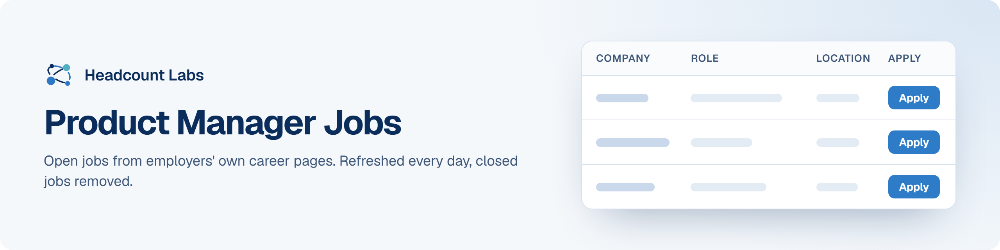

# Product Manager Jobs

Product manager and product owner jobs at US employers.

**394 open jobs** · 168 new since the last update · 174 removed because they closed or left the employer's board · updated November 17, 2026 at 4:58 AM EST

This list is built and refreshed every day by [Headcount Labs](https://headcountlabs.com/?utm_source=github&utm_medium=job-list&utm_campaign=product-manager-jobs), which reads jobs straight from employers' own career pages and job boards. Every job here was still listed on its source board when we last read that board, within the past 3 days, and was posted in the past 30 days. Copies of the same job are merged into one row, and jobs that close are removed at the next update.

Want this data in your own app or agent? Use the [Headcount Labs jobs API](https://headcountlabs.com/docs/?utm_source=github&utm_medium=job-list&utm_campaign=product-manager-jobs) (free tier), the [MCP server](https://headcountlabs.com/mcp/?utm_source=github&utm_medium=job-list&utm_campaign=product-manager-jobs) for Claude, ChatGPT and other AI assistants, or the [public dataset subsets](https://huggingface.co/HeadcountLabs) on Hugging Face (the full dataset is coming soon).

**Jump to:** [Posted in the last 7 days (161)](#posted-in-the-last-7-days) · [Posted 8 to 30 days ago (233)](#posted-8-to-30-days-ago)

**Columns.** *Apply* opens the original posting on the employer's site. *Details* opens the job on Headcount Labs, with every posting we found for it. *Remote* shows what the employer states; a dash means the posting doesn't say. *Pay* is the range the employer published.

## Posted in the last 7 days

| Company | Role | Location | Remote | Pay | Posted | Apply | Details |
| --- | --- | --- | --- | --- | --- | :---: | :---: |
| **Palo Alto Networks** | Senior Product Manager Critical Infrastructure Security (Device Security) | Santa Clara, CA | — | $153k–$248k/yr | Nov 16 |  | <a href="https://headcountlabs.com/catalog/jobs/71d848a0-ede1-487b-adea-24a25418e12f?utm_source=github&utm_medium=job-list&utm_campaign=product-manager-jobs">via Headcount Labs</a> |
| **NFP Corp** | VP, Technical Product Manager | 

2 locations
New York, NY Austin, TX
 | — | $165k–$190k/yr | Nov 16 |  | <a href="https://headcountlabs.com/catalog/jobs/e617b54b-40b4-4562-b339-ea47a9d9bfef?utm_source=github&utm_medium=job-list&utm_campaign=product-manager-jobs">via Headcount Labs</a> |
| **Ness Digital Engineering** | Technical Product Manager – Enterprise Data Platform (NYC) | New York, NY | — | — | Nov 16 |  | <a href="https://headcountlabs.com/catalog/jobs/c2fd1829-0d0c-4517-802e-b277fb1aadcb?utm_source=github&utm_medium=job-list&utm_campaign=product-manager-jobs">via Headcount Labs</a> |
| **Livetrends Design Group LLC** | Home Decor Product Manager | Apopka, FL | — | — | Nov 16 |  | <a href="https://headcountlabs.com/catalog/jobs/51ffce0e-4608-463a-b210-8d5f855826a9?utm_source=github&utm_medium=job-list&utm_campaign=product-manager-jobs">via Headcount Labs</a> |
| **libertymutualgroup** | Senior Director, Product Owner - Global Surety | 

4 locations
United States Seattle, WA Boston, MA Plano, TX
 | Remote | — | Nov 16 |  | <a href="https://headcountlabs.com/catalog/jobs/fbf45b41-ea60-4a03-a3d2-9ef1fbc3b55f?utm_source=github&utm_medium=job-list&utm_campaign=product-manager-jobs">via Headcount Labs</a> |
| **Alliance Laundry System** | Digital Product Manager | Ripon, WI | Remote | — | Nov 16 |  | <a href="https://headcountlabs.com/catalog/jobs/66b71ead-1747-49f1-8e7e-5db582092189?utm_source=github&utm_medium=job-list&utm_campaign=product-manager-jobs">via Headcount Labs</a> |
| **Red Hat** | Principal Product Manager - Technical | 

3 locations
Boston, MA United States Raleigh, NC
 | Hybrid | $154k–$254k/yr | Nov 15 |  | <a href="https://headcountlabs.com/catalog/jobs/e5d232ee-f8a0-48ae-ae7a-ce54e5e9ee91?utm_source=github&utm_medium=job-list&utm_campaign=product-manager-jobs">via Headcount Labs</a> |
| **HPE** | Networking MBA Product Manager Graduate | 

2 locations
Roseville, CA San Jose, CA
 | Hybrid | — | Nov 15 |  | <a href="https://headcountlabs.com/catalog/jobs/a8ec4639-e654-491a-82d1-805d0294b9c7?utm_source=github&utm_medium=job-list&utm_campaign=product-manager-jobs">via Headcount Labs</a> |
| **ASRC Federal Holding Company** | Scrum Master/Product Manager | 

2 locations
North Carolina United States
 | Remote | — | Nov 15 |  | <a href="https://headcountlabs.com/catalog/jobs/e7af3682-4014-4768-b114-f4b67da97675?utm_source=github&utm_medium=job-list&utm_campaign=product-manager-jobs">via Headcount Labs</a> |
| **ServiceNow, Inc.** | Sr Inbound Product Manager Intern (MBA Summer 2027) | San Diego, CA | — | $55.46–$71.09/hr | Nov 14 |  | <a href="https://headcountlabs.com/catalog/jobs/d9d4f6b1-4973-485c-b365-2caced9ff226?utm_source=github&utm_medium=job-list&utm_campaign=product-manager-jobs">via Headcount Labs</a> |
| **ServiceNow, Inc.** | Sr Outbound Product Manager Intern (MBA Summer 2027) | San Diego, CA | — | $55.46–$71.09/hr | Nov 14 |  | <a href="https://headcountlabs.com/catalog/jobs/d2182409-cac5-49fa-93ae-8778dec3db1c?utm_source=github&utm_medium=job-list&utm_campaign=product-manager-jobs">via Headcount Labs</a> |
| **Saint-Gobain** | Senior Digital Product Owner | NORTHBORO, MA | — | $92k–$142k/yr | Nov 14 |  | <a href="https://headcountlabs.com/catalog/jobs/3bd77d0e-dd76-4c4f-b75b-53f88a5274d0?utm_source=github&utm_medium=job-list&utm_campaign=product-manager-jobs">via Headcount Labs</a> |
| **Nomura Holdings, inc.** | Product Manager- Electronic Trading | New York, NY | — | $190k–$250k/yr | Nov 14 |  | <a href="https://headcountlabs.com/catalog/jobs/28706068-ee47-44d5-80f2-7e83a73afec5?utm_source=github&utm_medium=job-list&utm_campaign=product-manager-jobs">via Headcount Labs</a> |
| **Lyra** | Sr. Clinical Product Manager | United States | Remote | $119k–$164k/yr | Nov 14 |  | <a href="https://headcountlabs.com/catalog/jobs/b76ef528-13b9-4b93-bdf3-ae10dac9332b?utm_source=github&utm_medium=job-list&utm_campaign=product-manager-jobs">via Headcount Labs</a> |
| **HII** | Product Owner (Hybrid) - 29307 | San Antonio, TX | Hybrid | $116k–$160k/yr | Nov 14 |  | <a href="https://headcountlabs.com/catalog/jobs/b5846175-9b9b-4b3a-9b66-885f1b70b23b?utm_source=github&utm_medium=job-list&utm_campaign=product-manager-jobs">via Headcount Labs</a> |
| **Domino's** | Lead Product Owner | Ann Arbor, MI | — | — | Nov 14 |  | <a href="https://headcountlabs.com/catalog/jobs/497d316e-ebfa-4d53-a630-b42729134ac4?utm_source=github&utm_medium=job-list&utm_campaign=product-manager-jobs">via Headcount Labs</a> |
| **Disney Entertainment** | Product Manager II - Audience Targeting &amp; Measurement | 

2 locations
Glendale, CA New York, NY
 | — | $119k–$160k/yr | Nov 14 |  | <a href="https://headcountlabs.com/catalog/jobs/f6d2dbde-ead7-4d0d-a404-6b8394a66d1f?utm_source=github&utm_medium=job-list&utm_campaign=product-manager-jobs">via Headcount Labs</a> |
| **Delta Air Lines, Inc.** | Sr. Product Owner, Crew Servicing | Atlanta, GA | — | — | Nov 14 |  | <a href="https://headcountlabs.com/catalog/jobs/f0c82094-cc98-42ca-9a65-ced97036911d?utm_source=github&utm_medium=job-list&utm_campaign=product-manager-jobs">via Headcount Labs</a> |
| **Cisco Systems, Inc.** | Lead Engineering Product Manager, Application Synthetics(Hybrid) | 

3 locations
San Francisco, CA Milpitas, CA Mountain View, CA
 | Hybrid | $172k–$245k/yr | Nov 14 |  | <a href="https://headcountlabs.com/catalog/jobs/96ed6996-e6cf-4afb-aaea-a5cdc8034067?utm_source=github&utm_medium=job-list&utm_campaign=product-manager-jobs">via Headcount Labs</a> |
| **Cisco Systems, Inc.** | Senior Staff Product Manager - Identity Aware Networking &#124; Non-Human Identities (hybrid) | 

2 locations
Milpitas, CA San Jose, CA
 | Hybrid | $195k–$286k/yr | Nov 14 |  | <a href="https://headcountlabs.com/catalog/jobs/24716982-14e9-4e63-9d4f-1ce3fba47165?utm_source=github&utm_medium=job-list&utm_campaign=product-manager-jobs">via Headcount Labs</a> |
| **Cisco** | Senior Staff Product Manager - Identity Aware Networking &#124; Non-Human Identities (hybrid) | 

2 locations
Milpitas, CA San Jose, CA
 | Hybrid | $195k–$286k/yr | Nov 14 |  | <a href="https://headcountlabs.com/catalog/jobs/7f34d229-7828-49f7-9fa9-9d6af02978cd?utm_source=github&utm_medium=job-list&utm_campaign=product-manager-jobs">via Headcount Labs</a> |
| **Cisco** | Lead Engineering Product Manager, Application Synthetics(Hybrid) | 

3 locations
San Francisco, CA Milpitas, CA Mountain View, CA
 | Hybrid | $172k–$245k/yr | Nov 14 |  | <a href="https://headcountlabs.com/catalog/jobs/674b7d49-7ee0-4ade-96af-5813ae919f86?utm_source=github&utm_medium=job-list&utm_campaign=product-manager-jobs">via Headcount Labs</a> |
| **Capgemini** | Salesforce Technical Product Owner | Irvine, CA | — | — | Nov 14 |  | <a href="https://headcountlabs.com/catalog/jobs/ca8b919e-c350-4230-a0b8-23363fa01187?utm_source=github&utm_medium=job-list&utm_campaign=product-manager-jobs">via Headcount Labs</a> |
| **Bristol Myers Squibb** | Associate Director, Commercialization BI&amp;T Product Manager Patient Support Platforms | Princeton, NJ | — | $167k–$202k/yr | Nov 14 |  | <a href="https://headcountlabs.com/catalog/jobs/d9813de6-ab72-429e-a9f3-857680dc185d?utm_source=github&utm_medium=job-list&utm_campaign=product-manager-jobs">via Headcount Labs</a> |
| **WEX Inc** | Product Manager, Electric Vehicle &amp; Connected Fleet | United States | Remote | $90k–$120k/yr | Nov 13 |  | <a href="https://headcountlabs.com/catalog/jobs/61de5192-e0fc-462c-8524-2abf747a1594?utm_source=github&utm_medium=job-list&utm_campaign=product-manager-jobs">via Headcount Labs</a> |
| **Western Union, LLC** | Product Manager, Cross-Border Bill Pay | Denver, CO | Hybrid | $110k–$140k/yr | Nov 13 |  | <a href="https://headcountlabs.com/catalog/jobs/d2b2cfbf-e6f3-4d41-bad0-2423c36344a6?utm_source=github&utm_medium=job-list&utm_campaign=product-manager-jobs">via Headcount Labs</a> |
| **Western Union, LLC** | Product Manager, Consumer Services | Denver, CO | Hybrid | $110k–$140k/yr | Nov 13 |  | <a href="https://headcountlabs.com/catalog/jobs/97e84761-157b-457f-9378-5472edbde1cf?utm_source=github&utm_medium=job-list&utm_campaign=product-manager-jobs">via Headcount Labs</a> |
| **Walt Disney Attractions Technology LLC** | Lead Product Manager | Orlando, FL | Hybrid | $145k–$175k/yr | Nov 13 |  | <a href="https://headcountlabs.com/catalog/jobs/5c5fb6c1-4a3f-4e03-a7a6-d3b990607ec2?utm_source=github&utm_medium=job-list&utm_campaign=product-manager-jobs">via Headcount Labs</a> |
| **Visa U.S.A. Inc.** | Sr. Product Manager - Visa Spend Clarity | San Francisco, CA | — | $181k–$289k/yr | Nov 13 |  | <a href="https://headcountlabs.com/catalog/jobs/8fe3b3d3-6ef6-4ac7-bf9d-4ae16e910af3?utm_source=github&utm_medium=job-list&utm_campaign=product-manager-jobs">via Headcount Labs</a> |
| **United Services Automobile Asn** | Director, Development Product Owner &#124; Claim Modernization | 

6 locations
San Antonio, TX United States Colorado Springs Plano Legacy Tampa Tampa Crosstown
 | Hybrid | $127k–$243k/yr | Nov 13 |  | <a href="https://headcountlabs.com/catalog/jobs/4f26790c-3d6f-4b09-8ee4-5109fdd52215?utm_source=github&utm_medium=job-list&utm_campaign=product-manager-jobs">via Headcount Labs</a> |
| **U.S. Bank National Association** | TravelBank Platform Product Manager | 

2 locations
Minneapolis, MN Irving, TX
 | On-site | $120k–$141k/yr | Nov 13 |  | <a href="https://headcountlabs.com/catalog/jobs/8a991535-7382-4f70-98a8-9823b813b4dd?utm_source=github&utm_medium=job-list&utm_campaign=product-manager-jobs">via Headcount Labs</a> |
| **Trase Systems** | Senior Product Manager: Enterprise AI Platform | Seattle, WA | Remote | — | Nov 13 |  | <a href="https://headcountlabs.com/catalog/jobs/e9223ee6-287d-4aeb-9e8c-5ab7c687665a?utm_source=github&utm_medium=job-list&utm_campaign=product-manager-jobs">via Headcount Labs</a> |
| **Trase Systems** | Senior Product Manager: Developer Experience | Seattle, WA | Remote | — | Nov 13 |  | <a href="https://headcountlabs.com/catalog/jobs/6bf9ce6c-5a0d-4742-b7f6-1aaf442c4e58?utm_source=github&utm_medium=job-list&utm_campaign=product-manager-jobs">via Headcount Labs</a> |
| **Toast** | Principal Product Manager - Catering &amp; Events | United States | Remote | $190k–$304k/yr | Nov 13 |  | <a href="https://headcountlabs.com/catalog/jobs/2b89dca3-8243-46d2-a081-c3dc98f752af?utm_source=github&utm_medium=job-list&utm_campaign=product-manager-jobs">via Headcount Labs</a> |
| **Strategic Education, Inc.** | Sr. Product Manager, Product Design &amp; User Research, Sophia Learning | United States | Remote | $160k–$180k/yr | Nov 13 |  | <a href="https://headcountlabs.com/catalog/jobs/66851055-041e-4341-994e-a3b33ebfeca9?utm_source=github&utm_medium=job-list&utm_campaign=product-manager-jobs">via Headcount Labs</a> |
| **Stellar Health** | Senior Product Manager 2, Total Cost of Care | New York, NY | Hybrid | $190k–$210k/yr | Nov 13 |  | <a href="https://headcountlabs.com/catalog/jobs/ce3e0835-cc60-471e-8de4-724b2551dc9f?utm_source=github&utm_medium=job-list&utm_campaign=product-manager-jobs">via Headcount Labs</a> |
| **Stellantis** | Principal Technical Product Manager | Auburn Hills, MI | — | — | Nov 13 |  | <a href="https://headcountlabs.com/catalog/jobs/acdec903-75f9-4d23-bea4-41b36b14cbed?utm_source=github&utm_medium=job-list&utm_campaign=product-manager-jobs">via Headcount Labs</a> |
| **State of Illinois** | PRODUCT MANAGER | Springfield, IL | — | $10k–$11k/mo | Nov 13 |  | <a href="https://headcountlabs.com/catalog/jobs/ac4f34f7-4677-47a0-bfa0-82611ff6be67?utm_source=github&utm_medium=job-list&utm_campaign=product-manager-jobs">via Headcount Labs</a> |
| **SOVRA** | Senior Product Manager | United States | Hybrid | — | Nov 13 |  | <a href="https://headcountlabs.com/catalog/jobs/5be3f6a4-a494-427b-bcb7-6cfea6ccb982?utm_source=github&utm_medium=job-list&utm_campaign=product-manager-jobs">via Headcount Labs</a> |
| **Snowflake** | Senior Product Manager - Openflow | US-WA-Bellevue | — | $236k–$339k/yr | Nov 13 |  | <a href="https://headcountlabs.com/catalog/jobs/578ec69d-54d2-40ea-8735-77b94cf518ee?utm_source=github&utm_medium=job-list&utm_campaign=product-manager-jobs">via Headcount Labs</a> |
| **ServiceNow, Inc.** | Staff Technical Product Manager - Quote to Cash | Chicago, IL | — | $166k–$291k/yr | Nov 13 |  | <a href="https://headcountlabs.com/catalog/jobs/ac29836d-a441-4113-b70f-0f98393dbbca?utm_source=github&utm_medium=job-list&utm_campaign=product-manager-jobs">via Headcount Labs</a> |
| **Salesforce, Inc.** | Senior Product Manager, Tableau Applied AI | San Francisco, CA | — | $172k–$260k/yr | Nov 13 |  | <a href="https://headcountlabs.com/catalog/jobs/c727f861-54a5-456e-a47c-0072b4d8ca16?utm_source=github&utm_medium=job-list&utm_campaign=product-manager-jobs">via Headcount Labs</a> |
| **Salesforce, Inc.** | Senior Product Manager, Piper | San Francisco, CA | Remote | $172k–$260k/yr | Nov 13 |  | <a href="https://headcountlabs.com/catalog/jobs/aa9e0e3e-eb5d-49c6-8da9-31210eddf090?utm_source=github&utm_medium=job-list&utm_campaign=product-manager-jobs">via Headcount Labs</a> |
| **Rush University Medical Center** | Sr Product Owner Consumer Svcs - Healthcare | Chicago, IL | Remote | $55.75–$83.07/hr | Nov 13 |  | <a href="https://headcountlabs.com/catalog/jobs/543a55dd-f4f5-4d61-987d-2488c35e56c9?utm_source=github&utm_medium=job-list&utm_campaign=product-manager-jobs">via Headcount Labs</a> |
| **Reed Technology and Information Services LLC Company** | Sr Product Manager** EST Coast Preferred | Horsham, PA | — | $105k–$175k/yr | Nov 13 |  | <a href="https://headcountlabs.com/catalog/jobs/7bd1124a-555d-4f49-b6a6-ac8c17eab804?utm_source=github&utm_medium=job-list&utm_campaign=product-manager-jobs">via Headcount Labs</a> |
| **Red Hat, LLC** | Principal Product Manager - Technical | 

3 locations
Boston Lowell Raleigh
 | Hybrid | $154k–$254k/yr | Nov 13 |  | <a href="https://headcountlabs.com/catalog/jobs/05f359c3-0a95-4626-9879-716be9ef0f6c?utm_source=github&utm_medium=job-list&utm_campaign=product-manager-jobs">via Headcount Labs</a> |
| **QXO** | Senior Product Manager - Technical (Data Product Tooling) | Seattle, WA | — | $145k–$275k/yr | Nov 13 |  | <a href="https://headcountlabs.com/catalog/jobs/35a5d032-c41f-44d3-a714-a86cf9bd9397?utm_source=github&utm_medium=job-list&utm_campaign=product-manager-jobs">via Headcount Labs</a> |
| **Pushpay** | Senior Product Manager, Faith &amp; Strategy | Colorado Springs, CO | Remote | $106k–$137k/yr | Nov 13 |  | <a href="https://headcountlabs.com/catalog/jobs/430c7064-b294-4d0a-b8cf-603dcc9c7b62?utm_source=github&utm_medium=job-list&utm_campaign=product-manager-jobs">via Headcount Labs</a> |
| **Phantom** | Senior Product Manager (Prediction Markets) | United States | Remote | — | Nov 13 |  | <a href="https://headcountlabs.com/catalog/jobs/3289551e-6c08-4fa9-91db-d3fc3ed37161?utm_source=github&utm_medium=job-list&utm_campaign=product-manager-jobs">via Headcount Labs</a> |
| **PayPal, Inc.** | Sr Product Manager | San Jose, CA | — | $144k–$213k/yr | Nov 13 |  | <a href="https://headcountlabs.com/catalog/jobs/3e7c5909-aeeb-49ac-80db-f194a9d9a9da?utm_source=github&utm_medium=job-list&utm_campaign=product-manager-jobs">via Headcount Labs</a> |
| **PayPal, Inc.** | Sr Product Manager, Technical | 

4 locations
Scottsdale, AZ Austin, TX Chicago, IL San Jose, CA
 | — | $124k–$184k/yr | Nov 13 |  | <a href="https://headcountlabs.com/catalog/jobs/95ac2488-9f13-41ba-8959-a117d719e038?utm_source=github&utm_medium=job-list&utm_campaign=product-manager-jobs">via Headcount Labs</a> |
| **Palo Alto Networks, Inc.** | Associate IT Product Manager | United States | On-site | — | Nov 13 |  | <a href="https://headcountlabs.com/catalog/jobs/b894dca9-449d-41ea-9f85-fa771e45a14e?utm_source=github&utm_medium=job-list&utm_campaign=product-manager-jobs">via Headcount Labs</a> |
| **Overjet** | Lead Product Manager, Agentic | San Mateo, CA | Hybrid | — | Nov 13 |  | <a href="https://headcountlabs.com/catalog/jobs/ec4c43af-0bdb-44ac-806b-56a622807762?utm_source=github&utm_medium=job-list&utm_campaign=product-manager-jobs">via Headcount Labs</a> |
| **Onto Innovation Inc-US** | Senior Product Manager – Semiconductor Analytics &amp; Process Control Solutions | Wilmington-MA | — | $115k–$173k/yr | Nov 13 |  | <a href="https://headcountlabs.com/catalog/jobs/4160ac12-3b81-4e80-b18b-fe1fad2dc7c4?utm_source=github&utm_medium=job-list&utm_campaign=product-manager-jobs">via Headcount Labs</a> |
| **Okta** | Senior Product Manager - Okta Identity Governance | 

6 locations
Bellevue, WA Chicago, IL New York, NY San Francisco, CA Seattle, WA Washington, DC
 | — | — | Nov 13 |  | <a href="https://headcountlabs.com/catalog/jobs/a097c6fc-c05f-4b6b-bebe-e4f61c604163?utm_source=github&utm_medium=job-list&utm_campaign=product-manager-jobs">via Headcount Labs</a> |
| **OCLC, Inc.** | Senior Product Manager | Dublin | Hybrid | — | Nov 13 |  | <a href="https://headcountlabs.com/catalog/jobs/03f92837-4652-454d-bb52-0a0de10adcf8?utm_source=github&utm_medium=job-list&utm_campaign=product-manager-jobs">via Headcount Labs</a> |
| **Northwestern Mutual** | Product Manager III | United States | — | $119k–$178k/yr | Nov 13 |  | <a href="https://headcountlabs.com/catalog/jobs/8a6999e8-7f03-49d2-be49-04ac08fb8355?utm_source=github&utm_medium=job-list&utm_campaign=product-manager-jobs">via Headcount Labs</a> |
| **NetApp, Inc.** | Intern - Product Manager | 

2 locations
San Jose, CA Morrisville, NC
 | — | — | Nov 13 |  | <a href="https://headcountlabs.com/catalog/jobs/7a94e6fc-9061-4662-8228-9d9e20e4a553?utm_source=github&utm_medium=job-list&utm_campaign=product-manager-jobs">via Headcount Labs</a> |
| **MS Services Group, Inc.** | Enterprise AI - Technical Product Owner - Vice President | New York, NY | — | $155k–$215k/yr | Nov 13 |  | <a href="https://headcountlabs.com/catalog/jobs/ed378580-8dab-4835-bb9d-a5c783ba5ec3?utm_source=github&utm_medium=job-list&utm_campaign=product-manager-jobs">via Headcount Labs</a> |
| **Mecka** | Technical Product Manager (TPM), Delivery Ops | 

2 locations
New York San Francisco, CA
 | Hybrid | $160k–$200k/yr | Nov 13 |  | <a href="https://headcountlabs.com/catalog/jobs/9275316d-f567-4aae-bb92-6e8989292b4b?utm_source=github&utm_medium=job-list&utm_campaign=product-manager-jobs">via Headcount Labs</a> |
| **Mars** | Technical Product Owner, Consumer Care and Customer Service | Chicago, IL | Hybrid | — | Nov 13 |  | <a href="https://headcountlabs.com/catalog/jobs/ba3ca80d-6f55-4981-b00a-221e750f5d27?utm_source=github&utm_medium=job-list&utm_campaign=product-manager-jobs">via Headcount Labs</a> |
| **Manufacturers and Traders Trust Co** | Product Owner II (Data &amp; Migration) | 

2 locations
Buffalo, NY Wilmington, DE
 | Hybrid | $124k–$206k/yr | Nov 13 |  | <a href="https://headcountlabs.com/catalog/jobs/f34e135c-4224-41f8-ac20-9c5d6c675800?utm_source=github&utm_medium=job-list&utm_campaign=product-manager-jobs">via Headcount Labs</a> |
| **Lyra Health** | Sr. Clinical Product Manager | United States | Remote | $119k–$164k/yr | Nov 13 |  | <a href="https://headcountlabs.com/catalog/jobs/c79b0a6e-31e4-4271-bf5e-95b9344cfe6b?utm_source=github&utm_medium=job-list&utm_campaign=product-manager-jobs">via Headcount Labs</a> |
| **Lutron Electronics Co., Inc** | Product Manager | 

2 locations
Coopersburg, PA Conshohocken, PA
 | — | — | Nov 13 |  | <a href="https://headcountlabs.com/catalog/jobs/f4cde8f2-7787-44a9-b420-c225b15a8ab9?utm_source=github&utm_medium=job-list&utm_campaign=product-manager-jobs">via Headcount Labs</a> |
| **LSEG (member)** | Senior Product Manager – Private Markets, Data &amp; Feeds | New York | — | $144k–$240k/yr | Nov 13 |  | <a href="https://headcountlabs.com/catalog/jobs/e7dfc94f-d370-409f-b9c0-26bcb38eb79c?utm_source=github&utm_medium=job-list&utm_campaign=product-manager-jobs">via Headcount Labs</a> |
| **Lowes** | Sr Product Manager- Payments | Charlotte, NC | — | — | Nov 13 |  | <a href="https://headcountlabs.com/catalog/jobs/cab5789d-e14c-481d-8016-a6216a2d6f63?utm_source=github&utm_medium=job-list&utm_campaign=product-manager-jobs">via Headcount Labs</a> |
| **Leidos** | Senior Product Manager - Platform and Architecture | 

3 locations
Reston, VA Huntsville, AL San Diego, CA
 | — | $154k–$278k/yr | Nov 13 |  | <a href="https://headcountlabs.com/catalog/jobs/cffd8eb2-e816-444b-a708-b5cfc7c78f9a?utm_source=github&utm_medium=job-list&utm_campaign=product-manager-jobs">via Headcount Labs</a> |
| **Leidos** | Product Manager – Go-to-Market and Sales Enablement | 

3 locations
Reston, VA Huntsville, AL San Diego, CA
 | — | $108k–$195k/yr | Nov 13 |  | <a href="https://headcountlabs.com/catalog/jobs/564df379-364a-4861-8b7f-77fd0cf5c4b3?utm_source=github&utm_medium=job-list&utm_campaign=product-manager-jobs">via Headcount Labs</a> |
| **Leidos** | Senior Product Manager – Developer Relations and Ecosystem | 

3 locations
Reston, VA Huntsville, AL San Diego, CA
 | — | $131k–$237k/yr | Nov 13 |  | <a href="https://headcountlabs.com/catalog/jobs/20d9505f-9c17-4760-b637-e609d24fdcbf?utm_source=github&utm_medium=job-list&utm_campaign=product-manager-jobs">via Headcount Labs</a> |
| **Leidos** | Technical Product Owner / Systems Engineer | Bethesda, MD | — | $131k–$237k/yr | Nov 13 |  | <a href="https://headcountlabs.com/catalog/jobs/1b4925cf-621d-48e8-ae19-38775e2cd073?utm_source=github&utm_medium=job-list&utm_campaign=product-manager-jobs">via Headcount Labs</a> |
| **LE001 AAA Club Alliance Inc.** | Associate Digital Product Manager, Travel | Wilmington, DE | — | $80k–$90k/yr | Nov 13 |  | <a href="https://headcountlabs.com/catalog/jobs/c1fe00c9-4fba-47d1-90e3-952c9166fed6?utm_source=github&utm_medium=job-list&utm_campaign=product-manager-jobs">via Headcount Labs</a> |
| **Kyndryl, Inc.** | Product Owner | United States | On-site | $115k–$219k/yr | Nov 13 |  | <a href="https://headcountlabs.com/catalog/jobs/c14b7434-defc-4b7b-8969-88cce8ee3223?utm_source=github&utm_medium=job-list&utm_campaign=product-manager-jobs">via Headcount Labs</a> |
| **KeyBank National Association** | Fraud and Disputes Product Owner | 

2 locations
Brooklyn, OH United States
 | Remote | $71k–$125k/yr | Nov 13 |  | <a href="https://headcountlabs.com/catalog/jobs/69945c22-bf38-449c-ba72-00ad2acfa00e?utm_source=github&utm_medium=job-list&utm_campaign=product-manager-jobs">via Headcount Labs</a> |
| **Jonas Software** | Product Manager | United States | Remote | — | Nov 13 |  | <a href="https://headcountlabs.com/catalog/jobs/e0947382-73b6-45cf-86f9-e81a18d8a022?utm_source=github&utm_medium=job-list&utm_campaign=product-manager-jobs">via Headcount Labs</a> |
| **Jobgether** | Product Owner (Digital Product) | United States | Remote | — | Nov 13 |  | <a href="https://headcountlabs.com/catalog/jobs/fb8e6ed7-4787-4a0f-a95b-d85f80eba0ce?utm_source=github&utm_medium=job-list&utm_campaign=product-manager-jobs">via Headcount Labs</a> |
| **Jobgether** | Lead Product Manager, Agent Factory | United States | Remote | $180k–$265k/yr | Nov 13 |  | <a href="https://headcountlabs.com/catalog/jobs/8ec1314b-83b6-4661-80d6-b4b8c1c313a1?utm_source=github&utm_medium=job-list&utm_campaign=product-manager-jobs">via Headcount Labs</a> |
| **Jobgether** | Product Manager, Messaging | United States | Remote | $240k–$320k/yr | Nov 13 |  | <a href="https://headcountlabs.com/catalog/jobs/38d01c47-9004-4888-ba39-e5a1e3602ac6?utm_source=github&utm_medium=job-list&utm_campaign=product-manager-jobs">via Headcount Labs</a> |
| **Jobgether** | Sr. Product Manager - AI Products | United States | Remote | $139k–$197k/yr | Nov 13 |  | <a href="https://headcountlabs.com/catalog/jobs/00f153bf-7641-4287-b45d-bfda3d430399?utm_source=github&utm_medium=job-list&utm_campaign=product-manager-jobs">via Headcount Labs</a> |
| **Invitrogen Holdings LLC** | Product Manager, Residual DNA products | Pleasanton, CA | On-site | $125k–$180k/yr | Nov 13 |  | <a href="https://headcountlabs.com/catalog/jobs/a59b8650-9166-4cc4-a03d-ef8ec26588bc?utm_source=github&utm_medium=job-list&utm_campaign=product-manager-jobs">via Headcount Labs</a> |
| **Intuit** | Staff Product Manager, Services Growth &amp; Monetization | 

2 locations
Mountain View, CA San Francisco, CA
 | — | $188k–$255k/yr | Nov 13 |  | <a href="https://headcountlabs.com/catalog/jobs/3e107ad1-33d1-4bcc-9755-65d343987e02?utm_source=github&utm_medium=job-list&utm_campaign=product-manager-jobs">via Headcount Labs</a> |
| **INTEGRATED DNA TECHNOLOGIES, INC.** | Senior Commercial Product Manager, NGS Segments | United States | Remote | $110k–$150k/yr | Nov 13 |  | <a href="https://headcountlabs.com/catalog/jobs/82b229cb-c385-4a0c-9a61-98bebc7ed8a2?utm_source=github&utm_medium=job-list&utm_campaign=product-manager-jobs">via Headcount Labs</a> |
| **Illinois Tool Works Inc.** | Universal Testing Systems Product Manager | Mts | — | $110k–$140k/yr | Nov 13 |  | <a href="https://headcountlabs.com/catalog/jobs/46a277ef-f715-4a35-b241-dd3957c65adb?utm_source=github&utm_medium=job-list&utm_campaign=product-manager-jobs">via Headcount Labs</a> |
| **Illinois Tool Works** | Universal Testing Systems Product Manager | Eden Prairie, MN | — | $110k–$140k/yr | Nov 13 |  | <a href="https://headcountlabs.com/catalog/jobs/4c4f64fc-7f2c-41f8-af8e-a0082a4790ed?utm_source=github&utm_medium=job-list&utm_campaign=product-manager-jobs">via Headcount Labs</a> |
| **Humana Insurance Company** | Lead Product Manager – Clinical Outcomes | Chicago, IL | Remote | $139k–$191k/yr | Nov 13 |  | <a href="https://headcountlabs.com/catalog/jobs/6c02d0ff-c3ef-4567-a3cb-769d4b888f86?utm_source=github&utm_medium=job-list&utm_campaign=product-manager-jobs">via Headcount Labs</a> |
| **Health Care Service Corp.** | Strategic Product Manager | Chicago, IL | Hybrid | $84k–$152k/yr | Nov 13 |  | <a href="https://headcountlabs.com/catalog/jobs/c4232985-7551-4b35-a3af-14ee2edb58e4?utm_source=github&utm_medium=job-list&utm_campaign=product-manager-jobs">via Headcount Labs</a> |
| **Healogics LLC** | Senior Product Manager (Remote or Hybrid) | Jacksonville, FL | Hybrid | $130k–$160k/yr | Nov 13 |  | <a href="https://headcountlabs.com/catalog/jobs/052049f3-e2ab-4546-a126-e44ca34098dc?utm_source=github&utm_medium=job-list&utm_campaign=product-manager-jobs">via Headcount Labs</a> |
| **Greenheck Group** | Product Manager | 

2 locations
Clearwater, FL Tampa, FL
 | On-site | $144k–$178k/yr | Nov 13 |  | <a href="https://headcountlabs.com/catalog/jobs/b9804be8-0d76-425d-8c99-fb5c35404812?utm_source=github&utm_medium=job-list&utm_campaign=product-manager-jobs">via Headcount Labs</a> |
| **Gallagher** | Product Owner, Claim Intake | Rolling Meadows, IL | — | — | Nov 13 |  | <a href="https://headcountlabs.com/catalog/jobs/af297fbe-69bb-4363-98a4-de82ea184104?utm_source=github&utm_medium=job-list&utm_campaign=product-manager-jobs">via Headcount Labs</a> |
| **Ericsson** | Senior Product Manager Branch Solutions | 

3 locations
Plano, TX Santa Clara, CA Boise, ID
 | On-site | $176k–$232k/yr | Nov 13 |  | <a href="https://headcountlabs.com/catalog/jobs/bf91df5d-6b6c-49b0-991c-1f4db9f51e90?utm_source=github&utm_medium=job-list&utm_campaign=product-manager-jobs">via Headcount Labs</a> |
| **Encoura** | Senior Product Manager, Student Support Services | United States | Remote | $160k–$175k/yr | Nov 13 |  | <a href="https://headcountlabs.com/catalog/jobs/83e0e17c-c612-482b-82b7-e9ed0a19892c?utm_source=github&utm_medium=job-list&utm_campaign=product-manager-jobs">via Headcount Labs</a> |
| **Eli Lilly and Company** | LillyDirect Pharmacy Technical Product Owner Patient Data | Indianapolis IN | — | $129k–$189k/yr | Nov 13 |  | <a href="https://headcountlabs.com/catalog/jobs/4ca68d7e-cf0d-414c-80f2-4aa21e8c83b4?utm_source=github&utm_medium=job-list&utm_campaign=product-manager-jobs">via Headcount Labs</a> |
| **Early Warning Services, LLC** | Sr Lead Product Manager | 

4 locations
New York City Chicago San Francisco Scottsdale
 | — | $150k–$175k/yr | Nov 13 |  | <a href="https://headcountlabs.com/catalog/jobs/4a692284-0de1-4df4-818b-587f424e6902?utm_source=github&utm_medium=job-list&utm_campaign=product-manager-jobs">via Headcount Labs</a> |
| **E.R. Squibb &amp; Sons,L.L.C.** | Associate Director, Commercialization BI&amp;T Product Manager Patient Support Platforms | Princeton - NJ - | — | $167k–$202k/yr | Nov 13 |  | <a href="https://headcountlabs.com/catalog/jobs/5fb7f84d-ff97-47fb-9935-b9fef2b34208?utm_source=github&utm_medium=job-list&utm_campaign=product-manager-jobs">via Headcount Labs</a> |
| **DQQ Cohesity Inc.** | Senior Product Manager, AI | Santa Clara, CA | Hybrid | $194k–$216k/yr | Nov 13 |  | <a href="https://headcountlabs.com/catalog/jobs/5888a558-2b8f-4fd6-83ce-188fd7db00d4?utm_source=github&utm_medium=job-list&utm_campaign=product-manager-jobs">via Headcount Labs</a> |
| **Dental Imaging Technologies Corporation** | DEXIS Global Product Manager, Intraoral Scanner | United States | — | $139k–$170k/yr | Nov 13 |  | <a href="https://headcountlabs.com/catalog/jobs/51e06a5a-5910-4a2e-8dfc-7d999448434f?utm_source=github&utm_medium=job-list&utm_campaign=product-manager-jobs">via Headcount Labs</a> |
| **CrowdStrike, Inc.** | Sr. Product Manager - Cloud Workload Protection (Hybrid) | 

4 locations
Sunnyvale, CA Austin, TX New York, NY Redmond, WA
 | Hybrid | $140k–$220k/yr | Nov 13 |  | <a href="https://headcountlabs.com/catalog/jobs/0e6ac893-a95a-4fa1-955b-d87969d9604b?utm_source=github&utm_medium=job-list&utm_campaign=product-manager-jobs">via Headcount Labs</a> |
| **COV Covidien LP** | Global Senior Product Manager - Marketing, Acute Care and Monitoring | Lafayette, CO | On-site | $134k–$200k/yr | Nov 13 |  | <a href="https://headcountlabs.com/catalog/jobs/6fc178aa-3020-4892-b0d9-cf539000b7e8?utm_source=github&utm_medium=job-list&utm_campaign=product-manager-jobs">via Headcount Labs</a> |
| **Cisco Systems, Inc.** | Principal Product Manager - AI Defense (Hybrid) | 

5 locations
Milpitas, CA San Francisco, CA San Jose, CA San Mateo, CA Santa Clara, CA
 | Hybrid | $234k–$330k/yr | Nov 13 |  | <a href="https://headcountlabs.com/catalog/jobs/9384d83e-2b75-4f3b-8dee-527e56910f7f?utm_source=github&utm_medium=job-list&utm_campaign=product-manager-jobs">via Headcount Labs</a> |
| **Cisco Systems, Inc.** | Software Platforms Product Manager Cloud Hybrid California | 

2 locations
San Jose, CA North Carolina
 | Hybrid | $195k–$286k/yr | Nov 13 |  | <a href="https://headcountlabs.com/catalog/jobs/801aae76-df8d-420f-8cc6-13770df20c23?utm_source=github&utm_medium=job-list&utm_campaign=product-manager-jobs">via Headcount Labs</a> |
| **Buildertrend Solutions, Inc.** | Senior Product Manager - Core Financials | Omaha, NE | Remote | $120k–$180k/yr | Nov 13 |  | <a href="https://headcountlabs.com/catalog/jobs/bddbec1c-b35a-4e55-a332-541b4ca3a79e?utm_source=github&utm_medium=job-list&utm_campaign=product-manager-jobs">via Headcount Labs</a> |
| **Bostonscientific** | Senior Product Manager, Global Commercialization Accelerator | Arden Hills, MN | On-site | $102k/yr | Nov 13 |  | <a href="https://headcountlabs.com/catalog/jobs/e64047be-1e58-4539-be45-287d3d9b16bc?utm_source=github&utm_medium=job-list&utm_campaign=product-manager-jobs">via Headcount Labs</a> |
| **BBPLC NY Branch** | VP - Transaction Banking Product Manager | New York, NY | — | $155k/yr | Nov 13 |  | <a href="https://headcountlabs.com/catalog/jobs/a2f571f6-621e-4936-81aa-ddbae371ea78?utm_source=github&utm_medium=job-list&utm_campaign=product-manager-jobs">via Headcount Labs</a> |
| **Barclays Services LLC** | Senior AI Product Owner - VP | Whippany, NJ | — | $155k/yr | Nov 13 |  | <a href="https://headcountlabs.com/catalog/jobs/b948985e-3435-4def-af10-eb52446dd517?utm_source=github&utm_medium=job-list&utm_campaign=product-manager-jobs">via Headcount Labs</a> |
| **Baker Tilly Advisory Group, LP** | Principal Product Manager, AI Products | 

4 locations
California Pasadena, CA Redwood City, CA Santa Clara, CA
 | — | $168k/yr | Nov 13 |  | <a href="https://headcountlabs.com/catalog/jobs/500d4abb-b3fc-4c54-a3ed-8e7865d0bd89?utm_source=github&utm_medium=job-list&utm_campaign=product-manager-jobs">via Headcount Labs</a> |
| **ASUS USA -** | Senior Associate Product Manager, Consumer Products | City Of Industry, CA | — | $80k–$90k/yr | Nov 13 |  | <a href="https://headcountlabs.com/catalog/jobs/cad8ff24-796a-4f84-bdb7-6ac1c33720ca?utm_source=github&utm_medium=job-list&utm_campaign=product-manager-jobs">via Headcount Labs</a> |
| **ASUS USA -** | Go-to-Market (GTM) Associate Product Manager, Gaming Peripherals | City Of Industry, CA | — | $72k–$85k/yr | Nov 13 |  | <a href="https://headcountlabs.com/catalog/jobs/8cf63c7e-69f1-4e1d-a77e-189a9fbf9dd9?utm_source=github&utm_medium=job-list&utm_campaign=product-manager-jobs">via Headcount Labs</a> |
| **ASUS USA -** | Product Manager (PC Components) | Fremont, CA | — | $90k–$120k/yr | Nov 13 |  | <a href="https://headcountlabs.com/catalog/jobs/013d3db6-2745-427a-9cc2-27d4e7cb1500?utm_source=github&utm_medium=job-list&utm_campaign=product-manager-jobs">via Headcount Labs</a> |
| **Aristocrat Technologies Inc** | Product Owner, Product Lifecycle | Las Vegas, NV | Hybrid | — | Nov 13 |  | <a href="https://headcountlabs.com/catalog/jobs/7757238d-044e-4408-a40e-7f9c4e2efa0d?utm_source=github&utm_medium=job-list&utm_campaign=product-manager-jobs">via Headcount Labs</a> |
| **Allstate Insurance Co.** | Principal Digital Product Manager | USA -, IL | Remote | — | Nov 13 |  | <a href="https://headcountlabs.com/catalog/jobs/d3088418-2e53-49d8-a98d-586616461d29?utm_source=github&utm_medium=job-list&utm_campaign=product-manager-jobs">via Headcount Labs</a> |
| **94-1687665 Bank of America, National Association** | Product Manager, CashPro Security | 

3 locations
Charlotte Chicago North Carolina
 | — | $125k–$155k/yr | Nov 13 |  | <a href="https://headcountlabs.com/catalog/jobs/a0f906ee-150f-4306-9d45-12d18ce190dd?utm_source=github&utm_medium=job-list&utm_campaign=product-manager-jobs">via Headcount Labs</a> |
| **ZINC Zillow, Inc.** | Principal Product Manager, GenAI Media Experiences | United States | Remote | $196k–$312k/yr | Nov 12 |  | <a href="https://headcountlabs.com/catalog/jobs/a46df7bf-ea6e-4f94-8f73-16b658833d02?utm_source=github&utm_medium=job-list&utm_campaign=product-manager-jobs">via Headcount Labs</a> |
| **Verkada** | Lead Product Manager, Access Management | San Mateo | — | $205k–$240k/yr | Nov 12 |  | <a href="https://headcountlabs.com/catalog/jobs/46baa325-ea18-4596-bf3c-5964b3d24e27?utm_source=github&utm_medium=job-list&utm_campaign=product-manager-jobs">via Headcount Labs</a> |
| **UnitedHealth Group** | Lead Technology Product Manager - Remote | Eden Prairie, MN | Remote | $113k–$193k/yr | Nov 12 |  | <a href="https://headcountlabs.com/catalog/jobs/6863e644-ec77-4e92-a3b9-1c23966b60e5?utm_source=github&utm_medium=job-list&utm_campaign=product-manager-jobs">via Headcount Labs</a> |
| **Truist Bank** | Deposit Product Owner - Deposit Pricing and Rewards Engine | 

3 locations
Charlotte, NC Atlanta, GA Raleigh, NC
 | On-site | — | Nov 12 |  | <a href="https://headcountlabs.com/catalog/jobs/0cdf7dae-b1ed-4b85-921e-87fe5910809a?utm_source=github&utm_medium=job-list&utm_campaign=product-manager-jobs">via Headcount Labs</a> |
| **The Huntington National Bank** | Commercial Bank AI Product Manager | Charlotte, NC | On-site | — | Nov 12 |  | <a href="https://headcountlabs.com/catalog/jobs/2077bce4-19ff-4979-bcc0-b850d34a00b5?utm_source=github&utm_medium=job-list&utm_campaign=product-manager-jobs">via Headcount Labs</a> |
| **Tendo** | Principal Product Manager, Clinical Data Analytics | 

2 locations
Salt Lake City, UT San Francisco, CA
 | Remote | $132k–$178k/yr | Nov 12 |  | <a href="https://headcountlabs.com/catalog/jobs/e814c4c4-0f31-4686-844b-335dc62ba9a2?utm_source=github&utm_medium=job-list&utm_campaign=product-manager-jobs">via Headcount Labs</a> |
| **Stripe** | Staff Product Manager, Custom Objects | San Francisco, CA | — | — | Nov 12 |  | <a href="https://headcountlabs.com/catalog/jobs/85f10ee4-8d82-44ee-ac89-c7407b22f587?utm_source=github&utm_medium=job-list&utm_campaign=product-manager-jobs">via Headcount Labs</a> |
| **Jobgether** | Product Manager, AI | United States | Remote | — | Nov 12 |  | <a href="https://headcountlabs.com/catalog/jobs/b7c5615d-b4ff-416f-8a97-0e992e3b1ce3?utm_source=github&utm_medium=job-list&utm_campaign=product-manager-jobs">via Headcount Labs</a> |
| **Jobgether** | Lead Product Manager, Consumer Experience | United States | Remote | $180k–$210k/yr | Nov 12 |  | <a href="https://headcountlabs.com/catalog/jobs/a032dcf4-d4bf-423e-a652-ef55a9978740?utm_source=github&utm_medium=job-list&utm_campaign=product-manager-jobs">via Headcount Labs</a> |
| **Jobgether** | Product Manager | United States | Remote | $90k–$100k/yr | Nov 12 |  | <a href="https://headcountlabs.com/catalog/jobs/18024206-2af0-4575-afae-37585873cb55?utm_source=github&utm_medium=job-list&utm_campaign=product-manager-jobs">via Headcount Labs</a> |
| **Jobgether** | Senior Technical Product Owner | United States | Remote | $122k–$140k/yr | Nov 12 |  | <a href="https://headcountlabs.com/catalog/jobs/0f302559-c424-4864-8094-402adfba2148?utm_source=github&utm_medium=job-list&utm_campaign=product-manager-jobs">via Headcount Labs</a> |
| **Hewlett Packard Enterprise** | Senior Product Manager – AMD Processors &amp; CXL Devices | 

2 locations
Spring, TX Fort Collins, CO
 | Hybrid | $132k–$252k/yr | Nov 12 |  | <a href="https://headcountlabs.com/catalog/jobs/fbb1c4e7-07ba-4b90-afce-44feeab84a81?utm_source=github&utm_medium=job-list&utm_campaign=product-manager-jobs">via Headcount Labs</a> |
| **Genpact LLC** | Product Manager 4C | Dallas, TX | Hybrid | $60k–$75k/yr | Nov 12 |  | <a href="https://headcountlabs.com/catalog/jobs/134e6c71-b9d7-4c16-b1bf-c857a4e1b237?utm_source=github&utm_medium=job-list&utm_campaign=product-manager-jobs">via Headcount Labs</a> |
| **Ford Motor Company** | Group Product Manager - Rewards | Dearborn, MI | Hybrid | — | Nov 12 |  | <a href="https://headcountlabs.com/catalog/jobs/e327c70a-6966-4dfd-9dbf-c1294bc0cee5?utm_source=github&utm_medium=job-list&utm_campaign=product-manager-jobs">via Headcount Labs</a> |
| **Disney Entertainment** | Senior Product Manager II | 

2 locations
Bristol, CT Glendale, CA
 | — | $158k–$212k/yr | Nov 12 |  | <a href="https://headcountlabs.com/catalog/jobs/26fa0fe9-c08b-423b-9b76-be1ce0de6464?utm_source=github&utm_medium=job-list&utm_campaign=product-manager-jobs">via Headcount Labs</a> |
| **Candex** | Product Manager | 

3 locations
United States Miami, FL Boston, MA
 | Remote | — | Nov 12 |  | <a href="https://headcountlabs.com/catalog/jobs/b4772150-0ffb-4715-9d39-2327980609cf?utm_source=github&utm_medium=job-list&utm_campaign=product-manager-jobs">via Headcount Labs</a> |
| **Breeze Aviation Group, Inc.** | Product Manager | Cottonwood Heights, UT | — | — | Nov 12 |  | <a href="https://headcountlabs.com/catalog/jobs/c06dad15-77c2-42dc-873f-af718628b59c?utm_source=github&utm_medium=job-list&utm_campaign=product-manager-jobs">via Headcount Labs</a> |
| **BitGo** | Senior Product Manager - Tokenization &amp; Stablecoin Infrastructure | 

2 locations
Toronto New York
 | — | — | Nov 12 |  | <a href="https://headcountlabs.com/catalog/jobs/96e642c1-5e52-4247-bb33-1da696129726?utm_source=github&utm_medium=job-list&utm_campaign=product-manager-jobs">via Headcount Labs</a> |
| **Applied Compute** | Research Product Manager | San Francisco, CA | On-site | — | Nov 12 |  | <a href="https://headcountlabs.com/catalog/jobs/f59c9151-5877-4520-944d-9124b5f17156?utm_source=github&utm_medium=job-list&utm_campaign=product-manager-jobs">via Headcount Labs</a> |
| **Airwallex** | Staff Product Manager, T:0 (Agentic Finance) | US - San Francisco | Hybrid | $190k–$270k/yr | Nov 12 |  | <a href="https://headcountlabs.com/catalog/jobs/8434a4fd-427f-47ca-bc39-20dd229b080f?utm_source=github&utm_medium=job-list&utm_campaign=product-manager-jobs">via Headcount Labs</a> |
| **Airwallex** | Staff Product Manager, Embedded Finance | US - San Francisco | Hybrid | $190k–$270k/yr | Nov 12 |  | <a href="https://headcountlabs.com/catalog/jobs/03745669-5b4e-4ce3-825a-d0f8fcef78f7?utm_source=github&utm_medium=job-list&utm_campaign=product-manager-jobs">via Headcount Labs</a> |
| **94-1687665 Bank of America, National Association** | CashPro Data Product Manager | 

3 locations
Charlotte Chicago North Carolina
 | — | $125k–$155k/yr | Nov 12 |  | <a href="https://headcountlabs.com/catalog/jobs/41e60e9d-54e7-4c36-b474-4941c4625ab4?utm_source=github&utm_medium=job-list&utm_campaign=product-manager-jobs">via Headcount Labs</a> |
| **Zoom** | Senior Product Manager, Analytics and Insights | Boston, MA | Remote | $124k–$271k/yr | Nov 11 |  | <a href="https://headcountlabs.com/catalog/jobs/ed40fecd-0632-438d-bd50-2a30b4bc9537?utm_source=github&utm_medium=job-list&utm_campaign=product-manager-jobs">via Headcount Labs</a> |
| **Yokogawa Corporation of America YCA** | Product Manager III - Precision Power Measurement | YCA_Southern California | — | — | Nov 11 |  | <a href="https://headcountlabs.com/catalog/jobs/27e4aa0a-a0c3-48c7-af4f-672e9a952ae0?utm_source=github&utm_medium=job-list&utm_campaign=product-manager-jobs">via Headcount Labs</a> |
| **Xylem** | Product Manager Data Lake and Data Science | Morrisville, NC | Remote | $130k/yr | Nov 11 |  | <a href="https://headcountlabs.com/catalog/jobs/74c754b3-824b-4c07-9d63-c70f5cc63d07?utm_source=github&utm_medium=job-list&utm_campaign=product-manager-jobs">via Headcount Labs</a> |
| **Xometry** | Senior Product Manager, Account-Based Marketing &amp; Targeted Messaging | 

2 locations
Waltham, MA North Bethesda, MD
 | Hybrid | $115k–$140k/yr | Nov 11 |  | <a href="https://headcountlabs.com/catalog/jobs/2e05f45f-9d87-497d-89d3-66d684474be3?utm_source=github&utm_medium=job-list&utm_campaign=product-manager-jobs">via Headcount Labs</a> |
| **Unum Group** | Product Manager - AI Success | 

4 locations
Columbia, SC Dunwoody, GA Chattanooga, TN Portland, ME
 | — | $98k–$202k/yr | Nov 11 |  | <a href="https://headcountlabs.com/catalog/jobs/a35ae358-64f2-48d3-8174-0ac0083386f7?utm_source=github&utm_medium=job-list&utm_campaign=product-manager-jobs">via Headcount Labs</a> |
| **Under Armour, Inc.** | Principal, AI Technical Product Manager- Supply Chain | Baltimore, MD | Hybrid | $155k–$200k/yr | Nov 11 |  | <a href="https://headcountlabs.com/catalog/jobs/3051b1f7-e539-4088-b066-a288ccef6779?utm_source=github&utm_medium=job-list&utm_campaign=product-manager-jobs">via Headcount Labs</a> |
| **UMB Bank** | Institutional Banking Shared Services Product Owner | Kansas City, MO | Hybrid | $98k–$145k/yr | Nov 11 |  | <a href="https://headcountlabs.com/catalog/jobs/fb9dad77-35fb-4881-ad5a-9e1afbee4761?utm_source=github&utm_medium=job-list&utm_campaign=product-manager-jobs">via Headcount Labs</a> |
| **Stripe** | Staff Product Manager, Foundation Pillar | SF, SEA, NY, US | Remote | — | Nov 11 |  | <a href="https://headcountlabs.com/catalog/jobs/25e3543f-51a4-4f5e-b57f-3bb31ecd7f9f?utm_source=github&utm_medium=job-list&utm_campaign=product-manager-jobs">via Headcount Labs</a> |
| **ServiceNow, Inc.** | Senior Staff Technical Product Manager, Autonomous Workforce | San Diego, CA | — | $172k–$301k/yr | Nov 11 |  | <a href="https://headcountlabs.com/catalog/jobs/437380fb-6294-45b2-84e2-55c4e8d9ff67?utm_source=github&utm_medium=job-list&utm_campaign=product-manager-jobs">via Headcount Labs</a> |
| **ServiceNow, Inc.** | Staff Technical Product Manager, Autonomous Workforce | San Diego, CA | — | $150k–$262k/yr | Nov 11 |  | <a href="https://headcountlabs.com/catalog/jobs/40d473e7-1d8b-4712-bd06-682caa673682?utm_source=github&utm_medium=job-list&utm_campaign=product-manager-jobs">via Headcount Labs</a> |
| **Schneider Electric** | Panelboards Product Owner, Advanced | 

2 locations
Nashville, TN Raleigh, NC
 | — | — | Nov 11 |  | <a href="https://headcountlabs.com/catalog/jobs/e8192362-ca0a-4363-982a-507f7dc94764?utm_source=github&utm_medium=job-list&utm_campaign=product-manager-jobs">via Headcount Labs</a> |
| **Schneider Electric** | Circuit Breakers Product Owner | 

3 locations
Raleigh, NC Cedar Rapids, IA Nashville, TN
 | — | — | Nov 11 |  | <a href="https://headcountlabs.com/catalog/jobs/b194c245-e113-4eef-b4c4-b73f59fabf40?utm_source=github&utm_medium=job-list&utm_campaign=product-manager-jobs">via Headcount Labs</a> |
| **Noetic** | Senior Staff Product Manager | Dallas, TX | On-site | $220k–$330k/yr | Nov 11 |  | <a href="https://headcountlabs.com/catalog/jobs/bde03368-ab84-441d-940b-583dda8529a9?utm_source=github&utm_medium=job-list&utm_campaign=product-manager-jobs">via Headcount Labs</a> |
| **Gradient AI** | Senior Product Manager | Boston, MA | Hybrid | $150k–$195k/yr | Nov 11 |  | <a href="https://headcountlabs.com/catalog/jobs/c42db6c7-778d-441a-ba16-40d83267918b?utm_source=github&utm_medium=job-list&utm_campaign=product-manager-jobs">via Headcount Labs</a> |
| **BMO Financial Group** | Senior Product Manager, Sponsor Finance Technology | Chicago, IL | — | $100k–$220k/yr | Nov 11 |  | <a href="https://headcountlabs.com/catalog/jobs/4532d47b-b016-4744-b747-dfeb76531f21?utm_source=github&utm_medium=job-list&utm_campaign=product-manager-jobs">via Headcount Labs</a> |
| **Airwallex** | Staff Product Manager, Growth (Corporate Site) | US - San Francisco | Hybrid | $190k–$270k/yr | Nov 11 |  | <a href="https://headcountlabs.com/catalog/jobs/04dc5359-e901-46ba-950f-8d121885bd58?utm_source=github&utm_medium=job-list&utm_campaign=product-manager-jobs">via Headcount Labs</a> |
| **Ulta Beauty, Inc.** | Sr Product Owner, Cart &amp; Checkout | Bolingbrook, IL | — | $103k–$135k/yr | Nov 10 |  | <a href="https://headcountlabs.com/catalog/jobs/d27c0586-c59e-4d07-9730-a8cc398557f0?utm_source=github&utm_medium=job-list&utm_campaign=product-manager-jobs">via Headcount Labs</a> |
| **Super Micro Computer** | Product Manager - Key Components | San Jose, CA | — | $90k–$105k/yr | Nov 10 |  | <a href="https://headcountlabs.com/catalog/jobs/0ac10627-3ca1-48b1-8820-2ad8d2d1bd73?utm_source=github&utm_medium=job-list&utm_campaign=product-manager-jobs">via Headcount Labs</a> |
| **Snap Inc.** | Product Manager, Safety and Law Enforcement | 

4 locations
Los Angeles, CA Bellevue, WA New York, NY Washington, DC
 | — | $173k–$259k/yr | Nov 10 |  | <a href="https://headcountlabs.com/catalog/jobs/ceb1fcc5-6623-463c-9dc4-84376f7d4f3a?utm_source=github&utm_medium=job-list&utm_campaign=product-manager-jobs">via Headcount Labs</a> |
| **Skimmer** | Senior Product Manager, Financial Services | Austin, TX | Remote | — | Nov 10 |  | <a href="https://headcountlabs.com/catalog/jobs/e7a45e1a-7e62-4508-9c3f-db775519a18c?utm_source=github&utm_medium=job-list&utm_campaign=product-manager-jobs">via Headcount Labs</a> |
| **ServiceNow, Inc.** | Staff Inbound Product Manager - ServiceNow University | San Diego, CA | — | $150k–$262k/yr | Nov 10 |  | <a href="https://headcountlabs.com/catalog/jobs/b814caf0-f792-4b85-8fa4-2e29ba948846?utm_source=github&utm_medium=job-list&utm_campaign=product-manager-jobs">via Headcount Labs</a> |
| **Olympus Corporation of the Americas** | Product Manager-Surgical Video Microscopy | Westborough, MA | — | $109k–$152k/yr | Nov 10 |  | <a href="https://headcountlabs.com/catalog/jobs/f9940ece-3058-406e-9a97-6f0680b6e788?utm_source=github&utm_medium=job-list&utm_campaign=product-manager-jobs">via Headcount Labs</a> |
| **Moneycorp** | Product Manager - Payments | Stamford, CT | — | — | Nov 10 |  | <a href="https://headcountlabs.com/catalog/jobs/ced05a8b-cc5c-4963-8f00-8f3fbadadd02?utm_source=github&utm_medium=job-list&utm_campaign=product-manager-jobs">via Headcount Labs</a> |
| **Gallagher** | Product Manager | Rolling Meadows, IL | — | — | Nov 10 |  | <a href="https://headcountlabs.com/catalog/jobs/d2322b03-5255-4271-9838-b66d0ff95189?utm_source=github&utm_medium=job-list&utm_campaign=product-manager-jobs">via Headcount Labs</a> |
| **Disney Entertainment** | Staff Product Manager, Tech Solutions | Glendale, CA | — | $158k–$212k/yr | Nov 10 |  | <a href="https://headcountlabs.com/catalog/jobs/483ff1d3-e1f6-4352-b1cc-bce3eced8787?utm_source=github&utm_medium=job-list&utm_campaign=product-manager-jobs">via Headcount Labs</a> |
| **Cirrus Systems, Inc.** | Product Manager | Dallas, TX | On-site | — | Nov 10 |  | <a href="https://headcountlabs.com/catalog/jobs/da755dc4-f85d-4a63-ab9e-33a78fe6c3e1?utm_source=github&utm_medium=job-list&utm_campaign=product-manager-jobs">via Headcount Labs</a> |
| **Aspirion** | Product Manager (Fully Remote) | Columbus, GA | Remote | $91k–$136k/yr | Nov 10 |  | <a href="https://headcountlabs.com/catalog/jobs/bd541d48-0e68-4916-8bae-5d8c6b5cc464?utm_source=github&utm_medium=job-list&utm_campaign=product-manager-jobs">via Headcount Labs</a> |
| **Archer Daniels Midland** | Product Manager - Additives - Any ADM US location | Quincy, IL | — | — | Nov 10 |  | <a href="https://headcountlabs.com/catalog/jobs/0734a75e-a351-4e4f-8570-57726c08c4b5?utm_source=github&utm_medium=job-list&utm_campaign=product-manager-jobs">via Headcount Labs</a> |
| **American Heart Association** | Product Manager | Dallas, TX | Remote | $90k–$100k/yr | Nov 10 |  | <a href="https://headcountlabs.com/catalog/jobs/1182a018-a631-40e7-89e3-d8d8c619fc4e?utm_source=github&utm_medium=job-list&utm_campaign=product-manager-jobs">via Headcount Labs</a> |

## Posted 8 to 30 days ago

| Company | Role | Location | Remote | Pay | Posted | Apply | Details |
| --- | --- | --- | --- | --- | --- | :---: | :---: |
| **The Boeing Company** | Senior Cloud Product Owner **Sign on Bonus Potential** | 

3 locations
Berkeley, MO Daytona Beach, FL Seattle, WA
 | On-site | $124k–$193k/yr | Nov 9 |  | <a href="https://headcountlabs.com/catalog/jobs/1c7bc831-c74f-4493-84a3-7e0d4da7117d?utm_source=github&utm_medium=job-list&utm_campaign=product-manager-jobs">via Headcount Labs</a> |
| **Roblox** | Principal Product Manager, Creation Platform | San Mateo, CA | Hybrid | $331k–$383k/yr | Nov 9 |  | <a href="https://headcountlabs.com/catalog/jobs/44814fe4-958c-4e03-8aee-23333f022fdf?utm_source=github&utm_medium=job-list&utm_campaign=product-manager-jobs">via Headcount Labs</a> |
| **Natera** | Sr. Product Manager, Lab Execution CGP (Oncology) | San Carlos, CA | — | $155k–$193k/yr | Nov 9 |  | <a href="https://headcountlabs.com/catalog/jobs/8f9f2a84-25ac-4f82-81c8-3cdf2a54fd00?utm_source=github&utm_medium=job-list&utm_campaign=product-manager-jobs">via Headcount Labs</a> |
| **Edward Jones** | Product Manager, WMAS | Tempe, AZ | — | — | Nov 9 |  | <a href="https://headcountlabs.com/catalog/jobs/071ef9d8-a0e5-4dbc-9e4b-36390f04fea5?utm_source=github&utm_medium=job-list&utm_campaign=product-manager-jobs">via Headcount Labs</a> |
| **BNY** | Vice President, POM Product Owner | New York, NY | On-site | $69k–$185k/yr | Nov 9 |  | <a href="https://headcountlabs.com/catalog/jobs/a2a6c4fc-1f28-4bb9-8603-5c8326d4dafd?utm_source=github&utm_medium=job-list&utm_campaign=product-manager-jobs">via Headcount Labs</a> |
| **American Electric Power** | Quality Service Product Manager Sr. &#124; Generation (EcoSys, Sequence) | Columbus, OH | On-site | $99k–$129k/yr | Nov 9 |  | <a href="https://headcountlabs.com/catalog/jobs/33bdcfbd-9a33-4431-93d6-63db80d89fa1?utm_source=github&utm_medium=job-list&utm_campaign=product-manager-jobs">via Headcount Labs</a> |
| **Under Armour, Inc.** | Principal, AI Technical Product Manager- Merchandising | Baltimore, MD | Hybrid | $155k–$200k/yr | Nov 7 |  | <a href="https://headcountlabs.com/catalog/jobs/2e777e68-82f9-4c9c-9546-f9d384aed8c6?utm_source=github&utm_medium=job-list&utm_campaign=product-manager-jobs">via Headcount Labs</a> |
| **Under Armour, Inc.** | Principal, AI Technical Product Manager- Marketing | Baltimore, MD | Hybrid | $155k–$200k/yr | Nov 7 |  | <a href="https://headcountlabs.com/catalog/jobs/f8af9e6b-d7e8-4f46-8340-f5b88c42bdf4?utm_source=github&utm_medium=job-list&utm_campaign=product-manager-jobs">via Headcount Labs</a> |
| **Super Micro Computer** | Sr. Product Manager (26085) | San Jose, CA | — | $162k–$182k/yr | Nov 7 |  | <a href="https://headcountlabs.com/catalog/jobs/ee9752a0-a79d-447e-9efe-c4c5cbe1af62?utm_source=github&utm_medium=job-list&utm_campaign=product-manager-jobs">via Headcount Labs</a> |
| **Super Micro Computer** | Product Manager | San Jose, CA | — | $115k–$123k/yr | Nov 7 |  | <a href="https://headcountlabs.com/catalog/jobs/6b160d49-c9fd-46be-ae75-0ca3b78ebf7a?utm_source=github&utm_medium=job-list&utm_campaign=product-manager-jobs">via Headcount Labs</a> |
| **Snap Inc.** | Product Manager, Ad Tech | 

6 locations
Los Angeles, CA Chicago, IL New York, NY San Francisco, CA Bellevue, WA Palo Alto, CA
 | — | $209k–$313k/yr | Nov 7 |  | <a href="https://headcountlabs.com/catalog/jobs/ea8d1205-b5bd-4afd-af4c-c46329d0db0c?utm_source=github&utm_medium=job-list&utm_campaign=product-manager-jobs">via Headcount Labs</a> |
| **Delta Air Lines, Inc.** | Delta Vacations - Sr Commercial Product Owner Land Distribution Technology | Minneapolis, MN | — | $54k–$100k/yr | Nov 7 |  | <a href="https://headcountlabs.com/catalog/jobs/9cd1af6b-086c-4de4-a501-1b1c9c530ae3?utm_source=github&utm_medium=job-list&utm_campaign=product-manager-jobs">via Headcount Labs</a> |
| **Tint** | Associate Product Manager | United States | Remote | $94k–$125k/yr | Nov 6 |  | <a href="https://headcountlabs.com/catalog/jobs/3bfb064e-25fd-4e87-b30a-f2bc01329493?utm_source=github&utm_medium=job-list&utm_campaign=product-manager-jobs">via Headcount Labs</a> |
| **Super Micro Computer** | Staff Product Manager | San Jose, CA | — | $185k–$211k/yr | Nov 6 |  | <a href="https://headcountlabs.com/catalog/jobs/dbf35a38-c69e-4f29-81f9-1e3df6037f59?utm_source=github&utm_medium=job-list&utm_campaign=product-manager-jobs">via Headcount Labs</a> |
| **Super Micro Computer** | Sr. Product Manager | San Jose, CA | — | $162k–$182k/yr | Nov 6 |  | <a href="https://headcountlabs.com/catalog/jobs/c24a1e87-d71b-4363-93fd-c52d0bd51096?utm_source=github&utm_medium=job-list&utm_campaign=product-manager-jobs">via Headcount Labs</a> |
| **SOVRA** | Principal Product Manager | United States | Remote | — | Nov 6 |  | <a href="https://headcountlabs.com/catalog/jobs/cda8f3bf-6beb-46b6-a91c-f1a3dc87d8d0?utm_source=github&utm_medium=job-list&utm_campaign=product-manager-jobs">via Headcount Labs</a> |
| **Oracle** | Lead Product Manager , Growth and Strategy - Oracle AI Lakehouse | 

2 locations
United States San Francisco, CA
 | On-site | $119k–$264k/yr | Nov 6 |  | <a href="https://headcountlabs.com/catalog/jobs/f724b4ab-bf43-4bce-9e18-1554f69c1d5f?utm_source=github&utm_medium=job-list&utm_campaign=product-manager-jobs">via Headcount Labs</a> |
| **Oracle** | Principal Product Manager | 

4 locations
Nashville, TN Austin, TX Seattle, WA United States
 | Remote | $93k–$210k/yr | Nov 6 |  | <a href="https://headcountlabs.com/catalog/jobs/90556e48-e4d9-47ac-a6f8-6c26c58a5a72?utm_source=github&utm_medium=job-list&utm_campaign=product-manager-jobs">via Headcount Labs</a> |
| **Oracle** | Product Manager - Federal EHR Solutions | United States | On-site | $102k–$210k/yr | Nov 6 |  | <a href="https://headcountlabs.com/catalog/jobs/6d09c6bb-ff56-4013-8560-3dd5e9925b31?utm_source=github&utm_medium=job-list&utm_campaign=product-manager-jobs">via Headcount Labs</a> |
| **Mount Sinai Health Systems** | Product Manager II - Data Strategy &amp; Solutions - Digital and Technology Partners - Hybrid/Onsite | New York, NY | On-site | $132k–$198k/yr | Nov 6 |  | <a href="https://headcountlabs.com/catalog/jobs/ab399308-eaa8-441f-a182-a2de2ceb2cc9?utm_source=github&utm_medium=job-list&utm_campaign=product-manager-jobs">via Headcount Labs</a> |
| **KRAFTON Americas** | Senior Commerce Product Manager | El Segundo, CA | — | $130k–$179k/yr | Nov 6 |  | <a href="https://headcountlabs.com/catalog/jobs/707fa04a-a550-4664-82fb-7c4b377b24cc?utm_source=github&utm_medium=job-list&utm_campaign=product-manager-jobs">via Headcount Labs</a> |
| **Hyatt Corporation** | Data &amp; AI Product Manager | Chicago, IL | — | $109k–$142k/yr | Nov 6 |  | <a href="https://headcountlabs.com/catalog/jobs/6e696f1b-0fc9-4d33-89fd-615302d3556b?utm_source=github&utm_medium=job-list&utm_campaign=product-manager-jobs">via Headcount Labs</a> |
| **Hyatt Corporation** | Senior Data and AI Product Manager (Chicago- Hybrid) | Chicago, IL | Hybrid | $140k–$170k/yr | Nov 6 |  | <a href="https://headcountlabs.com/catalog/jobs/ae9139af-129c-4df4-9930-66b5ab5941e6?utm_source=github&utm_medium=job-list&utm_campaign=product-manager-jobs">via Headcount Labs</a> |
| **CrowdStrike, Inc.** | Principal Product Manager - Threat Detection Engine and Content (Hybrid) | 

5 locations
Arlington, VA Austin, TX New York, NY Redmond, WA Sunnyvale, CA
 | Hybrid | $160k–$260k/yr | Nov 6 |  | <a href="https://headcountlabs.com/catalog/jobs/dbcfd4b5-2f2e-4941-9bdc-77124a392474?utm_source=github&utm_medium=job-list&utm_campaign=product-manager-jobs">via Headcount Labs</a> |
| **Charlie Health** | Senior/Staff Product Manager, Client | New York, NY | Hybrid | $125k–$225k/yr | Nov 6 |  | <a href="https://headcountlabs.com/catalog/jobs/e0b74c24-1166-4fd7-882a-51684e83cb4b?utm_source=github&utm_medium=job-list&utm_campaign=product-manager-jobs">via Headcount Labs</a> |
| **Autodesk** | Principal Product Manager, Applied AI &amp; Data Science | 

2 locations
Portland, OR San Francisco, CA
 | — | $124k–$222k/yr | Nov 6 |  | <a href="https://headcountlabs.com/catalog/jobs/78af6308-a054-41f5-afbe-25f43450bb1f?utm_source=github&utm_medium=job-list&utm_campaign=product-manager-jobs">via Headcount Labs</a> |
| **ASSA ABLOY** | Product Manager | Tallahassee, FL | — | — | Nov 6 |  | <a href="https://headcountlabs.com/catalog/jobs/581ab81e-644c-4c16-aa1c-2e085e75458b?utm_source=github&utm_medium=job-list&utm_campaign=product-manager-jobs">via Headcount Labs</a> |
| **Ametek, Inc.** | Product Manager - Strategic Market Segment Leader | Waterbury, CT | — | — | Nov 6 |  | <a href="https://headcountlabs.com/catalog/jobs/ba2342a2-adef-47ff-bca4-3eb41f2cf1ca?utm_source=github&utm_medium=job-list&utm_campaign=product-manager-jobs">via Headcount Labs</a> |
| **The Clorox Company** | Product Owner - Production Scheduling | 

21 locations
Morrisville, NC Oakland, CA Rogers, AR Fairfield, CA Reno, NV Spring Hill, KS Belle, MO Glen, MS Pleasanton, CA Aberdeen, MD Burnside, KY Alpharetta, GA +9 more
 | Hybrid | $109k–$210k/yr | Nov 5 |  | <a href="https://headcountlabs.com/catalog/jobs/96f5b9bb-6208-4443-8099-1bddfeae54d7?utm_source=github&utm_medium=job-list&utm_campaign=product-manager-jobs">via Headcount Labs</a> |
| **The Clorox Company** | Product Owner - Material Planning | 

19 locations
Rogers, AR Burnside, KY Alpharetta, GA Martinsburg, WV Morrisville, NC Aberdeen, MD Pleasanton, CA Summer Shade, KY Spring Hill, KS Belle, MO Durham, NC Fairfield, CA +7 more
 | Hybrid | $109k–$210k/yr | Nov 5 |  | <a href="https://headcountlabs.com/catalog/jobs/1579ba5e-1764-4d31-8905-5f468c57dfce?utm_source=github&utm_medium=job-list&utm_campaign=product-manager-jobs">via Headcount Labs</a> |
| **Staples Inc.** | Product Manager - Inbound/Outbound Transportation | Framingham, MA | On-site | $89k–$121k/yr | Nov 5 |  | <a href="https://headcountlabs.com/catalog/jobs/dda3a66e-5368-4f99-bc4f-55ef9d93e1e6?utm_source=github&utm_medium=job-list&utm_campaign=product-manager-jobs">via Headcount Labs</a> |
| **Staples Inc.** | Product Manager, eCommerce Search Engine Optimization SEO | Framingham, MA | On-site | $89k–$121k/yr | Nov 5 |  | <a href="https://headcountlabs.com/catalog/jobs/861b6714-910a-4669-bfb1-2c06adf608da?utm_source=github&utm_medium=job-list&utm_campaign=product-manager-jobs">via Headcount Labs</a> |
| **S&amp;P Global** | Lead AI Product Manager, Private Markets | 

4 locations
Dallas, TX New York, NY Raleigh, NC Charlottesville, VA
 | — | $101k–$175k/yr | Nov 5 |  | <a href="https://headcountlabs.com/catalog/jobs/0304970d-9d03-4a48-a365-780470d8c43d?utm_source=github&utm_medium=job-list&utm_campaign=product-manager-jobs">via Headcount Labs</a> |
| **Roblox** | Sr/Principal Product Manager, Marketplace Discovery and Recommendations | San Mateo, CA | Hybrid | $331k–$383k/yr | Nov 5 |  | <a href="https://headcountlabs.com/catalog/jobs/247a47e4-2b6a-4398-b7b7-d5439409e769?utm_source=github&utm_medium=job-list&utm_campaign=product-manager-jobs">via Headcount Labs</a> |
| **Regions Bank** | Consumer Salesforce Product Owner | 

2 locations
Hoover, AL Atlanta, GA
 | — | $101k/yr | Nov 5 |  | <a href="https://headcountlabs.com/catalog/jobs/bd62dbbb-c08c-420b-b150-fce87bf7aeb6?utm_source=github&utm_medium=job-list&utm_campaign=product-manager-jobs">via Headcount Labs</a> |
| **RapidAI** | Senior Product Manager - Neurology | United States | Remote | $180k–$220k/yr | Nov 5 |  | <a href="https://headcountlabs.com/catalog/jobs/28116330-7bac-42b2-a6c7-92870abb810c?utm_source=github&utm_medium=job-list&utm_campaign=product-manager-jobs">via Headcount Labs</a> |
| **Oracle** | Principal Database Growth Product Manager | United States | On-site | $102k–$210k/yr | Nov 5 |  | <a href="https://headcountlabs.com/catalog/jobs/420a41ff-0d57-49dc-89ad-9fd797334c22?utm_source=github&utm_medium=job-list&utm_campaign=product-manager-jobs">via Headcount Labs</a> |
| **OppFi** | Product Manager | United States | Remote | $102k–$154k/yr | Nov 5 |  | <a href="https://headcountlabs.com/catalog/jobs/e67fd227-bc74-4222-8604-5b68eefd31ba?utm_source=github&utm_medium=job-list&utm_campaign=product-manager-jobs">via Headcount Labs</a> |
| **Matthews International Corporation** | Senior Product Manager | Cranberry Township, PA | Hybrid | — | Nov 5 |  | <a href="https://headcountlabs.com/catalog/jobs/d87e8d6a-c16b-4806-8d22-ee8c44f60fab?utm_source=github&utm_medium=job-list&utm_campaign=product-manager-jobs">via Headcount Labs</a> |
| **Matthews International Corporation** | Technical Product Manager-M126J05 | Aurora, IN | — | — | Nov 5 |  | <a href="https://headcountlabs.com/catalog/jobs/8864604d-242b-4d36-840c-85db4ccce2e1?utm_source=github&utm_medium=job-list&utm_campaign=product-manager-jobs">via Headcount Labs</a> |
| **Keysight Technologies, Inc.** | Senior Product Manager (AI Datacenter) | 

2 locations
Santa Clara, CA Calabasas, CA
 | — | $194k–$323k/yr | Nov 5 |  | <a href="https://headcountlabs.com/catalog/jobs/f9fd025c-733c-45bf-a2ae-740ea140a005?utm_source=github&utm_medium=job-list&utm_campaign=product-manager-jobs">via Headcount Labs</a> |
| **Keysight Technologies, Inc.** | Sr. Technical Product Manager | 

2 locations
Calabasas, CA Santa Clara, CA
 | — | $153k–$255k/yr | Nov 5 |  | <a href="https://headcountlabs.com/catalog/jobs/d1bb8120-f554-469a-8759-f3c9cecf031e?utm_source=github&utm_medium=job-list&utm_campaign=product-manager-jobs">via Headcount Labs</a> |
| **Kernel** | Senior Product Manager | San Francisco, CA | On-site | — | Nov 5 |  | <a href="https://headcountlabs.com/catalog/jobs/d780813f-6757-4926-b4b7-727b935ea72d?utm_source=github&utm_medium=job-list&utm_campaign=product-manager-jobs">via Headcount Labs</a> |
| **H&amp;R Block** | Senior Product Manager, Spruce | Missouri | Remote | $101k–$162k/yr | Nov 5 |  | <a href="https://headcountlabs.com/catalog/jobs/ca02ee77-6b28-4829-86d3-4b3b28a5747f?utm_source=github&utm_medium=job-list&utm_campaign=product-manager-jobs">via Headcount Labs</a> |
| **CrowdStrike, Inc.** | Principal Product Manager - Data Security (Hybrid) | 

4 locations
New York, NY Arlington, VA Austin, TX Boston, MA
 | Hybrid | $160k–$260k/yr | Nov 5 |  | <a href="https://headcountlabs.com/catalog/jobs/88fb02d5-0050-4ab3-ac24-68135e84ca7f?utm_source=github&utm_medium=job-list&utm_campaign=product-manager-jobs">via Headcount Labs</a> |
| **CrowdStrike, Inc.** | Sr. Product Manager - Falcon Privileged Access (Hybrid) | 

7 locations
Sunnyvale, CA Toronto Arlington, VA Austin, TX Boston, MA New York, NY Redmond, WA
 | Hybrid | $140k–$220k/yr | Nov 5 |  | <a href="https://headcountlabs.com/catalog/jobs/6695b657-140d-459a-a8da-e542d4825ae5?utm_source=github&utm_medium=job-list&utm_campaign=product-manager-jobs">via Headcount Labs</a> |
| **Coinbase** | Payments Infrastructure Product Manager | United States | Remote | $180k–$212k/yr | Nov 5 |  | <a href="https://headcountlabs.com/catalog/jobs/82d832fa-796f-4fef-8910-ea9514bd4a71?utm_source=github&utm_medium=job-list&utm_campaign=product-manager-jobs">via Headcount Labs</a> |
| **Centene Corporation** | Product Owner - Business Operations | Jefferson City, MO | — | $88k–$158k/yr | Nov 5 |  | <a href="https://headcountlabs.com/catalog/jobs/8d3ea95c-6dbb-494c-a9e8-eece6c384d97?utm_source=github&utm_medium=job-list&utm_campaign=product-manager-jobs">via Headcount Labs</a> |
| **BitGo** | Principal Product Manager - Accounting Platform (Product Minded Auditor) | 

2 locations
Palo Alto, CA New York
 | — | — | Nov 5 |  | <a href="https://headcountlabs.com/catalog/jobs/0b63863a-0ac9-4b65-9181-a42eca48f09f?utm_source=github&utm_medium=job-list&utm_campaign=product-manager-jobs">via Headcount Labs</a> |
| **The Huntington National Bank** | ServiceNow Product Owner (BSA Lead) | 

5 locations
Columbus, OH Atlanta, GA Birmingham, AL Dallas, TX Houston, TX
 | On-site | — | Nov 4 |  | <a href="https://headcountlabs.com/catalog/jobs/3bb5a121-a736-4aa5-aa6c-32e8ea00942b?utm_source=github&utm_medium=job-list&utm_campaign=product-manager-jobs">via Headcount Labs</a> |
| **Rocket Travel, Inc.** | Senior Product Manager, Product Systems | Chicago, IL | Hybrid | $138k–$187k/yr | Nov 4 |  | <a href="https://headcountlabs.com/catalog/jobs/4b6472d9-6f4d-43ca-9d9e-1426eee37f1a?utm_source=github&utm_medium=job-list&utm_campaign=product-manager-jobs">via Headcount Labs</a> |
| **Rippling** | Product Manager, Growth Platform (Cross-Sell Marketing) | 

2 locations
San Francisco, CA New York, NY
 | Hybrid | — | Nov 4 |  | <a href="https://headcountlabs.com/catalog/jobs/8538a905-8d9a-4ec9-a518-5b709e52e134?utm_source=github&utm_medium=job-list&utm_campaign=product-manager-jobs">via Headcount Labs</a> |
| **Point Digital Finance, Inc.** | Senior Product Manager | United States | Remote | $180k–$200k/yr | Nov 4 |  | <a href="https://headcountlabs.com/catalog/jobs/772dbda1-ceb7-4133-bc57-0871b8e97537?utm_source=github&utm_medium=job-list&utm_campaign=product-manager-jobs">via Headcount Labs</a> |
| **Okta** | Senior Product Manager, AI Products (Auth0) | 

5 locations
Chicago, IL New York, NY San Francisco, CA Seattle, WA Washington, DC
 | Hybrid | $189k–$260k/yr | Nov 4 |  | <a href="https://headcountlabs.com/catalog/jobs/f26f938f-a779-4219-8430-3746715a8c7b?utm_source=github&utm_medium=job-list&utm_campaign=product-manager-jobs">via Headcount Labs</a> |
| **Nucleus Security** | Principal Product Manager, AI &amp; Query Platform | Florida | Remote | $225k–$240k/yr | Nov 4 |  | <a href="https://headcountlabs.com/catalog/jobs/bad14d5c-25aa-479c-aeab-d04599c410f3?utm_source=github&utm_medium=job-list&utm_campaign=product-manager-jobs">via Headcount Labs</a> |
| **MetLife** | Product Manager, AI &amp; Automation | Virtual | Remote | $112k–$149k/yr | Nov 4 |  | <a href="https://headcountlabs.com/catalog/jobs/c68f9496-60e1-4e58-9d7c-fc0999915214?utm_source=github&utm_medium=job-list&utm_campaign=product-manager-jobs">via Headcount Labs</a> |
| **Cutera, Inc.** | Senior Staff Product Manager | RALEIGH, NC | — | — | Nov 4 |  | <a href="https://headcountlabs.com/catalog/jobs/10c6e2ea-3a10-46a4-bb90-8334e8621d10?utm_source=github&utm_medium=job-list&utm_campaign=product-manager-jobs">via Headcount Labs</a> |
| **Coinbase** | Senior Product Manager, Payments | United States | Remote | $207k–$244k/yr | Nov 4 |  | <a href="https://headcountlabs.com/catalog/jobs/08e1ed35-4474-4de6-b0ef-3ea1b8ef1821?utm_source=github&utm_medium=job-list&utm_campaign=product-manager-jobs">via Headcount Labs</a> |
| **Bristol Myers Squibb** | Associate Director, Commercial AI Product Owner | Princeton, NJ | — | $168k–$203k/yr | Nov 4 |  | <a href="https://headcountlabs.com/catalog/jobs/d2572485-1aec-48c8-97ad-3500acc5cefd?utm_source=github&utm_medium=job-list&utm_campaign=product-manager-jobs">via Headcount Labs</a> |
| **AOP and Ignite Christian Academy** | Product Manager, AI | Boston, MA | Hybrid | $129k–$200k/yr | Nov 4 |  | <a href="https://headcountlabs.com/catalog/jobs/f2853d26-3588-4571-8826-f5dd1959890f?utm_source=github&utm_medium=job-list&utm_campaign=product-manager-jobs">via Headcount Labs</a> |
| **Y99000 General Electric Company** | Principal Technical Product Manager | 

2 locations
Evendale Livonia
 | — | — | Nov 3 |  | <a href="https://headcountlabs.com/catalog/jobs/cd0fca50-4ef5-463d-a2b2-efc9e9a7980c?utm_source=github&utm_medium=job-list&utm_campaign=product-manager-jobs">via Headcount Labs</a> |
| **Veeam Software** | Principal Product Manager | San Jose, CA | — | $316k–$588k/yr | Nov 3 |  | <a href="https://headcountlabs.com/catalog/jobs/58a52a68-df27-4cd3-9bc4-37c72200db1d?utm_source=github&utm_medium=job-list&utm_campaign=product-manager-jobs">via Headcount Labs</a> |
| **USAFacts** | Technical Product Manager Intern | Bellevue, WA | Hybrid | $33/hr | Nov 3 |  | <a href="https://headcountlabs.com/catalog/jobs/cedf2d84-364b-4dae-9386-e633b656a559?utm_source=github&utm_medium=job-list&utm_campaign=product-manager-jobs">via Headcount Labs</a> |
| **The Huntington National Bank** | Product Manager | 

6 locations
Columbus, OH Charlotte, NC Dallas, TX Detroit, MI Hagerstown, MD Pittsburgh, PA
 | On-site | $93k–$189k/yr | Nov 3 |  | <a href="https://headcountlabs.com/catalog/jobs/16fb1afb-d700-4991-a8b5-54777532a1f7?utm_source=github&utm_medium=job-list&utm_campaign=product-manager-jobs">via Headcount Labs</a> |
| **Teradyne** | Technical Segment Product Manager (Memory Test Division, San Jose, CA) | San Jose, CA | — | $175k–$280k/yr | Nov 3 |  | <a href="https://headcountlabs.com/catalog/jobs/5bb9cbea-a5ef-4525-8c26-613f5c259633?utm_source=github&utm_medium=job-list&utm_campaign=product-manager-jobs">via Headcount Labs</a> |
| **SunSource** | Product Owner, Data &amp; Analytics | United States | On-site | — | Nov 3 |  | <a href="https://headcountlabs.com/catalog/jobs/0677550b-1a86-4a0f-981a-9538a210b1cc?utm_source=github&utm_medium=job-list&utm_campaign=product-manager-jobs">via Headcount Labs</a> |
| **Siftwell Analytics** | Product Manager | Charlotte, NC | Remote | $130k–$140k/yr | Nov 3 |  | <a href="https://headcountlabs.com/catalog/jobs/ad0796f8-6be8-4b6a-9801-b3b82c3444ed?utm_source=github&utm_medium=job-list&utm_campaign=product-manager-jobs">via Headcount Labs</a> |
| **Principal Financial Group** | Senior Product Manager 1 (Digital Experience) | Des Moines, IA | Remote | $127k–$152k/yr | Nov 3 |  | <a href="https://headcountlabs.com/catalog/jobs/a52f553f-df5c-46de-9cc9-2251482f9379?utm_source=github&utm_medium=job-list&utm_campaign=product-manager-jobs">via Headcount Labs</a> |
| **Pitney Bowes** | Senior Product Manager | 

4 locations
Connecticut Florida Texas North Carolina
 | Remote | $150k–$180k/yr | Nov 3 |  | <a href="https://headcountlabs.com/catalog/jobs/831aee6e-ad88-4f8c-9842-f589a24fe74d?utm_source=github&utm_medium=job-list&utm_campaign=product-manager-jobs">via Headcount Labs</a> |
| **Oracle** | Lead Principal Product Manager | 

3 locations
San Francisco, CA Seattle, WA Nashville, TN
 | On-site | $119k–$264k/yr | Nov 3 |  | <a href="https://headcountlabs.com/catalog/jobs/450ab454-dcf3-4c9d-bc30-7607f50ee9a5?utm_source=github&utm_medium=job-list&utm_campaign=product-manager-jobs">via Headcount Labs</a> |
| **Noom US** | Senior Product Manager | 

2 locations
New York, NY Princeton, NJ
 | Hybrid | $164k–$215k/yr | Nov 3 |  | <a href="https://headcountlabs.com/catalog/jobs/48eb79b4-41ad-49f7-a343-6b6fad2922d7?utm_source=github&utm_medium=job-list&utm_campaign=product-manager-jobs">via Headcount Labs</a> |
| **Micron Technology, Inc.** | Senior/Staff Product Owner, SMART MFG &amp; AI | Boise, ID | — | — | Nov 3 |  | <a href="https://headcountlabs.com/catalog/jobs/ff6247d9-9903-49ff-9317-18fed6f29a66?utm_source=github&utm_medium=job-list&utm_campaign=product-manager-jobs">via Headcount Labs</a> |
| **Intercontinental Exchange Holdings, Inc.** | AI and Data Product Manager | 

2 locations
Atlanta, GA Jacksonville, FL
 | — | — | Nov 3 |  | <a href="https://headcountlabs.com/catalog/jobs/e0e2d88f-0564-4ade-867b-d0c870b68015?utm_source=github&utm_medium=job-list&utm_campaign=product-manager-jobs">via Headcount Labs</a> |
| **InSite Health** | Product Manager | 

2 locations
Brookline, MA Marlton, NJ
 | Hybrid | $120k–$170k/yr | Nov 3 |  | <a href="https://headcountlabs.com/catalog/jobs/ea70ecdb-662f-4adb-8c63-0ead331738f4?utm_source=github&utm_medium=job-list&utm_campaign=product-manager-jobs">via Headcount Labs</a> |
| **IDEX** | Product Manager, Optical | 

2 locations
Albuquerque, NM United States
 | Remote | $113k–$169k/yr | Nov 3 |  | <a href="https://headcountlabs.com/catalog/jobs/d39dee4f-fd7c-4d4d-ab0d-a86d9bd932c4?utm_source=github&utm_medium=job-list&utm_campaign=product-manager-jobs">via Headcount Labs</a> |
| **HDR** | Product Manager | 

3 locations
Omaha, NE Round Rock, TX Austin, TX
 | — | — | Nov 3 |  | <a href="https://headcountlabs.com/catalog/jobs/9d698ded-0869-483f-b823-9fcaa2ffa55e?utm_source=github&utm_medium=job-list&utm_campaign=product-manager-jobs">via Headcount Labs</a> |
| **First Bank-MO** | VP, Product Manager - Strategy | St Louis, MO | — | $140k–$170k/yr | Nov 3 |  | <a href="https://headcountlabs.com/catalog/jobs/e3c79af5-e38b-48c6-af21-7e00f7a635e0?utm_source=github&utm_medium=job-list&utm_campaign=product-manager-jobs">via Headcount Labs</a> |
| **ExxonMobil** | IT Product Management Specialist - Advanced - Product Owner - Shared Services | Spring, TX | On-site | — | Nov 3 |  | <a href="https://headcountlabs.com/catalog/jobs/dd605aaf-2918-4329-b687-936cf450b6cd?utm_source=github&utm_medium=job-list&utm_campaign=product-manager-jobs">via Headcount Labs</a> |
| **Coinbase** | Senior Product Manager, Risk | United States | Remote | $207k–$244k/yr | Nov 3 |  | <a href="https://headcountlabs.com/catalog/jobs/1c9f709d-96b6-4f70-b01e-38b81c4852ae?utm_source=github&utm_medium=job-list&utm_campaign=product-manager-jobs">via Headcount Labs</a> |
| **Anduril Industries** | Senior Product Manager, Identity | 

4 locations
Washington, DC Boston, MA Seattle, WA Costa Mesa, CA
 | — | $167k–$222k/yr | Nov 3 |  | <a href="https://headcountlabs.com/catalog/jobs/9905b946-e71f-464c-be3d-76b46c2c6684?utm_source=github&utm_medium=job-list&utm_campaign=product-manager-jobs">via Headcount Labs</a> |
| **Allstate Insurance Co.** | Digital Product Manager - Control Integration Engineering | USA -, IL | Remote | — | Nov 3 |  | <a href="https://headcountlabs.com/catalog/jobs/287e1cc8-de64-4339-858b-3ba72f1fb21d?utm_source=github&utm_medium=job-list&utm_campaign=product-manager-jobs">via Headcount Labs</a> |
| **Oracle** | Principal Product Manager, Clinical | United States | On-site | $84k–$210k/yr | Nov 2 |  | <a href="https://headcountlabs.com/catalog/jobs/d5806f1b-be3b-4dd5-933e-512c0c637415?utm_source=github&utm_medium=job-list&utm_campaign=product-manager-jobs">via Headcount Labs</a> |
| **Infinite Computer Solutions** | Product Manager | Georgia | — | — | Nov 2 |  | <a href="https://headcountlabs.com/catalog/jobs/ff13d6a9-4ea2-4f9f-9652-54412ca1792b?utm_source=github&utm_medium=job-list&utm_campaign=product-manager-jobs">via Headcount Labs</a> |
| **Infinite Computer Solutions** | Product Owner | Georgia | — | — | Nov 2 |  | <a href="https://headcountlabs.com/catalog/jobs/bf2c053d-8d68-47da-bec7-b213e029e287?utm_source=github&utm_medium=job-list&utm_campaign=product-manager-jobs">via Headcount Labs</a> |
| **Inception Family Careers Canada** | Product Manager | 

2 locations
Houston, TX Franklin, TN
 | Remote | — | Nov 2 |  | <a href="https://headcountlabs.com/catalog/jobs/3e3a3370-73ce-401c-bd93-186a94b47bc2?utm_source=github&utm_medium=job-list&utm_campaign=product-manager-jobs">via Headcount Labs</a> |
| **Gallagher** | Waypoint Product Owner | Rolling Meadows, IL | — | — | Nov 2 |  | <a href="https://headcountlabs.com/catalog/jobs/727851ee-e5e5-4225-9022-79b6d8dba6df?utm_source=github&utm_medium=job-list&utm_campaign=product-manager-jobs">via Headcount Labs</a> |
| **CA Inc.** | Product Owner - Precision Design System UX/UI | 

2 locations
United States Pennsylvania
 | — | — | Nov 2 |  | <a href="https://headcountlabs.com/catalog/jobs/624b27ad-d9e3-4be4-ba8f-e98091888a13?utm_source=github&utm_medium=job-list&utm_campaign=product-manager-jobs">via Headcount Labs</a> |
| **Anduril Industries** | Senior Product Manager - A600 | Atlanta, GA | — | $132k–$198k/yr | Nov 2 |  | <a href="https://headcountlabs.com/catalog/jobs/a78e5dc8-94b6-4f83-aca7-6c6aee271fd7?utm_source=github&utm_medium=job-list&utm_campaign=product-manager-jobs">via Headcount Labs</a> |
| **- Lateral** | Asset &amp; Wealth Management, Multi-Asset Solutions: Personalized Portfolios Investment Product Manager (Retirement), Vice President - Chicago | Chicago, IL | On-site | $100k–$230k/yr | Nov 2 |  | <a href="https://headcountlabs.com/catalog/jobs/1f2528fa-db9a-426c-93a6-14e6ed07c7bc?utm_source=github&utm_medium=job-list&utm_campaign=product-manager-jobs">via Headcount Labs</a> |
| **Santander US** | Product Manager – Auto Lending Pricing &amp; Decision Platforms | Dallas, TX | — | $94k–$165k/yr | Nov 1 |  | <a href="https://headcountlabs.com/catalog/jobs/f61f824f-35ba-493b-b350-459f2b10d2ea?utm_source=github&utm_medium=job-list&utm_campaign=product-manager-jobs">via Headcount Labs</a> |
| **World Wide Technology** | Platform Product Manager | St. Louis, MO | — | $127k–$190k/yr | Oct 31 |  | <a href="https://headcountlabs.com/catalog/jobs/cc1da6f9-d68f-40cc-ab97-73473c8ecc12?utm_source=github&utm_medium=job-list&utm_campaign=product-manager-jobs">via Headcount Labs</a> |
| **UMB Bank** | Lending Product Manager | Kansas City, MO | — | $98k–$145k/yr | Oct 31 |  | <a href="https://headcountlabs.com/catalog/jobs/375084c3-8e84-4f1a-b20f-99aaedd3e72c?utm_source=github&utm_medium=job-list&utm_campaign=product-manager-jobs">via Headcount Labs</a> |
| **Nelnet** | Group Product Manager, NextGen | 

76 locations
Scottsbluff, NE Pierre, SD Eau Claire, WI Providence, RI Washington, DC Richmond, VA Concord, NH Hastings, NE Carson City, NV Columbus, OH Eagan, MN Augusta, ME +64 more
 | Remote | $115k–$165k/yr | Oct 31 |  | <a href="https://headcountlabs.com/catalog/jobs/84463904-9746-4a45-801d-4f56bb1d0ec7?utm_source=github&utm_medium=job-list&utm_campaign=product-manager-jobs">via Headcount Labs</a> |
| **DST Technologies, Inc.** | Senior Principal Product Manager, GenAI Distribution Solutions – PA-DSR-Q4-4 | 

2 locations
New York, NY Kansas City, MO
 | Hybrid | — | Oct 31 |  | <a href="https://headcountlabs.com/catalog/jobs/c99d138e-169a-4caa-acb0-31d1d4dddbd7?utm_source=github&utm_medium=job-list&utm_campaign=product-manager-jobs">via Headcount Labs</a> |
| **Disney Entertainment** | Senior Business Product Manager I, Content Platforms &amp; Operations | Glendale, CA | — | $144k–$193k/yr | Oct 31 |  | <a href="https://headcountlabs.com/catalog/jobs/b09d2218-f1d7-4f9e-9064-91db66acfda1?utm_source=github&utm_medium=job-list&utm_campaign=product-manager-jobs">via Headcount Labs</a> |
| **Coloplast** | Senior Global Product Manager, Upstream Marketing | United States | — | $142k–$160k/yr | Oct 31 |  | <a href="https://headcountlabs.com/catalog/jobs/0687f047-82a2-465c-bc72-10a7c647d978?utm_source=github&utm_medium=job-list&utm_campaign=product-manager-jobs">via Headcount Labs</a> |
| **Cargill** | Advisor, Global Product Manager- Real Estate | Wayzata, MN | — | $160k–$195k/yr | Oct 31 |  | <a href="https://headcountlabs.com/catalog/jobs/3c9c2553-f477-4d9d-b202-03930233ac6e?utm_source=github&utm_medium=job-list&utm_campaign=product-manager-jobs">via Headcount Labs</a> |
| **Bristol Myers Squibb** | Product Owner, Workday Adaptive Planning | Princeton, NJ | — | $159k–$193k/yr | Oct 31 |  | <a href="https://headcountlabs.com/catalog/jobs/a97509b6-2cb8-45c7-88d9-51db6e400de6?utm_source=github&utm_medium=job-list&utm_campaign=product-manager-jobs">via Headcount Labs</a> |
| **TE Connectivity** | Personalization and Experience Product Owner | United States | — | $145k–$181k/yr | Oct 30 |  | <a href="https://headcountlabs.com/catalog/jobs/2798e9c2-e8a6-4d16-9c61-596a99e0793b?utm_source=github&utm_medium=job-list&utm_campaign=product-manager-jobs">via Headcount Labs</a> |
| **TE Connectivity** | PRODUCT MANAGER IV | United States | — | $139k–$174k/yr | Oct 30 |  | <a href="https://headcountlabs.com/catalog/jobs/51bb397d-1447-4dbd-8def-6ec3995b2676?utm_source=github&utm_medium=job-list&utm_campaign=product-manager-jobs">via Headcount Labs</a> |
| **Security Service Federal Credit Union** | Business Product Manager-Cards | San Antonio, TX | — | — | Oct 30 |  | <a href="https://headcountlabs.com/catalog/jobs/6a72798b-3e6f-43f4-9cd2-e5dd34fc63d2?utm_source=github&utm_medium=job-list&utm_campaign=product-manager-jobs">via Headcount Labs</a> |
| **Red Ventures** | Mid, AI Product Manager | New York, NY or Charlotte, NC | Hybrid | $127k–$180k/yr | Oct 30 |  | <a href="https://headcountlabs.com/catalog/jobs/502bc3a3-59bb-4961-82fb-84be9e180fed?utm_source=github&utm_medium=job-list&utm_campaign=product-manager-jobs">via Headcount Labs</a> |
| **Okta** | Principal Product Manager, Enterprise AI | 

3 locations
Bellevue, WA Chicago, IL San Francisco, CA
 | — | $210k–$289k/yr | Oct 30 |  | <a href="https://headcountlabs.com/catalog/jobs/b8d303b8-a26b-4103-a449-334619a0354b?utm_source=github&utm_medium=job-list&utm_campaign=product-manager-jobs">via Headcount Labs</a> |
| **Axon** | Senior Product Manager I, Axon 911 | New York, NY | Hybrid | $151k–$201k/yr | Oct 30 |  | <a href="https://headcountlabs.com/catalog/jobs/0db84fa1-935d-4f8d-9be0-54e7c8484f11?utm_source=github&utm_medium=job-list&utm_campaign=product-manager-jobs">via Headcount Labs</a> |
| **Axon** | Senior Product Manager II, Axon 911 | New York, NY | Hybrid | $162k–$216k/yr | Oct 30 |  | <a href="https://headcountlabs.com/catalog/jobs/aa2e2373-b0d1-42da-895d-e4b9e799344d?utm_source=github&utm_medium=job-list&utm_campaign=product-manager-jobs">via Headcount Labs</a> |
| **Workato** | Principal Product Manager (Web Experience) | Denver, CO | — | — | Oct 29 |  | <a href="https://headcountlabs.com/catalog/jobs/1429aa52-24fb-4e2c-9caf-2dd478c148c3?utm_source=github&utm_medium=job-list&utm_campaign=product-manager-jobs">via Headcount Labs</a> |
| **The Walt Disney Company** | Sr Technical Product Manager - Project Hire | Celebration, FL | — | $137k–$184k/yr | Oct 29 |  | <a href="https://headcountlabs.com/catalog/jobs/2856f34f-d339-449f-a726-a66e63ed6dcf?utm_source=github&utm_medium=job-list&utm_campaign=product-manager-jobs">via Headcount Labs</a> |
| **SpotOn** | Product Manager (Owner Experiences) | 

2 locations
Austin, TX Chicago, IL
 | — | $185k–$215k/yr | Oct 29 |  | <a href="https://headcountlabs.com/catalog/jobs/84af8be8-8689-4e96-99fd-d24c77f95881?utm_source=github&utm_medium=job-list&utm_campaign=product-manager-jobs">via Headcount Labs</a> |
| **ServiceNow, Inc.** | Sr. Staff Product Manager, AI-Native IT Service Management | Santa Clara, CA | — | $191k–$334k/yr | Oct 29 |  | <a href="https://headcountlabs.com/catalog/jobs/affce15e-681c-45fe-bfea-12561fb453f2?utm_source=github&utm_medium=job-list&utm_campaign=product-manager-jobs">via Headcount Labs</a> |
| **Okta** | Sr. Manager, Digital Product Owner | San Francisco, CA | — | $170k–$234k/yr | Oct 29 |  | <a href="https://headcountlabs.com/catalog/jobs/6f580987-c0c9-4fa1-8463-a05a26417961?utm_source=github&utm_medium=job-list&utm_campaign=product-manager-jobs">via Headcount Labs</a> |
| **Hyatt Corporation** | Product Manager - Loyalty Systems | Chicago, IL | — | $117k–$125k/yr | Oct 29 |  | <a href="https://headcountlabs.com/catalog/jobs/a8468895-9f64-4f17-a999-76812e29f1a2?utm_source=github&utm_medium=job-list&utm_campaign=product-manager-jobs">via Headcount Labs</a> |
| **Formlabs** | Product Manager, Hardware | Somerville, MA | — | $125k–$150k/yr | Oct 29 |  | <a href="https://headcountlabs.com/catalog/jobs/4285dec6-b08b-4d92-b32a-0b28c4d5eaae?utm_source=github&utm_medium=job-list&utm_campaign=product-manager-jobs">via Headcount Labs</a> |
| **Conveyor** | Lead Product Manager, AI Products | United States | Remote | $190k–$215k/yr | Oct 29 |  | <a href="https://headcountlabs.com/catalog/jobs/616c98a4-9f0f-40cd-891b-ff0392c44f6f?utm_source=github&utm_medium=job-list&utm_campaign=product-manager-jobs">via Headcount Labs</a> |
| **ConcertAI** | Product Manager, Cadence Suite | Plymouth Meeting, PA | — | — | Oct 29 |  | <a href="https://headcountlabs.com/catalog/jobs/a98504f5-5109-491a-96ab-ab776a2a4d77?utm_source=github&utm_medium=job-list&utm_campaign=product-manager-jobs">via Headcount Labs</a> |
| **Centene Corporation** | Senior Enterprise Platforms Product Manager | Cheyenne, WY | — | $103k–$190k/yr | Oct 29 |  | <a href="https://headcountlabs.com/catalog/jobs/6362d05b-9187-46b2-a2f1-413e71e30d2c?utm_source=github&utm_medium=job-list&utm_campaign=product-manager-jobs">via Headcount Labs</a> |
| **Bristol Myers Squibb** | Tech Product Manager, Events and Meetings | Princeton, NJ | — | $135k–$164k/yr | Oct 29 |  | <a href="https://headcountlabs.com/catalog/jobs/b5dba8c1-9b47-421a-afdc-b029b07dd919?utm_source=github&utm_medium=job-list&utm_campaign=product-manager-jobs">via Headcount Labs</a> |
| **ALL JOB POSTINGS** | Product Manager | Alpena, MI | On-site | — | Oct 29 |  | <a href="https://headcountlabs.com/catalog/jobs/aa882082-813d-4ae6-99b9-9089198d9e4b?utm_source=github&utm_medium=job-list&utm_campaign=product-manager-jobs">via Headcount Labs</a> |
| **Advantest** | Senior Product Manager | Lake Forest, CA | — | — | Oct 29 |  | <a href="https://headcountlabs.com/catalog/jobs/6a3415fa-3f54-422f-b689-1cc5b4df9370?utm_source=github&utm_medium=job-list&utm_campaign=product-manager-jobs">via Headcount Labs</a> |
| **- Lateral** | Asset &amp; Wealth Management, Wealth Investment Solutions (WIS), Digital Product Manager, Analyst - New York | New York, NY | On-site | $90k–$125k/yr | Oct 29 |  | <a href="https://headcountlabs.com/catalog/jobs/920ce03a-e0f1-43c2-a9b7-65aa2604c275?utm_source=github&utm_medium=job-list&utm_campaign=product-manager-jobs">via Headcount Labs</a> |
| **- Lateral** | Global Banking &amp; Markets, Transaction Banking Digital Product Manager, Associate - Dallas | Dallas, TX | On-site | — | Oct 29 |  | <a href="https://headcountlabs.com/catalog/jobs/22128fbd-5fbc-4771-9c8f-f61b3d1a9702?utm_source=github&utm_medium=job-list&utm_campaign=product-manager-jobs">via Headcount Labs</a> |
| **Rubrik** | Staff Product Manager, Databases | Des Moines, IA | Remote | $211k–$317k/yr | Oct 28 |  | <a href="https://headcountlabs.com/catalog/jobs/90d0661a-d20c-4bb3-983e-058da4cf0c61?utm_source=github&utm_medium=job-list&utm_campaign=product-manager-jobs">via Headcount Labs</a> |
| **Oracle** | Senior Product Manager | United States | On-site | $77k–$187k/yr | Oct 28 |  | <a href="https://headcountlabs.com/catalog/jobs/14419a6e-0ff4-40b7-9b5d-2f6786474d1b?utm_source=github&utm_medium=job-list&utm_campaign=product-manager-jobs">via Headcount Labs</a> |
| **GoodParty.org** | Staff Product Manager | United States | Remote | — | Oct 28 |  | <a href="https://headcountlabs.com/catalog/jobs/8fb0ff80-6f59-4ed2-a4b0-91d65469cadc?utm_source=github&utm_medium=job-list&utm_campaign=product-manager-jobs">via Headcount Labs</a> |
| **Elastic** | Principal Product Manager, Security Pricing and Packaging (Serverless) - Security Solutions | United States | — | — | Oct 28 |  | <a href="https://headcountlabs.com/catalog/jobs/340e487c-6e5c-41a3-935e-540cea5508d8?utm_source=github&utm_medium=job-list&utm_campaign=product-manager-jobs">via Headcount Labs</a> |
| **CrossFit, LLC** | Senior Product Manager, Education | United States | Remote | — | Oct 28 |  | <a href="https://headcountlabs.com/catalog/jobs/710c195c-c358-4b2d-90ae-fb54590b5f04?utm_source=github&utm_medium=job-list&utm_campaign=product-manager-jobs">via Headcount Labs</a> |
| **Anduril Industries** | Senior Industrial Design Product Manager | Costa Mesa, CA | — | $142k–$188k/yr | Oct 28 |  | <a href="https://headcountlabs.com/catalog/jobs/bbcf89ae-b93f-4635-9281-bd19b5c73fcb?utm_source=github&utm_medium=job-list&utm_campaign=product-manager-jobs">via Headcount Labs</a> |
| **Ametek, Inc.** | Product Manager | 

2 locations
Keene, NH Austin, TX
 | — | — | Oct 28 |  | <a href="https://headcountlabs.com/catalog/jobs/a762b5f4-32f4-493a-b512-a2bab2c814c8?utm_source=github&utm_medium=job-list&utm_campaign=product-manager-jobs">via Headcount Labs</a> |
| **TE Connectivity** | Product Manager Intern | United States | — | $19.62–$32.22/hr | Oct 27 |  | <a href="https://headcountlabs.com/catalog/jobs/c1504c7e-17cf-4b8c-8b46-a0584e7a9cbf?utm_source=github&utm_medium=job-list&utm_campaign=product-manager-jobs">via Headcount Labs</a> |
| **SpaceXSI** | Senior Product Manager, Commerce Platform | Palo Alto, CA | — | $180k–$275k/yr | Oct 27 |  | <a href="https://headcountlabs.com/catalog/jobs/38cbe68b-5b0e-491a-8f5b-61d473a62ed1?utm_source=github&utm_medium=job-list&utm_campaign=product-manager-jobs">via Headcount Labs</a> |
| **Snap Inc.** | Staff Product Manager, Ads Measurement | 

6 locations
Bellevue, WA Chicago, IL Palo Alto, CA Los Angeles, CA New York, NY San Francisco, CA
 | — | $229k–$343k/yr | Oct 27 |  | <a href="https://headcountlabs.com/catalog/jobs/a1fb5178-688c-4103-8b9f-ad30554a9c8b?utm_source=github&utm_medium=job-list&utm_campaign=product-manager-jobs">via Headcount Labs</a> |
| **Paradigm** | Senior Product Manager - AI | Irving, TX | Hybrid | $135k–$185k/yr | Oct 27 |  | <a href="https://headcountlabs.com/catalog/jobs/b72685a5-5022-4204-b004-ac4f7ed21777?utm_source=github&utm_medium=job-list&utm_campaign=product-manager-jobs">via Headcount Labs</a> |
| **Manychat, Inc** | Senior Product Manager (Brands) | United States | Hybrid | — | Oct 27 |  | <a href="https://headcountlabs.com/catalog/jobs/ae2c40da-376b-475d-a8d6-566b2d4d9341?utm_source=github&utm_medium=job-list&utm_campaign=product-manager-jobs">via Headcount Labs</a> |
| **LILT** | Senior Product Manager, Translation Quality &amp; Platform | United States | Remote | — | Oct 27 |  | <a href="https://headcountlabs.com/catalog/jobs/2d2576ed-3401-4eae-b343-73c3a7c2eda1?utm_source=github&utm_medium=job-list&utm_campaign=product-manager-jobs">via Headcount Labs</a> |
| **Fortive Corporation** | Product Manager | Pittsburgh, PA | — | $88k–$147k/yr | Oct 27 |  | <a href="https://headcountlabs.com/catalog/jobs/225a834e-e708-4efa-b9ad-c5d5ef3eb801?utm_source=github&utm_medium=job-list&utm_campaign=product-manager-jobs">via Headcount Labs</a> |
| **ARTHREX INC** | Product Manager, Shoulder Sports Medicine | Naples, FL | On-site | — | Oct 27 |  | <a href="https://headcountlabs.com/catalog/jobs/6dc6f4cf-655c-4112-bc6b-2e9012053fba?utm_source=github&utm_medium=job-list&utm_campaign=product-manager-jobs">via Headcount Labs</a> |
| **Anduril Industries** | Product Manager, Core Solutions | Costa Mesa, CA | — | $110k–$175k/yr | Oct 27 |  | <a href="https://headcountlabs.com/catalog/jobs/95b8c254-f655-4261-a465-f1d25a24b4ab?utm_source=github&utm_medium=job-list&utm_campaign=product-manager-jobs">via Headcount Labs</a> |
| **American Heart Association** | Product Manager, Data Solutions, Digital | Dallas, TX | On-site | $76k–$102k/yr | Oct 27 |  | <a href="https://headcountlabs.com/catalog/jobs/0a6d4e8f-7e75-4f8a-94f9-69419b41e0db?utm_source=github&utm_medium=job-list&utm_campaign=product-manager-jobs">via Headcount Labs</a> |
| **Allstate Insurance Co.** | Lead Digital Product Manager (Workday) | USA -, VA | Remote | — | Oct 27 |  | <a href="https://headcountlabs.com/catalog/jobs/ac855752-da50-4b66-8a69-98ff51aad4c1?utm_source=github&utm_medium=job-list&utm_campaign=product-manager-jobs">via Headcount Labs</a> |
| **Xometry** | Staff Product Manager, Agentic Quoting Tools | 

3 locations
North Bethesda, MD Lexington, KY Waltham, MA
 | — | $180k–$207k/yr | Oct 26 |  | <a href="https://headcountlabs.com/catalog/jobs/a17f3220-5290-4a6b-8d80-2005e606e392?utm_source=github&utm_medium=job-list&utm_campaign=product-manager-jobs">via Headcount Labs</a> |
| **Verkada** | Senior Product Manager, Access Management | San Mateo | — | $185k–$215k/yr | Oct 26 |  | <a href="https://headcountlabs.com/catalog/jobs/f500b065-4517-45fe-818d-1a8230ab4f9a?utm_source=github&utm_medium=job-list&utm_campaign=product-manager-jobs">via Headcount Labs</a> |
| **Verkada** | Lead Product Manager, Intercom Calling | San Mateo | On-site | $205k–$240k/yr | Oct 26 |  | <a href="https://headcountlabs.com/catalog/jobs/de14a38d-ce39-4413-8956-9f64de488d0a?utm_source=github&utm_medium=job-list&utm_campaign=product-manager-jobs">via Headcount Labs</a> |
| **Verkada** | Senior Product Manager, Intercom Calling | San Mateo | On-site | $185k–$215k/yr | Oct 26 |  | <a href="https://headcountlabs.com/catalog/jobs/449b26f5-9e98-4364-b4f3-3b7ca9d9ead6?utm_source=github&utm_medium=job-list&utm_campaign=product-manager-jobs">via Headcount Labs</a> |
| **Super Micro Computer** | Principal Product Manager, Pricing, Packaging, Growth &amp; P&amp;L Operations (Cloud and AI Software) | San Jose, CA | — | $200k–$230k/yr | Oct 26 |  | <a href="https://headcountlabs.com/catalog/jobs/1c0b909c-6131-48ec-b1c8-4baab96071cb?utm_source=github&utm_medium=job-list&utm_campaign=product-manager-jobs">via Headcount Labs</a> |
| **Ryder System** | Senior Product Manager | 

2 locations
Novi, MI Fort Worth, TX
 | — | $115k–$130k/yr | Oct 26 |  | <a href="https://headcountlabs.com/catalog/jobs/9eeae888-d584-4a12-bd7c-bf3e5e5b8745?utm_source=github&utm_medium=job-list&utm_campaign=product-manager-jobs">via Headcount Labs</a> |
| **Rainforest** | Technical Product Owner - AI &amp; Agents | Atlanta, GA | Hybrid | — | Oct 26 |  | <a href="https://headcountlabs.com/catalog/jobs/7e28752a-774d-4ffb-88a8-e77b5b05a1a8?utm_source=github&utm_medium=job-list&utm_campaign=product-manager-jobs">via Headcount Labs</a> |
| **Paramount** | Sr. Data Product Manager | 

2 locations
Burbank, CA San Francisco, CA
 | — | $110k–$166k/yr | Oct 26 |  | <a href="https://headcountlabs.com/catalog/jobs/cac71358-a791-447b-b5f3-80a1b9471293?utm_source=github&utm_medium=job-list&utm_campaign=product-manager-jobs">via Headcount Labs</a> |
| **Micron Semiconductor Prds** | New College Grad - Product Manager, HBM | Boise, ID | — | — | Oct 26 |  | <a href="https://headcountlabs.com/catalog/jobs/b6623e6f-c4f2-48c6-92a2-23b2a4a4452c?utm_source=github&utm_medium=job-list&utm_campaign=product-manager-jobs">via Headcount Labs</a> |
| **Fortive** | Product Manager | Pittsburgh, PA | On-site | — | Oct 26 |  | <a href="https://headcountlabs.com/catalog/jobs/48097b18-9234-485d-89ff-eee1048e44b8?utm_source=github&utm_medium=job-list&utm_campaign=product-manager-jobs">via Headcount Labs</a> |
| **Coinbase** | Product Manager II, Wallets and DeFi | United States | Remote | $180k–$212k/yr | Oct 26 |  | <a href="https://headcountlabs.com/catalog/jobs/3313530a-26ff-4daa-ba01-1bf34d51729d?utm_source=github&utm_medium=job-list&utm_campaign=product-manager-jobs">via Headcount Labs</a> |
| **BlueCrest** | Product Manager - Insert | Danbury, CT | — | — | Oct 26 |  | <a href="https://headcountlabs.com/catalog/jobs/95f4d30a-3514-4d45-a13d-13be45a6b200?utm_source=github&utm_medium=job-list&utm_campaign=product-manager-jobs">via Headcount Labs</a> |
| **Ametek, Inc.** | Product Manager - Aftermarket Services | Wichita, KS | — | — | Oct 26 |  | <a href="https://headcountlabs.com/catalog/jobs/7376c240-b507-49ed-b14c-0bf8cceaf401?utm_source=github&utm_medium=job-list&utm_campaign=product-manager-jobs">via Headcount Labs</a> |
| **SMBC** | GTBD Product Manager, Associate | New York, NY | — | $85k–$115k/yr | Oct 24 |  | <a href="https://headcountlabs.com/catalog/jobs/ba7c4484-3d83-4464-84c3-e6125111ae28?utm_source=github&utm_medium=job-list&utm_campaign=product-manager-jobs">via Headcount Labs</a> |
| **ServiceNow, Inc.** | Senior Staff Inbound Product Manager, AI/Super Intelligence Control Tower - End to End Experience | Santa Clara, CA | — | $191k–$334k/yr | Oct 24 |  | <a href="https://headcountlabs.com/catalog/jobs/7089bb50-79c1-4018-be95-e6d12b64adeb?utm_source=github&utm_medium=job-list&utm_campaign=product-manager-jobs">via Headcount Labs</a> |
| **Y99000 General Electric Company** | Executive Product Manager | Evendale | — | — | Oct 23 |  | <a href="https://headcountlabs.com/catalog/jobs/f114ef9b-c11c-4d33-b78b-8f11b1dca9cc?utm_source=github&utm_medium=job-list&utm_campaign=product-manager-jobs">via Headcount Labs</a> |
| **Suppli** | Product Manager | United States | Remote | $180k–$220k/yr | Oct 23 |  | <a href="https://headcountlabs.com/catalog/jobs/f9e44be0-6cd7-4a68-a49a-c3795c18e2d5?utm_source=github&utm_medium=job-list&utm_campaign=product-manager-jobs">via Headcount Labs</a> |
| **Super.com** | Senior Product Manager, Payments | United States | Remote | $124k–$180k/yr | Oct 23 |  | <a href="https://headcountlabs.com/catalog/jobs/610ecad7-d7d5-4ffb-be6d-28c4b9eac33b?utm_source=github&utm_medium=job-list&utm_campaign=product-manager-jobs">via Headcount Labs</a> |
| **Super Micro Computer** | System Product Manager, Workstations | San Jose, CA | — | $140k–$165k/yr | Oct 23 |  | <a href="https://headcountlabs.com/catalog/jobs/622690d3-a00a-4c7e-a4bb-abad36e14211?utm_source=github&utm_medium=job-list&utm_campaign=product-manager-jobs">via Headcount Labs</a> |
| **Sharp Electronics Corporation** | Associate Product Manager - Automotive | Southfield, MI | — | $80k–$85k/yr | Oct 23 |  | <a href="https://headcountlabs.com/catalog/jobs/85678773-4b91-4523-a8b5-606b3c8e71d3?utm_source=github&utm_medium=job-list&utm_campaign=product-manager-jobs">via Headcount Labs</a> |
| **Samsara** | Lead Product Manager | United States | Remote | $131k–$220k/yr | Oct 23 |  | <a href="https://headcountlabs.com/catalog/jobs/884916a7-c600-4eb7-83d6-c92a542400fd?utm_source=github&utm_medium=job-list&utm_campaign=product-manager-jobs">via Headcount Labs</a> |
| **Samsara** | Principal Product Manager | United States | Remote | $137k–$245k/yr | Oct 23 |  | <a href="https://headcountlabs.com/catalog/jobs/40b35be6-bac6-4cd6-8ef0-e88b76a9a5d1?utm_source=github&utm_medium=job-list&utm_campaign=product-manager-jobs">via Headcount Labs</a> |
| **Nelnet** | Product Manager-NBS-SGO Disbursements | 

2 locations
United States Nebraska
 | Remote | $120k–$140k/yr | Oct 23 |  | <a href="https://headcountlabs.com/catalog/jobs/814cf474-b694-4d24-97ec-9aacc1251dcb?utm_source=github&utm_medium=job-list&utm_campaign=product-manager-jobs">via Headcount Labs</a> |
| **Nelnet** | Product Manager-NBS-SGO Donor | 

2 locations
United States Nebraska
 | Remote | $120k–$140k/yr | Oct 23 |  | <a href="https://headcountlabs.com/catalog/jobs/12f491c1-2c9e-43d4-b045-a0134749b829?utm_source=github&utm_medium=job-list&utm_campaign=product-manager-jobs">via Headcount Labs</a> |
| **Keysight Technologies, Inc.** | Grid Test Solutions Product Manager | 

2 locations
Loveland, CO Bochum
 | — | — | Oct 23 |  | <a href="https://headcountlabs.com/catalog/jobs/8eaa1929-4126-4f49-9c44-a36dd8cc9137?utm_source=github&utm_medium=job-list&utm_campaign=product-manager-jobs">via Headcount Labs</a> |
| **Govcio LLC** | Technical Product Manager (Remote) | United States | Remote | $145k–$160k/yr | Oct 23 |  | <a href="https://headcountlabs.com/catalog/jobs/7f3f6786-637a-4feb-831f-3da937432dc7?utm_source=github&utm_medium=job-list&utm_campaign=product-manager-jobs">via Headcount Labs</a> |
| **GiveCampus** | Senior Product Manager, GC Events | United States | — | — | Oct 23 |  | <a href="https://headcountlabs.com/catalog/jobs/9d4cef41-e992-4aca-aaba-bcd503ab29b7?utm_source=github&utm_medium=job-list&utm_campaign=product-manager-jobs">via Headcount Labs</a> |
| **Formlabs** | Senior Product Manager, Hardware | Somerville, MA | — | $150k–$200k/yr | Oct 23 |  | <a href="https://headcountlabs.com/catalog/jobs/3216408a-7254-4f1e-903a-381dfc2301aa?utm_source=github&utm_medium=job-list&utm_campaign=product-manager-jobs">via Headcount Labs</a> |
| **Faire** | Staff Product Manager, Incentives | 

2 locations
New York City, NY San Francisco, CA
 | On-site | — | Oct 23 |  | <a href="https://headcountlabs.com/catalog/jobs/fa1f28d5-f659-4c81-9bd2-ca19d5ab945a?utm_source=github&utm_medium=job-list&utm_campaign=product-manager-jobs">via Headcount Labs</a> |
| **Disney Entertainment** | Senior Principal Product Manager, Advertising Strategic Growth | 

3 locations
Santa Monica, CA Glendale, CA San Francisco, CA
 | — | $210k–$282k/yr | Oct 23 |  | <a href="https://headcountlabs.com/catalog/jobs/e66fcf02-6d4e-4010-958a-134f364a9118?utm_source=github&utm_medium=job-list&utm_campaign=product-manager-jobs">via Headcount Labs</a> |
| **Artisight** | Senior Product Manager, OR Solutions | United States | Remote | — | Oct 23 |  | <a href="https://headcountlabs.com/catalog/jobs/ad747949-424d-436a-a8bf-d805dbcda25c?utm_source=github&utm_medium=job-list&utm_campaign=product-manager-jobs">via Headcount Labs</a> |
| **Staples Inc.** | Product Manager - Omni Services | Framingham, MA | On-site | $89k–$121k/yr | Oct 22 |  | <a href="https://headcountlabs.com/catalog/jobs/ceac85a0-4d16-40f1-96f2-2f422f0e32b4?utm_source=github&utm_medium=job-list&utm_campaign=product-manager-jobs">via Headcount Labs</a> |
| **Ralliant** | Product Manager | 

52 locations
Montpelier, VT Raleigh, NC Juneau, AK Montgomery, AL Topeka, KS Saint Paul, MN United States Columbia, SC Salt Lake City, UT Madison, WI Boston, MA Carson City, NV +40 more
 | Remote | $83k–$155k/yr | Oct 22 |  | <a href="https://headcountlabs.com/catalog/jobs/819f3129-2bb9-45df-afc8-73e73af1e001?utm_source=github&utm_medium=job-list&utm_campaign=product-manager-jobs">via Headcount Labs</a> |
| **PrimeSource Building Products** | Sr. Product Manager | Irving, TX | — | — | Oct 22 |  | <a href="https://headcountlabs.com/catalog/jobs/b636038e-43b5-43f7-8483-0a8acace877b?utm_source=github&utm_medium=job-list&utm_campaign=product-manager-jobs">via Headcount Labs</a> |
| **Plymouth Rock Assurance Corporation** | Associate Product Manager | Boston, MA | — | $123k–$164k/yr | Oct 22 |  | <a href="https://headcountlabs.com/catalog/jobs/43a236ce-a990-4517-95a5-f80ab3c0edab?utm_source=github&utm_medium=job-list&utm_campaign=product-manager-jobs">via Headcount Labs</a> |
| **Mount Sinai Health Systems** | Oracle HCM Cloud Technical Architect(Product Owner III) - Digital and Technology Partners - Remote | New York, NY | Remote | $103k–$198k/yr | Oct 22 |  | <a href="https://headcountlabs.com/catalog/jobs/bae7d37b-99c9-4503-8871-f3a39c65ea30?utm_source=github&utm_medium=job-list&utm_campaign=product-manager-jobs">via Headcount Labs</a> |
| **DST Technologies, Inc.** | Senior Product Manager | United States | Remote | $130k–$150k/yr | Oct 22 |  | <a href="https://headcountlabs.com/catalog/jobs/5184e124-d3f0-4ea5-b7aa-92f88089baa4?utm_source=github&utm_medium=job-list&utm_campaign=product-manager-jobs">via Headcount Labs</a> |
| **Disney Entertainment** | Senior Product Manager II, Payments | New York, NY | — | $166k–$222k/yr | Oct 22 |  | <a href="https://headcountlabs.com/catalog/jobs/eb2bb9cf-9699-4f19-b55c-a04b7f66c356?utm_source=github&utm_medium=job-list&utm_campaign=product-manager-jobs">via Headcount Labs</a> |
| **Chase** | Senior Associate, Product Manager – Open Banking | New York, NY | On-site | $100k–$155k/yr | Oct 22 |  | <a href="https://headcountlabs.com/catalog/jobs/b11ec294-502d-4826-90ba-6472d56be1f2?utm_source=github&utm_medium=job-list&utm_campaign=product-manager-jobs">via Headcount Labs</a> |
| **Cargill** | Product Manager - Learning &amp; Development | Wayzata, MN | — | $135k–$175k/yr | Oct 22 |  | <a href="https://headcountlabs.com/catalog/jobs/1edf456e-37f3-4c1a-9d2a-49a2547f4969?utm_source=github&utm_medium=job-list&utm_campaign=product-manager-jobs">via Headcount Labs</a> |
| **Cargill** | Product Owner - Core &amp; SGA Planning | Wayzata, MN | — | $150k–$200k/yr | Oct 22 |  | <a href="https://headcountlabs.com/catalog/jobs/99658459-8f35-4f59-b046-7ba66a1d4ae1?utm_source=github&utm_medium=job-list&utm_campaign=product-manager-jobs">via Headcount Labs</a> |
| **Anduril Industries** | Staff Product Manager, Manufacturing Software | Costa Mesa, CA | — | $209k–$278k/yr | Oct 22 |  | <a href="https://headcountlabs.com/catalog/jobs/d21d2c3b-6ec3-4b95-a59e-84d033f87c84?utm_source=github&utm_medium=job-list&utm_campaign=product-manager-jobs">via Headcount Labs</a> |
| **Toast** | Senior Product Manager, Lending | United States | Remote | $159k–$254k/yr | Oct 21 |  | <a href="https://headcountlabs.com/catalog/jobs/fbb01abf-abf5-40f8-a8fd-f834a6ab3dd7?utm_source=github&utm_medium=job-list&utm_campaign=product-manager-jobs">via Headcount Labs</a> |
| **TE Connectivity** | Product Manager Underground Connectors | United States | Hybrid | $141k–$176k/yr | Oct 21 |  | <a href="https://headcountlabs.com/catalog/jobs/537ced64-3e14-4fbd-a39b-164ece66c844?utm_source=github&utm_medium=job-list&utm_campaign=product-manager-jobs">via Headcount Labs</a> |
| **Stripe** | Product Manager, Radar - Fraud and Abuse Prevention | San Francisco, Seattle, NY | Remote | — | Oct 21 |  | <a href="https://headcountlabs.com/catalog/jobs/be6d240e-abf3-4864-8923-4ddbbf6f848a?utm_source=github&utm_medium=job-list&utm_campaign=product-manager-jobs">via Headcount Labs</a> |
| **SpyCloud** | Product Manager, Investigations | Austin, TX | — | $115k–$150k/yr | Oct 21 |  | <a href="https://headcountlabs.com/catalog/jobs/206c9688-30d4-4606-8f6d-c95f0662b4be?utm_source=github&utm_medium=job-list&utm_campaign=product-manager-jobs">via Headcount Labs</a> |
| **RapidAI** | Senior Product Manager | United States | Remote | $180k–$200k/yr | Oct 21 |  | <a href="https://headcountlabs.com/catalog/jobs/2b612ac0-eeab-43d5-bab8-4f3515c5b402?utm_source=github&utm_medium=job-list&utm_campaign=product-manager-jobs">via Headcount Labs</a> |
| **Ralliant** | Product Manager (Solutions &amp; Services) | Fairport, NY | Hybrid | $104k–$194k/yr | Oct 21 |  | <a href="https://headcountlabs.com/catalog/jobs/918e796d-c1e8-4e9e-ba2b-f397d734f5c3?utm_source=github&utm_medium=job-list&utm_campaign=product-manager-jobs">via Headcount Labs</a> |
| **Pushpay** | Senior Product Manager 1 | Colorado Springs, CO | Remote | $107k–$130k/yr | Oct 21 |  | <a href="https://headcountlabs.com/catalog/jobs/b0c0f10a-6cd1-471b-9a52-a42d9b6995de?utm_source=github&utm_medium=job-list&utm_campaign=product-manager-jobs">via Headcount Labs</a> |
| **Principal Financial Group** | Product Manager, HR Talent Products | Des Moines, IA | — | $120k–$145k/yr | Oct 21 |  | <a href="https://headcountlabs.com/catalog/jobs/3d01e32f-7f15-4b07-b75c-c520a2975141?utm_source=github&utm_medium=job-list&utm_campaign=product-manager-jobs">via Headcount Labs</a> |
| **Mercury Systems** | Principal Product Manager | Andover, MA | — | — | Oct 21 |  | <a href="https://headcountlabs.com/catalog/jobs/1f4f04e5-52ee-4a29-b39b-937d4f7a342e?utm_source=github&utm_medium=job-list&utm_campaign=product-manager-jobs">via Headcount Labs</a> |
| **Disney Entertainment** | Sr Product Manager | 

2 locations
New York, NY Glendale, CA
 | — | $144k–$193k/yr | Oct 21 |  | <a href="https://headcountlabs.com/catalog/jobs/0213fd0f-bff0-44db-ac2b-aba1679fd7f7?utm_source=github&utm_medium=job-list&utm_campaign=product-manager-jobs">via Headcount Labs</a> |
| **Chase** | Product Manager, Vice President - Data Management | 

2 locations
Plano, TX Jersey City, NJ
 | On-site | $133k–$215k/yr | Oct 21 |  | <a href="https://headcountlabs.com/catalog/jobs/3a71d91a-b63f-45fd-a35b-6dd1ea28bdb1?utm_source=github&utm_medium=job-list&utm_campaign=product-manager-jobs">via Headcount Labs</a> |
| **Axon** | Senior Product Manager, Software &#124; Dedrone by Axon | Sterling, VA | Hybrid | $131k–$210k/yr | Oct 21 |  | <a href="https://headcountlabs.com/catalog/jobs/5c450f25-10e2-4ccf-b838-646f7ffa9d14?utm_source=github&utm_medium=job-list&utm_campaign=product-manager-jobs">via Headcount Labs</a> |
| **Axon** | Senior Product Manager, Integrations &amp; Solutions &#124; Dedrone by Axon | Sterling, VA | Hybrid | $131k–$210k/yr | Oct 21 |  | <a href="https://headcountlabs.com/catalog/jobs/ad35f023-e6d9-47b5-afa4-01afe802fe32?utm_source=github&utm_medium=job-list&utm_campaign=product-manager-jobs">via Headcount Labs</a> |
| **AOP and Ignite Christian Academy** | Senior Product Manager, AI Initiatives | United States | Remote | — | Oct 21 |  | <a href="https://headcountlabs.com/catalog/jobs/38e84705-1875-4c48-b02b-d40d96573713?utm_source=github&utm_medium=job-list&utm_campaign=product-manager-jobs">via Headcount Labs</a> |
| **Anduril Industries** | Senior Software Product Manager - Factory Systems | Costa Mesa, CA | — | $167k–$222k/yr | Oct 21 |  | <a href="https://headcountlabs.com/catalog/jobs/d0001050-9c0d-468f-a90a-fc96bd949b4a?utm_source=github&utm_medium=job-list&utm_campaign=product-manager-jobs">via Headcount Labs</a> |
| **Anduril Industries** | Senior Product Manager, Manufacturing Software | Costa Mesa, CA | — | $167k–$222k/yr | Oct 21 |  | <a href="https://headcountlabs.com/catalog/jobs/335f1a04-f4bb-44ea-8c10-334e121ab0d1?utm_source=github&utm_medium=job-list&utm_campaign=product-manager-jobs">via Headcount Labs</a> |
| **Allstate Insurance Co.** | Digital Product Manager - Billings &amp; Payments | USA -, IL | Remote | — | Oct 21 |  | <a href="https://headcountlabs.com/catalog/jobs/b6f8950a-0dbe-460f-9781-02eb15dbe2bc?utm_source=github&utm_medium=job-list&utm_campaign=product-manager-jobs">via Headcount Labs</a> |
| **Acuity Inc.** | Sr. Technical Product Manager - Platform Services | Conyers, GA | — | $120k–$217k/yr | Oct 21 |  | <a href="https://headcountlabs.com/catalog/jobs/549dc71c-7f33-461a-a6b1-c2fe9efe2eb9?utm_source=github&utm_medium=job-list&utm_campaign=product-manager-jobs">via Headcount Labs</a> |
| **Acuity Inc.** | Sr. Technical Product Manager - BMS Applications Lead | Conyers, GA | — | $120k–$217k/yr | Oct 21 |  | <a href="https://headcountlabs.com/catalog/jobs/4811e1fa-46d2-45f4-a5d9-8506c25e9669?utm_source=github&utm_medium=job-list&utm_campaign=product-manager-jobs">via Headcount Labs</a> |
| **Zoom** | Chat Product Manager | Seattle, WA | Hybrid | $124k–$271k/yr | Oct 20 |  | <a href="https://headcountlabs.com/catalog/jobs/e25bc63f-04ca-4e9f-824a-61592d1762c8?utm_source=github&utm_medium=job-list&utm_campaign=product-manager-jobs">via Headcount Labs</a> |
| **The Walt Disney Company** | Senior Product Manager I -Digital Payments | Orlando, FL | — | $137k–$184k/yr | Oct 20 |  | <a href="https://headcountlabs.com/catalog/jobs/547b4037-143c-44f8-9476-b01d552d0adc?utm_source=github&utm_medium=job-list&utm_campaign=product-manager-jobs">via Headcount Labs</a> |
| **The Walt Disney Company** | Senior Product Manager (Project Hire) | Celebration, FL | — | $137k–$184k/yr | Oct 20 |  | <a href="https://headcountlabs.com/catalog/jobs/51eb4cb9-d540-451e-a49d-7cb84f424c20?utm_source=github&utm_medium=job-list&utm_campaign=product-manager-jobs">via Headcount Labs</a> |
| **The Motley Fool** | Senior Product Manager, Member Experience (Contract) | United States | Remote | $90–$100/hr | Oct 20 |  | <a href="https://headcountlabs.com/catalog/jobs/c61d29c6-66bc-4bac-91b3-487f9733990f?utm_source=github&utm_medium=job-list&utm_campaign=product-manager-jobs">via Headcount Labs</a> |
| **Sprig** | Senior Product Manager, Core | San Francisco, CA | Hybrid | $200k–$255k/yr | Oct 20 |  | <a href="https://headcountlabs.com/catalog/jobs/17313025-0fd4-4fcd-9626-3a128ce53564?utm_source=github&utm_medium=job-list&utm_campaign=product-manager-jobs">via Headcount Labs</a> |
| **SanDisk** | Technical Product Manager | Milpitas, CA | — | $108k–$184k/yr | Oct 20 |  | <a href="https://headcountlabs.com/catalog/jobs/683d38ce-486c-4bf8-ae69-3054aeafde1d?utm_source=github&utm_medium=job-list&utm_campaign=product-manager-jobs">via Headcount Labs</a> |
| **ROCKWOOL USA INC.** | Product Manager - Metal Ceilings &amp; Grid | Chicago, IL | — | $95k–$115k/yr | Oct 20 |  | <a href="https://headcountlabs.com/catalog/jobs/8797b794-128d-44e0-b4dd-01a0cd3edd6e?utm_source=github&utm_medium=job-list&utm_campaign=product-manager-jobs">via Headcount Labs</a> |
| **Ralliant** | Staff Product Manager (Semiconductor Systems) | Solon, OH | Hybrid | $104k–$194k/yr | Oct 20 |  | <a href="https://headcountlabs.com/catalog/jobs/4825a392-6004-4dfa-9ab1-7924739be3df?utm_source=github&utm_medium=job-list&utm_campaign=product-manager-jobs">via Headcount Labs</a> |
| **Pitney Bowes** | Deposits Product Manager (Global Treasury Services) | 

3 locations
North Carolina Salt Lake City, UT Shelton, CT
 | Hybrid | $150k–$175k/yr | Oct 20 |  | <a href="https://headcountlabs.com/catalog/jobs/b8eea9c7-35c6-42ea-abfb-a6dcbfdab9bd?utm_source=github&utm_medium=job-list&utm_campaign=product-manager-jobs">via Headcount Labs</a> |
| **Okta** | Staff Product Manager - Okta Identity Governance | 

5 locations
Bellevue, WA Chicago, IL New York, NY San Francisco, CA Washington, DC
 | Hybrid | $219k–$301k/yr | Oct 20 |  | <a href="https://headcountlabs.com/catalog/jobs/ac5f39e6-c058-493d-acbc-9c08624f4cf8?utm_source=github&utm_medium=job-list&utm_campaign=product-manager-jobs">via Headcount Labs</a> |
| **Micron Technology, Inc.** | Principal Technical Product Manager | 

2 locations
Folsom, CA San Jose, CA
 | — | $171k–$337k/yr | Oct 20 |  | <a href="https://headcountlabs.com/catalog/jobs/03b6af0a-9337-4bba-bc48-a98280bd240b?utm_source=github&utm_medium=job-list&utm_campaign=product-manager-jobs">via Headcount Labs</a> |
| **LiveRamp** | Principal Product Manager, Financial Services Solutions | Seattle, WA | Hybrid | $160k–$234k/yr | Oct 20 |  | <a href="https://headcountlabs.com/catalog/jobs/fb26f866-f3ec-4c8b-801b-5cf9e1eb01df?utm_source=github&utm_medium=job-list&utm_campaign=product-manager-jobs">via Headcount Labs</a> |
| **LiveRamp** | Lead Privacy Product Manager | 

3 locations
Little Rock, AR Seattle, WA San Francisco, CA
 | Hybrid | $141k–$208k/yr | Oct 20 |  | <a href="https://headcountlabs.com/catalog/jobs/e119c21f-2d7a-4de0-91df-2b6e43a9fb44?utm_source=github&utm_medium=job-list&utm_campaign=product-manager-jobs">via Headcount Labs</a> |
| **LiveRamp** | Principal Product Manager, Healthcare Solutions | San Francisco, CA | Hybrid | $200k–$234k/yr | Oct 20 |  | <a href="https://headcountlabs.com/catalog/jobs/8b755387-e3b5-43e0-b825-da2a536da983?utm_source=github&utm_medium=job-list&utm_campaign=product-manager-jobs">via Headcount Labs</a> |
| **Internet Brands** | Product Manager | El Segundo, CA | — | — | Oct 20 |  | <a href="https://headcountlabs.com/catalog/jobs/4da6cbc6-ab64-48d8-973b-cfe43464c1f4?utm_source=github&utm_medium=job-list&utm_campaign=product-manager-jobs">via Headcount Labs</a> |
| **Internet Brands** | GenAI Technical Product Manager | El Segundo, CA | On-site | — | Oct 20 |  | <a href="https://headcountlabs.com/catalog/jobs/2c3098ec-a1b7-4f98-837a-f9cbcc823df3?utm_source=github&utm_medium=job-list&utm_campaign=product-manager-jobs">via Headcount Labs</a> |
| **Disney Entertainment** | Principal Product Manager, Data Platform Governance | 

2 locations
Seattle, WA Santa Monica, CA
 | — | $200k–$269k/yr | Oct 20 |  | <a href="https://headcountlabs.com/catalog/jobs/6b80fca4-480a-44d9-928c-da13634dcea0?utm_source=github&utm_medium=job-list&utm_campaign=product-manager-jobs">via Headcount Labs</a> |
| **Coloplast** | Senior Product Manager, Downstream - Men's Health | United States | — | $142k–$170k/yr | Oct 20 |  | <a href="https://headcountlabs.com/catalog/jobs/b67b1592-bc15-40f8-8cdf-0df96d78b36f?utm_source=github&utm_medium=job-list&utm_campaign=product-manager-jobs">via Headcount Labs</a> |
| **Cintas** | Senior Digital Product Manager (Billing &amp; Payment) | Ohio | — | — | Oct 20 |  | <a href="https://headcountlabs.com/catalog/jobs/65906cf9-7c1a-48c9-9c52-e7b28d09b0df?utm_source=github&utm_medium=job-list&utm_campaign=product-manager-jobs">via Headcount Labs</a> |
| **BetterUp** | Staff Product Manager, Forward Deployment | 

4 locations
Austin, TX San Francisco, CA New York, NY Arlington, VA
 | Hybrid | $200k–$250k/yr | Oct 20 |  | <a href="https://headcountlabs.com/catalog/jobs/5c5fbfad-8aa8-47f2-811f-f134fc89218f?utm_source=github&utm_medium=job-list&utm_campaign=product-manager-jobs">via Headcount Labs</a> |
| **Airbnb** | Product Manager, Social Features | United States | — | $200k–$240k/yr | Oct 20 |  | <a href="https://headcountlabs.com/catalog/jobs/ee5c6bdb-4fc1-4ee1-9e4e-7a20fc4310ad?utm_source=github&utm_medium=job-list&utm_campaign=product-manager-jobs">via Headcount Labs</a> |
| **Airbnb** | Product Manager, Trips | San Francisco, CA | — | $200k–$240k/yr | Oct 20 |  | <a href="https://headcountlabs.com/catalog/jobs/b13afbb1-a0d5-4101-8945-b14e2ccccd31?utm_source=github&utm_medium=job-list&utm_campaign=product-manager-jobs">via Headcount Labs</a> |
| **Verkada** | Lead Product Manager, Video Platform | San Mateo | On-site | $205k–$240k/yr | Oct 19 |  | <a href="https://headcountlabs.com/catalog/jobs/dce54f59-a597-4473-8e5d-a3de60197b03?utm_source=github&utm_medium=job-list&utm_campaign=product-manager-jobs">via Headcount Labs</a> |
| **Verkada** | Group Product Manager, Video Platform | San Mateo | On-site | $235k–$275k/yr | Oct 19 |  | <a href="https://headcountlabs.com/catalog/jobs/ce6369a0-9391-4409-bb68-a50fb700e0b0?utm_source=github&utm_medium=job-list&utm_campaign=product-manager-jobs">via Headcount Labs</a> |
| **Super Micro Computer** | Product Manager, Motherboard | San Jose, CA | — | $140k–$155k/yr | Oct 19 |  | <a href="https://headcountlabs.com/catalog/jobs/7d706567-32cf-4df5-8d90-52480b0a5d9a?utm_source=github&utm_medium=job-list&utm_campaign=product-manager-jobs">via Headcount Labs</a> |
| **J.P. Morgan U.S. Private Bank** | Private Bank, Margin Digital Experience, Product Manager, Executive Director | 

2 locations
New York, NY Jersey City, NJ
 | On-site | — | Oct 19 |  | <a href="https://headcountlabs.com/catalog/jobs/2cc3b67a-b9ad-45e8-b4bb-505b40e7ea20?utm_source=github&utm_medium=job-list&utm_campaign=product-manager-jobs">via Headcount Labs</a> |
| **Genius AI** | Senior Product Manager - Core AI | United States | Hybrid | $180k–$220k/yr | Oct 19 |  | <a href="https://headcountlabs.com/catalog/jobs/4f2c86df-66be-43b2-a0e8-a08fc265eb8d?utm_source=github&utm_medium=job-list&utm_campaign=product-manager-jobs">via Headcount Labs</a> |
| **Campus** | Senior Product Manager, Core Systems | Campus NYC | Hybrid | — | Oct 19 |  | <a href="https://headcountlabs.com/catalog/jobs/2a435692-55f3-4f61-9a41-92670043170d?utm_source=github&utm_medium=job-list&utm_campaign=product-manager-jobs">via Headcount Labs</a> |
| **CA Inc.** | Senior Product Owner | 

2 locations
United States Durham, NC
 | — | — | Oct 19 |  | <a href="https://headcountlabs.com/catalog/jobs/94a603c6-cb0a-4d2f-a1f7-b9f7cf865a67?utm_source=github&utm_medium=job-list&utm_campaign=product-manager-jobs">via Headcount Labs</a> |
| **ARTHREX INC** | Product Manager, Synergy Integration | Santa Barbara, CA | — | $94k/yr | Oct 19 |  | <a href="https://headcountlabs.com/catalog/jobs/a9c30459-553d-4369-9a91-0017c656684e?utm_source=github&utm_medium=job-list&utm_campaign=product-manager-jobs">via Headcount Labs</a> |
| **Allstate Insurance Co.** | Digital Product Manager (Multiple Levels Available) | USA -, IL | Remote | — | Oct 19 |  | <a href="https://headcountlabs.com/catalog/jobs/ae5d845d-8c1e-45c9-afbb-605e35fb9895?utm_source=github&utm_medium=job-list&utm_campaign=product-manager-jobs">via Headcount Labs</a> |
| **Allstate Insurance Co.** | Digital Product Manager Expert - Security Platforms | USA -, IL | Remote | — | Oct 19 |  | <a href="https://headcountlabs.com/catalog/jobs/078d51b5-fd99-4382-b2fb-08db89e31906?utm_source=github&utm_medium=job-list&utm_campaign=product-manager-jobs">via Headcount Labs</a> |
| **Infinite Computer Solutions** | Junior Product Manager | Georgia | — | — | Oct 18 |  | <a href="https://headcountlabs.com/catalog/jobs/7899ae8f-bd53-4ed6-8ce8-b668f5823977?utm_source=github&utm_medium=job-list&utm_campaign=product-manager-jobs">via Headcount Labs</a> |
| **Infinite Computer Solutions** | Senior Product Manager | Georgia | — | — | Oct 18 |  | <a href="https://headcountlabs.com/catalog/jobs/730c080b-943b-40cb-8280-9edae37b2f49?utm_source=github&utm_medium=job-list&utm_campaign=product-manager-jobs">via Headcount Labs</a> |

## Related data on Headcount Labs

- [Product manager salary data from posted pay](https://headcountlabs.com/salary-data/product-manager/)
- [Product manager job postings dataset](https://headcountlabs.com/data/product-manager-job-postings/)
- [US job market report: open jobs by state, top employers, pay and remote share](https://headcountlabs.com/reports/us-job-market/)

## More lists from Headcount Labs

[Software Engineering Internships](https://github.com/HeadcountLabs/software-engineering-internships) · [Data Science, AI and Machine Learning Internships](https://github.com/HeadcountLabs/data-science-ai-internships) · [Engineering Internships](https://github.com/HeadcountLabs/engineering-internships) · [Business, Finance and Marketing Internships](https://github.com/HeadcountLabs/business-finance-internships) · [Internships in the US](https://github.com/HeadcountLabs/internships) · [New Grad Software Engineer Jobs](https://github.com/HeadcountLabs/new-grad-software-engineer-jobs) · [Entry-Level and New Grad Jobs](https://github.com/HeadcountLabs/entry-level-jobs) · [Entry-Level Data Analyst Jobs](https://github.com/HeadcountLabs/entry-level-data-analyst-jobs) · [Remote Software Engineer Jobs](https://github.com/HeadcountLabs/remote-software-engineer-jobs) · [Remote Data, AI and Machine Learning Jobs](https://github.com/HeadcountLabs/remote-data-jobs) · [Remote Product Manager Jobs](https://github.com/HeadcountLabs/remote-product-manager-jobs) · [Remote Marketing Jobs](https://github.com/HeadcountLabs/remote-marketing-jobs) · [Remote Sales Jobs](https://github.com/HeadcountLabs/remote-sales-jobs) · [Remote Customer Support and Success Jobs](https://github.com/HeadcountLabs/remote-customer-support-jobs) · [Remote Healthcare Jobs](https://github.com/HeadcountLabs/remote-healthcare-jobs) · [Remote Finance and Accounting Jobs](https://github.com/HeadcountLabs/remote-finance-accounting-jobs) · [Remote Jobs in the US](https://github.com/HeadcountLabs/remote-jobs) · [AI and Machine Learning Engineer Jobs](https://github.com/HeadcountLabs/ai-ml-engineer-jobs) · [Data Engineer Jobs](https://github.com/HeadcountLabs/data-engineer-jobs) · [Cybersecurity Jobs](https://github.com/HeadcountLabs/cybersecurity-jobs) · [Registered Nurse Jobs](https://github.com/HeadcountLabs/registered-nurse-jobs) · [Software Jobs Paying $200k+](https://github.com/HeadcountLabs/high-paying-software-jobs) · [Tech and Software Jobs in the US](https://github.com/HeadcountLabs/tech-jobs) · [Jobs with Salary Listed in the US](https://github.com/HeadcountLabs/pay-transparency-jobs) · [San Francisco Bay Area Tech Jobs](https://github.com/HeadcountLabs/bay-area-tech-jobs) · [New York City Tech Jobs](https://github.com/HeadcountLabs/new-york-tech-jobs) · [Seattle Tech Jobs](https://github.com/HeadcountLabs/seattle-tech-jobs) · [Austin Tech Jobs](https://github.com/HeadcountLabs/austin-tech-jobs) · [Boston Tech Jobs](https://github.com/HeadcountLabs/boston-tech-jobs) · [Los Angeles Tech Jobs](https://github.com/HeadcountLabs/los-angeles-tech-jobs) · [Washington, DC Tech Jobs](https://github.com/HeadcountLabs/washington-dc-tech-jobs)

## Contributing

This README is generated, so edits to it are overwritten at the next update. If a job is closed, a link is broken or a detail is wrong, [open an issue](../../issues/new) with the link and we'll fix it in the data, which fixes it everywhere. Requests for new lists are welcome too.

## License

The list data is under the [Open Database License (ODbL) 1.0](LICENSE). Our own values in it are under the [Database Contents License (DbCL) 1.0](https://opendatacommons.org/licenses/dbcl/1-0/). Credit "Headcount Labs (https://headcountlabs.com)" when you reuse it. Job description text is the employer's own text and is not licensed by us. Takedown requests: [https://headcountlabs.com/remove/](https://headcountlabs.com/remove/). Location data includes data from OpenStreetMap contributors (ODbL) and Overture Maps. The same rows are in [`data/jobs.csv`](data/jobs.csv).

Generated by Headcount Labs from the jobs API on November 17, 2026 at 4:58 AM EST. At most 8 jobs per employer are shown in each list.
