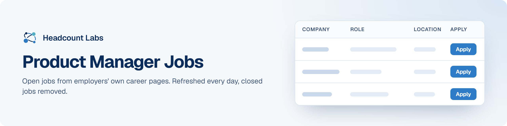

# Product Manager Jobs

Product manager and product owner jobs at US employers.

**400 open jobs** · 388 new since the last update · 4 removed because they closed or left the employer's board · updated November 9, 2026 at 4:48 AM EST

This list is built and refreshed every day by [Headcount Labs](https://headcountlabs.com/?utm_source=github&utm_medium=job-list&utm_campaign=product-manager-jobs), which reads jobs straight from employers' own career pages and job boards. Every job here was still listed on its source board when we last read that board, within the past 3 days, and was posted in the past 30 days. Copies of the same job are merged into one row, and jobs that close are removed at the next update.

Want this data in your own app or agent? Use the [Headcount Labs jobs API](https://headcountlabs.com/docs/?utm_source=github&utm_medium=job-list&utm_campaign=product-manager-jobs) (free tier), the [MCP server](https://headcountlabs.com/mcp/?utm_source=github&utm_medium=job-list&utm_campaign=product-manager-jobs) for Claude, ChatGPT and other AI assistants, or the [public dataset subsets](https://huggingface.co/HeadcountLabs) on Hugging Face (the full dataset is coming soon).

**Jump to:** [Posted in the last 7 days (265)](#posted-in-the-last-7-days) · [Posted 8 to 30 days ago (135)](#posted-8-to-30-days-ago)

**Columns.** *Apply* opens the original posting on the employer's site. *Details* opens the job on Headcount Labs, with every posting we found for it. *Remote* shows what the employer states; a dash means the posting doesn't say. *Pay* is the range the employer published.

## Posted in the last 7 days

| Company | Role | Location | Remote | Pay | Posted | Apply | Details |
| --- | --- | --- | --- | --- | --- | :---: | :---: |
| **Trillium Flow Technologies** | Product Manager - Roto-Jet | Houston, TX | — | $125k–$140k/yr | Nov 9 |  | <a href="https://headcountlabs.com/catalog/jobs/04a8e203-ef7c-4814-96cb-3eeb134a02b0?utm_source=github&utm_medium=job-list&utm_campaign=product-manager-jobs">via Headcount Labs</a> |
| **Sonova Group** | Senior Product Manager, Digital Solutions | 

3 locations
Valencia (CA) Valencia city
 | Hybrid | $132k–$150k/yr | Nov 9 |  | <a href="https://headcountlabs.com/catalog/jobs/e11f7ebb-aaf2-482b-bd30-a5c00b7fec39?utm_source=github&utm_medium=job-list&utm_campaign=product-manager-jobs">via Headcount Labs</a> |
| **LED FastStart** | Product Manager Insurance Services | New Orleans, LA | — | — | Nov 8 |  | <a href="https://headcountlabs.com/catalog/jobs/a229c53f-0f19-4a55-9c3c-a507c234eaf4?utm_source=github&utm_medium=job-list&utm_campaign=product-manager-jobs">via Headcount Labs</a> |
| **LED FastStart** | Product Manager, Insurance SaaS Platform | New Orleans, LA | — | — | Nov 8 |  | <a href="https://headcountlabs.com/catalog/jobs/16a61dc0-cd63-4fa4-90dd-9943054ffa33?utm_source=github&utm_medium=job-list&utm_campaign=product-manager-jobs">via Headcount Labs</a> |
| **Auto Club Of Southern Calif** | Product Manager | Costa Mesa, CA | On-site | $120k–$161k/yr | Nov 8 |  | <a href="https://headcountlabs.com/catalog/jobs/747ea802-839b-492d-95bb-1f34be35b40c?utm_source=github&utm_medium=job-list&utm_campaign=product-manager-jobs">via Headcount Labs</a> |
| **Valon Tech** | Senior Product Manager, Product Infrastructure | 

2 locations
New York, NY San Francisco, CA
 | Hybrid | $200k–$235k/yr | Nov 7 |  | <a href="https://headcountlabs.com/catalog/jobs/64eaf514-0adb-4cb7-a555-7e9c1ef7c642?utm_source=github&utm_medium=job-list&utm_campaign=product-manager-jobs">via Headcount Labs</a> |
| **Uber Freight** | Product Manager | 

2 locations
Chicago San Francisco
 | Hybrid | — | Nov 7 |  | <a href="https://headcountlabs.com/catalog/jobs/78285d68-7a3d-4f09-b6c8-891d7782b196?utm_source=github&utm_medium=job-list&utm_campaign=product-manager-jobs">via Headcount Labs</a> |
| **True Talent Solutions Partners** | Forward Deployed Product Manager | 

2 locations
New York, NY San Francisco, CA
 | On-site | — | Nov 7 |  | <a href="https://headcountlabs.com/catalog/jobs/f26f93b5-371a-42a3-bf3a-ef616b101d10?utm_source=github&utm_medium=job-list&utm_campaign=product-manager-jobs">via Headcount Labs</a> |
| **True Talent Solutions Partners** | Staff Product Manager | New York, NY | On-site | — | Nov 7 |  | <a href="https://headcountlabs.com/catalog/jobs/a7c6f990-ecf4-4744-aae0-eefea9171559?utm_source=github&utm_medium=job-list&utm_campaign=product-manager-jobs">via Headcount Labs</a> |
| **Sunday Robotics** | Product Manager, HRI (Human Robot Interaction) | Redwood City, CA | On-site | $180k–$250k/yr | Nov 7 |  | <a href="https://headcountlabs.com/catalog/jobs/9fdbaf2b-3867-40c8-ac34-3dd1c6d3b601?utm_source=github&utm_medium=job-list&utm_campaign=product-manager-jobs">via Headcount Labs</a> |
| **Sunday Robotics** | Product Manager, Trust &amp; Safety | Redwood City, CA | On-site | $180k–$250k/yr | Nov 7 |  | <a href="https://headcountlabs.com/catalog/jobs/3f1bdeb2-2396-4b46-9e89-a8777dc5c2d6?utm_source=github&utm_medium=job-list&utm_campaign=product-manager-jobs">via Headcount Labs</a> |
| **Snowflake** | Senior Product Manager: Extensible Compute | 

2 locations
US-CA-Menlo Park US-WA-Bellevue
 | Hybrid | $200k–$288k/yr | Nov 7 |  | <a href="https://headcountlabs.com/catalog/jobs/7cc400e5-aba5-4607-bdb0-1f27e57806bc?utm_source=github&utm_medium=job-list&utm_campaign=product-manager-jobs">via Headcount Labs</a> |
| **Outschool** | Senior Product Manager | United States | Remote | — | Nov 7 |  | <a href="https://headcountlabs.com/catalog/jobs/d8da7e6f-c581-4279-973c-d15178ee237a?utm_source=github&utm_medium=job-list&utm_campaign=product-manager-jobs">via Headcount Labs</a> |
| **Numa** | Product Manager | United States | — | $150k–$220k/yr | Nov 7 |  | <a href="https://headcountlabs.com/catalog/jobs/e5d77df8-2437-4f2a-a047-54654810d709?utm_source=github&utm_medium=job-list&utm_campaign=product-manager-jobs">via Headcount Labs</a> |
| **Imprint** | Lead Product Manager, Agentic Commerce | 

2 locations
San Francisco, CA New York City, NY
 | Hybrid | $190k–$210k/yr | Nov 7 |  | <a href="https://headcountlabs.com/catalog/jobs/8cc29994-cf2a-42de-8718-75fb69c4b299?utm_source=github&utm_medium=job-list&utm_campaign=product-manager-jobs">via Headcount Labs</a> |
| **Hanley Wood** | Product Manager, Visual Lease &amp; CoStar Real Estate Manager | Atlanta, GA | On-site | $94k–$126k/yr | Nov 7 |  | <a href="https://headcountlabs.com/catalog/jobs/f3850331-de8d-434d-b8e1-4938840e95cb?utm_source=github&utm_medium=job-list&utm_campaign=product-manager-jobs">via Headcount Labs</a> |
| **Hanley Wood** | Senior Product Manager, AI Products, Visual Lease &amp; CoStar Real Estate Manager | Atlanta, GA | On-site | $119k–$161k/yr | Nov 7 |  | <a href="https://headcountlabs.com/catalog/jobs/df5f8eff-8c72-48bf-971c-bea1ebf25666?utm_source=github&utm_medium=job-list&utm_campaign=product-manager-jobs">via Headcount Labs</a> |
| **Hanley Wood** | Principal Product Manager, Underwriting Specialist, CoStar Debt Solutions | Boston, MA | On-site | $152k–$206k/yr | Nov 7 |  | <a href="https://headcountlabs.com/catalog/jobs/ced2cf6d-1237-424f-a3d1-135e94d80478?utm_source=github&utm_medium=job-list&utm_campaign=product-manager-jobs">via Headcount Labs</a> |
| **Hanley Wood** | Associate Product Manager - Sunnyvale, CA | Sunnyvale, CA | On-site | $86k–$104k/yr | Nov 7 |  | <a href="https://headcountlabs.com/catalog/jobs/ae5de9ef-7973-437c-8be4-8ecaa58a6376?utm_source=github&utm_medium=job-list&utm_campaign=product-manager-jobs">via Headcount Labs</a> |
| **Hanley Wood** | Senior Product Manager, Owners &amp; Funds | Richmond, VA | On-site | $107k–$181k/yr | Nov 7 |  | <a href="https://headcountlabs.com/catalog/jobs/5e1f8ca1-58b2-4579-a75b-73ae085ec5f2?utm_source=github&utm_medium=job-list&utm_campaign=product-manager-jobs">via Headcount Labs</a> |
| **HALO INVESTING INC.** | Product Manager/Execution Domain | Chicago, IL | — | $85k–$120k/yr | Nov 7 |  | <a href="https://headcountlabs.com/catalog/jobs/8877354e-000a-46b8-9017-7a74137080be?utm_source=github&utm_medium=job-list&utm_campaign=product-manager-jobs">via Headcount Labs</a> |
| **Faire** | Staff Product Manager, Retailer &amp; App Experience | San Francisco, CA | On-site | $220k–$302k/yr | Nov 7 |  | <a href="https://headcountlabs.com/catalog/jobs/f9847162-b00b-468f-a56c-f0c3d0d7f216?utm_source=github&utm_medium=job-list&utm_campaign=product-manager-jobs">via Headcount Labs</a> |
| **Clera** | Senior Product Manager, Banking | New York, NY | Remote | — | Nov 7 |  | <a href="https://headcountlabs.com/catalog/jobs/82bad208-cc76-49f4-9d94-5ffebf00f519?utm_source=github&utm_medium=job-list&utm_campaign=product-manager-jobs">via Headcount Labs</a> |
| **Clera** | Senior Product Manager, SMB Platform | New York, NY | Remote | — | Nov 7 |  | <a href="https://headcountlabs.com/catalog/jobs/6cbb9b6c-c75e-4620-97e0-5af50efaa569?utm_source=github&utm_medium=job-list&utm_campaign=product-manager-jobs">via Headcount Labs</a> |
| **York Space Systems** | Product Manager | Greenwood Village, CO | Hybrid | — | Nov 6 |  | <a href="https://headcountlabs.com/catalog/jobs/bd4042c7-39f7-484b-81f9-4f61ac6c016f?utm_source=github&utm_medium=job-list&utm_campaign=product-manager-jobs">via Headcount Labs</a> |
| **WMC Wellington Management Company LLP** | Product Owner - Client Data &amp; Analytics | 

2 locations
Boston, MA London
 | — | — | Nov 6 |  | <a href="https://headcountlabs.com/catalog/jobs/f24b2f3a-184f-4e8e-b5b6-450baa97c85a?utm_source=github&utm_medium=job-list&utm_campaign=product-manager-jobs">via Headcount Labs</a> |
| **WMC Wellington Management Company LLP** | Product Owner - Client Onboarding &amp; Servicing | 

2 locations
Boston, MA London
 | — | — | Nov 6 |  | <a href="https://headcountlabs.com/catalog/jobs/39a57acd-4950-4bd2-9ec6-70a7d3f1c49b?utm_source=github&utm_medium=job-list&utm_campaign=product-manager-jobs">via Headcount Labs</a> |
| **Versant** | Software Product Manager | Carlsbad, CA | — | $130k–$151k/yr | Nov 6 |  | <a href="https://headcountlabs.com/catalog/jobs/af6d2e4e-9367-4d0a-a689-00d22b3d9f9f?utm_source=github&utm_medium=job-list&utm_campaign=product-manager-jobs">via Headcount Labs</a> |
| **VEHLO** | Product Manager | Knoxville, TN | Remote | — | Nov 6 |  | <a href="https://headcountlabs.com/catalog/jobs/79b79413-d388-4a41-b056-ff9a6e6f329f?utm_source=github&utm_medium=job-list&utm_campaign=product-manager-jobs">via Headcount Labs</a> |
| **United Airlines** | Product Manager - IT Metrics &amp; Governance | Chicago, IL | Hybrid | $112k–$147k/yr | Nov 6 |  | <a href="https://headcountlabs.com/catalog/jobs/59abfede-e0e1-49d4-802c-dbbe44335381?utm_source=github&utm_medium=job-list&utm_campaign=product-manager-jobs">via Headcount Labs</a> |
| **Twin Health** | Associate Product Manager, Nutrition | United States | Remote | $105k–$120k/yr | Nov 6 |  | <a href="https://headcountlabs.com/catalog/jobs/cd41c683-0fac-4e00-b4cd-99d6af4d9b89?utm_source=github&utm_medium=job-list&utm_campaign=product-manager-jobs">via Headcount Labs</a> |
| **True Talent Solutions Partners** | Technical Product Manager | 

2 locations
New York, NY Sunnyvale, CA
 | On-site | — | Nov 6 |  | <a href="https://headcountlabs.com/catalog/jobs/643a6ba5-858f-44b4-a93e-dc5158106042?utm_source=github&utm_medium=job-list&utm_campaign=product-manager-jobs">via Headcount Labs</a> |
| **True Talent Solutions Partners** | Product Manager, Product Growth | United States | On-site | — | Nov 6 |  | <a href="https://headcountlabs.com/catalog/jobs/bf1f521a-5d4d-4216-bba8-05e0319a64c1?utm_source=github&utm_medium=job-list&utm_campaign=product-manager-jobs">via Headcount Labs</a> |
| **True Talent Solutions Partners** | Staff Product Manager, AI | Palo Alto, CA | On-site | — | Nov 6 |  | <a href="https://headcountlabs.com/catalog/jobs/49a40879-8212-4af7-a805-99c53a802657?utm_source=github&utm_medium=job-list&utm_campaign=product-manager-jobs">via Headcount Labs</a> |
| **True Talent Solutions Partners** | Product Manager, Supply Chain | Los Angeles, CA | On-site | — | Nov 6 |  | <a href="https://headcountlabs.com/catalog/jobs/339c9ddc-d34e-4c9a-a658-1882dd959408?utm_source=github&utm_medium=job-list&utm_campaign=product-manager-jobs">via Headcount Labs</a> |
| **trane technologies** | Product Manager - TCDC Fan Coil Wall Data Centers | 

2 locations
Columbia, SC Davidson, NC
 | — | — | Nov 6 |  | <a href="https://headcountlabs.com/catalog/jobs/f7469e4e-1d4f-4d58-86d1-45dbc8d746e8?utm_source=github&utm_medium=job-list&utm_campaign=product-manager-jobs">via Headcount Labs</a> |
| **Tint** | Associate Product Manager | United States | Remote | $94k–$125k/yr | Nov 6 |  | <a href="https://headcountlabs.com/catalog/jobs/3bfb064e-25fd-4e87-b30a-f2bc01329493?utm_source=github&utm_medium=job-list&utm_campaign=product-manager-jobs">via Headcount Labs</a> |
| **TheGuarantors** | Sr. Product Manager | New York, NY | On-site | $190k–$215k/yr | Nov 6 |  | <a href="https://headcountlabs.com/catalog/jobs/f0d19e15-7262-4ab4-845d-6350c4f53c3f?utm_source=github&utm_medium=job-list&utm_campaign=product-manager-jobs">via Headcount Labs</a> |
| **The Northern Trust Company** | Senior Product Manager - Private Passport | Chicago, IL | — | $114k–$195k/yr | Nov 6 |  | <a href="https://headcountlabs.com/catalog/jobs/1007de5c-488c-4699-a1e1-b8ca6a7187dc?utm_source=github&utm_medium=job-list&utm_campaign=product-manager-jobs">via Headcount Labs</a> |
| **THE JAY GROUP INC** | Product Manager/Product Owner | Lancaster, PA | Hybrid | — | Nov 6 |  | <a href="https://headcountlabs.com/catalog/jobs/32ebd33c-f369-4428-9d4c-bc2966a91936?utm_source=github&utm_medium=job-list&utm_campaign=product-manager-jobs">via Headcount Labs</a> |
| **The Elevance Health Companies, Inc.** | Senior Product Manager | United States | — | — | Nov 6 |  | <a href="https://headcountlabs.com/catalog/jobs/122bbac5-65ae-46f0-89e5-8aa74332483c?utm_source=github&utm_medium=job-list&utm_campaign=product-manager-jobs">via Headcount Labs</a> |
| **TeamViewer Germany GmbH** | Product Manager, DEX Platform, MSP | Austin | Hybrid | — | Nov 6 |  | <a href="https://headcountlabs.com/catalog/jobs/ab2c7b21-d756-4ce3-8856-9095b314816b?utm_source=github&utm_medium=job-list&utm_campaign=product-manager-jobs">via Headcount Labs</a> |
| **StubHub** | Staff Product Manager - Personalization | 

3 locations
Aliso Viejo, CA New York, NY Los Angeles, CA
 | Hybrid | $270k–$325k/yr | Nov 6 |  | <a href="https://headcountlabs.com/catalog/jobs/ceed41ef-b67c-4564-9d19-b451ab253ea5?utm_source=github&utm_medium=job-list&utm_campaign=product-manager-jobs">via Headcount Labs</a> |
| **Sphera Solutions, Inc.** | Sr. AI Product Owner | United States | Remote | $127k–$203k/yr | Nov 6 |  | <a href="https://headcountlabs.com/catalog/jobs/a99242ff-0471-4029-9d95-00709d01b4a2?utm_source=github&utm_medium=job-list&utm_campaign=product-manager-jobs">via Headcount Labs</a> |
| **SOVRA** | Senior Product Manager | United States | Remote | — | Nov 6 |  | <a href="https://headcountlabs.com/catalog/jobs/fc3001e3-ddee-4e82-ba08-9c799a200c9a?utm_source=github&utm_medium=job-list&utm_campaign=product-manager-jobs">via Headcount Labs</a> |
| **SOVRA** | Principal Product Manager | United States | Remote | — | Nov 6 |  | <a href="https://headcountlabs.com/catalog/jobs/cda8f3bf-6beb-46b6-a91c-f1a3dc87d8d0?utm_source=github&utm_medium=job-list&utm_campaign=product-manager-jobs">via Headcount Labs</a> |
| **Snap Inc.** | Product Manager, Ad Tech | 

6 locations
Los Angeles, CA Bellevue, WA Chicago, IL New York, NY Palo Alto, CA San Francisco, CA
 | — | $209k–$313k/yr | Nov 6 |  | <a href="https://headcountlabs.com/catalog/jobs/98f588ac-396c-4074-8926-355c628511d3?utm_source=github&utm_medium=job-list&utm_campaign=product-manager-jobs">via Headcount Labs</a> |
| **Seaman Corporation** | Product Manager | Wooster, OH | Remote | — | Nov 6 |  | <a href="https://headcountlabs.com/catalog/jobs/7fac9072-9d11-4c1f-bb75-c736bed51404?utm_source=github&utm_medium=job-list&utm_campaign=product-manager-jobs">via Headcount Labs</a> |
| **Savvy Wealth** | Senior Product Manager | United States | Hybrid | $220k–$252k/yr | Nov 6 |  | <a href="https://headcountlabs.com/catalog/jobs/e98b90e6-59dc-4b7c-9570-5e2763fd65f8?utm_source=github&utm_medium=job-list&utm_campaign=product-manager-jobs">via Headcount Labs</a> |
| **Savvy Wealth** | Product Manager | United States | Hybrid | $170k–$200k/yr | Nov 6 |  | <a href="https://headcountlabs.com/catalog/jobs/e35b756b-9f61-4741-92cb-af48aabec735?utm_source=github&utm_medium=job-list&utm_campaign=product-manager-jobs">via Headcount Labs</a> |
| **Sage** | Product Manager - Lending &amp; Financial Services | 

2 locations
Austin, TX Atlanta, GA
 | Hybrid | — | Nov 6 |  | <a href="https://headcountlabs.com/catalog/jobs/7299d6ba-2381-474e-8f22-0def974c96c8?utm_source=github&utm_medium=job-list&utm_campaign=product-manager-jobs">via Headcount Labs</a> |
| **RVO Health** | Product Manager, Client Services | Charlotte, NC | Hybrid | $80k–$100k/yr | Nov 6 |  | <a href="https://headcountlabs.com/catalog/jobs/b734cd54-eec7-4dca-b185-7a63ab3411a3?utm_source=github&utm_medium=job-list&utm_campaign=product-manager-jobs">via Headcount Labs</a> |
| **Reddit** | Senior Product Manager, Finance Technology (Procure-to-Pay &amp; Record-to-Report) | United States | Remote | $168k–$234k/yr | Nov 6 |  | <a href="https://headcountlabs.com/catalog/jobs/a87f3ff6-54d4-4810-a74c-4d03f7f25347?utm_source=github&utm_medium=job-list&utm_campaign=product-manager-jobs">via Headcount Labs</a> |
| **Raydar** | Founding Product Manager | Boston, MA | Hybrid | — | Nov 6 |  | <a href="https://headcountlabs.com/catalog/jobs/aa55eafd-dc9b-4dba-9fb3-414a9b6a73b4?utm_source=github&utm_medium=job-list&utm_campaign=product-manager-jobs">via Headcount Labs</a> |
| **RADIANS INC** | PRODUCT MANAGER | MEMPHIS, TN | — | — | Nov 6 |  | <a href="https://headcountlabs.com/catalog/jobs/831691ca-b0de-44ea-9267-ee96104a8d4d?utm_source=github&utm_medium=job-list&utm_campaign=product-manager-jobs">via Headcount Labs</a> |
| **Qnity** | Digital Product Manager | Newark, DE | On-site | $79k–$124k/yr | Nov 6 |  | <a href="https://headcountlabs.com/catalog/jobs/0b89d3f0-d005-478f-8542-abbbf3053eba?utm_source=github&utm_medium=job-list&utm_campaign=product-manager-jobs">via Headcount Labs</a> |
| **PwC** | Lead Product Manager AI productivity and adoption, Azure | Orlando, FL | — | $99k–$232k/yr | Nov 6 |  | <a href="https://headcountlabs.com/catalog/jobs/51a7a52a-b634-4620-9e94-64b4f1c4f8ed?utm_source=github&utm_medium=job-list&utm_campaign=product-manager-jobs">via Headcount Labs</a> |
| **Pride Mobility &amp; Quantum Rehab** | Junior Product Manager - Quantum | Duryea, PA | On-site | $56k/yr | Nov 6 |  | <a href="https://headcountlabs.com/catalog/jobs/0a542b5e-db8a-4d59-a436-8d178e0087d2?utm_source=github&utm_medium=job-list&utm_campaign=product-manager-jobs">via Headcount Labs</a> |
| **Preferred Mortgage Services** | Product Manager | Henderson, NV | On-site | — | Nov 6 |  | <a href="https://headcountlabs.com/catalog/jobs/05afeae4-1b2f-4552-ba3e-839089c90d28?utm_source=github&utm_medium=job-list&utm_campaign=product-manager-jobs">via Headcount Labs</a> |
| **PiovanGroup North America** | Product Manager, Size Reduction | Cranberry Township, PA | — | — | Nov 6 |  | <a href="https://headcountlabs.com/catalog/jobs/e925287b-8579-479b-b86d-cb07edb5fe05?utm_source=github&utm_medium=job-list&utm_campaign=product-manager-jobs">via Headcount Labs</a> |
| **NVIDIA USA** | Senior Product Manager, Agent Optimization | Santa Clara, CA | Remote | $208k–$328k/yr | Nov 6 |  | <a href="https://headcountlabs.com/catalog/jobs/78fc901a-1fdb-45c2-b4fd-e75b9a1a7b59?utm_source=github&utm_medium=job-list&utm_campaign=product-manager-jobs">via Headcount Labs</a> |
| **Nuveen Services LLC** | VP, Wealth Alternatives Product Manager | 

2 locations
Charlotte, NC New York, NY
 | Hybrid | $136k–$217k/yr | Nov 6 |  | <a href="https://headcountlabs.com/catalog/jobs/71b15a4e-e1f8-46f9-a1a8-13c756526fb7?utm_source=github&utm_medium=job-list&utm_campaign=product-manager-jobs">via Headcount Labs</a> |
| **NBH Bank** | Business Channel Strategy &amp; Product - Product Manager | Kansas City, MO | On-site | — | Nov 6 |  | <a href="https://headcountlabs.com/catalog/jobs/9270bfa4-6e27-4a19-8902-96249ef9422d?utm_source=github&utm_medium=job-list&utm_campaign=product-manager-jobs">via Headcount Labs</a> |
| **Nature's Sunshine Products** | IT Product Manager | Lehi, UT | Hybrid | — | Nov 6 |  | <a href="https://headcountlabs.com/catalog/jobs/7dcaf7b5-6ea4-42e2-ab4e-3b1c83f36722?utm_source=github&utm_medium=job-list&utm_campaign=product-manager-jobs">via Headcount Labs</a> |
| **Nature's Sunshine Products** | Sr. IT Product Manager | Lehi, UT | — | — | Nov 6 |  | <a href="https://headcountlabs.com/catalog/jobs/7953db97-8ae9-4ba5-9b3f-45873b765aa5?utm_source=github&utm_medium=job-list&utm_campaign=product-manager-jobs">via Headcount Labs</a> |
| **Munich Re** | Digital Product Manager Client Lifecycle | Hartford, CT | — | — | Nov 6 |  | <a href="https://headcountlabs.com/catalog/jobs/ebd06b54-a719-4767-91f3-33d90e1782e5?utm_source=github&utm_medium=job-list&utm_campaign=product-manager-jobs">via Headcount Labs</a> |
| **Mount Sinai Kravis Children's Hospital** | Product Manager II - Data Strategy &amp; Solutions - Digital and Technology Partners - Hybrid/Onsite | United States | Hybrid | $132k–$198k/yr | Nov 6 |  | <a href="https://headcountlabs.com/catalog/jobs/51412863-0a3f-457a-b2d9-ff2487c433d2?utm_source=github&utm_medium=job-list&utm_campaign=product-manager-jobs">via Headcount Labs</a> |
| **MoneyGram** | Product Manager, Digital Money Transfer | United States | Remote | — | Nov 6 |  | <a href="https://headcountlabs.com/catalog/jobs/930d3e66-4778-4b99-913b-b6de1e867a0b?utm_source=github&utm_medium=job-list&utm_campaign=product-manager-jobs">via Headcount Labs</a> |
| **Modern Campus** | Product Manager (Contractor) | United States | Remote | — | Nov 6 |  | <a href="https://headcountlabs.com/catalog/jobs/e26b62d7-7d53-4716-8f71-9b642cf5799b?utm_source=github&utm_medium=job-list&utm_campaign=product-manager-jobs">via Headcount Labs</a> |
| **Mirum Pharmaceuticals** | Product Manager, Cholbam/Ctexli | Foster City, CA | Hybrid | $175k–$190k/yr | Nov 6 |  | <a href="https://headcountlabs.com/catalog/jobs/4bd35831-5a02-4fa7-a26a-53415c15ee6f?utm_source=github&utm_medium=job-list&utm_campaign=product-manager-jobs">via Headcount Labs</a> |
| **MetaPhase Consulting** | Product Manager | Reston, VA | On-site | $150k–$175k/yr | Nov 6 |  | <a href="https://headcountlabs.com/catalog/jobs/ed165d80-8521-451a-9567-6255ff0eafc1?utm_source=github&utm_medium=job-list&utm_campaign=product-manager-jobs">via Headcount Labs</a> |
| **MaintainX (An Autodesk Company)** | Lead Product Manager, Enterprise Data Model | San Francisco, CA | Hybrid | $182k–$266k/yr | Nov 6 |  | <a href="https://headcountlabs.com/catalog/jobs/43245afd-0fe8-467d-aa20-26a627d7d94d?utm_source=github&utm_medium=job-list&utm_campaign=product-manager-jobs">via Headcount Labs</a> |
| **Livetrends Design Group LLC** | Home Decor Product Manager | Apopka, FL | — | — | Nov 6 |  | <a href="https://headcountlabs.com/catalog/jobs/51ffce0e-4608-463a-b210-8d5f855826a9?utm_source=github&utm_medium=job-list&utm_campaign=product-manager-jobs">via Headcount Labs</a> |
| **L3HHCM20** | Government Compliance Specialist - Product Owner | Salt Lake City, UT | — | — | Nov 6 |  | <a href="https://headcountlabs.com/catalog/jobs/4747fac8-1f56-4173-a73c-f487a4192ae2?utm_source=github&utm_medium=job-list&utm_campaign=product-manager-jobs">via Headcount Labs</a> |
| **Korterra Inc** | Product Manager | Chanhassen, MN | — | $100k–$130k/yr | Nov 6 |  | <a href="https://headcountlabs.com/catalog/jobs/5186b078-e51b-45ae-8456-d41da27ece82?utm_source=github&utm_medium=job-list&utm_campaign=product-manager-jobs">via Headcount Labs</a> |
| **Junction** | Product Manager, Clinical Data &amp; Workflows | EDT / EST (US East Coast only) | Remote | $190k–$240k/yr | Nov 6 |  | <a href="https://headcountlabs.com/catalog/jobs/4b675837-2f31-46ff-ba63-4d091a902cea?utm_source=github&utm_medium=job-list&utm_campaign=product-manager-jobs">via Headcount Labs</a> |
| **Junction** | Product Manager, Patient Access &amp; Fulfilment | EDT / EST (US East Coast only) | Remote | $190k–$240k/yr | Nov 6 |  | <a href="https://headcountlabs.com/catalog/jobs/2e6f3953-4431-4639-856d-5b20eb53c862?utm_source=github&utm_medium=job-list&utm_campaign=product-manager-jobs">via Headcount Labs</a> |
| **JPMC** | Business Banking Deposits - Product Manager, Vice President | 

3 locations
Plano, TX New York, NY Columbus, OH
 | On-site | $110k–$160k/yr | Nov 6 |  | <a href="https://headcountlabs.com/catalog/jobs/6525b896-11d7-4494-aa40-4a15a3015629?utm_source=github&utm_medium=job-list&utm_campaign=product-manager-jobs">via Headcount Labs</a> |
| **JPMC** | Product Manager, Card Servicing and Partner Services | Wilmington, DE | On-site | — | Nov 6 |  | <a href="https://headcountlabs.com/catalog/jobs/7b81d4a5-b4d2-4425-a8ff-2f846d737911?utm_source=github&utm_medium=job-list&utm_campaign=product-manager-jobs">via Headcount Labs</a> |
| **JPMC** | Vice President, Product Manager - Asset Management Client Service Experience - Service Assist (AI Builder) | New York, NY | On-site | $133k–$215k/yr | Nov 6 |  | <a href="https://headcountlabs.com/catalog/jobs/512afe68-e60a-4ded-9ec5-ecb6659fbea3?utm_source=github&utm_medium=job-list&utm_campaign=product-manager-jobs">via Headcount Labs</a> |
| **Integral Ad Science, Inc.** | Senior Staff Product Manager | 

2 locations
New York, NY Toronto
 | Hybrid | $155k–$265k/yr | Nov 6 |  | <a href="https://headcountlabs.com/catalog/jobs/0b06d798-3a52-474e-9597-78cb840f3c9d?utm_source=github&utm_medium=job-list&utm_campaign=product-manager-jobs">via Headcount Labs</a> |
| **Hipcamp Inc.** | Sr. Product Manager | United States | Remote | — | Nov 6 |  | <a href="https://headcountlabs.com/catalog/jobs/4513dcb2-f753-4977-9b0e-68611ab539c1?utm_source=github&utm_medium=job-list&utm_campaign=product-manager-jobs">via Headcount Labs</a> |
| **Hi Marley** | Sr. Product Manager, AI Products | Boston, MA | Hybrid | $130k–$205k/yr | Nov 6 |  | <a href="https://headcountlabs.com/catalog/jobs/942483d1-c534-442f-ada3-af4e83e67260?utm_source=github&utm_medium=job-list&utm_campaign=product-manager-jobs">via Headcount Labs</a> |
| **HarbourVest Partners, LLC** | Senior Associate, Salesforce Product Owner, Client Services | Boston | Hybrid | $130k–$150k/yr | Nov 6 |  | <a href="https://headcountlabs.com/catalog/jobs/b3884680-5c6e-4306-9ec5-5320f2d806cc?utm_source=github&utm_medium=job-list&utm_campaign=product-manager-jobs">via Headcount Labs</a> |
| **Hagerty Management, LLC** | Senior Product Manager of Insurance Compliance | United States | Remote | — | Nov 6 |  | <a href="https://headcountlabs.com/catalog/jobs/333c8696-2e73-475f-940a-94c4ed4ad708?utm_source=github&utm_medium=job-list&utm_campaign=product-manager-jobs">via Headcount Labs</a> |
| **Globality, Inc.** | Data Product Manager | Palo Alto, CA | Hybrid | $150k–$250k/yr | Nov 6 |  | <a href="https://headcountlabs.com/catalog/jobs/5ba60d76-5b77-44d0-909a-c1845d429240?utm_source=github&utm_medium=job-list&utm_campaign=product-manager-jobs">via Headcount Labs</a> |
| **GE Aerospace** | Principal Aftermarket Technical Product Manager | 

75 locations
E Cleveland, OH Indianapolis, IN Dover, DE Minnetonka, MN Bismarck, ND Baltimore, MD West Melbourne, FL Jackson, MS Oklahoma City, OK Honolulu, HI Auburn, ME Tampa, FL +63 more
 | Remote | $152k–$202k/yr | Nov 6 |  | <a href="https://headcountlabs.com/catalog/jobs/8d16159a-7021-49bc-8705-b822eb732c3e?utm_source=github&utm_medium=job-list&utm_campaign=product-manager-jobs">via Headcount Labs</a> |
| **Future Works** | Senior AI Product Manager (CRE) | 

2 locations
United States New York, NY
 | Remote | — | Nov 6 |  | <a href="https://headcountlabs.com/catalog/jobs/1662ecaf-45d3-40ca-8b4e-180ea4f81b58?utm_source=github&utm_medium=job-list&utm_campaign=product-manager-jobs">via Headcount Labs</a> |
| **Fiserv** | Sr. Product Manager, Restaurants (KDS) | Sunnyvale, CA | — | $134k–$218k/yr | Nov 6 |  | <a href="https://headcountlabs.com/catalog/jobs/f64c11dd-e905-411a-831a-1c75bc09784c?utm_source=github&utm_medium=job-list&utm_campaign=product-manager-jobs">via Headcount Labs</a> |
| **Faire** | Staff Product Manager, Brand Success | 

2 locations
New York City, NY San Francisco, CA
 | On-site | — | Nov 6 |  | <a href="https://headcountlabs.com/catalog/jobs/d1f868c9-2f24-4ff1-977b-97053ea2863c?utm_source=github&utm_medium=job-list&utm_campaign=product-manager-jobs">via Headcount Labs</a> |
| **Etsy, Inc.** | Senior Staff Product Manager, Agentic Platform | Brooklyn, NY | Hybrid | $226k–$306k/yr | Nov 6 |  | <a href="https://headcountlabs.com/catalog/jobs/61a7d93c-a0c0-4916-93ce-7588f0dc1962?utm_source=github&utm_medium=job-list&utm_campaign=product-manager-jobs">via Headcount Labs</a> |
| **Equip Health** | Senior Product Manager, Patient Engagement &amp; AI | United States | Remote | $158k–$175k/yr | Nov 6 |  | <a href="https://headcountlabs.com/catalog/jobs/2770c5d9-a540-444b-80b7-8c9f9558240d?utm_source=github&utm_medium=job-list&utm_campaign=product-manager-jobs">via Headcount Labs</a> |
| **ELLIPSIS HEALTH, INC.** | Senior Product Manager | 

2 locations
New York, NY San Francisco, CA
 | Hybrid | $150k–$190k/yr | Nov 6 |  | <a href="https://headcountlabs.com/catalog/jobs/5913ded5-ae8d-4bcf-993e-8fe8008db174?utm_source=github&utm_medium=job-list&utm_campaign=product-manager-jobs">via Headcount Labs</a> |
| **Dynetics, Inc** | Senior Software Product Owner (Agile SAFe) | Huntsville, AL | — | $131k–$237k/yr | Nov 6 |  | <a href="https://headcountlabs.com/catalog/jobs/29b16508-c9a4-497d-8623-b9bba49453aa?utm_source=github&utm_medium=job-list&utm_campaign=product-manager-jobs">via Headcount Labs</a> |
| **DiliTrust** | Product Manager, US Market | 

2 locations
Wilmington, DE Dover
 | Hybrid | — | Nov 6 |  | <a href="https://headcountlabs.com/catalog/jobs/c1a3dbfb-ad2a-4367-9596-6afef5359e91?utm_source=github&utm_medium=job-list&utm_campaign=product-manager-jobs">via Headcount Labs</a> |
| **Datavant** | Sr. Product Manager, L&amp;I | United States | Remote | $170k–$200k/yr | Nov 6 |  | <a href="https://headcountlabs.com/catalog/jobs/3ce0de59-c5f8-4fea-934c-5b7bf377e4b8?utm_source=github&utm_medium=job-list&utm_campaign=product-manager-jobs">via Headcount Labs</a> |
| **DAT** | Technical Product Manager | Seattle, WA | — | $138k–$185k/yr | Nov 6 |  | <a href="https://headcountlabs.com/catalog/jobs/6bd16c66-d386-40ed-86cf-8bb61c29c7f2?utm_source=github&utm_medium=job-list&utm_campaign=product-manager-jobs">via Headcount Labs</a> |
| **Danaher** | Sr. Software Product Manager, NGS | 

10 locations
Boulder, CO Coralville, IA Denver, CO Englewood, CO Fort Collins, CO Golden, CO Loveland, CO Niwot, CO San Diego, CA Sunnyvale, CA
 | On-site | — | Nov 6 |  | <a href="https://headcountlabs.com/catalog/jobs/32477c32-67a5-442a-85b4-a011beac5d3f?utm_source=github&utm_medium=job-list&utm_campaign=product-manager-jobs">via Headcount Labs</a> |
| **Copeland Cold Chain LP** | Senior Hardware Product Manager | 

4 locations
Saint Louis, MO Boise, ID Kennesaw, GA Sidney, OH
 | Hybrid | — | Nov 6 |  | <a href="https://headcountlabs.com/catalog/jobs/68dc9b22-cdce-4079-a055-5297e79da02a?utm_source=github&utm_medium=job-list&utm_campaign=product-manager-jobs">via Headcount Labs</a> |
| **Computer Services, Inc.** | Senior Technical Product Owner– Retail Performance Engine | United States | Remote | — | Nov 6 |  | <a href="https://headcountlabs.com/catalog/jobs/65a31f08-b574-46f7-9866-424d0bbf42b9?utm_source=github&utm_medium=job-list&utm_campaign=product-manager-jobs">via Headcount Labs</a> |
| **Commerce Bank** | Product Manager - Wealth Management | Kansas City, MO | — | $93k–$124k/yr | Nov 6 |  | <a href="https://headcountlabs.com/catalog/jobs/dbce4171-1ddd-47cc-a2a8-dcf7288664b6?utm_source=github&utm_medium=job-list&utm_campaign=product-manager-jobs">via Headcount Labs</a> |
| **Collibra** | Staff Product Manager | New York, NY | Hybrid | $204k–$255k/yr | Nov 6 |  | <a href="https://headcountlabs.com/catalog/jobs/b2a09d62-d211-4df3-9f5a-10b567851b9d?utm_source=github&utm_medium=job-list&utm_campaign=product-manager-jobs">via Headcount Labs</a> |
| **Coinbase** | Group Product Manager, AI Foundations | United States | Remote | $244k–$287k/yr | Nov 6 |  | <a href="https://headcountlabs.com/catalog/jobs/ab4d31b0-3801-4ae9-8ea7-2d0e833b6769?utm_source=github&utm_medium=job-list&utm_campaign=product-manager-jobs">via Headcount Labs</a> |
| **Coinbase** | Product Manager II | United States | Remote | $149k–$172k/yr | Nov 6 |  | <a href="https://headcountlabs.com/catalog/jobs/bfbf4200-7969-4cc2-bc79-2e4ff790ed78?utm_source=github&utm_medium=job-list&utm_campaign=product-manager-jobs">via Headcount Labs</a> |
| **Coinbase** | Senior Product Manager | United States | Remote | $207k–$244k/yr | Nov 6 |  | <a href="https://headcountlabs.com/catalog/jobs/8e48a4ea-a80d-4516-b3d4-dc75a55f1f2c?utm_source=github&utm_medium=job-list&utm_campaign=product-manager-jobs">via Headcount Labs</a> |
| **Chewy** | Senior Product Manager | 

2 locations
Bellevue, WA Plantation, FL
 | — | $141k–$225k/yr | Nov 6 |  | <a href="https://headcountlabs.com/catalog/jobs/7114f6a3-afc0-458a-a957-1823a5bb4c88?utm_source=github&utm_medium=job-list&utm_campaign=product-manager-jobs">via Headcount Labs</a> |
| **Chewy** | Senior Technical Product Manager | Boston, MA | — | $141k–$225k/yr | Nov 6 |  | <a href="https://headcountlabs.com/catalog/jobs/054aaf98-5581-41cc-9399-897d9ec7a0c3?utm_source=github&utm_medium=job-list&utm_campaign=product-manager-jobs">via Headcount Labs</a> |
| **Charlie Health** | Senior/Staff Product Manager, Client | New York, NY | Hybrid | $125k–$225k/yr | Nov 6 |  | <a href="https://headcountlabs.com/catalog/jobs/e0b74c24-1166-4fd7-882a-51684e83cb4b?utm_source=github&utm_medium=job-list&utm_campaign=product-manager-jobs">via Headcount Labs</a> |
| **Caris MPI, Inc.** | Liquid Product Manager - Indiana-Michigan | United States | Remote | $150k–$180k/yr | Nov 6 |  | <a href="https://headcountlabs.com/catalog/jobs/70d26fb2-c79c-4230-b52a-b5aa8a46c06e?utm_source=github&utm_medium=job-list&utm_campaign=product-manager-jobs">via Headcount Labs</a> |
| **Capital One** | Senior Manager, Cyber Security (IAM Product Manager) | San Jose, CA | Hybrid | $251k–$286k/yr | Nov 6 |  | <a href="https://headcountlabs.com/catalog/jobs/eeb2423b-fefb-4584-a1d7-536a78d483fe?utm_source=github&utm_medium=job-list&utm_campaign=product-manager-jobs">via Headcount Labs</a> |
| **Building Automation Products Inc** | TECHNICAL PRODUCT MANAGER | Gays Mills, WI | — | — | Nov 6 |  | <a href="https://headcountlabs.com/catalog/jobs/5a944efe-d2b3-4958-9941-ee0cd0730dde?utm_source=github&utm_medium=job-list&utm_campaign=product-manager-jobs">via Headcount Labs</a> |
| **Book of the Month** | Technical Product Manager, Order Management and Renewal Systems | New York, NY | On-site | $100k–$165k/yr | Nov 6 |  | <a href="https://headcountlabs.com/catalog/jobs/bd867cb6-d38c-4d8c-af00-d749bf40fde5?utm_source=github&utm_medium=job-list&utm_campaign=product-manager-jobs">via Headcount Labs</a> |
| **BlueLinx Corporation** | Product Manager - Engineered Wood Products | 

2 locations
Blasdell, NY Buffalo, NY
 | On-site | — | Nov 6 |  | <a href="https://headcountlabs.com/catalog/jobs/e330c133-eddf-4072-9177-d25fea5d6873?utm_source=github&utm_medium=job-list&utm_campaign=product-manager-jobs">via Headcount Labs</a> |
| **Autodesk** | Principal Product Manager, Applied AI &amp; Data Science | 

2 locations
Portland, OR San Francisco, CA
 | — | $124k–$222k/yr | Nov 6 |  | <a href="https://headcountlabs.com/catalog/jobs/ee6496fb-663e-4deb-91d7-7ccf63fb4476?utm_source=github&utm_medium=job-list&utm_campaign=product-manager-jobs">via Headcount Labs</a> |
| **ASSA ABLOY** | Product Manager | 

3 locations
Monroe, NC Charlotte, NC Tallahassee, FL
 | — | — | Nov 6 |  | <a href="https://headcountlabs.com/catalog/jobs/581ab81e-644c-4c16-aa1c-2e085e75458b?utm_source=github&utm_medium=job-list&utm_campaign=product-manager-jobs">via Headcount Labs</a> |
| **Arizona State University** | Principal Product Manager | United States | — | $104k–$125k/yr | Nov 6 |  | <a href="https://headcountlabs.com/catalog/jobs/aa129dd3-215d-48f4-976a-1730235daf8e?utm_source=github&utm_medium=job-list&utm_campaign=product-manager-jobs">via Headcount Labs</a> |
| **AREA 17** | Freelance Product Manager (US) | United States | — | — | Nov 6 |  | <a href="https://headcountlabs.com/catalog/jobs/882b4e4e-2eb5-4a3f-b96c-e7e981b1fc33?utm_source=github&utm_medium=job-list&utm_campaign=product-manager-jobs">via Headcount Labs</a> |
| **Ametek, Inc.** | Product Manager - Strategic Market Segment Leader | Waterbury, CT | — | — | Nov 6 |  | <a href="https://headcountlabs.com/catalog/jobs/ba2342a2-adef-47ff-bca4-3eb41f2cf1ca?utm_source=github&utm_medium=job-list&utm_campaign=product-manager-jobs">via Headcount Labs</a> |
| **Acer Group** | Product Manager - AI PC Commercial | San Jose, CA | — | — | Nov 6 |  | <a href="https://headcountlabs.com/catalog/jobs/2633fb5e-29f2-462b-81ae-5c95db72df66?utm_source=github&utm_medium=job-list&utm_campaign=product-manager-jobs">via Headcount Labs</a> |
| **003 Humana Inc.** | Senior Insurance Product Manager | United States | Remote | $86k–$119k/yr | Nov 6 |  | <a href="https://headcountlabs.com/catalog/jobs/af466692-20ce-4269-b3a8-5b8a7f61e07e?utm_source=github&utm_medium=job-list&utm_campaign=product-manager-jobs">via Headcount Labs</a> |
| **WEX Health, Inc.** | Product Manager (Healthcare Payments &amp; HSA/FSA) | 

2 locations
Maine United States
 | Remote | $90k–$120k/yr | Nov 5 |  | <a href="https://headcountlabs.com/catalog/jobs/5731da4d-a1d6-488d-b4f7-aa8f12d51047?utm_source=github&utm_medium=job-list&utm_campaign=product-manager-jobs">via Headcount Labs</a> |
| **Vesync** | Ecommerce Product Manager | Tustin, CA | On-site | — | Nov 5 |  | <a href="https://headcountlabs.com/catalog/jobs/6b891f21-c00e-4b0d-a2a6-7837e60f7094?utm_source=github&utm_medium=job-list&utm_campaign=product-manager-jobs">via Headcount Labs</a> |
| **Vertex, Inc.** | Senior Principal Product Manager – Audit AI | Pennsylvania | Remote | $192k–$249k/yr | Nov 5 |  | <a href="https://headcountlabs.com/catalog/jobs/1030ce08-678f-4f64-8486-39db71ae413c?utm_source=github&utm_medium=job-list&utm_campaign=product-manager-jobs">via Headcount Labs</a> |
| **USA018 Thomson Reuters Holdings Inc.** | Senior Product Manager, Data Platform | New York | Hybrid | $138k–$256k/yr | Nov 5 |  | <a href="https://headcountlabs.com/catalog/jobs/b22608da-1f5c-409b-9d27-f18e08f2cfc3?utm_source=github&utm_medium=job-list&utm_campaign=product-manager-jobs">via Headcount Labs</a> |
| **US003 CNMK Texas Properties, LLC.** | Sr. Product Manager | Plano, TX | — | — | Nov 5 |  | <a href="https://headcountlabs.com/catalog/jobs/7250624c-a6e4-4f05-9dcb-ce2929029c86?utm_source=github&utm_medium=job-list&utm_campaign=product-manager-jobs">via Headcount Labs</a> |
| **UMG Recordings Inc** | Senior Data Product Manager - Streaming and Social | 

2 locations
Santa Monica, CA New York, NY
 | — | $122k–$185k/yr | Nov 5 |  | <a href="https://headcountlabs.com/catalog/jobs/3561d881-4c79-4d29-955d-696be1534730?utm_source=github&utm_medium=job-list&utm_campaign=product-manager-jobs">via Headcount Labs</a> |
| **True Talent Solutions Partners** | Product Manager, AI Agents | San Francisco, CA | On-site | — | Nov 5 |  | <a href="https://headcountlabs.com/catalog/jobs/a11e76dd-99a2-46b3-a909-596b6b10dc58?utm_source=github&utm_medium=job-list&utm_campaign=product-manager-jobs">via Headcount Labs</a> |
| **trane technologies** | Senior Product Manager- Smart Services | 

3 locations
United States Davidson, NC St Paul, MN
 | — | — | Nov 5 |  | <a href="https://headcountlabs.com/catalog/jobs/b72c7ffe-84fb-4987-a220-d159cc6266b4?utm_source=github&utm_medium=job-list&utm_campaign=product-manager-jobs">via Headcount Labs</a> |
| **Titan Brands** | Product Manager – Tractor &amp; Skid Steer Attachments | Memphis, TN | — | — | Nov 5 |  | <a href="https://headcountlabs.com/catalog/jobs/51dc14d8-a134-489b-90e4-a5beca2b9728?utm_source=github&utm_medium=job-list&utm_campaign=product-manager-jobs">via Headcount Labs</a> |
| **The Coca-Cola Company** | RGM Product Manager | Atlanta, GA | — | — | Nov 5 |  | <a href="https://headcountlabs.com/catalog/jobs/c3a1a792-848f-4898-a5c6-c46cf9ab3c18?utm_source=github&utm_medium=job-list&utm_campaign=product-manager-jobs">via Headcount Labs</a> |
| **The Clorox Company** | Product Owner - Material Planning | 

19 locations
Rogers, AR Burnside, KY Alpharetta, GA Martinsburg, WV Morrisville, NC Aberdeen, MD Pleasanton, CA Summer Shade, KY Spring Hill, KS Belle, MO Durham, NC Fairfield, CA +7 more
 | Hybrid | $109k–$210k/yr | Nov 5 |  | <a href="https://headcountlabs.com/catalog/jobs/935aeee3-ca11-4e56-9e8e-02c565a89210?utm_source=github&utm_medium=job-list&utm_campaign=product-manager-jobs">via Headcount Labs</a> |
| **The Clorox Company** | Product Owner - Production Scheduling | 

21 locations
Morrisville, NC Oakland, CA Rogers, AR Fairfield, CA Reno, NV Spring Hill, KS Belle, MO Glen, MS Pleasanton, CA Aberdeen, MD Burnside, KY Alpharetta, GA +9 more
 | Hybrid | $109k–$210k/yr | Nov 5 |  | <a href="https://headcountlabs.com/catalog/jobs/4ff6fdb6-6a86-42ae-be2a-9be7df4b2362?utm_source=github&utm_medium=job-list&utm_campaign=product-manager-jobs">via Headcount Labs</a> |
| **TE Connectivity** | Global Product Manager | United States | — | $141k–$212k/yr | Nov 5 |  | <a href="https://headcountlabs.com/catalog/jobs/714a957c-7f18-4c02-b322-069f03048279?utm_source=github&utm_medium=job-list&utm_campaign=product-manager-jobs">via Headcount Labs</a> |
| **SunStrong Management, LLC** | Product Manager, Consumer &amp; Mobile Applications | Houston, TX | Remote | — | Nov 5 |  | <a href="https://headcountlabs.com/catalog/jobs/a9be660e-13d5-4b77-9df9-d69acf90afd5?utm_source=github&utm_medium=job-list&utm_campaign=product-manager-jobs">via Headcount Labs</a> |
| **SunStrong Management, LLC** | Sr. Product Manager, Fleet Telemetry | Houston, TX | Remote | — | Nov 5 |  | <a href="https://headcountlabs.com/catalog/jobs/6cbf25f0-171c-472a-8e15-7c1e8072c23f?utm_source=github&utm_medium=job-list&utm_campaign=product-manager-jobs">via Headcount Labs</a> |
| **StubHub** | Senior Product Manager- Consumer Experience | New York, NY | — | $194k–$270k/yr | Nov 5 |  | <a href="https://headcountlabs.com/catalog/jobs/d66d221f-a070-4a35-8c20-394f73c46562?utm_source=github&utm_medium=job-list&utm_campaign=product-manager-jobs">via Headcount Labs</a> |
| **South State Bank** | Product Owner | Winter Haven, FL | — | — | Nov 5 |  | <a href="https://headcountlabs.com/catalog/jobs/8b733b61-7aa3-4c58-b6d2-e591d78c3bea?utm_source=github&utm_medium=job-list&utm_campaign=product-manager-jobs">via Headcount Labs</a> |
| **Softpro, LLC** | Product Manager - Trust Accounting Team | Raleigh, NC | Hybrid | — | Nov 5 |  | <a href="https://headcountlabs.com/catalog/jobs/1ae65ade-270e-4c46-bbae-2b7bfc201f0f?utm_source=github&utm_medium=job-list&utm_campaign=product-manager-jobs">via Headcount Labs</a> |
| **Serve Robotics** | Senior Product Manager, Operations &amp; Commercialization | 

7 locations
United States Montreal Calgary Toronto Ottawa Surrey Vancouver
 | Remote | $165k–$195k/yr | Nov 5 |  | <a href="https://headcountlabs.com/catalog/jobs/8045e062-6010-4198-901f-724a89c046b1?utm_source=github&utm_medium=job-list&utm_campaign=product-manager-jobs">via Headcount Labs</a> |
| **RTX** | Radar Digital Product Line (RDPL) Product Owner | woburn, MA | On-site | $118k–$225k/yr | Nov 5 |  | <a href="https://headcountlabs.com/catalog/jobs/93564366-af62-476e-bce8-33c730547a40?utm_source=github&utm_medium=job-list&utm_campaign=product-manager-jobs">via Headcount Labs</a> |
| **RTX** | Product Manager (Hybrid) | fairfield, CA | Hybrid | $118k–$225k/yr | Nov 5 |  | <a href="https://headcountlabs.com/catalog/jobs/2bcaaf1c-91d6-4776-9bb8-3f73d4b420ed?utm_source=github&utm_medium=job-list&utm_campaign=product-manager-jobs">via Headcount Labs</a> |
| **Rocket Limited Partnership** | Senior Product Owner, Workday Financial Systems | United States | Remote | $102k–$216k/yr | Nov 5 |  | <a href="https://headcountlabs.com/catalog/jobs/4170d8cb-5b31-481d-8c27-901b06d08468?utm_source=github&utm_medium=job-list&utm_campaign=product-manager-jobs">via Headcount Labs</a> |
| **Riot Games** | Senior Game Product Manager - Unpublished R&amp;D Product | Los Angeles | — | — | Nov 5 |  | <a href="https://headcountlabs.com/catalog/jobs/ae5572ee-0d49-44ea-9403-c82792b3328b?utm_source=github&utm_medium=job-list&utm_campaign=product-manager-jobs">via Headcount Labs</a> |
| **RFA Engineering** | Software Product Manager | 

2 locations
Eden Prairie, MN Fargo, ND
 | — | $100k–$150k/yr | Nov 5 |  | <a href="https://headcountlabs.com/catalog/jobs/0b3f7c2f-e5bc-49a1-8cfd-b5b00c5907ea?utm_source=github&utm_medium=job-list&utm_campaign=product-manager-jobs">via Headcount Labs</a> |
| **RBGlobal** | Group Technical Product Owner | 

2 locations
United States Newnan, GA
 | Hybrid | $113k–$141k/yr | Nov 5 |  | <a href="https://headcountlabs.com/catalog/jobs/2d14ef24-6074-40ee-aebd-6e67cc133996?utm_source=github&utm_medium=job-list&utm_campaign=product-manager-jobs">via Headcount Labs</a> |
| **RapidAI** | Senior Product Manager - Neurology | United States | Remote | $180k–$220k/yr | Nov 5 |  | <a href="https://headcountlabs.com/catalog/jobs/28116330-7bac-42b2-a6c7-92870abb810c?utm_source=github&utm_medium=job-list&utm_campaign=product-manager-jobs">via Headcount Labs</a> |
| **PWC US** | Lead Product Manager AI productivity and adoption, Azure | 

65 locations
NY-New York, NY NC-Raleigh NC-Charlotte IL-Chicago OH-Cincinnati OH-Cleveland SC-Columbia OH-Columbus TX-Dallas VA-Richmond MD-Baltimore NY-Rochester +53 more
 | — | $99k–$232k/yr | Nov 5 |  | <a href="https://headcountlabs.com/catalog/jobs/8a5e560a-e084-48bc-b80e-f1f7d9c788bf?utm_source=github&utm_medium=job-list&utm_campaign=product-manager-jobs">via Headcount Labs</a> |
| **Plaid** | Staff Product Manager - Agent Trust | 

2 locations
New York City San Francisco, CA
 | Hybrid | $208k–$340k/yr | Nov 5 |  | <a href="https://headcountlabs.com/catalog/jobs/872c86cc-d296-40bd-ae4a-3e62f09e61c6?utm_source=github&utm_medium=job-list&utm_campaign=product-manager-jobs">via Headcount Labs</a> |
| **Philips** | Product Manager PACS Client, Radiology Informatics | 

2 locations
Cambridge, MA Massachusetts
 | Remote | $125k–$199k/yr | Nov 5 |  | <a href="https://headcountlabs.com/catalog/jobs/4b9aa395-c29a-4612-8f68-b4a4c1b2ad16?utm_source=github&utm_medium=job-list&utm_campaign=product-manager-jobs">via Headcount Labs</a> |
| **PayPal, Inc.** | Sr Product Manager | 

4 locations
San Jose, CA Austin, TX Chicago, IL New York City, NY
 | — | $144k–$213k/yr | Nov 5 |  | <a href="https://headcountlabs.com/catalog/jobs/d610cc21-046b-44dd-b4c1-769538b3eefb?utm_source=github&utm_medium=job-list&utm_campaign=product-manager-jobs">via Headcount Labs</a> |
| **NVIDIA USA** | Senior Product Manager, AI Physics | California | Remote | $168k–$259k/yr | Nov 5 |  | <a href="https://headcountlabs.com/catalog/jobs/d1639bf3-ea86-4ad3-9eb8-6d10d09c93b3?utm_source=github&utm_medium=job-list&utm_campaign=product-manager-jobs">via Headcount Labs</a> |
| **Mercer Advisors** | Senior Product Manager - Estate Planning | United States | Remote | $136k–$160k/yr | Nov 5 |  | <a href="https://headcountlabs.com/catalog/jobs/8031ebef-16b7-4cf0-9cc7-ae23fdfb4678?utm_source=github&utm_medium=job-list&utm_campaign=product-manager-jobs">via Headcount Labs</a> |
| **Markit North America** | Lead AI Product Manager, Private Markets | 

4 locations
Ny Nyc Raleigh, NC New York United States
 | Hybrid | $101k–$175k/yr | Nov 5 |  | <a href="https://headcountlabs.com/catalog/jobs/32a891dd-5ed8-42e9-98d2-3a4cc4ac6db6?utm_source=github&utm_medium=job-list&utm_campaign=product-manager-jobs">via Headcount Labs</a> |
| **MagMutual** | Product Manager - Coverage Expansion &amp; Allied Innovation | United States | — | — | Nov 5 |  | <a href="https://headcountlabs.com/catalog/jobs/e3cd8f40-ff92-4f4e-922a-07c67cf916a3?utm_source=github&utm_medium=job-list&utm_campaign=product-manager-jobs">via Headcount Labs</a> |
| **MagMutual** | Product Manager, MyAdvice: Education &amp; Engagement | United States | — | — | Nov 5 |  | <a href="https://headcountlabs.com/catalog/jobs/b84e2562-8b8e-4c8b-bd18-d846d5197f15?utm_source=github&utm_medium=job-list&utm_campaign=product-manager-jobs">via Headcount Labs</a> |
| **MagMutual** | Product Owner, MyAdvice: Risk Intelligence &amp; Proactive Advice | United States | — | — | Nov 5 |  | <a href="https://headcountlabs.com/catalog/jobs/0e30e809-f4f0-4522-86db-46cac07b52f0?utm_source=github&utm_medium=job-list&utm_campaign=product-manager-jobs">via Headcount Labs</a> |
| **Kernel** | Senior Product Manager | San Francisco, CA | On-site | — | Nov 5 |  | <a href="https://headcountlabs.com/catalog/jobs/d780813f-6757-4926-b4b7-727b935ea72d?utm_source=github&utm_medium=job-list&utm_campaign=product-manager-jobs">via Headcount Labs</a> |
| **JPMC** | Real Time Payments- Product Manager - Vice President | Jersey City, NJ | On-site | $133k–$215k/yr | Nov 5 |  | <a href="https://headcountlabs.com/catalog/jobs/b14434f2-8d3f-47b0-89d7-1173cb9bea86?utm_source=github&utm_medium=job-list&utm_campaign=product-manager-jobs">via Headcount Labs</a> |
| **JPMC** | Trust &amp; Safety Product Manager - Payments - Vice President | 

4 locations
Seattle, WA New York, NY Tampa, FL Palo Alto, CA
 | On-site | — | Nov 5 |  | <a href="https://headcountlabs.com/catalog/jobs/4fd4d001-98de-41ab-b7b8-a5f2f613bd4a?utm_source=github&utm_medium=job-list&utm_campaign=product-manager-jobs">via Headcount Labs</a> |
| **JPMC** | Commercial Initiatives Product Manager - Payments - Vice President | 

4 locations
Jersey City, NJ Atlanta, GA New York, NY Brooklyn, NY
 | On-site | — | Nov 5 |  | <a href="https://headcountlabs.com/catalog/jobs/bc8fbe4a-647b-484c-bfc9-f78b4596182e?utm_source=github&utm_medium=job-list&utm_campaign=product-manager-jobs">via Headcount Labs</a> |
| **JPMC** | Vice President, Product Manager - Consumer Branded Cards Cross Card Capabilities | New York, NY | On-site | $133k–$215k/yr | Nov 5 |  | <a href="https://headcountlabs.com/catalog/jobs/7f83e973-e054-4084-8b9d-934a9c451317?utm_source=github&utm_medium=job-list&utm_campaign=product-manager-jobs">via Headcount Labs</a> |
| **JPMC** | Senior AI Product Manager | New York, NY | On-site | $133k–$215k/yr | Nov 5 |  | <a href="https://headcountlabs.com/catalog/jobs/bf673354-75d0-4089-b3ac-5e9f5fc4dbcd?utm_source=github&utm_medium=job-list&utm_campaign=product-manager-jobs">via Headcount Labs</a> |
| **Instacart** | Principal Product Manager, Ads Quality | United States | Remote | $250k–$264k/yr | Nov 5 |  | <a href="https://headcountlabs.com/catalog/jobs/383abc75-ed7d-4452-80c8-ab9aec13eef0?utm_source=github&utm_medium=job-list&utm_campaign=product-manager-jobs">via Headcount Labs</a> |
| **Humana** | Lead Product Manager- Consent &amp; Preference MGMT Platform | United States | Remote | $126k–$174k/yr | Nov 5 |  | <a href="https://headcountlabs.com/catalog/jobs/2d09ad1e-7f16-4aba-b86f-abe562df0848?utm_source=github&utm_medium=job-list&utm_campaign=product-manager-jobs">via Headcount Labs</a> |
| **Graybar Electric Company, Inc.** | AI Product Owner - Project Management Optimization | Clayton, MO | — | — | Nov 5 |  | <a href="https://headcountlabs.com/catalog/jobs/646451d1-aa65-43d8-82f7-441e43f0c53a?utm_source=github&utm_medium=job-list&utm_campaign=product-manager-jobs">via Headcount Labs</a> |
| **Financial Industry Regulatory Authority, Inc.** | Lead Product Manager | Plano, TX | — | $131k–$238k/yr | Nov 5 |  | <a href="https://headcountlabs.com/catalog/jobs/ea8fdd33-7437-4811-af01-7aedf2e47a08?utm_source=github&utm_medium=job-list&utm_campaign=product-manager-jobs">via Headcount Labs</a> |
| **Fidelity Distributors Company LLC** | Product Manager, Portfolio Construction Solutions | Merrimack, NH | — | — | Nov 5 |  | <a href="https://headcountlabs.com/catalog/jobs/2d7b2434-d66d-487e-8ed2-d429994624e9?utm_source=github&utm_medium=job-list&utm_campaign=product-manager-jobs">via Headcount Labs</a> |
| **Equifax, Inc** | Senior Product Manager | 

3 locations
Washington-DC Atlanta Alpharetta, GA
 | — | — | Nov 5 |  | <a href="https://headcountlabs.com/catalog/jobs/d876a93e-906f-475f-baed-497a6bae0cac?utm_source=github&utm_medium=job-list&utm_campaign=product-manager-jobs">via Headcount Labs</a> |
| **Eli Lilly and Company** | Associate Director - Technical Data Product Owner | Indianapolis IN | — | $129k–$189k/yr | Nov 5 |  | <a href="https://headcountlabs.com/catalog/jobs/951934e3-b6a9-4fb3-8096-0dcadb1f9bf1?utm_source=github&utm_medium=job-list&utm_campaign=product-manager-jobs">via Headcount Labs</a> |
| **eHealthInsurance Services, Inc.** | Principal Product Manager | United States | Remote | $182k–$243k/yr | Nov 5 |  | <a href="https://headcountlabs.com/catalog/jobs/5ea90523-bff5-40bc-bfbc-326b65e6bef5?utm_source=github&utm_medium=job-list&utm_campaign=product-manager-jobs">via Headcount Labs</a> |
| **EBSCO Industries Inc** | Sr. Software Product Owner | Birmingham, AL | — | — | Nov 5 |  | <a href="https://headcountlabs.com/catalog/jobs/e2809043-43e6-4ab7-8b0d-8f52deea036a?utm_source=github&utm_medium=job-list&utm_campaign=product-manager-jobs">via Headcount Labs</a> |
| **Deluxe Corporation** | Senior Product Manager | 

2 locations
Atlanta, GA Minneapolis, MN
 | — | $140k–$165k/yr | Nov 5 |  | <a href="https://headcountlabs.com/catalog/jobs/8734795b-2b2a-4927-b2bc-ac2d8603cfa6?utm_source=github&utm_medium=job-list&utm_campaign=product-manager-jobs">via Headcount Labs</a> |
| **Delta Air Lines, Inc.** | Lead Product Manager, OBX | Atlanta, GA | — | — | Nov 5 |  | <a href="https://headcountlabs.com/catalog/jobs/d73503ac-b759-4fbb-84dd-41f69ae10a74?utm_source=github&utm_medium=job-list&utm_campaign=product-manager-jobs">via Headcount Labs</a> |
| **DeliverThat** | Product Manager (7342) | Canton, OH | Remote | $105k–$125k/yr | Nov 5 |  | <a href="https://headcountlabs.com/catalog/jobs/0af7f6e6-e4b5-4ea9-9e36-8303f72a38d4?utm_source=github&utm_medium=job-list&utm_campaign=product-manager-jobs">via Headcount Labs</a> |
| **Copeland LP** | Product Manager | Saint Louis, MO | Hybrid | — | Nov 5 |  | <a href="https://headcountlabs.com/catalog/jobs/67f50044-8155-4ec3-8a3f-7f5ef4676fe0?utm_source=github&utm_medium=job-list&utm_campaign=product-manager-jobs">via Headcount Labs</a> |
| **Coinbase** | Payments Infrastructure Product Manager | United States | Remote | $180k–$212k/yr | Nov 5 |  | <a href="https://headcountlabs.com/catalog/jobs/82d832fa-796f-4fef-8910-ea9514bd4a71?utm_source=github&utm_medium=job-list&utm_campaign=product-manager-jobs">via Headcount Labs</a> |
| **CMW The Charles Machine Works, Inc.** | Product Manager - Ditch Witch (HDD Tooling &amp; Drill Pipe) | Perry, OK | — | — | Nov 5 |  | <a href="https://headcountlabs.com/catalog/jobs/061c0005-f3f7-4c0e-acac-1a17a7f21a6a?utm_source=github&utm_medium=job-list&utm_campaign=product-manager-jobs">via Headcount Labs</a> |
| **Clearwater Analytics, LLC** | Principal Product Manager - Insurance Accounting, Private Funds | United States | — | $207k–$296k/yr | Nov 5 |  | <a href="https://headcountlabs.com/catalog/jobs/1de16cea-dae3-4650-aca1-202d14951b7a?utm_source=github&utm_medium=job-list&utm_campaign=product-manager-jobs">via Headcount Labs</a> |
| **Chewy** | Associate Director Product Manager - Payments | 

4 locations
Bellevue, WA Boston, MA Minneapolis, MN Plantation, FL
 | — | $166k–$265k/yr | Nov 5 |  | <a href="https://headcountlabs.com/catalog/jobs/4a543b8a-159f-4cac-a78d-83e3833e0345?utm_source=github&utm_medium=job-list&utm_campaign=product-manager-jobs">via Headcount Labs</a> |
| **Chewy** | Associate Director, Product Manager | Bellevue, WA | — | $166k–$265k/yr | Nov 5 |  | <a href="https://headcountlabs.com/catalog/jobs/1f5b790b-a5bb-4e83-bc38-389400b4caf1?utm_source=github&utm_medium=job-list&utm_campaign=product-manager-jobs">via Headcount Labs</a> |
| **CHERVON NORTH AMERICA INC** | Senior Product Manager &#124; EGO | Naperville, IL | — | $115k–$145k/yr | Nov 5 |  | <a href="https://headcountlabs.com/catalog/jobs/fa2038eb-d50c-479e-bbd4-43b2482f1172?utm_source=github&utm_medium=job-list&utm_campaign=product-manager-jobs">via Headcount Labs</a> |
| **Caterpillar** | Product Owner - Architecture | Irving, TX | — | $128k–$193k/yr | Nov 5 |  | <a href="https://headcountlabs.com/catalog/jobs/bb55cb06-6745-4e37-9180-ff80939a45f1?utm_source=github&utm_medium=job-list&utm_campaign=product-manager-jobs">via Headcount Labs</a> |
| **Carl Zeiss Vision, Inc.** | Associate Product Manager | Princeton, NJ | On-site | $72k–$90k/yr | Nov 5 |  | <a href="https://headcountlabs.com/catalog/jobs/035c21a8-9c46-4e66-aa17-2a8d0aa62a3f?utm_source=github&utm_medium=job-list&utm_campaign=product-manager-jobs">via Headcount Labs</a> |
| **Cambridge Associates LLC** | Product Manager | Boston, MA | — | — | Nov 5 |  | <a href="https://headcountlabs.com/catalog/jobs/49990cba-8e5d-4526-bb65-ab9e17066cbb?utm_source=github&utm_medium=job-list&utm_campaign=product-manager-jobs">via Headcount Labs</a> |
| **CAI Cox Automotive Corp Svcs., LLC** | Product Manager II | Atlanta, GA | — | $89k–$134k/yr | Nov 5 |  | <a href="https://headcountlabs.com/catalog/jobs/c1044334-9dbd-435b-91f3-686dd71c546b?utm_source=github&utm_medium=job-list&utm_campaign=product-manager-jobs">via Headcount Labs</a> |
| **CAI Cox Automotive Corp Svcs., LLC** | Sr Product Manager | Atlanta, GA | — | $102k–$169k/yr | Nov 5 |  | <a href="https://headcountlabs.com/catalog/jobs/ef0e99c3-1ad5-4178-b909-b34b388901ed?utm_source=github&utm_medium=job-list&utm_campaign=product-manager-jobs">via Headcount Labs</a> |
| **Booz Allen Hamilton_United States** | Technical Product Manager, Senior | Pensacola, FL | — | $99k–$225k/yr | Nov 5 |  | <a href="https://headcountlabs.com/catalog/jobs/8179edec-5cb7-4034-a379-7ae2178df9f7?utm_source=github&utm_medium=job-list&utm_campaign=product-manager-jobs">via Headcount Labs</a> |
| **Booz Allen Hamilton_United States** | Product Manager, Senior | Washington, DC | — | $87k–$198k/yr | Nov 5 |  | <a href="https://headcountlabs.com/catalog/jobs/26b65713-a564-4f81-9810-cea75df8eddd?utm_source=github&utm_medium=job-list&utm_campaign=product-manager-jobs">via Headcount Labs</a> |
| **Black &amp; Decker (U.S.) Inc.** | Product Manager – Electrical Tools | Towson, MD | Hybrid | $62k–$100k/yr | Nov 5 |  | <a href="https://headcountlabs.com/catalog/jobs/f7db713c-2445-4ce8-be6e-d123aabc5f37?utm_source=github&utm_medium=job-list&utm_campaign=product-manager-jobs">via Headcount Labs</a> |
| **Black &amp; Decker (U.S.) Inc.** | Associate Product Manager - Sets &amp; Promotions , DEWALT | Towson, MD | Hybrid | $62k–$100k/yr | Nov 5 |  | <a href="https://headcountlabs.com/catalog/jobs/a8f65f79-39c6-4327-84ac-e1f079ec2882?utm_source=github&utm_medium=job-list&utm_campaign=product-manager-jobs">via Headcount Labs</a> |
| **BitGo** | Principal Product Manager - Accounting Platform (Product Minded Auditor) | 

2 locations
Palo Alto, CA New York
 | — | — | Nov 5 |  | <a href="https://headcountlabs.com/catalog/jobs/d968082d-8d61-48ac-bc65-69ed7cf634e9?utm_source=github&utm_medium=job-list&utm_campaign=product-manager-jobs">via Headcount Labs</a> |
| **BCBSM, Inc.** | Principal Product Manager - Behavorial Health | Eagan, MN | Hybrid | $118k–$200k/yr | Nov 5 |  | <a href="https://headcountlabs.com/catalog/jobs/7d6e266c-7409-40d3-b888-a5b68ea5a828?utm_source=github&utm_medium=job-list&utm_campaign=product-manager-jobs">via Headcount Labs</a> |
| **AspenTech Corporation** | Technical Product Owner (Refining Domain Knowledge) | Houston | — | — | Nov 5 |  | <a href="https://headcountlabs.com/catalog/jobs/8738bd70-9583-4ca0-8fbc-9b1aff3d5575?utm_source=github&utm_medium=job-list&utm_campaign=product-manager-jobs">via Headcount Labs</a> |
| **AspenTech Corporation** | Sr Product Manager - Cost Estimation | Houston | — | — | Nov 5 |  | <a href="https://headcountlabs.com/catalog/jobs/176dabff-7bdc-4591-93e3-3eac70753c37?utm_source=github&utm_medium=job-list&utm_campaign=product-manager-jobs">via Headcount Labs</a> |
| **Ametek, Inc.** | Product Manager | 

4 locations
Keene, NH Columbus, OH Huntsville, AL Austin, TX
 | — | — | Nov 5 |  | <a href="https://headcountlabs.com/catalog/jobs/dad0c1ed-cc70-4986-8a0a-682ab3308d1a?utm_source=github&utm_medium=job-list&utm_campaign=product-manager-jobs">via Headcount Labs</a> |
| **Amerihealth Caritas** | Technical Analytics Product Manager | United States | — | — | Nov 5 |  | <a href="https://headcountlabs.com/catalog/jobs/80880c73-ad16-4f05-84db-cf62453c0cd4?utm_source=github&utm_medium=job-list&utm_campaign=product-manager-jobs">via Headcount Labs</a> |
| **American Heart Association** | Product Manager | Dallas, TX | Remote | $90k–$100k/yr | Nov 5 |  | <a href="https://headcountlabs.com/catalog/jobs/69cb2778-fbbc-4c93-b6fb-3be75491d540?utm_source=github&utm_medium=job-list&utm_campaign=product-manager-jobs">via Headcount Labs</a> |
| **(5100) Genzyme Corporation** | Senior Product Manager, DERM DTC | Cambridge, MA | — | $122k–$177k/yr | Nov 5 |  | <a href="https://headcountlabs.com/catalog/jobs/3d8010b0-0f3d-40c2-8a53-d1a67c507a57?utm_source=github&utm_medium=job-list&utm_campaign=product-manager-jobs">via Headcount Labs</a> |
| **Utah First Credit Union** | Technical Product Owner | Salt Lake City, UT | On-site | — | Nov 4 |  | <a href="https://headcountlabs.com/catalog/jobs/2829e363-dd78-4e0d-bcfc-267a6733215a?utm_source=github&utm_medium=job-list&utm_campaign=product-manager-jobs">via Headcount Labs</a> |
| **Temporal (member)** | Staff Product Manager, Nexus | 

4 locations
San Francisco, CA Seattle, WA United States New York, NY
 | Hybrid | $200k–$262k/yr | Nov 4 |  | <a href="https://headcountlabs.com/catalog/jobs/7b91ee51-2385-49f3-95d3-1e3e11cd5530?utm_source=github&utm_medium=job-list&utm_campaign=product-manager-jobs">via Headcount Labs</a> |
| **Supermicro** | Product Manager - Key Components | San Jose, CA | — | — | Nov 4 |  | <a href="https://headcountlabs.com/catalog/jobs/2a3f099f-4665-4e30-a8aa-800ed5901876?utm_source=github&utm_medium=job-list&utm_campaign=product-manager-jobs">via Headcount Labs</a> |
| **RTX** | Senior Software Engineer - Agile Product Owner (Onsite) | sterling, VA | On-site | $96k–$182k/yr | Nov 4 |  | <a href="https://headcountlabs.com/catalog/jobs/f36a3e7b-5e7c-4d1f-9fa4-68d044656077?utm_source=github&utm_medium=job-list&utm_campaign=product-manager-jobs">via Headcount Labs</a> |
| **Roku** | Lead Product Manager, Experimentation Platform | San Jose, CA | — | $167k–$308k/yr | Nov 4 |  | <a href="https://headcountlabs.com/catalog/jobs/412887f6-df53-4304-bbd6-edc62763c132?utm_source=github&utm_medium=job-list&utm_campaign=product-manager-jobs">via Headcount Labs</a> |
| **Rocket Travel, Inc.** | Senior Product Manager, Product Systems | Chicago, IL | Hybrid | $138k–$187k/yr | Nov 4 |  | <a href="https://headcountlabs.com/catalog/jobs/c35a44a3-d926-46fc-835a-7b088ddd17bb?utm_source=github&utm_medium=job-list&utm_campaign=product-manager-jobs">via Headcount Labs</a> |
| **Rippling** | Growth Product Manager, Cross-Sell | 

2 locations
San Francisco, CA New York, NY
 | Hybrid | — | Nov 4 |  | <a href="https://headcountlabs.com/catalog/jobs/8538a905-8d9a-4ec9-a518-5b709e52e134?utm_source=github&utm_medium=job-list&utm_campaign=product-manager-jobs">via Headcount Labs</a> |
| **RedSail Technologies** | Senior Product Manager, Business Systems | 

2 locations
United States Long Island, NY
 | Remote | $140k/yr | Nov 4 |  | <a href="https://headcountlabs.com/catalog/jobs/1a9ff764-dedc-43b8-9ea9-e5a58b219318?utm_source=github&utm_medium=job-list&utm_campaign=product-manager-jobs">via Headcount Labs</a> |
| **Philips** | Product Manager, Upstream Marketing – Advanced Imaging (Bedford, MA) | Bedford, MA | — | $110k–$174k/yr | Nov 4 |  | <a href="https://headcountlabs.com/catalog/jobs/28831794-8c25-4bfe-a627-8d3b7105b48b?utm_source=github&utm_medium=job-list&utm_campaign=product-manager-jobs">via Headcount Labs</a> |
| **NerdWallet** | Staff Data Product Manager (Machine Learning) | NerdWallet US | Remote | $140k–$246k/yr | Nov 4 |  | <a href="https://headcountlabs.com/catalog/jobs/6e2f74eb-ef08-4edc-9b52-61c659569c2f?utm_source=github&utm_medium=job-list&utm_campaign=product-manager-jobs">via Headcount Labs</a> |
| **Morgan Properties** | Senior Product Manager - Resident Journey | King of Prussia, PA | On-site | — | Nov 4 |  | <a href="https://headcountlabs.com/catalog/jobs/0f8c62fb-a4f7-4c2d-95d6-57831ebe5921?utm_source=github&utm_medium=job-list&utm_campaign=product-manager-jobs">via Headcount Labs</a> |
| **LPL Financial Corp** | AVP, Data Product Owner | 

2 locations
United States Fort Mill, SC
 | — | $109k–$182k/yr | Nov 4 |  | <a href="https://headcountlabs.com/catalog/jobs/1031d71b-47ba-40e7-aa20-01f393a59295?utm_source=github&utm_medium=job-list&utm_campaign=product-manager-jobs">via Headcount Labs</a> |
| **Huntington Ingalls** | SENIOR PRODUCT OWNER - PORTFOLIO/PRODUCT MANAGER | Newport News, VA | — | $113k–$142k/yr | Nov 4 |  | <a href="https://headcountlabs.com/catalog/jobs/a95091c6-7e9a-40bf-9744-54a6ae3091f2?utm_source=github&utm_medium=job-list&utm_campaign=product-manager-jobs">via Headcount Labs</a> |
| **Humana** | Lead Product Manager - Clinical Strategy | United States | Remote | $126k–$174k/yr | Nov 4 |  | <a href="https://headcountlabs.com/catalog/jobs/2fb532f8-2c74-422e-bd93-7fe84608dc20?utm_source=github&utm_medium=job-list&utm_campaign=product-manager-jobs">via Headcount Labs</a> |
| **GSK** | Sr. Product Manager – Market Access | 

2 locations
Philadelphia, PA Durham, NC
 | Hybrid | — | Nov 4 |  | <a href="https://headcountlabs.com/catalog/jobs/c03e944c-5a58-4bc6-b3cd-853d88f5c827?utm_source=github&utm_medium=job-list&utm_campaign=product-manager-jobs">via Headcount Labs</a> |
| **Firestorm** | Senior Product Manager, UAS Development | San Diego, CA | — | $140k–$170k/yr | Nov 4 |  | <a href="https://headcountlabs.com/catalog/jobs/9148322c-bb20-40a6-8680-e872b682871c?utm_source=github&utm_medium=job-list&utm_campaign=product-manager-jobs">via Headcount Labs</a> |
| **Enerflex** | Product Manager - Emission Abatement &amp; Selective Catalytic Reduction Systems | Houston, TX | — | — | Nov 4 |  | <a href="https://headcountlabs.com/catalog/jobs/0965c4f8-84a6-4ab8-b554-cfa7e020df35?utm_source=github&utm_medium=job-list&utm_campaign=product-manager-jobs">via Headcount Labs</a> |
| **Deaconess Health System** | Software Product Manager - SailPoint | Evansville, IN | Remote | — | Nov 4 |  | <a href="https://headcountlabs.com/catalog/jobs/ac0fb5d8-b9a7-476d-9b96-7025d65751c6?utm_source=github&utm_medium=job-list&utm_campaign=product-manager-jobs">via Headcount Labs</a> |
| **Cutera, Inc.** | Senior Staff Product Manager | RALEIGH, NC | — | — | Nov 4 |  | <a href="https://headcountlabs.com/catalog/jobs/10c6e2ea-3a10-46a4-bb90-8334e8621d10?utm_source=github&utm_medium=job-list&utm_campaign=product-manager-jobs">via Headcount Labs</a> |
| **Coinbase** | Senior Product Manager, Payments | United States | Remote | $207k–$244k/yr | Nov 4 |  | <a href="https://headcountlabs.com/catalog/jobs/08e1ed35-4474-4de6-b0ef-3ea1b8ef1821?utm_source=github&utm_medium=job-list&utm_campaign=product-manager-jobs">via Headcount Labs</a> |
| **ClearConnect Solutions** | Product Owner / Project Manager | 

4 locations
GRAND RAPIDS, MI ATLANTA AUSTIN, TX CHICAGO, IL
 | — | $85k/yr | Nov 4 |  | <a href="https://headcountlabs.com/catalog/jobs/ae92ad23-679d-460a-ba12-cdd81f4e5964?utm_source=github&utm_medium=job-list&utm_campaign=product-manager-jobs">via Headcount Labs</a> |
| **Bristol Myers Squibb** | Associate Director, Commercial AI Product Owner | Princeton, NJ | — | $168k–$203k/yr | Nov 4 |  | <a href="https://headcountlabs.com/catalog/jobs/d2572485-1aec-48c8-97ad-3500acc5cefd?utm_source=github&utm_medium=job-list&utm_campaign=product-manager-jobs">via Headcount Labs</a> |
| **AgileEngine** | Technical Product Owner ID70119 | 

5 locations
Irving, TX New York, NY Chicago, IL Austin, TX Dallas, TX
 | — | — | Nov 4 |  | <a href="https://headcountlabs.com/catalog/jobs/083f4e05-118a-400c-9e7c-2ebb44af596c?utm_source=github&utm_medium=job-list&utm_campaign=product-manager-jobs">via Headcount Labs</a> |
| **adidas AG** | Product Manager Footwear - Creation Center Portland | Portland, OR | — | — | Nov 4 |  | <a href="https://headcountlabs.com/catalog/jobs/95ec7a87-cea8-40a9-a743-72926aed5ba4?utm_source=github&utm_medium=job-list&utm_campaign=product-manager-jobs">via Headcount Labs</a> |
| **WoodmenLife** | 2027 Summer Product Owner Intern | Omaha, NE | Hybrid | — | Nov 3 |  | <a href="https://headcountlabs.com/catalog/jobs/59f2d1e2-607b-4ce0-8555-eb63f3596704?utm_source=github&utm_medium=job-list&utm_campaign=product-manager-jobs">via Headcount Labs</a> |
| **Truist Bank** | Product Owner - Operations &amp; Workflow Applications | Atlanta, GA | — | — | Nov 3 |  | <a href="https://headcountlabs.com/catalog/jobs/5392e7ec-48b5-439c-a73e-854b5d95152e?utm_source=github&utm_medium=job-list&utm_campaign=product-manager-jobs">via Headcount Labs</a> |
| **TireHub** | Product Owner, Business Intelligence, Automation, and AI | Atlanta, GA | Hybrid | — | Nov 3 |  | <a href="https://headcountlabs.com/catalog/jobs/31542c22-b65f-4eb1-86d9-51163ab2e2aa?utm_source=github&utm_medium=job-list&utm_campaign=product-manager-jobs">via Headcount Labs</a> |
| **Teradyne** | Technical Segment Product Manager (Memory Test Division, San Jose, CA) | San Jose, CA | — | $175k–$280k/yr | Nov 3 |  | <a href="https://headcountlabs.com/catalog/jobs/0021ce59-a7f5-4c6f-ad46-684796f5619a?utm_source=github&utm_medium=job-list&utm_campaign=product-manager-jobs">via Headcount Labs</a> |
| **SunSource** | Product Owner, Data &amp; Analytics | United States | On-site | — | Nov 3 |  | <a href="https://headcountlabs.com/catalog/jobs/0677550b-1a86-4a0f-981a-9538a210b1cc?utm_source=github&utm_medium=job-list&utm_campaign=product-manager-jobs">via Headcount Labs</a> |
| **State Street** | AWS Cloud Product Manager, Vice President | Quincy, MA | — | $120k–$218k/yr | Nov 3 |  | <a href="https://headcountlabs.com/catalog/jobs/37ce4601-3157-4e18-9413-5094a5d4b827?utm_source=github&utm_medium=job-list&utm_campaign=product-manager-jobs">via Headcount Labs</a> |
| **Softpro, LLC** | Product Owner (Technology Operations) | Raleigh, NC | Hybrid | — | Nov 3 |  | <a href="https://headcountlabs.com/catalog/jobs/23e69a2d-0438-4dd0-a359-4d2e6f39d3ae?utm_source=github&utm_medium=job-list&utm_campaign=product-manager-jobs">via Headcount Labs</a> |
| **Snap Inc.** | Product Manager, Ads Product - Brand | 

5 locations
Los Angeles, CA Palo Alto, CA Bellevue, WA New York, NY San Francisco, CA
 | — | $209k–$313k/yr | Nov 3 |  | <a href="https://headcountlabs.com/catalog/jobs/d57eab64-c4b3-4e2b-b2a4-93daf22196b5?utm_source=github&utm_medium=job-list&utm_campaign=product-manager-jobs">via Headcount Labs</a> |
| **Sila** | Product Manager | Alameda, CA | On-site | $151k–$191k/yr | Nov 3 |  | <a href="https://headcountlabs.com/catalog/jobs/5a002f5e-99aa-42d2-bb8a-0f8822e38b92?utm_source=github&utm_medium=job-list&utm_campaign=product-manager-jobs">via Headcount Labs</a> |
| **ServiceNow, Inc.** | Technical Product Manager, Legal AI and Platforms | Chicago, IL | — | $132k–$230k/yr | Nov 3 |  | <a href="https://headcountlabs.com/catalog/jobs/3d6a4459-9900-4db6-a68f-06f34713bd1c?utm_source=github&utm_medium=job-list&utm_campaign=product-manager-jobs">via Headcount Labs</a> |
| **SciPlay Games, LLC** | Product Manager, LiveOps | Austin, TX | On-site | — | Nov 3 |  | <a href="https://headcountlabs.com/catalog/jobs/9c71684f-16f9-4af1-8c09-c1ab8a60ad08?utm_source=github&utm_medium=job-list&utm_campaign=product-manager-jobs">via Headcount Labs</a> |
| **Pulley** | Product Manager | San Francisco | — | $180k–$230k/yr | Nov 3 |  | <a href="https://headcountlabs.com/catalog/jobs/a7aefd36-54cd-42dc-b43f-32d4177072ff?utm_source=github&utm_medium=job-list&utm_campaign=product-manager-jobs">via Headcount Labs</a> |
| **Progressive Leasing** | Senior Product Manager- Agentic Commerce (Remote) | Utah | Remote | — | Nov 3 |  | <a href="https://headcountlabs.com/catalog/jobs/b11438a0-6fae-4cba-b822-419dbac9b0c7?utm_source=github&utm_medium=job-list&utm_campaign=product-manager-jobs">via Headcount Labs</a> |
| **Principal Financial Group** | Senior Product Manager 1 (Digital Experience) | Des Moines, IA | Remote | $127k–$152k/yr | Nov 3 |  | <a href="https://headcountlabs.com/catalog/jobs/a52f553f-df5c-46de-9cc9-2251482f9379?utm_source=github&utm_medium=job-list&utm_campaign=product-manager-jobs">via Headcount Labs</a> |
| **Munich Re** | Associate, Product Manager (Integrated Analytics) | New York, NY | — | $115k–$133k/yr | Nov 3 |  | <a href="https://headcountlabs.com/catalog/jobs/e7805b9c-2f26-4cc2-9ec5-0e4fc1a13274?utm_source=github&utm_medium=job-list&utm_campaign=product-manager-jobs">via Headcount Labs</a> |
| **Lowes** | Lead Product Manager, Innovation – New Frontiers | Kirkland, WA | — | $112k–$212k/yr | Nov 3 |  | <a href="https://headcountlabs.com/catalog/jobs/32fba9d1-e607-429a-9c30-fa1d29ad7cde?utm_source=github&utm_medium=job-list&utm_campaign=product-manager-jobs">via Headcount Labs</a> |
| **Insperity** | Senior Direct Response Product Manager | Bloomington, MN | On-site | — | Nov 3 |  | <a href="https://headcountlabs.com/catalog/jobs/3fd04e74-2314-435e-a321-be576fb8c6f5?utm_source=github&utm_medium=job-list&utm_campaign=product-manager-jobs">via Headcount Labs</a> |
| **ICP Group** | Sr. Product Manager, Roofing products | Dallas, TX | Remote | — | Nov 3 |  | <a href="https://headcountlabs.com/catalog/jobs/b78b455e-d3b8-4d50-b17b-6b46a27a9606?utm_source=github&utm_medium=job-list&utm_campaign=product-manager-jobs">via Headcount Labs</a> |
| **Hexion** | Product Manager | Columbus, OH | — | — | Nov 3 |  | <a href="https://headcountlabs.com/catalog/jobs/cebf5bd7-ddc9-41ef-a20a-75e7e2c00c1a?utm_source=github&utm_medium=job-list&utm_campaign=product-manager-jobs">via Headcount Labs</a> |
| **GitLab** | Staff Product Manager, Tenant Scale | United States | Remote | $168k–$286k/yr | Nov 3 |  | <a href="https://headcountlabs.com/catalog/jobs/e9581d61-db59-4b9a-a49e-b587893f82dc?utm_source=github&utm_medium=job-list&utm_campaign=product-manager-jobs">via Headcount Labs</a> |
| **Flexport** | Senior Product Manager, Ops Tech | 

2 locations
Bellevue, WA San Francisco, CA
 | On-site | $156k–$194k/yr | Nov 3 |  | <a href="https://headcountlabs.com/catalog/jobs/fc88cd10-1e65-4ab0-b0fe-7ca06429d6e0?utm_source=github&utm_medium=job-list&utm_campaign=product-manager-jobs">via Headcount Labs</a> |
| **First Bank-MO** | VP, Product Manager - Strategy | St Louis, MO | — | $140k–$170k/yr | Nov 3 |  | <a href="https://headcountlabs.com/catalog/jobs/688cb365-f3ff-46f8-ae32-8bbc0563a338?utm_source=github&utm_medium=job-list&utm_campaign=product-manager-jobs">via Headcount Labs</a> |
| **Everpure** | Principal Product Manager, Object Storage | Santa Clara, CA | On-site | $198k–$247k/yr | Nov 3 |  | <a href="https://headcountlabs.com/catalog/jobs/2f280167-1191-4223-851d-5bd5bae6a2d7?utm_source=github&utm_medium=job-list&utm_campaign=product-manager-jobs">via Headcount Labs</a> |
| **Endear** | Product Manager | United States | Remote | $140k–$170k/yr | Nov 3 |  | <a href="https://headcountlabs.com/catalog/jobs/2f61517f-7376-476e-952d-a9b9da820e6d?utm_source=github&utm_medium=job-list&utm_campaign=product-manager-jobs">via Headcount Labs</a> |
| **Coinbase** | Senior Product Manager, Risk | United States | Remote | $207k–$244k/yr | Nov 3 |  | <a href="https://headcountlabs.com/catalog/jobs/1c9f709d-96b6-4f70-b01e-38b81c4852ae?utm_source=github&utm_medium=job-list&utm_campaign=product-manager-jobs">via Headcount Labs</a> |
| **Brightstar Lottery** | Product Manager - Retail Applications &amp; Platform Strategy | West Greenwich, RI | — | $75k–$165k/yr | Nov 3 |  | <a href="https://headcountlabs.com/catalog/jobs/e2256de3-c9ae-47a4-bfe8-cef07cfed8f4?utm_source=github&utm_medium=job-list&utm_campaign=product-manager-jobs">via Headcount Labs</a> |
| **Bright Vision Technologies** | Product Manager | Edison / Middlesex County, NJ | Remote | $55–$60/hr | Nov 3 |  | <a href="https://headcountlabs.com/catalog/jobs/51758a02-08b3-4299-ac3d-8480819e9719?utm_source=github&utm_medium=job-list&utm_campaign=product-manager-jobs">via Headcount Labs</a> |
| **Anduril Industries** | Senior Product Manager, Identity | 

4 locations
Washington, DC Boston, MA Seattle, WA Costa Mesa, CA
 | — | $167k–$222k/yr | Nov 3 |  | <a href="https://headcountlabs.com/catalog/jobs/268dfb45-7a5d-4901-ac48-24938c172661?utm_source=github&utm_medium=job-list&utm_campaign=product-manager-jobs">via Headcount Labs</a> |
| **AEG Worldwide** | Sr Product Manager, Resale Platform Experience | Scottsdale, AZ | Hybrid | $127k–$135k/yr | Nov 3 |  | <a href="https://headcountlabs.com/catalog/jobs/7cec3c61-86c3-4e2d-b058-57835449fc33?utm_source=github&utm_medium=job-list&utm_campaign=product-manager-jobs">via Headcount Labs</a> |
| **adidas AG** | Assistant Product Manager Footwear - Creation Center Portland | Portland, OR | — | — | Nov 3 |  | <a href="https://headcountlabs.com/catalog/jobs/16c3f81d-dca5-4796-9d66-c2639bac91cd?utm_source=github&utm_medium=job-list&utm_campaign=product-manager-jobs">via Headcount Labs</a> |
| **Western States** | Technology Product Owner | Meridian, ID | — | — | Nov 2 |  | <a href="https://headcountlabs.com/catalog/jobs/7c053bda-9e90-43af-b99e-06e1665645b4?utm_source=github&utm_medium=job-list&utm_campaign=product-manager-jobs">via Headcount Labs</a> |
| **URUS Group** | AI Product Manager, Enterprise Operations | Madison, WI | Remote | — | Nov 2 |  | <a href="https://headcountlabs.com/catalog/jobs/a1d97886-71ce-4914-83b3-3f50812de3db?utm_source=github&utm_medium=job-list&utm_campaign=product-manager-jobs">via Headcount Labs</a> |
| **Prometric** | Product Owner | United States | Remote | — | Nov 2 |  | <a href="https://headcountlabs.com/catalog/jobs/4eb62f0f-b065-43e2-b2cd-847e985f81d6?utm_source=github&utm_medium=job-list&utm_campaign=product-manager-jobs">via Headcount Labs</a> |
| **Nucor.com/benefits** | Associate Product Manager | Lewisville, TX | — | — | Nov 2 |  | <a href="https://headcountlabs.com/catalog/jobs/a6d54867-ae80-47a1-aec7-f4077ba18c96?utm_source=github&utm_medium=job-list&utm_campaign=product-manager-jobs">via Headcount Labs</a> |
| **McCormick &amp; Company** | Product Manager I - French's | HUNT VALLEY, MD | — | $80k–$137k/yr | Nov 2 |  | <a href="https://headcountlabs.com/catalog/jobs/5d9d802b-9aca-4961-ae70-2b52cab93396?utm_source=github&utm_medium=job-list&utm_campaign=product-manager-jobs">via Headcount Labs</a> |
| **McCormick** | Product Manager I - French's | Hunt Valley, MD | — | $80k–$137k/yr | Nov 2 |  | <a href="https://headcountlabs.com/catalog/jobs/fde4ec74-62c3-4343-a285-33a0186e3d21?utm_source=github&utm_medium=job-list&utm_campaign=product-manager-jobs">via Headcount Labs</a> |
| **KeyBank National Association** | Senior Product Manager (Commercial Lending) | 

5 locations
Cleveland, OH Amherst, NY Cincinnati, OH Columbus, OH United States
 | — | $96k–$181k/yr | Nov 2 |  | <a href="https://headcountlabs.com/catalog/jobs/8c35985f-e3fb-4df0-9633-571ce8cfd050?utm_source=github&utm_medium=job-list&utm_campaign=product-manager-jobs">via Headcount Labs</a> |
| **Jerry.ai** | Product Manager-in-Training (YC cofounder/CEO-led) | 

5 locations
Palo Alto, CA Chicago, IL Boston, MA New York, NY San Francisco Bay Area, CA
 | Remote | $130k–$160k/yr | Nov 2 |  | <a href="https://headcountlabs.com/catalog/jobs/a49e35ee-4fdc-46e1-82b9-d66e0037860e?utm_source=github&utm_medium=job-list&utm_campaign=product-manager-jobs">via Headcount Labs</a> |
| **Jerry.ai** | Product Manager (2x YC founder mentorship) | 

6 locations
Palo Alto, CA Chicago, IL Boston, MA Austin, TX New York, NY San Francisco Bay Area, CA
 | Remote | $130k–$160k/yr | Nov 2 |  | <a href="https://headcountlabs.com/catalog/jobs/1bf02999-329f-4a01-8cb8-55968b443153?utm_source=github&utm_medium=job-list&utm_campaign=product-manager-jobs">via Headcount Labs</a> |
| **Inception Family** | Product Manager | 

2 locations
Houston, TX Franklin, TN
 | Remote | — | Nov 2 |  | <a href="https://headcountlabs.com/catalog/jobs/1d7bbfb9-23cc-4443-afa4-0a9a34bb6888?utm_source=github&utm_medium=job-list&utm_campaign=product-manager-jobs">via Headcount Labs</a> |
| **Grainger Businesses** | Sr Product Manager | CHICAGO, IL | — | $134k–$224k/yr | Nov 2 |  | <a href="https://headcountlabs.com/catalog/jobs/5565f513-b0ef-4297-81a3-98064ea0848e?utm_source=github&utm_medium=job-list&utm_campaign=product-manager-jobs">via Headcount Labs</a> |
| **Bausch Health** | Senior Product Manager, Product Lifecycle Management (Remote) | Bothell, WA | Remote | — | Nov 2 |  | <a href="https://headcountlabs.com/catalog/jobs/e9151c5a-a639-4693-90e6-992f937df376?utm_source=github&utm_medium=job-list&utm_campaign=product-manager-jobs">via Headcount Labs</a> |
| **Bausch Health** | Senior Product Manager-Upstream Marketing Lead (Remote) | Bothell, WA | Remote | — | Nov 2 |  | <a href="https://headcountlabs.com/catalog/jobs/5f975762-dc09-4133-94b7-925e4d4ea609?utm_source=github&utm_medium=job-list&utm_campaign=product-manager-jobs">via Headcount Labs</a> |

## Posted 8 to 30 days ago

| Company | Role | Location | Remote | Pay | Posted | Apply | Details |
| --- | --- | --- | --- | --- | --- | :---: | :---: |
| **Crown Equipment Corporation** | Product Manager | New Bremen, OH | — | — | Nov 1 |  | <a href="https://headcountlabs.com/catalog/jobs/e029c05e-4456-4814-bff7-8ce44d696ca7?utm_source=github&utm_medium=job-list&utm_campaign=product-manager-jobs">via Headcount Labs</a> |
| **ServiceNow, Inc.** | Business Systems Product Manager | Santa Clara, CA | — | $127k–$222k/yr | Oct 31 |  | <a href="https://headcountlabs.com/catalog/jobs/d99767db-a026-4e43-b054-d5a542f0eb12?utm_source=github&utm_medium=job-list&utm_campaign=product-manager-jobs">via Headcount Labs</a> |
| **Principal Financial Group** | Experienced Info Security Engineer (Product Owner Role) | Des Moines, IA | Remote | $104k–$191k/yr | Oct 31 |  | <a href="https://headcountlabs.com/catalog/jobs/1af5d3ec-4c38-40c9-826a-5b8b412e758c?utm_source=github&utm_medium=job-list&utm_campaign=product-manager-jobs">via Headcount Labs</a> |
| **Penguin Solutions** | Product Manager, Xlamp | Durham, NC | Hybrid | $130k–$160k/yr | Oct 31 |  | <a href="https://headcountlabs.com/catalog/jobs/bbbd41c8-4ee9-4f9e-b556-4ef684e77198?utm_source=github&utm_medium=job-list&utm_campaign=product-manager-jobs">via Headcount Labs</a> |
| **Capital One** | Manager, Product Manager, Bank Modernization | Philadelphia, PA | On-site | $165k–$188k/yr | Oct 31 |  | <a href="https://headcountlabs.com/catalog/jobs/eeae2521-b5e3-4326-8a2c-35be6b66f3a3?utm_source=github&utm_medium=job-list&utm_campaign=product-manager-jobs">via Headcount Labs</a> |
| **Bristol Myers Squibb** | Product Owner, Workday Adaptive Planning | Princeton, NJ | — | $159k–$193k/yr | Oct 31 |  | <a href="https://headcountlabs.com/catalog/jobs/a97509b6-2cb8-45c7-88d9-51db6e400de6?utm_source=github&utm_medium=job-list&utm_campaign=product-manager-jobs">via Headcount Labs</a> |
| **W.C. Bradley Co.** | Product Manager | Menomonee Falls, WI | — | — | Oct 30 |  | <a href="https://headcountlabs.com/catalog/jobs/91dbb2dc-3b5a-46ad-86fc-ceda5df0f075?utm_source=github&utm_medium=job-list&utm_campaign=product-manager-jobs">via Headcount Labs</a> |
| **TE Connectivity** | PRODUCT MANAGER IV | 

2 locations
Troy, MI United States
 | — | $139k–$174k/yr | Oct 30 |  | <a href="https://headcountlabs.com/catalog/jobs/51bb397d-1447-4dbd-8def-6ec3995b2676?utm_source=github&utm_medium=job-list&utm_campaign=product-manager-jobs">via Headcount Labs</a> |
| **TE Connectivity** | Personalization and Experience Product Owner | United States | — | $145k–$181k/yr | Oct 30 |  | <a href="https://headcountlabs.com/catalog/jobs/2798e9c2-e8a6-4d16-9c61-596a99e0793b?utm_source=github&utm_medium=job-list&utm_campaign=product-manager-jobs">via Headcount Labs</a> |
| **Supermicro** | Sr. Product Manager | San Jose, CA | — | — | Oct 30 |  | <a href="https://headcountlabs.com/catalog/jobs/9dccd38c-c079-4d29-8789-ffa8fa792451?utm_source=github&utm_medium=job-list&utm_campaign=product-manager-jobs">via Headcount Labs</a> |
| **ServiceNow, Inc.** | Senior Staff Inbound Product Manager - AI Search | 

2 locations
Addison, TX Santa Clara, CA
 | — | — | Oct 30 |  | <a href="https://headcountlabs.com/catalog/jobs/e1361d2b-6902-4265-82a2-f1310a8fd48b?utm_source=github&utm_medium=job-list&utm_campaign=product-manager-jobs">via Headcount Labs</a> |
| **RTX** | Principal Software Security Engineer - Product Owner | cedar rapids, IA | On-site | $108k–$204k/yr | Oct 30 |  | <a href="https://headcountlabs.com/catalog/jobs/a1636ef7-7b38-43e2-842d-cf82d3bb0519?utm_source=github&utm_medium=job-list&utm_campaign=product-manager-jobs">via Headcount Labs</a> |
| **RELX INC** | Product Manager, Property Intelligence | United States | Remote | $95k–$159k/yr | Oct 30 |  | <a href="https://headcountlabs.com/catalog/jobs/c7c986c7-a006-4339-89e7-15fdd7955bb9?utm_source=github&utm_medium=job-list&utm_campaign=product-manager-jobs">via Headcount Labs</a> |
| **RELX INC** | Senior Product Manager | 

3 locations
New York, NY London Paris
 | — | $104k–$173k/yr | Oct 30 |  | <a href="https://headcountlabs.com/catalog/jobs/9c86586e-4d4c-4515-bae8-82bf5f1d3840?utm_source=github&utm_medium=job-list&utm_campaign=product-manager-jobs">via Headcount Labs</a> |
| **Medica** | Product Manager III - Medicare Advantage | 

4 locations
Minnetonka, MN Madison, WI Omaha, NE St Louis, MO
 | Hybrid | $79k–$135k/yr | Oct 30 |  | <a href="https://headcountlabs.com/catalog/jobs/4e5de85a-2ffe-4d3b-842c-a2f19a9930cd?utm_source=github&utm_medium=job-list&utm_campaign=product-manager-jobs">via Headcount Labs</a> |
| **Mastercard** | Product Manager - B2B Payments | New York, NY | — | $156k–$265k/yr | Oct 30 |  | <a href="https://headcountlabs.com/catalog/jobs/17ef79f7-8137-479c-a347-4b05688f9e7d?utm_source=github&utm_medium=job-list&utm_campaign=product-manager-jobs">via Headcount Labs</a> |
| **Lubrizol** | Global Product Manager - LLS | Brecksville, OH | On-site | — | Oct 30 |  | <a href="https://headcountlabs.com/catalog/jobs/f00858a0-c8f6-42e6-8ede-770b5c2c5883?utm_source=github&utm_medium=job-list&utm_campaign=product-manager-jobs">via Headcount Labs</a> |
| **Kiddom** | ELA Content Product Manager | United States | Remote | $70k–$90k/yr | Oct 30 |  | <a href="https://headcountlabs.com/catalog/jobs/89fd072e-ce18-4731-88c2-673bbd4ac16e?utm_source=github&utm_medium=job-list&utm_campaign=product-manager-jobs">via Headcount Labs</a> |
| **Dufry** | Product Manager | 

2 locations
Boston, MA Jamaica, NY
 | — | $57k–$65k/yr | Oct 30 |  | <a href="https://headcountlabs.com/catalog/jobs/fd1225e1-85e1-4401-a462-19cce060793e?utm_source=github&utm_medium=job-list&utm_campaign=product-manager-jobs">via Headcount Labs</a> |
| **Deep Sync** | Senior Product Manager - Technical | Kirkland, WA | — | $155k–$185k/yr | Oct 30 |  | <a href="https://headcountlabs.com/catalog/jobs/87fa5461-badf-4f62-a1d7-adc2c4aa83d7?utm_source=github&utm_medium=job-list&utm_campaign=product-manager-jobs">via Headcount Labs</a> |
| **Danaher** | Senior Product Manager, Laboratory Analytics and Optimization Solutions, Performance Partnership | Austin, TX | Remote | — | Oct 30 |  | <a href="https://headcountlabs.com/catalog/jobs/7753e110-1235-432b-b5d5-4b5642d89441?utm_source=github&utm_medium=job-list&utm_campaign=product-manager-jobs">via Headcount Labs</a> |
| **ConnectWise** | Product Manager | United States | Remote | — | Oct 30 |  | <a href="https://headcountlabs.com/catalog/jobs/1b0f78f0-94ce-4780-ac06-9e01cd3f061b?utm_source=github&utm_medium=job-list&utm_campaign=product-manager-jobs">via Headcount Labs</a> |
| **Capital One** | Sr. Manager, Product Manager- Global Payment Network | 

5 locations
New York, NY Riverwoods, IL Richmond, VA Chicago, IL McLean, VA
 | On-site | $182k–$208k/yr | Oct 30 |  | <a href="https://headcountlabs.com/catalog/jobs/079a9314-4675-4bc5-9970-288258fd2afc?utm_source=github&utm_medium=job-list&utm_campaign=product-manager-jobs">via Headcount Labs</a> |
| **Baltimore Aircoil Company** | Product Owner, Equipment Innovation &amp; NPD | Jessup, MD | — | $98k–$169k/yr | Oct 30 |  | <a href="https://headcountlabs.com/catalog/jobs/81a29889-0747-41dc-bced-d200a678e466?utm_source=github&utm_medium=job-list&utm_campaign=product-manager-jobs">via Headcount Labs</a> |
| **B10 Wells Fargo Bank, N. A.** | Executive Director, FCM Product Manager | NEW YORK, NY | On-site | $215k–$355k/yr | Oct 30 |  | <a href="https://headcountlabs.com/catalog/jobs/ff897ee8-3047-4768-b820-7788f234730e?utm_source=github&utm_medium=job-list&utm_campaign=product-manager-jobs">via Headcount Labs</a> |
| **Axon** | Senior Product Manager II, Axon 911 | New York, NY | Hybrid | $162k–$216k/yr | Oct 30 |  | <a href="https://headcountlabs.com/catalog/jobs/aa2e2373-b0d1-42da-895d-e4b9e799344d?utm_source=github&utm_medium=job-list&utm_campaign=product-manager-jobs">via Headcount Labs</a> |
| **Axon** | Senior Product Manager I, Axon 911 | New York, NY | Hybrid | $151k–$201k/yr | Oct 30 |  | <a href="https://headcountlabs.com/catalog/jobs/0db84fa1-935d-4f8d-9be0-54e7c8484f11?utm_source=github&utm_medium=job-list&utm_campaign=product-manager-jobs">via Headcount Labs</a> |
| **Arizona State University** | Senior Product Manager | United States | — | $94k–$115k/yr | Oct 30 |  | <a href="https://headcountlabs.com/catalog/jobs/52470f19-e7d3-42cf-9983-2166c7e9d750?utm_source=github&utm_medium=job-list&utm_campaign=product-manager-jobs">via Headcount Labs</a> |
| **Ametek, Inc.** | Product Manager - High Speed Imaging Systems | Wayne, NJ | — | — | Oct 30 |  | <a href="https://headcountlabs.com/catalog/jobs/3dfb003b-c5f1-4b90-8fc5-375b5150ef8c?utm_source=github&utm_medium=job-list&utm_campaign=product-manager-jobs">via Headcount Labs</a> |
| **Workato** | Principal Product Manager (Web Experience) | Denver, CO | — | — | Oct 29 |  | <a href="https://headcountlabs.com/catalog/jobs/1429aa52-24fb-4e2c-9caf-2dd478c148c3?utm_source=github&utm_medium=job-list&utm_campaign=product-manager-jobs">via Headcount Labs</a> |
| **Voltus** | Product Manager - Market Product (MISO + IESO) | United States | Remote | $140k–$150k/yr | Oct 29 |  | <a href="https://headcountlabs.com/catalog/jobs/cc6533ae-7b93-41be-9dc5-85d95cdeb816?utm_source=github&utm_medium=job-list&utm_campaign=product-manager-jobs">via Headcount Labs</a> |
| **TrueComp** | Product Owner II | United States | Remote | — | Oct 29 |  | <a href="https://headcountlabs.com/catalog/jobs/99c0a362-f6b6-4f42-be51-fe0c47712630?utm_source=github&utm_medium=job-list&utm_campaign=product-manager-jobs">via Headcount Labs</a> |
| **trane technologies** | Digital Product Manager - ServiceNow HR Service Delivery | Davidson, NC | — | — | Oct 29 |  | <a href="https://headcountlabs.com/catalog/jobs/b84428eb-2b69-431d-a201-5139d1586e0c?utm_source=github&utm_medium=job-list&utm_campaign=product-manager-jobs">via Headcount Labs</a> |
| **Skydio** | Data Product Manager, Business Operations | San Mateo, CA | Hybrid | — | Oct 29 |  | <a href="https://headcountlabs.com/catalog/jobs/6acc02c0-028a-48a9-8abd-331e1e8ae196?utm_source=github&utm_medium=job-list&utm_campaign=product-manager-jobs">via Headcount Labs</a> |
| **ServiceNow, Inc.** | Sr. Staff Product Manager, AI-Native IT Service Management | Santa Clara, CA | — | $191k–$334k/yr | Oct 29 |  | <a href="https://headcountlabs.com/catalog/jobs/affce15e-681c-45fe-bfea-12561fb453f2?utm_source=github&utm_medium=job-list&utm_campaign=product-manager-jobs">via Headcount Labs</a> |
| **RTX** | Manufacturing Product Manager | andover, MA | On-site | $96k–$182k/yr | Oct 29 |  | <a href="https://headcountlabs.com/catalog/jobs/ed2fedff-cf53-4b75-96c2-723dc9c82b69?utm_source=github&utm_medium=job-list&utm_campaign=product-manager-jobs">via Headcount Labs</a> |
| **PayPal, Inc.** | Lead Product Manager, Risk Decisioning | 

3 locations
San Jose, CA Austin, TX Chicago, IL
 | — | $176k–$262k/yr | Oct 29 |  | <a href="https://headcountlabs.com/catalog/jobs/cfe9cd09-afe8-4d85-af62-7863827adea4?utm_source=github&utm_medium=job-list&utm_campaign=product-manager-jobs">via Headcount Labs</a> |
| **PayPal, Inc.** | Lead Product Manager, Decisioning Platform | 

3 locations
San Jose, CA Austin, TX Chicago, IL
 | — | $176k–$262k/yr | Oct 29 |  | <a href="https://headcountlabs.com/catalog/jobs/0d3fc57d-382b-4007-82fa-09464a074dcb?utm_source=github&utm_medium=job-list&utm_campaign=product-manager-jobs">via Headcount Labs</a> |
| **PayPal, Inc.** | Sr Lead Product Manager, Risk Decisioning | 

3 locations
San Jose, CA Austin, TX Chicago, IL
 | — | $196k–$292k/yr | Oct 29 |  | <a href="https://headcountlabs.com/catalog/jobs/0987f866-d522-430b-b9d7-f0d71f09deb6?utm_source=github&utm_medium=job-list&utm_campaign=product-manager-jobs">via Headcount Labs</a> |
| **Northrop Grumman** | Sr Principal Agile Product Owner – Verification PO (26-384) | Colorado Springs, CO | On-site | $129k–$194k/yr | Oct 29 |  | <a href="https://headcountlabs.com/catalog/jobs/09af2544-6404-48d0-b5b6-14c59a4b0c9c?utm_source=github&utm_medium=job-list&utm_campaign=product-manager-jobs">via Headcount Labs</a> |
| **Nooks** | Product Manager - Deal Agents | San Francisco, CA | Hybrid | $200k–$260k/yr | Oct 29 |  | <a href="https://headcountlabs.com/catalog/jobs/0fd80370-3128-4313-b067-bc3750359bac?utm_source=github&utm_medium=job-list&utm_campaign=product-manager-jobs">via Headcount Labs</a> |
| **National Financial Services LLC** | Sr Mgr, Product Manager - CRM Strategy | Westlake, TX | — | — | Oct 29 |  | <a href="https://headcountlabs.com/catalog/jobs/75392170-0b0f-47e1-8dc4-dc0796a93d61?utm_source=github&utm_medium=job-list&utm_campaign=product-manager-jobs">via Headcount Labs</a> |
| **Huntington Ingalls** | SENIOR PRODUCT OWNER 5 | Newport News, VA | — | $147k–$184k/yr | Oct 29 |  | <a href="https://headcountlabs.com/catalog/jobs/c020f2ea-7390-4827-9e6e-9c20ac19ab27?utm_source=github&utm_medium=job-list&utm_campaign=product-manager-jobs">via Headcount Labs</a> |
| **Harvey** | Senior Product Manager, Admin | San Francisco, CA | Hybrid | $178k–$266k/yr | Oct 29 |  | <a href="https://headcountlabs.com/catalog/jobs/65384583-d3d5-420e-8dbe-e79ebe75ae61?utm_source=github&utm_medium=job-list&utm_campaign=product-manager-jobs">via Headcount Labs</a> |
| **Greenlight Financial Technology** | Senior Product Manager, Conversion Rate Optimization | Atlanta | Remote | $160k–$210k/yr | Oct 29 |  | <a href="https://headcountlabs.com/catalog/jobs/53845a4a-b7a8-4f37-8d8a-a9b7dabbdd2f?utm_source=github&utm_medium=job-list&utm_campaign=product-manager-jobs">via Headcount Labs</a> |
| **Exciting** | Technical Product Manager - Cloud Hosting | Phoenix, AZ | Hybrid | — | Oct 29 |  | <a href="https://headcountlabs.com/catalog/jobs/620e5474-b2cc-49f8-91a6-260285f87b51?utm_source=github&utm_medium=job-list&utm_campaign=product-manager-jobs">via Headcount Labs</a> |
| **DigniFi** | Senior Product Manager- Partner Integration | United States | Remote | $112k–$147k/yr | Oct 29 |  | <a href="https://headcountlabs.com/catalog/jobs/d9d426dd-0898-46f3-b2a4-daa768215eb4?utm_source=github&utm_medium=job-list&utm_campaign=product-manager-jobs">via Headcount Labs</a> |
| **ConcertAI** | Product Manager, Cadence Suite | Plymouth Meeting, PA | — | — | Oct 29 |  | <a href="https://headcountlabs.com/catalog/jobs/2bff6292-b81d-4dad-8c18-90125f1c7adf?utm_source=github&utm_medium=job-list&utm_campaign=product-manager-jobs">via Headcount Labs</a> |
| **Centene Corporation** | Senior Enterprise Platforms Product Manager | 

2 locations
United States Cheyenne, WY
 | Remote | $103k–$190k/yr | Oct 29 |  | <a href="https://headcountlabs.com/catalog/jobs/6362d05b-9187-46b2-a2f1-413e71e30d2c?utm_source=github&utm_medium=job-list&utm_campaign=product-manager-jobs">via Headcount Labs</a> |
| **Caterpillar** | Product Owner- Data Engineering | Irving, TX | — | $128k–$193k/yr | Oct 29 |  | <a href="https://headcountlabs.com/catalog/jobs/cda2bff7-3392-4a5f-b91b-fe2696969e3f?utm_source=github&utm_medium=job-list&utm_campaign=product-manager-jobs">via Headcount Labs</a> |
| **Cargill** | Advisor, Global Product Manager- Real Estate | 

2 locations
Fort Worth&#124;Wayzata&#124;Wichita&#124;Chicago&#124;Atlanta Wayzata, MN
 | — | $160k–$195k/yr | Oct 29 |  | <a href="https://headcountlabs.com/catalog/jobs/3c9c2553-f477-4d9d-b202-03930233ac6e?utm_source=github&utm_medium=job-list&utm_campaign=product-manager-jobs">via Headcount Labs</a> |
| **Capital One** | Senior Manager, Product Manager- Global Payment Network | 

5 locations
McLean, VA Chicago, IL Richmond, VA Riverwoods, IL New York, NY
 | On-site | $182k–$208k/yr | Oct 29 |  | <a href="https://headcountlabs.com/catalog/jobs/bb6ede81-3947-4f5d-9d72-aa1d89f28af8?utm_source=github&utm_medium=job-list&utm_campaign=product-manager-jobs">via Headcount Labs</a> |
| **Capital One** | Sr. Manager, Product Manager- AI Enablement- GPN | 

2 locations
McLean, VA New York, NY
 | On-site | $201k–$229k/yr | Oct 29 |  | <a href="https://headcountlabs.com/catalog/jobs/5de47bf3-ce88-4b8a-9e6c-24fed056dc3e?utm_source=github&utm_medium=job-list&utm_campaign=product-manager-jobs">via Headcount Labs</a> |
| **Capital One** | Senior Associate, Product Manager | 

3 locations
Richmond, VA McLean, VA New York, NY
 | On-site | $111k–$127k/yr | Oct 29 |  | <a href="https://headcountlabs.com/catalog/jobs/f6e0ed63-15e3-4b1c-ab8d-e7f5864efd5c?utm_source=github&utm_medium=job-list&utm_campaign=product-manager-jobs">via Headcount Labs</a> |
| **Capital One** | Manager, Product Manager - Case Servicing | 

4 locations
Richmond, VA Wilmington, DE McLean, VA New York, NY
 | — | $165k–$188k/yr | Oct 29 |  | <a href="https://headcountlabs.com/catalog/jobs/dccd75dc-98d9-4d50-ab0a-d00a46b09e57?utm_source=github&utm_medium=job-list&utm_campaign=product-manager-jobs">via Headcount Labs</a> |
| **Bristol Myers Squibb** | Tech Product Manager, Events and Meetings | Princeton, NJ | — | $135k–$164k/yr | Oct 29 |  | <a href="https://headcountlabs.com/catalog/jobs/b5dba8c1-9b47-421a-afdc-b029b07dd919?utm_source=github&utm_medium=job-list&utm_campaign=product-manager-jobs">via Headcount Labs</a> |
| **TTI** | Product Manager &#124; Fort Worth, TX | Fort Worth, TX | — | — | Oct 28 |  | <a href="https://headcountlabs.com/catalog/jobs/f660d2cc-4825-424b-9285-401b0bbb9917?utm_source=github&utm_medium=job-list&utm_campaign=product-manager-jobs">via Headcount Labs</a> |
| **trane technologies** | Product Manager, Water Cooled Chiller | La Crosse, WI | — | — | Oct 28 |  | <a href="https://headcountlabs.com/catalog/jobs/0d9be6ec-e3a5-4ec1-b085-3cff7bced8ab?utm_source=github&utm_medium=job-list&utm_campaign=product-manager-jobs">via Headcount Labs</a> |
| **trane technologies** | Sr. Product Manager- Controls Service Agreements | 

3 locations
St Paul, MN Davidson, NC La Crosse, WI
 | Remote | — | Oct 28 |  | <a href="https://headcountlabs.com/catalog/jobs/493d5f50-31d2-4646-a1a0-338983830910?utm_source=github&utm_medium=job-list&utm_campaign=product-manager-jobs">via Headcount Labs</a> |
| **SPX Cooling Technologies** | Product Manager - Aviation | Franklin, TN | — | — | Oct 28 |  | <a href="https://headcountlabs.com/catalog/jobs/de59b58a-5e4d-4d97-a33b-fe2665dbb9a6?utm_source=github&utm_medium=job-list&utm_campaign=product-manager-jobs">via Headcount Labs</a> |
| **SimplePractice** | Principal Product Manager, Data &amp; AI | United States | — | $224k–$280k/yr | Oct 28 |  | <a href="https://headcountlabs.com/catalog/jobs/c0007bc0-fdcf-443a-9fc8-64f7595ed2d5?utm_source=github&utm_medium=job-list&utm_campaign=product-manager-jobs">via Headcount Labs</a> |
| **RTX** | Principal Software Engineer Lead - High Energy Laser (HEL) Beam Director Product Owner | mckinney, TX | On-site | $108k–$204k/yr | Oct 28 |  | <a href="https://headcountlabs.com/catalog/jobs/31b0ffa3-4b7a-4d7a-995a-2f9be4b640a0?utm_source=github&utm_medium=job-list&utm_campaign=product-manager-jobs">via Headcount Labs</a> |
| **Open Systems International, Inc.** | Product Manager - Digital Grid - Distribution Management System | Medina, MN | — | $130k–$162k/yr | Oct 28 |  | <a href="https://headcountlabs.com/catalog/jobs/fb1ae2fb-d9af-4e66-ba2d-35d8840be64b?utm_source=github&utm_medium=job-list&utm_campaign=product-manager-jobs">via Headcount Labs</a> |
| **Mural Group** | Forward Deployed Product Manager | United States | Remote | — | Oct 28 |  | <a href="https://headcountlabs.com/catalog/jobs/8d10ec0c-ed17-4f34-9286-8b6d3e39a202?utm_source=github&utm_medium=job-list&utm_campaign=product-manager-jobs">via Headcount Labs</a> |
| **MISO Default Brand** | Senior Product Owner (Energy Market) | 

3 locations
Carmel, IN Eagan, MN Little Rock, AR
 | On-site | $168k–$193k/yr | Oct 28 |  | <a href="https://headcountlabs.com/catalog/jobs/a053f2c8-0c32-45e2-b307-20ef6e4db4ad?utm_source=github&utm_medium=job-list&utm_campaign=product-manager-jobs">via Headcount Labs</a> |
| **Magellan Health** | Lead IT Product Manager | United States | Remote | $118k/yr | Oct 28 |  | <a href="https://headcountlabs.com/catalog/jobs/d0c1e1ae-6fef-4dff-b81a-b7f4747e4fc3?utm_source=github&utm_medium=job-list&utm_campaign=product-manager-jobs">via Headcount Labs</a> |
| **Lyft** | Staff Product Manager I, Base Pricing | 

2 locations
New York, NY San Francisco, CA
 | Hybrid | $176k–$220k/yr | Oct 28 |  | <a href="https://headcountlabs.com/catalog/jobs/ec442bb7-9374-4f8c-bb32-b9122637e02c?utm_source=github&utm_medium=job-list&utm_campaign=product-manager-jobs">via Headcount Labs</a> |
| **Justworks** | Senior Product Manager, Tax | New York, NY | — | $166k–$242k/yr | Oct 28 |  | <a href="https://headcountlabs.com/catalog/jobs/eb2caeae-4b71-4dac-9489-6efa941248a0?utm_source=github&utm_medium=job-list&utm_campaign=product-manager-jobs">via Headcount Labs</a> |
| **Harvey** | Senior Product Manager, Embedded Experiences | San Francisco, CA | Hybrid | $178k–$266k/yr | Oct 28 |  | <a href="https://headcountlabs.com/catalog/jobs/c51e0165-6263-42c9-8f7a-eb4a61d52fad?utm_source=github&utm_medium=job-list&utm_campaign=product-manager-jobs">via Headcount Labs</a> |
| **Fidelity Brokerage Services LLC** | Check &amp; Deposit Services Product Manager | Merrimack, NH | On-site | — | Oct 28 |  | <a href="https://headcountlabs.com/catalog/jobs/7f78385e-79e3-4323-9a29-efad591d2b90?utm_source=github&utm_medium=job-list&utm_campaign=product-manager-jobs">via Headcount Labs</a> |
| **Emerald** | Product Manager | United States | Remote | $110k–$125k/yr | Oct 28 |  | <a href="https://headcountlabs.com/catalog/jobs/109171e8-ca5f-4f14-8d58-3b10dee8cb7c?utm_source=github&utm_medium=job-list&utm_campaign=product-manager-jobs">via Headcount Labs</a> |
| **Elastic** | Principal Product Manager, Security Pricing and Packaging (Serverless) - Security Solutions | United States | — | — | Oct 28 |  | <a href="https://headcountlabs.com/catalog/jobs/a9097d67-c563-4fc9-bb17-9ca8a1277ee8?utm_source=github&utm_medium=job-list&utm_campaign=product-manager-jobs">via Headcount Labs</a> |
| **Coinbase** | Senior Enterprise Product Manager, FP&amp;A | United States | Remote | $149k–$175k/yr | Oct 28 |  | <a href="https://headcountlabs.com/catalog/jobs/8a57116a-f401-48ac-8a61-f824c21bed93?utm_source=github&utm_medium=job-list&utm_campaign=product-manager-jobs">via Headcount Labs</a> |
| **Circana** | Sr. Product Manager, Product Operations &amp; Insights&#124; US: Remote | United States | Remote | $150k–$159k/yr | Oct 28 |  | <a href="https://headcountlabs.com/catalog/jobs/cd607e87-4c39-4371-8b7c-f5f974456758?utm_source=github&utm_medium=job-list&utm_campaign=product-manager-jobs">via Headcount Labs</a> |
| **Circana** | Senior Product Manager, AI Products &amp; Commercialization&#124; US: Remote | United States | Remote | $150k–$159k/yr | Oct 28 |  | <a href="https://headcountlabs.com/catalog/jobs/744596bc-73ac-4858-92dd-b6b70b9de980?utm_source=github&utm_medium=job-list&utm_campaign=product-manager-jobs">via Headcount Labs</a> |
| **Circana** | Senior Product Manager, AI Workflow Design&#124; US: Remote | United States | Remote | $125k/yr | Oct 28 |  | <a href="https://headcountlabs.com/catalog/jobs/5cddc1af-6167-41d3-adcb-eab03728d099?utm_source=github&utm_medium=job-list&utm_campaign=product-manager-jobs">via Headcount Labs</a> |
| **Circana** | Senior Product Manager, AI Evaluation &amp; Quality&#124; Level 18&#124; US: Remote | United States | Remote | $150k–$159k/yr | Oct 28 |  | <a href="https://headcountlabs.com/catalog/jobs/4a975bdb-cd9e-4820-b6ac-684f80fb4d37?utm_source=github&utm_medium=job-list&utm_campaign=product-manager-jobs">via Headcount Labs</a> |
| **Catalent** | Product Manager-Annual Product Reviews | Winchester, KY | On-site | — | Oct 28 |  | <a href="https://headcountlabs.com/catalog/jobs/41784676-6ec2-4963-a223-5459542ccdf5?utm_source=github&utm_medium=job-list&utm_campaign=product-manager-jobs">via Headcount Labs</a> |
| **Capital One** | Manager, Product Manager- Global Payment Network | 

5 locations
New York, NY McLean, VA Chicago, IL Richmond, VA Riverwoods, IL
 | Hybrid | $150k–$171k/yr | Oct 28 |  | <a href="https://headcountlabs.com/catalog/jobs/b4c00a16-16ba-4e17-b30c-19ebf8790e37?utm_source=github&utm_medium=job-list&utm_campaign=product-manager-jobs">via Headcount Labs</a> |
| **BASF SE** | Product Manager - Personal Care, Toll Manufacturing | Florham Park, NJ | — | $130k–$162k/yr | Oct 28 |  | <a href="https://headcountlabs.com/catalog/jobs/eb026ff1-e507-43c8-8508-0ea0d2bea66d?utm_source=github&utm_medium=job-list&utm_campaign=product-manager-jobs">via Headcount Labs</a> |
| **BASF SE** | Product Manager - Personal Care, Commercial Excellence | Florham Park, NJ | — | $130k–$162k/yr | Oct 28 |  | <a href="https://headcountlabs.com/catalog/jobs/8d40fa9a-6e89-47b1-817d-04694e3b331e?utm_source=github&utm_medium=job-list&utm_campaign=product-manager-jobs">via Headcount Labs</a> |
| **Axle** | Technical Product Manager | New York City, NY | On-site | $160k–$200k/yr | Oct 28 |  | <a href="https://headcountlabs.com/catalog/jobs/2c9eb6fb-fdc4-492b-89cb-2ef2f8a5bc2c?utm_source=github&utm_medium=job-list&utm_campaign=product-manager-jobs">via Headcount Labs</a> |
| **ASSA ABLOY Group Our** | Product Manager | United States | — | — | Oct 28 |  | <a href="https://headcountlabs.com/catalog/jobs/779a63a3-8e08-4b74-b89e-b1c6394b2e29?utm_source=github&utm_medium=job-list&utm_campaign=product-manager-jobs">via Headcount Labs</a> |
| **Apply now!** | Product Manager | Morrisville | — | — | Oct 28 |  | <a href="https://headcountlabs.com/catalog/jobs/9abb932a-ef6e-458a-b548-b10f0ceeb5a7?utm_source=github&utm_medium=job-list&utm_campaign=product-manager-jobs">via Headcount Labs</a> |
| **Zebra Technologies** | 2027 Summer Internship (US) - Go-To-Market Product Manager | 

2 locations
Lincolnshire, IL Holtsville, NY
 | Hybrid | $24–$29/hr | Oct 27 |  | <a href="https://headcountlabs.com/catalog/jobs/e92bf81a-c5c0-42d0-952b-608da1266936?utm_source=github&utm_medium=job-list&utm_campaign=product-manager-jobs">via Headcount Labs</a> |
| **Thoropass** | Senior Product Manager, AI Audit Automation | United States | — | $143k–$180k/yr | Oct 27 |  | <a href="https://headcountlabs.com/catalog/jobs/c30cfb1e-65f0-43c9-a70f-6094b78a73ee?utm_source=github&utm_medium=job-list&utm_campaign=product-manager-jobs">via Headcount Labs</a> |
| **The New York Times** | Technical Product Manager II, Content Data Products | New York, NY | Hybrid | $120k–$142k/yr | Oct 27 |  | <a href="https://headcountlabs.com/catalog/jobs/eb528c30-fd88-4305-9c2a-edf221aa1463?utm_source=github&utm_medium=job-list&utm_campaign=product-manager-jobs">via Headcount Labs</a> |
| **Supermicro** | Associate Product Manager - Key Components | San Jose, CA | — | — | Oct 27 |  | <a href="https://headcountlabs.com/catalog/jobs/7dfead85-bc48-45be-8d95-edf2d37474d3?utm_source=github&utm_medium=job-list&utm_campaign=product-manager-jobs">via Headcount Labs</a> |
| **State Street** | Product Manager - Enterprise Data Management Platform Services, Charles River Development, Assistant Vice President | Burlington, MA | — | $90k–$158k/yr | Oct 27 |  | <a href="https://headcountlabs.com/catalog/jobs/b9d65500-ccee-454b-b7a7-e98c7bc797ec?utm_source=github&utm_medium=job-list&utm_campaign=product-manager-jobs">via Headcount Labs</a> |
| **State Street** | Product Manager - Enterprise Data Management Platform Services, Charles River Development, Vice President | Burlington, MA | — | $110k–$208k/yr | Oct 27 |  | <a href="https://headcountlabs.com/catalog/jobs/de66a8d9-1a8f-494b-a86a-5aa8d579ef19?utm_source=github&utm_medium=job-list&utm_campaign=product-manager-jobs">via Headcount Labs</a> |
| **Southwire Company LLC** | Product Manager - Material Handling, Storage &amp; Hand Tools | Carrollton, GA | Remote | — | Oct 27 |  | <a href="https://headcountlabs.com/catalog/jobs/cb81f7e9-257d-49a9-a9fa-3f9c3ad5247a?utm_source=github&utm_medium=job-list&utm_campaign=product-manager-jobs">via Headcount Labs</a> |
| **Snap Inc.** | Staff Product Manager, Ads Measurement | 

6 locations
Los Angeles, CA Bellevue, WA Chicago, IL New York, NY Palo Alto, CA San Francisco, CA
 | — | $229k–$343k/yr | Oct 27 |  | <a href="https://headcountlabs.com/catalog/jobs/f87690cb-a0b9-4cfa-9034-1442966039d9?utm_source=github&utm_medium=job-list&utm_campaign=product-manager-jobs">via Headcount Labs</a> |
| **Rubrik Job Board** | Staff Product Manager, Databases | United States | Remote | $211k–$317k/yr | Oct 27 |  | <a href="https://headcountlabs.com/catalog/jobs/1f52f2d7-1c64-438a-a9d4-b8911d7ae33a?utm_source=github&utm_medium=job-list&utm_campaign=product-manager-jobs">via Headcount Labs</a> |
| **RTX** | Development NPI Product Manager - McKinney, TX | mckinney, TX | On-site | $87k–$165k/yr | Oct 27 |  | <a href="https://headcountlabs.com/catalog/jobs/41cfb06a-a69a-4366-9064-fb910807c5ec?utm_source=github&utm_medium=job-list&utm_campaign=product-manager-jobs">via Headcount Labs</a> |
| **RTX** | Senior Software Security Engineer - Product Owner | cedar rapids, IA | On-site | $87k–$165k/yr | Oct 27 |  | <a href="https://headcountlabs.com/catalog/jobs/26ac17f3-e9e0-46b7-a4c5-b9466b1ce9e8?utm_source=github&utm_medium=job-list&utm_campaign=product-manager-jobs">via Headcount Labs</a> |
| **PayPal, Inc.** | Senior Lead Product Manager, Decisioning Platform | 

3 locations
San Jose, CA Austin, TX Chicago, IL
 | — | $196k–$292k/yr | Oct 27 |  | <a href="https://headcountlabs.com/catalog/jobs/877a604e-e0d3-4108-835c-ac2c4f987379?utm_source=github&utm_medium=job-list&utm_campaign=product-manager-jobs">via Headcount Labs</a> |
| **Metropolis** | Senior Product Manager, Applied AI | 

3 locations
Seattle, WA New York, NY Los Angeles, CA
 | — | $170k/yr | Oct 27 |  | <a href="https://headcountlabs.com/catalog/jobs/f01dd965-b569-4268-bcee-217813782b90?utm_source=github&utm_medium=job-list&utm_campaign=product-manager-jobs">via Headcount Labs</a> |
| **Mastercard** | Lead Product Manager - Technical | New York, NY | Hybrid | $156k–$265k/yr | Oct 27 |  | <a href="https://headcountlabs.com/catalog/jobs/b5213424-4751-4d8d-8cce-6a72cfa0b6e1?utm_source=github&utm_medium=job-list&utm_campaign=product-manager-jobs">via Headcount Labs</a> |
| **Mastercard** | Product Manager - Technical (Salesforce Admin) | Purchase, NY | — | $120k–$204k/yr | Oct 27 |  | <a href="https://headcountlabs.com/catalog/jobs/ad460ecd-addc-4511-bbab-83b075ceba84?utm_source=github&utm_medium=job-list&utm_campaign=product-manager-jobs">via Headcount Labs</a> |
| **Mastercard** | Airport Services Product Manager, Cardholder Services - North America | 

2 locations
Purchase, NY New York
 | — | — | Oct 27 |  | <a href="https://headcountlabs.com/catalog/jobs/30ce0b1c-f3a8-41de-b28c-6b60659a3559?utm_source=github&utm_medium=job-list&utm_campaign=product-manager-jobs">via Headcount Labs</a> |
| **Mastercard** | Senior Product Manager, Business Experimentation &amp; Optimization | Arlington, VA | — | $120k–$204k/yr | Oct 27 |  | <a href="https://headcountlabs.com/catalog/jobs/9033caaa-5204-4191-aaa4-367d5fcf77dd?utm_source=github&utm_medium=job-list&utm_campaign=product-manager-jobs">via Headcount Labs</a> |
| **Manychat, Inc** | Senior Product Manager (Brands) | United States | Hybrid | — | Oct 27 |  | <a href="https://headcountlabs.com/catalog/jobs/ae2c40da-376b-475d-a8d6-566b2d4d9341?utm_source=github&utm_medium=job-list&utm_campaign=product-manager-jobs">via Headcount Labs</a> |
| **LILT** | Senior Product Manager, Translation Quality &amp; Platform | United States | Remote | — | Oct 27 |  | <a href="https://headcountlabs.com/catalog/jobs/2d2576ed-3401-4eae-b343-73c3a7c2eda1?utm_source=github&utm_medium=job-list&utm_campaign=product-manager-jobs">via Headcount Labs</a> |
| **LeadsOnline** | Senior Product Manager | Plano, TX | On-site | — | Oct 27 |  | <a href="https://headcountlabs.com/catalog/jobs/1d84ca0f-f441-455c-a87e-243facd048da?utm_source=github&utm_medium=job-list&utm_campaign=product-manager-jobs">via Headcount Labs</a> |
| **Genentech** | Innovation Accelerator Principal Product Manager | Boston, MA | — | $136k–$252k/yr | Oct 27 |  | <a href="https://headcountlabs.com/catalog/jobs/65d9fbbb-737b-4424-b923-83fcdd4f8f0f?utm_source=github&utm_medium=job-list&utm_campaign=product-manager-jobs">via Headcount Labs</a> |
| **Fortive Corporation** | Product Manager | Pittsburgh, PA | — | $88k–$147k/yr | Oct 27 |  | <a href="https://headcountlabs.com/catalog/jobs/386c50df-f2a2-4833-9f87-c752d4f865de?utm_source=github&utm_medium=job-list&utm_campaign=product-manager-jobs">via Headcount Labs</a> |
| **First American** | Product Owner (Remote in CA) | Santa Ana, CA | — | $112k–$150k/yr | Oct 27 |  | <a href="https://headcountlabs.com/catalog/jobs/44fa9fed-7fbb-45e1-9762-90b26b4f1b93?utm_source=github&utm_medium=job-list&utm_campaign=product-manager-jobs">via Headcount Labs</a> |
| **Exciting** | Sr Product Manager Commercial Digital Banking | Phoenix, AZ | Hybrid | — | Oct 27 |  | <a href="https://headcountlabs.com/catalog/jobs/81db4823-3e30-417f-8d1f-059268080ae8?utm_source=github&utm_medium=job-list&utm_campaign=product-manager-jobs">via Headcount Labs</a> |
| **Coloplast A/S** | Senior Global Product Manager, Upstream Marketing | 

2 locations
United States Minneapolis, MN
 | — | $142k–$160k/yr | Oct 27 |  | <a href="https://headcountlabs.com/catalog/jobs/0687f047-82a2-465c-bc72-10a7c647d978?utm_source=github&utm_medium=job-list&utm_campaign=product-manager-jobs">via Headcount Labs</a> |
| **Blue Bottle Coffee** | US Senior Product Manager | 

2 locations
San Francisco, CA Los Angeles, CA
 | Hybrid | $120k–$166k/yr | Oct 27 |  | <a href="https://headcountlabs.com/catalog/jobs/4d733f9d-b7b6-4173-a705-c25d31aaac71?utm_source=github&utm_medium=job-list&utm_campaign=product-manager-jobs">via Headcount Labs</a> |
| **ARTHREX INC** | Product Manager, Shoulder Sports Medicine | Naples, FL | On-site | — | Oct 27 |  | <a href="https://headcountlabs.com/catalog/jobs/6dc6f4cf-655c-4112-bc6b-2e9012053fba?utm_source=github&utm_medium=job-list&utm_campaign=product-manager-jobs">via Headcount Labs</a> |
| **American Heart Association** | Product Manager, Data Solutions, Digital | Dallas, TX | On-site | $76k–$102k/yr | Oct 27 |  | <a href="https://headcountlabs.com/catalog/jobs/82cd72ad-405c-4973-9edd-f6b8f3c573c2?utm_source=github&utm_medium=job-list&utm_campaign=product-manager-jobs">via Headcount Labs</a> |
| **Xometry** | Staff Product Manager, Agentic Quoting Tools | Waltham, MA | — | $180k–$207k/yr | Oct 26 |  | <a href="https://headcountlabs.com/catalog/jobs/266d6def-c066-4a51-ba55-37d1a52ddc4b?utm_source=github&utm_medium=job-list&utm_campaign=product-manager-jobs">via Headcount Labs</a> |
| **Verkada** | Senior Product Manager, Access Management | San Mateo | — | $185k–$215k/yr | Oct 26 |  | <a href="https://headcountlabs.com/catalog/jobs/f500b065-4517-45fe-818d-1a8230ab4f9a?utm_source=github&utm_medium=job-list&utm_campaign=product-manager-jobs">via Headcount Labs</a> |
| **Verkada** | Senior Product Manager, Intercom Calling | San Mateo | On-site | $185k–$215k/yr | Oct 26 |  | <a href="https://headcountlabs.com/catalog/jobs/449b26f5-9e98-4364-b4f3-3b7ca9d9ead6?utm_source=github&utm_medium=job-list&utm_campaign=product-manager-jobs">via Headcount Labs</a> |
| **Verkada** | Lead Product Manager, Intercom Calling | San Mateo | On-site | $205k–$240k/yr | Oct 26 |  | <a href="https://headcountlabs.com/catalog/jobs/de14a38d-ce39-4413-8956-9f64de488d0a?utm_source=github&utm_medium=job-list&utm_campaign=product-manager-jobs">via Headcount Labs</a> |
| **The New York Times** | Technical Product Manager II, Data Platforms | New York, NY | Hybrid | $120k–$142k/yr | Oct 26 |  | <a href="https://headcountlabs.com/catalog/jobs/c4bb5195-e894-4a0d-97fe-709b4fe6e96c?utm_source=github&utm_medium=job-list&utm_campaign=product-manager-jobs">via Headcount Labs</a> |
| **Supermicro** | Principal Product Manager, Pricing, Packaging, Growth &amp; P&amp;L Operations (Cloud and AI Software) | San Jose, CA | — | — | Oct 26 |  | <a href="https://headcountlabs.com/catalog/jobs/1c0b909c-6131-48ec-b1c8-4baab96071cb?utm_source=github&utm_medium=job-list&utm_campaign=product-manager-jobs">via Headcount Labs</a> |
| **State Street** | Enterprise Product Manager – Market Operations Platforms, Vice President, Onsite | Boston, MA | On-site | $120k–$218k/yr | Oct 26 |  | <a href="https://headcountlabs.com/catalog/jobs/adae177b-bc03-4d49-9877-820cf4f210be?utm_source=github&utm_medium=job-list&utm_campaign=product-manager-jobs">via Headcount Labs</a> |
| **Sourcebooks** | Product Manager, Awareness Platform | New York, NY | Hybrid | $105k–$125k/yr | Oct 26 |  | <a href="https://headcountlabs.com/catalog/jobs/06bb72b1-d3b2-4525-b51d-070477b58a56?utm_source=github&utm_medium=job-list&utm_campaign=product-manager-jobs">via Headcount Labs</a> |
| **Ryder System** | Senior Product Manager | 

2 locations
Fort Worth, TX Novi, MI
 | — | $115k–$130k/yr | Oct 26 |  | <a href="https://headcountlabs.com/catalog/jobs/672883aa-a0a6-4474-92ce-bf5f61f07c10?utm_source=github&utm_medium=job-list&utm_campaign=product-manager-jobs">via Headcount Labs</a> |
| **QuinStreet** | AI Product Manager | United States | Remote | $120k/yr | Oct 26 |  | <a href="https://headcountlabs.com/catalog/jobs/1b77696f-146f-45f3-91bb-088390da00b5?utm_source=github&utm_medium=job-list&utm_campaign=product-manager-jobs">via Headcount Labs</a> |
| **Nucor.com/benefits** | Product Manager | Lewisville, TX | — | — | Oct 26 |  | <a href="https://headcountlabs.com/catalog/jobs/b60a5d34-182e-46d2-aad1-1434f4b37a19?utm_source=github&utm_medium=job-list&utm_campaign=product-manager-jobs">via Headcount Labs</a> |
| **Lincoln Financial** | Lead Group Product Manager | Omaha, NE | Hybrid | $107k–$171k/yr | Oct 26 |  | <a href="https://headcountlabs.com/catalog/jobs/032cb52b-7242-4ca5-a960-7be36c0a1ebe?utm_source=github&utm_medium=job-list&utm_campaign=product-manager-jobs">via Headcount Labs</a> |
| **Inspectorio** | Senior Product Manager (Food &amp;Beverage) | United States | Remote | — | Oct 26 |  | <a href="https://headcountlabs.com/catalog/jobs/8821c58f-3807-4bdd-aae8-5f5bce98ae00?utm_source=github&utm_medium=job-list&utm_campaign=product-manager-jobs">via Headcount Labs</a> |
| **HII** | Product Owner (Hybrid) - 30854 | Fort Meade, MD | Hybrid | — | Oct 26 |  | <a href="https://headcountlabs.com/catalog/jobs/c9afed57-8cb1-4bf6-ad54-107617d22d13?utm_source=github&utm_medium=job-list&utm_campaign=product-manager-jobs">via Headcount Labs</a> |
| **GSK** | Senior Product Manager, AIML | 

3 locations
London Collegeville, PA Cambridge, MA
 | Hybrid | — | Oct 26 |  | <a href="https://headcountlabs.com/catalog/jobs/eddd9c13-5668-442d-ab68-e37cd0688c45?utm_source=github&utm_medium=job-list&utm_campaign=product-manager-jobs">via Headcount Labs</a> |
| **Coinbase** | Product Manager II, Wallets and DeFi | United States | Remote | $180k–$212k/yr | Oct 26 |  | <a href="https://headcountlabs.com/catalog/jobs/3313530a-26ff-4daa-ba01-1bf34d51729d?utm_source=github&utm_medium=job-list&utm_campaign=product-manager-jobs">via Headcount Labs</a> |
| **BlueCrest** | Product Manager - Insert | Danbury, CT | — | — | Oct 26 |  | <a href="https://headcountlabs.com/catalog/jobs/4c8d7241-75c9-43b9-90f8-c5705bbe1fb1?utm_source=github&utm_medium=job-list&utm_campaign=product-manager-jobs">via Headcount Labs</a> |
| **Bill Me Later, Inc.** | Sr Lead Product Manager | 

3 locations
New York City, NY Chicago, IL San Jose, CA
 | — | $196k–$292k/yr | Oct 26 |  | <a href="https://headcountlabs.com/catalog/jobs/ace5f636-0fe6-4e27-bf34-15ac978433f3?utm_source=github&utm_medium=job-list&utm_campaign=product-manager-jobs">via Headcount Labs</a> |
| **Avaya** | Principal Product Manager - AI &amp; Platform Innovation | Virtual | Remote | — | Oct 26 |  | <a href="https://headcountlabs.com/catalog/jobs/cf0be918-237d-47b1-8869-8cbcc35b3118?utm_source=github&utm_medium=job-list&utm_campaign=product-manager-jobs">via Headcount Labs</a> |
| **Avaya** | Principal Product Manager - Platform &amp; APIs | Virtual | Remote | — | Oct 26 |  | <a href="https://headcountlabs.com/catalog/jobs/0761b71c-3e74-4847-9ece-c67ea845768e?utm_source=github&utm_medium=job-list&utm_campaign=product-manager-jobs">via Headcount Labs</a> |
| **Ametek, Inc.** | Product Manager - Aftermarket Services | Wichita, KS | — | — | Oct 26 |  | <a href="https://headcountlabs.com/catalog/jobs/7376c240-b507-49ed-b14c-0bf8cceaf401?utm_source=github&utm_medium=job-list&utm_campaign=product-manager-jobs">via Headcount Labs</a> |
| **McCormick &amp; Company** | Merchandising Manager/Display Product Manager | HUNT VALLEY, MD | — | — | Oct 25 |  | <a href="https://headcountlabs.com/catalog/jobs/75dbe488-2725-4d8d-a5d5-166c591b7bd3?utm_source=github&utm_medium=job-list&utm_campaign=product-manager-jobs">via Headcount Labs</a> |
| **Vontier** | Product Manager II | Akron, OH | — | $112k–$144k/yr | Oct 24 |  | <a href="https://headcountlabs.com/catalog/jobs/887d558b-1990-4cb2-9394-3dc34cdf3439?utm_source=github&utm_medium=job-list&utm_campaign=product-manager-jobs">via Headcount Labs</a> |

## Related data on Headcount Labs

- [Product manager salary data from posted pay](https://headcountlabs.com/salary-data/product-manager/)
- [Product manager job postings dataset](https://headcountlabs.com/data/product-manager-job-postings/)
- [US job market report: open jobs by state, top employers, pay and remote share](https://headcountlabs.com/reports/us-job-market/)

## More lists from Headcount Labs

[Software Engineering Internships](https://github.com/HeadcountLabs/software-engineering-internships) · [Data Science, AI and Machine Learning Internships](https://github.com/HeadcountLabs/data-science-ai-internships) · [Engineering Internships](https://github.com/HeadcountLabs/engineering-internships) · [Business, Finance and Marketing Internships](https://github.com/HeadcountLabs/business-finance-internships) · [Internships in the US](https://github.com/HeadcountLabs/internships) · [New Grad Software Engineer Jobs](https://github.com/HeadcountLabs/new-grad-software-engineer-jobs) · [Entry-Level and New Grad Jobs](https://github.com/HeadcountLabs/entry-level-jobs) · [Entry-Level Data Analyst Jobs](https://github.com/HeadcountLabs/entry-level-data-analyst-jobs) · [Remote Software Engineer Jobs](https://github.com/HeadcountLabs/remote-software-engineer-jobs) · [Remote Data, AI and Machine Learning Jobs](https://github.com/HeadcountLabs/remote-data-jobs) · [Remote Product Manager Jobs](https://github.com/HeadcountLabs/remote-product-manager-jobs) · [Remote Marketing Jobs](https://github.com/HeadcountLabs/remote-marketing-jobs) · [Remote Sales Jobs](https://github.com/HeadcountLabs/remote-sales-jobs) · [Remote Customer Support and Success Jobs](https://github.com/HeadcountLabs/remote-customer-support-jobs) · [Remote Healthcare Jobs](https://github.com/HeadcountLabs/remote-healthcare-jobs) · [Remote Finance and Accounting Jobs](https://github.com/HeadcountLabs/remote-finance-accounting-jobs) · [Remote Jobs in the US](https://github.com/HeadcountLabs/remote-jobs) · [AI and Machine Learning Engineer Jobs](https://github.com/HeadcountLabs/ai-ml-engineer-jobs) · [Data Engineer Jobs](https://github.com/HeadcountLabs/data-engineer-jobs) · [Cybersecurity Jobs](https://github.com/HeadcountLabs/cybersecurity-jobs) · [Registered Nurse Jobs](https://github.com/HeadcountLabs/registered-nurse-jobs) · [Software Jobs Paying $200k+](https://github.com/HeadcountLabs/high-paying-software-jobs) · [Tech and Software Jobs in the US](https://github.com/HeadcountLabs/tech-jobs) · [Jobs with Salary Listed in the US](https://github.com/HeadcountLabs/pay-transparency-jobs) · [San Francisco Bay Area Tech Jobs](https://github.com/HeadcountLabs/bay-area-tech-jobs) · [New York City Tech Jobs](https://github.com/HeadcountLabs/new-york-tech-jobs) · [Seattle Tech Jobs](https://github.com/HeadcountLabs/seattle-tech-jobs) · [Austin Tech Jobs](https://github.com/HeadcountLabs/austin-tech-jobs) · [Boston Tech Jobs](https://github.com/HeadcountLabs/boston-tech-jobs) · [Los Angeles Tech Jobs](https://github.com/HeadcountLabs/los-angeles-tech-jobs) · [Washington, DC Tech Jobs](https://github.com/HeadcountLabs/washington-dc-tech-jobs)

## Contributing

This README is generated, so edits to it are overwritten at the next update. If a job is closed, a link is broken or a detail is wrong, [open an issue](../../issues/new) with the link and we'll fix it in the data, which fixes it everywhere. Requests for new lists are welcome too.

## License

The list data is under the [Open Database License (ODbL) 1.0](LICENSE). Our own values in it are under the [Database Contents License (DbCL) 1.0](https://opendatacommons.org/licenses/dbcl/1-0/). Credit "Headcount Labs (https://headcountlabs.com)" when you reuse it. Job description text is the employer's own text and is not licensed by us. Takedown requests: [https://headcountlabs.com/remove/](https://headcountlabs.com/remove/). Location data includes data from OpenStreetMap contributors (ODbL) and Overture Maps. The same rows are in [`data/jobs.csv`](data/jobs.csv).

Generated by Headcount Labs from the jobs API on November 9, 2026 at 4:48 AM EST. At most 8 jobs per employer are shown in each list.
